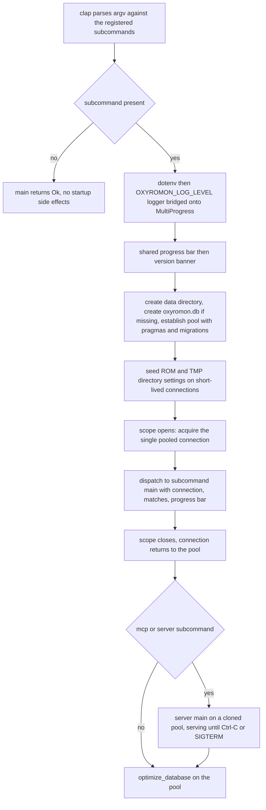

# CLI Entrypoint and the Subcommand Contract

`src/main.rs` is the only binary target (`oxyromon`). It owns three things: the
registry of clap subcommands, the process-wide startup every subcommand depends
on, and the database-connection lifetime. Everything else — DAT import, ROM
import, sorting, checking, purging, conversion, arcade rebuilds, playlist
generation — lives in per-feature modules that obey one uniform interface.

## Startup sequence

`main()` is a `#[tokio::main]` async fn. It builds the `subcommands` vec from
each module's `subcommand()`, appends `mcp::subcommand()` and
`server::subcommand()` only when their Cargo features are on, and parses argv.
The command metadata (name, version, description, author) comes from
`CARGO_*` compile-time environment variables, so `Cargo.toml` is the single
source of truth for `--version` and `--help`.

Everything after parsing is guarded by `if let Some((subcommand, sub_matches)) =
matches.subcommand()`. There is no startup work at all when no subcommand was
matched: the `.env` file is not loaded, no logger is installed, and no data
directory, database file, or pool is touched.

Inside the guard, in order:

1. `dotenv().ok()` — loads `.env` from the working directory, ignoring a missing
   file. Because it runs before the logger and before the data-directory lookup,
   a `.env` file can supply `OXYROMON_LOG_LEVEL`, `OXYROMON_DATA_DIRECTORY`,
   `OXYROMON_ROM_DIRECTORY`, and `OXYROMON_TMP_DIRECTORY`.
2. An `env_logger` builder from `OXYROMON_LOG_LEVEL`, whose filter level is
   captured *before* the builder is wrapped: `LogWrapper::new(multi, logger)`
   installs the global MultiProgress bridge, and the captured level is then
   re-applied with `log::set_max_level(level)`. Without that re-apply, the
   bridge's own logger would decide verbosity instead of the env var. Bridging
   `log` records through the MultiProgress is what keeps log lines from
   tearing the animated progress bars apart.
3. One shared progress bar (`get_progress_bar(0, get_none_progress_style())`) is
   created and used to print the version banner. This same bar object is handed
   to the subcommand, which is free to restyle it, set its length, and tick it —
   the entrypoint never touches it again.
4. The data directory: `OXYROMON_DATA_DIRECTORY`, else `dirs::data_dir()/oxyromon`,
   created with `create_directory`. `oxyromon.db` is created there if absent,
   and `establish_connection` is called with that path.
5. `establish_connection` configures the pool's SQLite pragmas (`foreign_keys`,
   `locking_mode`, WAL journal, `synchronous`, `temp_store`, `mmap_size`,
   `cache_size`, `auto_vacuum = INCREMENTAL`) and runs the embedded migrations.
   Any failure here panics: the process cannot run without a usable database.
6. `get_rom_directory` and `get_tmp_directory` are each called on a short-lived
   acquired connection. Their return values are discarded on purpose: calling
   them persists the first-run defaults (`OXYROMON_ROM_DIRECTORY` or
   `~/Emulation`; `OXYROMON_TMP_DIRECTORY` or the system temp dir) into the
   `settings` table, so every later lookup — including the ones inside format
   code and in `benchmark`, which reads `ROM_DIRECTORY`/`TMP_DIRECTORY`
   directly with `find_setting_by_key` — finds a value.



*Caption: the entrypoint's control flow, from argv parsing to the final database optimization.*

## The scoped single-connection trick

CLI work runs inside a bare block that holds one pooled connection:

```rust
// the CLI pool only has a single connection, scope it so it is released
// before optimize_database acquires one
{
    let connection = &mut pool.acquire().await.unwrap();
    match subcommand { /* ... */ }
}
```

The reason is pool sizing. `establish_connection` uses `cfg_if` on the feature
set: a default CLI build gets `max_connections = 1` with `PRAGMA locking_mode =
EXCLUSIVE`, while a build with `server` or `mcp` gets `max_connections = 5` with
`locking_mode = NORMAL`. Both shapes use a 5-second `acquire_timeout`, so with a
one-connection pool any code that acquires a second connection while the
subcommand still holds the only one blocks for five seconds and then fails.
`optimize_database(pool)` — `incremental_vacuum`, `optimize`,
`wal_checkpoint(truncate)` — takes a connection itself, so the scope must close
before it runs. Single-connection + EXCLUSIVE locking is also the fast path for
a single-process batch tool: no writer contention to negotiate.

Note the entrypoint does not pass the pool into the CLI dispatch at all: a
subcommand can only ever see `&mut SqliteConnection`, and transactions are
derived from that connection inside the module (for example `check_roms` opens
one transaction for a whole system and moves failing files to the trash within
it).

Long-lived servers are dispatched *after* the scoped block and take the pool
instead of a connection:

```rust
#[cfg(feature = "mcp")]
if subcommand == "mcp" { mcp::main(pool.clone(), sub_matches).await?; }
#[cfg(feature = "server")]
if subcommand == "server" { server::main(pool.clone(), sub_matches).await?; }
optimize_database(pool).await;
```

This ordering matters twice. First, the CLI connection is returned before the
server binds its socket, so the server's real pool (5 connections, `NORMAL`
locking) starts uncontended. Second, the two server `main()`s only return when
the transport ends — stdin closes or Ctrl+C/SIGTERM arrives for `mcp`,
Ctrl+C/SIGTERM for `server` — so
`optimize_database(pool)` runs as shutdown cleanup rather than after a batch job.
`server::main` also checkpoints through its own `shutdown_signal` before
cancelling in-flight work, so the CLI's final call is idempotent housekeeping on
an already-clean database.

The dispatch `match` ends in `_ => ()`. A subcommand registered in the vec but
forgotten in the match exits silently with success — the failure mode to check
first when a new subcommand "does nothing". Because the arms are matched on the
string clap reported, adding a command is a three-place change in this file and
each place fails in a different way: `mod` missing is a compile error, a missing
vec entry makes the command unknown to `--help`, and a missing arm is the silent
no-op.

## The uniform subcommand contract

Every feature module exports the same pair of items:

```rust
pub fn subcommand() -> Command { /* clap Command: name, about, args */ }

pub async fn main(
    connection: &mut SqliteConnection,
    matches: &ArgMatches,
    progress_bar: &ProgressBar,
) -> Result<()>
```

`subcommand()` is a pure argv-shape declaration with no I/O; `main()` does the
work, reports through the progress bar, and returns `anyhow::Result<()>` —
errors bubble to `main()` and abort the run with `?`. `info` is the one
signature exception: its `Command` declares no arguments, so `info::main` takes
only `(connection, progress_bar)`. The server pair breaks the shape
deliberately: `mcp::main(pool, matches)` and `server::main(pool, matches)` take
a `SqlitePool` because they must multiplex requests.

The dispatch table in `src/main.rs` covers, in vec order: `info`, `config`,
`create-dats`, `import-dats`, `download-dats`, `import-irds`, `purge-irds`,
`import-patches`, `import-roms`, `sort-roms`, `convert-roms`, `export-roms`,
`rebuild-roms`, `check-roms`, `purge-roms`, `purge-systems`,
`generate-playlists`, and `benchmark`, plus the feature-gated `mcp`
(`--read-only` exposes non-mutating tools only) and `server`
(`--address`/`--port`).

Selection of work follows a consistent pattern across the batch subcommands:

- `matches.get_many::<String>("SYSTEM")` present → resolve systems by
  name-glob with `resolve_systems_by_name_like` (sorted and deduped by id so
  overlapping patterns cannot process a system twice), no prompts.
- Absent → `prompt_for_systems(...)`, an interactive fuzzy multiselect, bypassed
  when `--all` is given or when nothing was found.
- Likewise `--game` filters games and `prompt_for_games` narrows the matches —
  `common::select_games` is the shared helper, with `check_roms` keeping a local
  copy of the same shape.

Confirmation and progress are contract-level, not module-level, concerns:
file-deleting modules (`sort-roms`, `purge-roms`) expose `-y/--yes` so the
`confirm()` prompt can be answered programmatically, and all user-facing output
goes through the categorized `print_header` / `print_subheader` / `print_info` /
`print_success` / `print_warning` / `print_error` / `print_skip` / `print_action`
helpers rather than raw `println!` (`import_roms` carries an explicit comment at
the one place a stray `println!` used to live: stdout can be the MCP protocol
channel). `cfg!(test)` is used where a selection would otherwise hang headless
(`prompt_for_games(games, cfg!(test))`).

## The `info` report: dependencies and statistics

`info` is the diagnostic subcommand — no arguments, no prompts, no filesystem
writes beyond what its queries do. It prints two sections on the shared bar and
then finishes it.

The **Dependencies** section is a table assembled from each format module's
`get_version()`. The entries are collected into a vec and sorted by the name
reported, so the display order is `chd-rs`, `cia-rs`, `nod`, `nsz-rs`,
`sevenz-rust2`, `xdelta-rs`, `xps-rs`, `xso-rs` regardless of push order:

| Reported name | Backing module | Value on a working install |
| --- | --- | --- |
| `chd-rs` | `src/chd.rs` | `built-in` |
| `cia-rs` | `src/cia.rs` | `built-in` |
| `nod` | `src/rvz.rs` (also backs WBFS) | `built-in` |
| `nsz-rs` | `src/nsz.rs` | `built-in`, or `built-in, prod.keys not found` |
| `sevenz-rust2` | `src/archive.rs` | `built-in` |
| `xdelta-rs` | `src/xdelta.rs` | `built-in` |
| `xps-rs` | `src/xps.rs` | `built-in` |
| `xso-rs` | `src/xso.rs` | `built-in` |

Every backend is a linked library now: `ctrtool`, the last external program,
was replaced by the in-tree `cia-rs` crate, and `util::tool_version` went with
it. A compiled-in crate has no runtime version to query, so each entry reports
the literal `built-in` — the fact worth knowing is that the module is present,
not which point release it is. The `Err` arm still exists in the loop and would
print a dim `↪ <name>: not found` through `print_skip`, but no `get_version()`
returns an error any more, so `info` cannot report a missing dependency.
`nsz-rs` adds a second dimension — it never fails, but reports
`built-in, prod.keys not found` when `~/.switch/prod.keys` is absent, so the
missing-keys condition is discovered at `info` time instead of mid-compression.

The **Statistics** section is three counts against the connected database
(`count_systems`, `count_games`, `count_roms`), followed by the project's
donation footer and `progress_bar.finish_and_clear()` — the subcommand, not the
entrypoint, ends the bar it was handed.

## Adding a subcommand

The canonical checklist:

1. Create `src/my_command.rs`.
2. Implement `pub fn subcommand() -> Command` with the subcommand name and args.
3. Implement `pub async fn main(connection: &mut SqliteConnection, matches:
   &ArgMatches, progress_bar: &ProgressBar) -> Result<()>`.
4. Add `mod my_command;` to the module list in `src/main.rs` (inside the
   `#[cfg(feature = ...)]` gate if the command belongs to the server or MCP
   build).
5. Add `my_command::subcommand()` to the `subcommands` vec.
6. Add `"my-command" => my_command::main(connection, sub_matches,
   &progress_bar).await?` to the dispatch match — omitting this step is the
   silent no-op failure mode.
7. Put tests in `src/my_command/test_*.rs` and wire them with
   `#[cfg(test)] mod test_*;` at the bottom of the module file.

Steps 5 and 6 are both required: registration makes the command visible to clap,
the match arm makes it run. See [Test Harness and Conventions](../testing/testing-conventions.md)
for the test skeleton step 7 refers to, and
the "New subcommand" checklist in [`AGENTS.md`](../../AGENTS.md#checklists),
which keeps the same steps in condensed form.

## Why the contract is reused by the servers

Because `subcommand()` is a standalone argv parser and `main()` takes only a
connection, matches, and a bar, non-CLI hosts drive the exact same code paths.
GraphQL mutations synthesize argv and run the module:

```rust
let matches = sort_roms::subcommand().try_get_matches_from(arguments)?;
sort_roms::main(connection, &matches, &progress_bar).await
```

inside `spawn_cli_action`, which acquires its own pooled connection in a spawned
task and reports `*_started` / `*_complete` / `*_error` over SSE. The MCP write
tools do the same through `run_action`, which takes the process-wide write lock,
acquires a connection, and builds a hidden progress bar that a poller samples
into MCP `notifications/progress`. Hosts inject the long form of the confirmation
flag into the synthesized argv because there is no TTY to answer `confirm()` —
`--yes` for `sort-roms` / `purge-roms`, `-a`/`--all` or `--system <name>` to skip
the system multiselect, `-u/--unattended` for `import-roms`, and `--system` for
`import-irds`. The pattern is uniform enough that the HTTP handlers reuse it too:
`POST /roms` and `POST /irds` build argv and call `import_roms::main` /
`import_irds::main` directly rather than going through the GraphQL layer.

Tests exploit the same property: a test builds a temp database with
`establish_connection`, acquires a connection, points the ROM/tmp directory
settings at `TempDir`s, builds argv with `subcommand().get_matches_from([...])`,
runs `main(&mut connection, &matches, &ProgressBar::hidden())`, and asserts on
database and filesystem state — with the global `MUTEX` from `config.rs`
serializing tests that share process-wide state. There is no CLI harness in that
loop, which is exactly why the interface must not grow process-level
assumptions. See [CLI Output, Progress and Prompts](../concepts/cli-output-progress-and-prompts.md),
[HTTP Server and GraphQL API](../server/http-server-and-graphql-api.md),
[MCP Server: Tools, Resources and Prompts](../server/mcp-server.md), and
[ROM Import Pipeline](../workflows/rom-import-pipeline.md).
