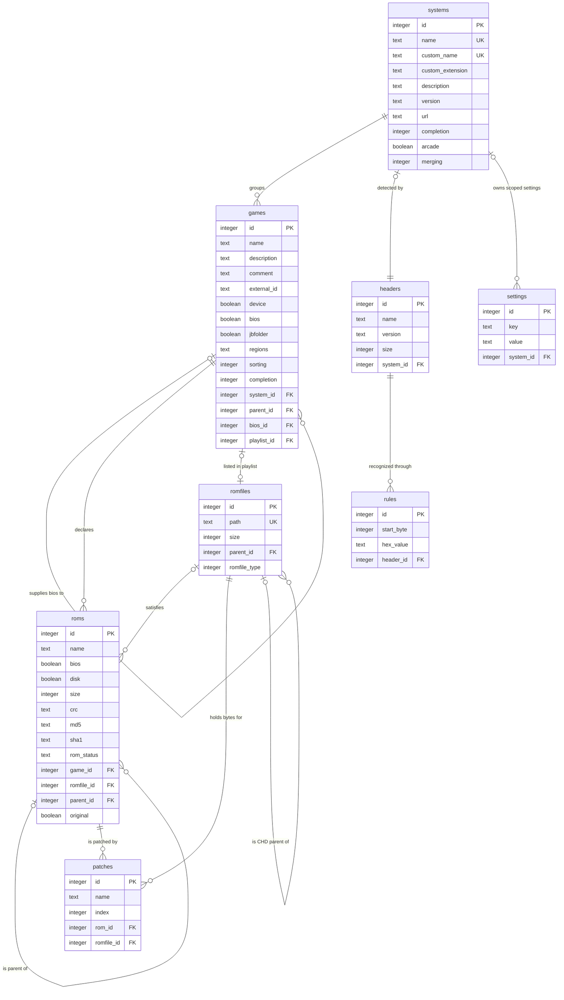
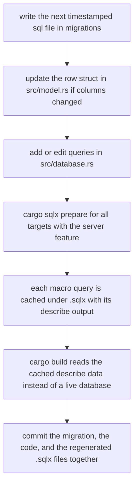

# Data Model, SQLite Usage and Migrations

oxyromon keeps all of its state in a single SQLite file. The whole data layer is
three artifacts wide: `migrations/` owns the schema, `src/database.rs` owns
every query, and `src/model.rs` owns the row types they materialize. There is no
ORM, no repository layer, and no second datastore.

## Where the database lives

`src/main.rs` resolves the data directory (`OXYROMON_DATA_DIRECTORY`, else
`dirs::data_dir()/oxyromon`), creates `oxyromon.db` there if it is missing, and
passes that path to `establish_connection`. Tests use the same entrypoint with a
`tempfile::NamedTempFile` path, so a test database is exactly a production
database with migrations applied.

## `establish_connection`: pool shape and PRAGMAs

`establish_connection` builds a `SqlitePool` (`min_connections(1)`,
`acquire_timeout` of 5 seconds) and then splits on the Cargo feature set with
`cfg_if`:

| Build | `max_connections` | `PRAGMA locking_mode` |
| --- | --- | --- |
| default (CLI) | 1 | `EXCLUSIVE` |
| `server` or `mcp` | 5 | `NORMAL` |

A single-process batch tool has no writer to contend with, so it takes the
cheapest locking mode and one connection; a long-lived web or MCP server must
multiplex requests, so it gets a real pool and must not hold the file
exclusively. See [CLI Entrypoint and the Subcommand Contract](cli-entrypoint-and-subcommands.md)
for why the CLI dispatch is wrapped in a scope that releases that one
connection before `optimize_database` acquires one.

After the pool exists and before migrations run, the following pragmas are
issued through `pool.execute`: `foreign_keys = ON`, `locking_mode` (from the
table above), `journal_mode = WAL`, `synchronous = NORMAL`,
`temp_store = MEMORY`, `mmap_size = 268435456`, `cache_size = 10000`,
`auto_vacuum = INCREMENTAL`. `foreign_keys = ON` is load-bearing rather than
tuning: every cascade in the schema below — deleting a system tearing out its
games, roms and patches, or clearing `roms.romfile_id` when a file row goes away
— only happens because enforcement is on. Only `locking_mode` is interpolated
into SQL, and it is wrapped in `AssertSqlSafe` to satisfy sqlx's safe-SQL lint.

`MIGRATOR` is a `static Migrator = sqlx::migrate!()`, i.e. the `migrations/`
directory is embedded into the binary at compile time. `MIGRATOR.run(&pool)`
executes on *every* connection setup, including inside tests, and a failing
migration panics — there is no version negotiation, no down-migration, and no
way to start with a half-applied schema. The counterpart, `optimize_database`,
runs `incremental_vacuum`, `optimize` and `wal_checkpoint(truncate)` once the
work is done, which pairs with `auto_vacuum = INCREMENTAL`: freed pages are
actually returned to the OS at the end of a batch run.

## Schema

*Caption: the eight tables in `migrations/`, their key columns, and the cascade relationships that define deletion behaviour.*

The spine is **declaration versus reality**. `systems`, `games` and `roms`
describe what a DAT says *should* exist (name, expected size, expected crc/md5/
sha1, merge status); `romfiles` describes what is actually on disk. `roms`
carries the only join between the two — `roms.romfile_id`, a foreign key declared
`ON DELETE SET NULL` — so an unmatched ROM keeps its declaration and simply has
`romfile_id IS NULL`. That single nullable column drives the whole
product: "wanted ROMs" queries filter on it, completion is computed from it, and
deleting a file row detaches rather than destroys the declaration. The
relationship is many-to-one, not one-to-one: in merged sets one romfile serves
many roms across clone games.

Wantedness is filtered by `roms.parent_id`, not just by the null romfile id.
The "wanted ROMs" readers the completion, sort and rebuild paths use — e.g.
`find_roms_without_romfile_by_size_and_crc` and
`find_roms_without_romfile_by_game_ids` — add `parent_id IS NULL`, so a merged
child whose data lives in its parent romfile is never reported as missing, while
the PS3/IRD helpers invert the filter (`parent_id = ?`, or `IS NOT NULL`) to walk
the children of a matched parent.

Uniqueness is scoped deliberately: `systems.name` is globally unique,
`games` is unique on `(name, system_id)`, `roms` on `(name, game_id)`, `patches`
on `(name, rom_id)`, and `headers` on `(system_id)` — at most one header per
system. `romfiles.path` is unique, and that uniqueness is what makes a path a usable
identity: `import_rom` calls `find_romfile_by_path` first and skips a file that
is already registered unless `--force` is given.

Parent/child structures are self-referential rather than junction tables:
`games.parent_id` is the clone-to-parent link, `games.bios_id` the BIOS a game
needs, `games.playlist_id` the `.m3u` romfile a game belongs to
(`ON DELETE SET NULL`), `roms.parent_id` the merged-set parent rom, and
`romfiles.parent_id` the CHD a given CHD was written against (`ON DELETE
SET NULL`). The romfile link is deliberately not "the archive that contains this
file": oxyromon registers whole files, and the only child rows it creates point
from one CHD to the parent CHD it needs. `update_romfile_parent` is the single
writer of that column and `find_romfiles_by_parent_id` the only reader of it —
`convert-roms` uses the latter as a guard ("CHD has children, skipping") before
touching a parent, and clears the link when it converts one away.

`rules` is the historical tail of `headers`: `20211114103012_create_rules.sql`
created the table, copied `start_byte`/`hex_value` out of `headers`, and dropped
those columns. One header owns many rules, and `get_file_and_header_size` only
treats a file as headered when **all** of a header's rules match the bytes read
at their offsets; otherwise it rewinds and hashes the file whole. Re-importing a
DAT with a detector replaces the rule set wholesale
(`delete_rules_by_header_id` then re-insert), so rules are always in lockstep
with the newest detector XML.

## How `model.rs` maps onto the tables

Each table has a plain `#[derive(FromRow)]` struct whose field names match the
columns: `System`, `Header`, `Rule`, `Game`, `Rom`, `Patch`, `Romfile`,
`Setting`. Under `--features server` the same structs additionally derive
`SimpleObject` (and `Enum` for the enums), so GraphQL exposes the row shape
directly instead of a second DTO layer; without the feature the unused fields
are `#[allow(dead_code)]`.

Two deviations matter:

- **Computed columns.** `System.games_complete` / `System.games_total` are not
  table columns; every `System`-mapping query appends the same two count
  subqueries. `src/query.rs` re-declares that projection as
  `TableRow::SELECT` for the DataLoader, and the comment there warns that the
  two copies must stay in agreement or the loader fails to map the row.
  `Game.description` is `graphql(skip)`ped and resolved by hand, because for a
  console DAT duplicating `name` in `description` accounts for a third of the
  response.
- **Int-encoded enums.** `Merging`, `Sorting`, `Completion` and `RomfileType`
  are `#[repr(i8)]` + `FromPrimitive` and stored as `SMALLINT`/`INTEGER` with
  defaults (`merging = 0` Split, `sorting = 0` AllRegions, `completion = 0`
  None, `romfile_type = 0` Romfile). The row structs keep the raw `i64` field so
  `FromRow` stays trivial, and call sites narrow with
  `Merging::from_i64(system.merging)` / `Sorting::from_i64(game.sorting)`.
  `romfile_type` distinguishes ordinary romfiles, generated playlists and patches —
  the backfill in `20240824155008_add_romfile_type_to_romfiles.sql` reclassified
  existing `%.m3u` rows as `Playlist` — but `import_patches` still creates a
  patch's romfile with `RomfileType::Romfile`, so value 2 is only a label the MCP
  output layer maps to `"patch"`, not something the write path produces.

### CHD parentage lives in the file, not the row

`romfiles.parent_id` is the one column whose meaning is not readable from the
schema alone: the CHD format stores the parent's SHA-1 inside the child file, and
oxyromon reads it in process through `chd-rs` — `AsChd::parse_chd` calls
`Chd::open`/`chd.info()` and hex-encodes `info.sha1`, `info.data_sha1` and
`info.parent_sha1` (see [CHD Format and chd-rs](../concepts/chd-format-and-chd-rs.md)).
No external `chdman` binary is shelled out to and its stdout is never parsed, and
the GraphQL `dependencies` resolver reports `chd-rs` as `built-in` for exactly
this reason. The database column is only a denormalised cache of that in-file
value: `romfile_as_chd` (in `transcode.rs`) resolves a row's parent by loading
`find_romfile_by_id(romfile.parent_id)` and handing it to `as_chd_with_parent`,
which re-parses both files and bails with "Parent CHD SHA1 mismatch" if the
cached link no longer matches what the child demands. When the file itself
carries no link — the import path — `as_chd` scans the containing directory and
adopts the first CHD whose own hash equals the child's `parent_sha1`. Import order
depends on the same in-file field: `import_roms` sorts candidate paths so CHDs
reporting a `parent_sha1` are processed before parentless ones.

The write side keeps a second, independent notion of "which file should be this
CHD's parent": when `export-roms`/`convert-roms` builds a child CHD it asks
`util::find_parent_chd_romfile_by_game`, which walks the game's
`games.playlist_id` to the first game in that playlist and takes that game's
`.chd` romfile — a playlist-derived parent chosen by set membership, not by
reading the child's `parent_sha1`. `update_romfile_parent` then records the
result, and the read path above verifies it.

## Query conventions in `database.rs`

`database.rs` holds well over a hundred `pub async fn` items and they all
follow one shape: a free function (no `impl`, no struct holding the pool),
`&mut SqliteConnection` as the first argument, parameters bound positionally
with `?`, and a return type from `model.rs` — `Vec<T>`, `Option<T>`, one `T`, an
`i64` count, or the `last_insert_rowid()` of an `INSERT`. `sqlx::query!` is used
when the result is not mapped onto a `model.rs` struct (a `COUNT` query reads its
value straight off the anonymous record), `sqlx::query_as!(Row, …)` when the
result columns must be checked against one. Because everything takes a
connection rather than a pool, the same functions serve the CLI, the GraphQL
resolvers (`query.rs`, which acquires a connection per call) and the MCP
read tools.

`Transaction<'_, Sqlite>` derefs to the inner connection, so modules pass
`&mut transaction` to the very same functions. `begin_transaction`,
`commit_transaction` and `rollback_transaction` are thin wrappers that each
`expect` success. The granularity convention is one transaction per unit of
work: per DAT (`import_dats`), per file (`import_rom`), per system (`check_roms`,
`sort_roms`), per conversion step. `sort_roms` is the reference for the
interactive case — it opens a transaction, and only commits the database side
after the user confirms the planned moves, rolling back otherwise.

Not every query is a macro. `IN (…)` lists are built by joining ids with
`Itertools::join` and executed through `sqlx::query_as::<_, T>(AssertSqlSafe(sql))`,
since the macro cannot expand a variable-length bind list; `query.rs` does the
same for server-side composed SQL (system size sums, the `ignored` bios lookup,
the DataLoader `WHERE id in (…)`). These paths lose compile-time checking, which
is the trade to keep in mind when adding a query shape. A handful of finders are
`#[cfg(test)]`-only (e.g. `find_games`, `find_roms`) and exist so assertions in
tests can read whole tables; they are part of the offline query data too.

Error handling is panic-based, deliberately. Query failures `expect` or
`unwrap_or_else(|_| panic!(…))` with a message naming the operation and the id
involved, so a subcommand aborts rather than continuing against a
partially-written database — the transactions above are what bound the damage.
Lookup helpers come in pairs for the one case that is not a bug:
`find_system_by_id` panics on a missing row, while `find_system_by_id_opt` and
`find_rom_by_id_opt` return `Option` for ids arriving from HTTP/MCP clients, and
the server turns `None` into a 400 instead of a crash.

## Derived state: completion

`systems.completion` and `games.completion` are `Completion` values
(None/Partial/Full) recomputed in SQL, except for the Wii U pass below.
`compute_system_completion` (in `util.rs`) is the single orchestrator: it first
creates placeholder empty files for partial games, then picks the game-completion
statement based on the system's `arcade` flag and `Merging` mode — split and
merged sets ignore merged parent roms (a merged set files each clone's own roms
where a split one does, only inside the parent's ZIP), non-merged sets ignore
parent roms whose parent game is a BIOS, full sets consider every rom — then runs the jbfolder
variant for console systems, then the Wii U pass `update_nus_games_completion`,
which regrades titles whose DAT entry spans several versions against their
newest TMD (the one step that reads a file rather than staying in SQL), and finally rolls the game states up into the
system with a `CASE` in `update_system_completion`. Every mutation-heavy
subcommand (`import-dats`, `import-roms`, `sort-roms`, `check-roms`, `purge-roms`,
`rebuild-roms`, `import-irds`) ends by calling it, which is why completion is
consistent without any trigger or cached counter.

## The relative-path invariant

`romfiles.path` is stored **relative to the `ROM_DIRECTORY` setting**, not
absolute. Writes go through `Persist::create`/`update`, which call
`get_relative_path` → `path.strip_prefix(rom_directory)`; reads go through
`AsCommon::as_common`, which rebuilds the absolute path with
`rom_directory.join(&self.path)`. `20241117210150_make_romfile_paths_relative.sql`
rewrote pre-existing rows by stripping the recorded `ROM_DIRECTORY` prefix from
each path that began with it, so the invariant holds for databases created
before the change. The payoff is that pointing `ROM_DIRECTORY` at a moved or
renamed library is a single settings-row update with no table rewrite — and the
cost is that any new code touching `path` must never assume it is absolute (the
same convention appears in `purge-roms` and `rebuild-roms` strip_prefix calls,
and `find_romfiles_in_trash` pattern-matches `%/Trash/%` (plus the bare
`Trash/%` prefix for a trashed library root) against the relative path).

## Orphan and missing-file queries

The romfile cleanup readers in `database.rs` define what "unreferenced" means,
and both are strict about the parent link:

- `find_orphan_romfiles` returns rows with **no** `roms.romfile_id` pointing at
  them **and** no `games.playlist_id` pointing at them. It deliberately does not
  consult `romfiles.parent_id`, so a child CHD whose parent row is about to be
  deleted is itself reported as an orphan in the same pass — `purge-roms --orphan`
  walks that set in one transaction, deleting the file and the row together and
  then pruning emptied directories.
- `purge-roms --missing` is not a query at all: `find_romfiles` reads every row
  and the module checks `as_common(...).path.is_file()` on disk, deleting rows
  whose file is gone. `--foreign` inverts the same lookup, walking the ROM
  directory and reporting relative paths for which `find_romfile_by_path` returns
  `None`, except files in a `.update-partitions` store that one of the library's
  WUAs still lists among its store entries, or any store file at all when one
  of those WUAs can't be read. Both paths are the DB-side of the relative-path invariant, and every
  purge branch finishes by recomputing completion for all systems.

`find_romfiles_by_system_id_and_extension_and_no_parent_id` is the fourth shape:
candidate parents for a conversion or export. It restricts to a system's romfiles
by extension and excludes rows that already have a parent, so a chained CHD is
never offered as a parent; `prompt_for_parent_romfile` then ranks that set by
jaro-winkler similarity to the game name.

## Settings: one table, two scopes

`settings` is a key/value store whose `system_id` column (added in
`20260317000001_add_system_id_to_settings.sql`, which rebuilt the table via
`settings_new` because SQLite cannot `ALTER` a uniqueness constraint) makes any
key per-system. Uniqueness is enforced by two partial indexes: one on `key`
`WHERE system_id IS NULL` (at most one global row per key) and one on
`(key, system_id)` `WHERE system_id IS NOT NULL`. Reads resolve through
`config::get_setting`, which looks up the per-system row first and falls back to
the global row, so a system inherits until it overrides; `list_settings` merges
the two sets with the override winning. All writes funnel through one
`upsert_setting` helper (update-by-id when the scoped row exists, insert
otherwise), and `find_setting_by_key` / `find_settings` use `IS ?` so a `NULL`
`system_id` binds as "the global rows".

Values are always text. `config.rs` classifies keys into `BOOLEANS`, choice
keys, choice-list keys, integer keys with validated ranges, `LISTS`, `PATHS`,
`NULLABLES` and `SORTED_LISTS`; lists are joined into one row with `|`
(`20230528135145_use_pipe_as_separator_in_settings.sql` rewrote the existing
values from the earlier `,` separator), directories are canonicalized on write,
and `ROM_DIRECTORY` / `TMP_DIRECTORY` self-seed their first-run defaults.
Default values themselves live in migrations as `INSERT OR REPLACE INTO
settings` — the same statement style is used for idempotent retcons such as
rewriting the RVZ `bzip` algorithm value to `bzip2`, which dolphin-tool would
otherwise refuse to parse. Migration
`20260810000001_add_archive_compression_algorithms.sql` shows the other use of
the same idempotent seed: it installs the per-format compression
algorithm/level defaults (`SEVENZIP_COMPRESSION_ALGORITHM`,
`ZIP_COMPRESSION_ALGORITHM`, and the two `*_ZSTD_COMPRESSION_LEVEL` rows) in one
file, and `20260811000001_add_prefer_format_setting.sql` seeds `PREFER_FORMAT`
to `NULL`, which is what makes an unset choice behave as "no preference". See [Settings and Configuration](settings-and-configuration.md)
for the key catalogue and CLI surface.

## Adding a migration

Migrations are append-only, ordered by the `YYYYMMDDHHMMSS` prefix in the
filename, and written in SQLite dialect. The repository's own checklist
(`AGENTS.md`) plus the shape of the directory give the workflow:

1. Create `migrations/<next timestamp>_<description>.sql`.
2. If a column was added, update the matching struct in `src/model.rs`; if the
   change alters SQL, add or edit the query in `src/database.rs`.
3. Run `cargo sqlx prepare -- --all-targets --features server`.
4. Verify with `cargo build --features server`.

*Caption: the migration workflow — schema change, row-type change, offline query cache refresh, then an offline-verified build.*

Step 3 is not optional. The `sqlx::query!` macros are verified at compile time,
and there is no live database to verify them against: `cargo sqlx prepare`
records each macro's describe output into the committed `.sqlx/` directory, whose
file names are the query hashes and whose bodies record the query text, the
parameter count and the described result columns. With the `server` feature the
macro set is larger — `query.rs`, `mutation.rs` and `mcp/` add queries — which
is why the documented command passes `--features server`, and why CI builds
and tests with that feature so an unrefreshed cache cannot slip through. It also
passes `--all-targets`: without it `prepare` skips test code and deletes the
cached data of queries only tests use, such as `SELECT * FROM roms ORDER BY name`. The
whole payload lives one file per query in `.sqlx/`. Editing SQL, or changing a
table a macro reads, invalidates the cached describe and the macro fails to
compile until `prepare` runs again. The converse is equally useful at review
time: the runtime `sqlx::query_as::<_, T>` calls in `query.rs` and
`src/mcp/read.rs` were never macro-expanded, so adding or changing one needs no
`prepare` run and no `.sqlx/` diff — and no compile-time guarantee either.

Migration style is constrained by SQLite itself: making a hash optional
(`make_md5_optional`, `make_crc_optional`) is done with rename-column, add-column,
copy, drop-column; adding a constraint or a column to `settings` means creating a
replacement table, copying, dropping and renaming. Column renames that carry
semantic changes appear as data migrations too — `complete BOOLEAN` became the
three-valued `completion SMALLINT` on both `games` and `systems`, with the old
indexes dropped and `(completion, sorting)` composites created in the same file.
Index creation is its own migration genre: `(size, crc)`, `(size, md5)` and
`(size, sha1)` on `roms` back the hash-matching hot path used by ROM import, FK
columns get explicit indexes because SQLite does not create them, and the
partial unique index on `games(external_id, system_id)` keeps IRD/DAT external ids
unique only where they exist.

Data migrations that rewrite rows must respect every unique constraint on the
columns they write, because a failing migration panics at startup and the app
will not open. `move_redump_to_redump_info` is the worked example: when Redump
moved to redump.info and renamed twelve systems, each rename sets
`custom_name = COALESCE(custom_name, name)` so the system directory, which
`get_system_directory` derives from the custom name when one is set, stays put.
Both `systems.name` (declared `UNIQUE` in `create_systems`) and
`systems.custom_name` (the `systems_custom_name` unique index added later in
`add_custom_name_to_system`) are guarded with `NOT EXISTS` subqueries, so a
collision skips that rename instead of aborting the file. The closing statement
moves every remaining `http://redump.org/` row to `https://redump.info/` except
the old names whose rename was skipped, so no row is left half-migrated.
