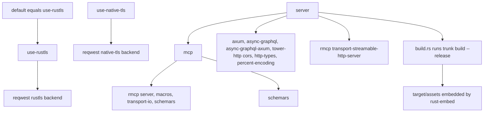
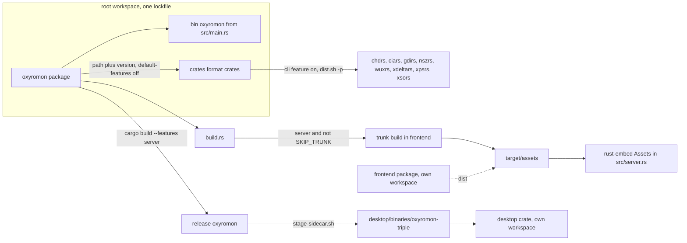
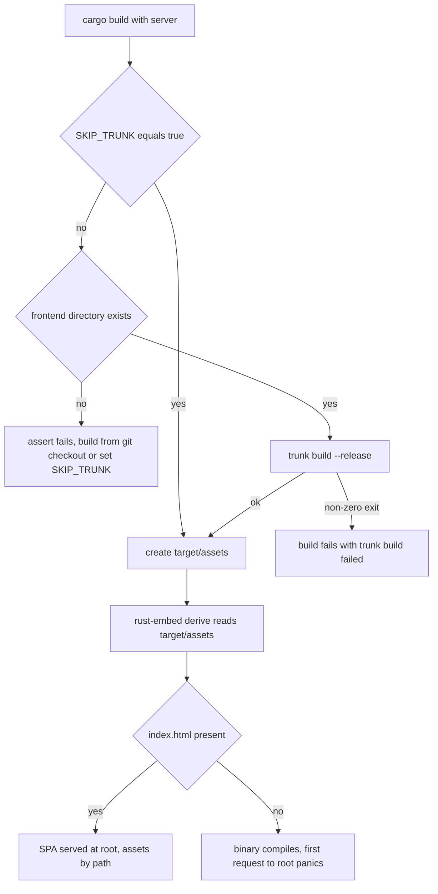

# Feature Flags and Build Topology

oxyromon ships one Rust package that produces three very different artifacts: a
headless CLI, a web server carrying an embedded Leptos/WASM SPA and an MCP
endpoint, and a Tauri desktop bundle. Four Cargo features decide which of those
an existing binary is, and `build.rs` decides whether the web UI is compiled at
all. The features are not decoration: they change which modules exist, which
transports a process serves, and even how many SQLite connections the process
opens. Around that package the repository is a Cargo workspace whose `crates/*`
members supply the format support oxyromon used to shell out for; they share its
lockfile, CI run and release script, but are versioned and published on their own.

## The feature graph



*Caption: the four features, what each pulls in, and the one build-script side effect that only `server` triggers.*

`default = ["use-rustls"]` (Cargo.toml). `server` lists `mcp` among its
dependencies, so **`server` implies `mcp`**: a `--features server` build serves
MCP over Streamable HTTP at `/mcp` on the same listener as GraphQL, and a
`--features mcp` build produces only the stdio `mcp` subcommand, with no web
server, no embedded UI, and no HTTP transport. Both statements are load-bearing
for release packaging: the CI release build and every `dist.sh` artifact use
`--features server`, while the dedicated clippy pass exists precisely to keep
the `mcp`-without-`server` combination compiling.

The TLS pair is a pure passthrough to `reqwest`, which is declared with
`default-features = false` so no backend is implied by anything else. Choosing
neither (`--no-default-features` alone) leaves the HTTP client without a TLS
backend; the documented way to switch passes one explicitly —
`--no-default-features --features use-native-tls` for system OpenSSL. Nothing in `Cargo.toml` or
`build.rs` asserts mutual exclusion: the flags are additive, and picking both is
the operator's mistake to make, not something the build catches.

## What the gates actually remove

`src/main.rs` gates whole modules, so a lean build does not merely skip routes —
it never compiles them:

```rust
#[cfg(feature = "mcp")]
mod mcp;
#[cfg(feature = "server")]
mod mutation;
#[cfg(feature = "server")]
mod query;
#[cfg(feature = "server")]
mod server;
#[cfg(feature = "server")]
mod validator;
```

The matching `subcommands` vec pushes `mcp::subcommand()` and
`server::subcommand()` under the same gates, and the long-lived dispatch after
the scoped CLI connection block is gated identically. The argv surface therefore
shrinks with the feature set: `oxyromon mcp` and `oxyromon server` are absent
from a default build, and `/mcp` is absent from a build without `server`.

The gates also reach inside otherwise-shared code:

- **Inside the MCP server**, the SSE fan-out exists only in `server` builds: the
  `sse_tx` field on `OxyromonMcp`, `with_sse`, `mcp_http_service()`, and the
  `sse_send` calls that mirror tool outcomes onto `/events` are all
  `#[cfg(feature = "server")]`. The stdio build has no `SseMessage` type at all.
- **Inside `model.rs`**, GraphQL derives are attached with
  `#[cfg_attr(feature = "server", derive(Enum))]` /
  `derive(Clone, SimpleObject)`; `Dependency` and `GameInformation` exist only in
  server builds. The CLI build compiles the same structs without `async_graphql`
  in scope.
- **Query and upload paths** are server-only where they exist solely for the
  web UI: `find_games_by_system_id_paged` in `database.rs`, and
  `process_dat_upload` plus `ImportDatResult` in `import_dats.rs`.

Most consequentially, the features change runtime database behaviour.
`establish_connection` uses `cfg_if` on `any(feature = "server", feature = "mcp")`:
long-lived processes get `max_connections = 5` with `PRAGMA locking_mode =
NORMAL`, everything else gets a single connection with `EXCLUSIVE` locking. The
same source therefore yields two different concurrency and locking contracts
depending on a build flag, which is why the CLI's single-connection scope in
`src/main.rs` is safe (see [CLI Entrypoint and the Subcommand Contract](cli-entrypoint-and-subcommands.md)).

Note also that the `server` feature pulls `tower-http` unconditionally while the
permissive `CorsLayer` is compiled only under `#[cfg(debug_assertions)]`. Release
server builds link the crate and serve without CORS — same-origin is assumed,
which is what both the embedded SPA and the desktop webview rely on.

Finally, these four are the whole set. The `nod` and `sevenz` features older
releases carried are gone, and with them every gate around the tools they used to
guard: no `#[cfg(feature = "nod")]` or `#[cfg(feature = "sevenz")]` survives in
`src/`, because nod, sevenz-rust2, zip and the eight crates under `crates/` are now
plain unconditional dependencies. `cargo build` always compiles the CHD, RVZ/WBFS,
7z and ZIP code paths — `src/chd.rs` has no feature gate at all — so only `mcp`
and `server` still add or remove functionality.

## build.rs: when the web UI is built, and when it must not be

`build.rs` always runs, so the decision is made inside it:

```rust
if cfg!(feature = "server") && env::var("SKIP_TRUNK").unwrap_or_default() != "true" {
```

That is the whole contract: **the wasm bundle is rebuilt only for `server`
builds, and only when `SKIP_TRUNK` is not exactly `true`**. Inside the branch the
script runs `trunk build --release` with `frontend` as the working directory and
fails the whole build if the command exits non-zero —
`assert!(status.success(), ...)` with the message "`trunk build` failed".

Before shelling out it asserts that `frontend/` exists, and the reason is a
specific diagnostic failure. `frontend/` is a package in its own right, and cargo
leaves nested packages out of the tarball it publishes, so building the
crates.io crate (for example `cargo install oxyromon --features server`) has no
`frontend/` at all. `Command` reports a missing working directory exactly the
way it reports a missing binary, so without the assert that build fails blaming
`trunk` and sends people off to install a tool they already have. The assert's
message names the real options: build from a git checkout, or set `SKIP_TRUNK=true`
if `target/assets` already holds a built UI.

The script then unconditionally creates `target/assets`:

```rust
let _ = std::fs::create_dir_all(Path::new("target").join("assets"));
```

rust-embed's `#[folder = "target/assets"]` is resolved by the derive at compile
time and requires the folder to exist. Creating it even when nothing was built
keeps the published-crate path compiling; the result is a working binary whose UI
is simply empty. That failure is deferred rather than absent: `serve_index` does
`Assets::get("index.html").unwrap()`, so a `server` binary built with `SKIP_TRUNK=true`
and no prebuilt assets compiles fine and then panics when the first request hits
`/`.

Finally the script declares `rerun-if-changed` for `frontend/src`,
`frontend/index.html`, `frontend/styles.css`, `frontend/Trunk.toml` and
`frontend/Cargo.toml`. `SKIP_TRUNK` itself is **not** declared with
`cargo:rerun-if-env-changed`, so flipping it on an already-built tree does not
re-run the script — once you clear `SKIP_TRUNK`, the wasm bundle only gets rebuilt
when one of the listed frontend paths changes or the build is otherwise fresh.
Rebuilding the UI out of band (`cd frontend && trunk build --release`) is the
supported way to refresh assets under `SKIP_TRUNK=true`.

## Trunk, rust-embed, and the contract between them

`frontend/Trunk.toml` exists to satisfy what `src/server.rs` expects:

- `dist = "../target/assets"` — the bundle lands exactly where the `RustEmbed`
  derive reads it.
- `target = "index.html"` and `public_url = "/"` — rust-embed resolves assets by
  exact path (`index.html`, hashed JS/WASM), and `server.rs` serves
  `index.html` as the SPA fallback, so relative URLs work regardless of mount
  point.
- A `pre_build` hook runs `scripts/fetch-webawesome.sh`, which vendors Web Awesome
  and the Font Awesome icons the components need into `frontend/vendor/` (gitignored).
  The UI must work offline because it is served by `oxyromon server` and shipped
  inside the desktop bundle, so nothing may come from a CDN at runtime; the
  script is a no-op when its pinned-version-plus-icon-list stamp already matches.
- The `[[proxy]]` entries for `/graphql`, `/events`, `/dats` and `/romfiles/`
  apply to `trunk serve` (dev, pointing at a local `oxyromon server` on
  `127.0.0.1:8000`) and are ignored by `trunk build`.

At runtime two independent `RustEmbed` types exist. `src/server.rs` embeds
`target/assets` (with `rust-embed`'s `compression` feature enabled in
`Cargo.toml`) and serves it through `serve_index` on `/` and `serve_asset` on
`/{*path}`, sniffing a MIME type from the bytes and falling back to the file
extension, with a plain 404 for unknown paths. `src/import_dats.rs` has a second
`Assets` embedding `data/` for Logiqx header XML files, used when a DAT names a
header file that is not on disk next to it. That one is **not** feature-gated: it
is compiled into every build, which is why `rust-embed` is a plain dependency
rather than a `server`-only one.

## CI and release composition

`.github/workflows/continuous_integration.yml` sets `SKIP_TRUNK: "true"` for the
whole job and builds the web UI once in a dedicated step
(`cd frontend && trunk build --release`), with `TRUNK_VERSION` pinned to 0.21.14
and the `wasm32-unknown-unknown` target installed. Every later cargo invocation
then reuses `target/assets` instead of recompiling the wasm several times.

Two clippy passes guard the feature matrix:

```
cargo clippy --workspace --all-targets --features oxyromon/server
cargo clippy --no-default-features --features use-rustls,mcp --all-targets
```

The first uses the package-qualified feature name because a workspace with
several selected packages requires it. The second is the point of interest: it
lints the MCP stdio server **without** the web server, so `mcp`-only builds —
which nothing else in CI compiles — cannot silently rot. The job then builds
`--release --features server` and runs workspace tests under
`cargo llvm-cov --workspace --features oxyromon/server`. Feature-gated tests
follow the same split: `tests/mcp_stdio.rs` opens with `#![cfg(feature = "mcp")]`
and drives the real binary over stdin/stdout with raw JSON-RPC, so the stdio
transport contract is exercised by the lean combination rather than by the
server build.

`test.sh` mirrors that invocation exactly — a single
`cargo llvm-cov --workspace --features oxyromon/server --lcov --output-path
lcov.info` — now that the `nod`/`sevenz` feature passes it once also ran refer to
flags that no longer exist. A second pass with those names would fail on unknown
features, so the script is one command: workspace-wide coverage of the
`--features server` shape, which subsumes `mcp`. `build.sh` is the host-side
equivalent of the release build (`trunk build --release`, then
`cargo build --release --features server`).

`dist.sh` is where `SKIP_TRUNK` earns its keep. It exports `SKIP_TRUNK=true`, and
`Cross.toml` passes that variable through into the cross container
(`[build.env] passthrough`). For every target it runs `(cd frontend && trunk
build --release)` on the host first — the wasm bundle is target-independent, so
it is built once per loop iteration outside the container — then
`cross build --release --target <t> --features server`. Then a second
`cross build` with `-p chd-rs -p cia-rs -p gdi-rs -p nsz-rs -p wux-rs -p xdelta-rs
-p xps-rs -p xso-rs` builds all eight format-crate CLIs, and each of `chdrs`, `ciars`,
`gdirs`, `nszrs`, `wuxrs`, `xdeltars`, `xpsrs` and `xsors` is archived next to
`oxyromon` — `tar -cJf` for
the four Linux and two macOS targets, `7z a` for
`x86_64-pc-windows-gnullvm` — before `cargo clean` resets `target/` for the next
iteration. The Apple targets additionally run every binary through `rcodesign
sign` before it is archived. The desktop app is built
for the host only: Tauri links the platform's own webview, which the cross images
do not carry and for which no cross toolchain exists. That final step runs with
`NO_STRIP=true` because linuxdeploy bundles a binutils too old to read the
`.relr.dyn` sections modern distributions ship.

The container image takes the opposite route and does not set `SKIP_TRUNK`: the
single Alpine-based `Dockerfile` installs trunk and the wasm target and runs
`cargo install --features server`. It downloads trunk's musl build, which runs
natively on Alpine along with the wasm-bindgen and wasm-opt binaries it fetches,
so no glibc shim is needed. One more build-only package fills a gap the CI runner
covers by default: GNU `tar`, because the web UI's `fetch-webawesome.sh` hook
extracts one directory by name, which BusyBox tar cannot do. CMake is no longer
installed: `chd-rs` takes its FLAC codec from the pure-Rust `rusty_flac` rather
than `libflac-sys`, and nothing else invokes the `cmake` binary. The `cmake` crate
does stay in `Cargo.lock`, as a build dependency of `aws-lc-sys` (rustls's crypto
backend, through `reqwest`), but `aws-lc-sys` builds with its `cc` builder and
reaches for CMake only in configurations the Alpine build does not use, such as
FIPS or `AWS_LC_SYS_CMAKE_BUILDER`.

## Workspace topology and the format crates

The root package declares `members = ["crates/*"]` alongside the `oxyromon`
package itself, and the only binary target of the root package is `oxyromon` from
`src/main.rs`. `frontend/` and `desktop/` are deliberately **not** workspace
members: each declares an empty `[workspace]` in its own `Cargo.toml`, has its own
`Cargo.lock`, and is `publish = false`. That keeps the Leptos/wasm toolchain and
the Tauri/webkit dependency trees out of the native CLI build and out of the root
lockfile. Profiles diverge accordingly: the CLI release profile
optimizes for throughput (`lto = "thin"`, `codegen-units = 1`, `panic = "abort"`)
and forces `[profile.dev.package."*"] opt-level = 3` so debug builds are usable at
all — compression and hashing now live in dependencies, and at opt-level 0 the
pure Rust codecs run roughly an order of magnitude slower than their release
selves — while the frontend and desktop profiles both use `opt-level = "z"` to
shrink a wasm payload and a bundled shell. The format crates carry no
`[profile]` at all: only the root workspace's applies to them.

`crates/` holds eight format crates — `chd-rs`, `cia-rs`, `gdi-rs`, `nsz-rs`,
`wux-rs`, `xdelta-rs`, `xps-rs` and `xso-rs` — seven of them ports of an external tool
oxyromon used to shell out to, and `wux-rs` a Wii U crate following wudd and Cemu
(GPL-3.0+, shipping no key). Each is published to crates.io on its own schedule
and under its upstream's license (MIT for `cia-rs`, whose upstream shipped none), and each taking `edition`, `rust-version`, `repository` and shared
dependency versions from `[workspace.package]` / `[workspace.dependencies]`. The
dependency contract is uniform and load-bearing: oxyromon depends on every crate
by `path = "crates/<name>"` **and** a `version` requirement matching that crate
(`chd-rs = { path = "crates/chd-rs", version = "0.1.0", default-features = false }`)
with
`default-features = false`, which pulls in the library while leaving the crate's
`default = ["cli"]` feature — and with it `clap`, `console` and `indicatif` —
turned off. That is why the `[[bin]]` target in every crate is declared
`required-features = ["cli"]`: the CLI exists only for standalone use and for
`dist.sh`, never inside the oxyromon binary. `Cargo.lock` shows the result: the
entries for `chd-rs`, `gdi-rs`, `nsz-rs` and the rest carry a version but **no
`source` and no checksum**, which is how a lockfile records a workspace path
member rather than a crates.io download — the local `crates/` tree is what the
root build compiles, and the registry version matters only at publish time.

The `path` + `version` pair is what makes releases safe: cargo resolves the crate
from `crates/` during development, but rejects a publish whose declared version
does not exist on crates.io, so a crate must be published before an oxyromon
release that needs its new version. Within oxyromon the crates are consumed
synchronously, file to file, through `run_blocking` in `src/progress.rs` — for
instance `src/chd.rs` calling `chd_rs::create_cd`, `create_dvd`, `create_hd`,
`create_ld` and `extract_cd` — with `chd-rs` replacing the external `chdman`
entirely, and `cia-rs` replacing `ctrtool` the same way, so no format path
launches a process anymore and oxyromon needs no external tool at runtime.
`oxyromon info` reports each of these dependencies with the version string
`built-in`.

The desktop app adds no backend code. `tauri.conf.json` declares
`externalBin: ["binaries/oxyromon"]` and runs `desktop/scripts/stage-sidecar.sh`
as both `beforeDevCommand` and `beforeBuildCommand`. The script resolves the
target triple from `TARGET_TRIPLE` or `rustc -vV`, runs `cargo build --release
--features server` **from the repository root**, and copies the result to
`desktop/binaries/oxyromon-<triple>[.exe]` — the suffixed name Tauri's
`externalBin` requires. `desktop/binaries/` is generated and gitignored.

At runtime `desktop/src/server.rs` reserves a free loopback port, spawns the
sidecar as `oxyromon server --address 127.0.0.1 --port <port>`, and polls the
port with `TcpStream::connect` for up to 30 seconds; `desktop/src/main.rs` then
opens a `WebviewUrl::External` window pointed at that origin and kills the
`CommandChild` on `RunEvent::Exit` so no orphaned server keeps the database
locked. Because the window is served *from* the sidecar, the SPA keeps using
same-origin relative URLs — no CORS, no desktop-specific frontend build, and no
changes to `server.rs`. `desktop/capabilities/default.json` grants an empty
permission set for the same reason: the page never calls Tauri IPC.



*Caption: how one package plus eight path dependencies and two standalone crates compose the shipped artifacts.*

## What blocks publishing

`Cargo.toml` carries a `ponytail` comment recording that the package cannot be
published as-is, because crates.io rejects git dependencies:

- `nod = { git = "https://github.com/encounter/nod", tag = "v2.0.0-alpha.12" }` —
  pinned to a git tag until `nod` publishes past 2.0.0-alpha.9 to crates.io. It
  must return to a plain version requirement before a release.
- `[patch.crates-io] rusty_flac = { git = "https://github.com/alucryd/rusty_flac",
  rev = "563068c…" }` — `chd-rs` asks for `rusty_flac = "0.2.2"`, but it calls
  `Encoder::set_block_size`, which only the fork's `feat/block-size` branch has
  so far. The patch names a revision rather than the branch, so a `cargo update`
  cannot move it when the branch moves. A
  patch does not travel with a published crate, so `chd-rs` cannot be published
  until a rusty_flac release carries the method and `chd-rs` requires that
  version; the patch is then dropped.

`sevenz-rust2`, which an earlier release pinned to a fork revision, is back on the
registry (`0.24.0`, `features = ["zstd"]`) and no longer blocks anything. Both
archive libraries are mandatory dependencies rather than optional features: 0.25.0
removed the `nod` and `sevenz` features when RVZ/WBFS and 7z/ZIP support stopped
shelling out to `dolphin-tool`, `wit` and 7-Zip.

The package also ships `exclude = [".github/", "crates/", "dist/", "tests/"]`, so
a published tarball contains neither the format crates nor the integration
fixtures. That is the same mechanism that makes `build.rs` assert on a missing
`frontend/`: `cargo install oxyromon --features server` gets sources plus
`build.rs`, and nothing else in the repository.



*Caption: build.rs control flow and where each failure mode lands.*

See also [Build and Release](../operations/build-and-release.md),
[HTTP Server and GraphQL API](../server/http-server-and-graphql-api.md), and
[MCP Server](../server/mcp-server.md).
