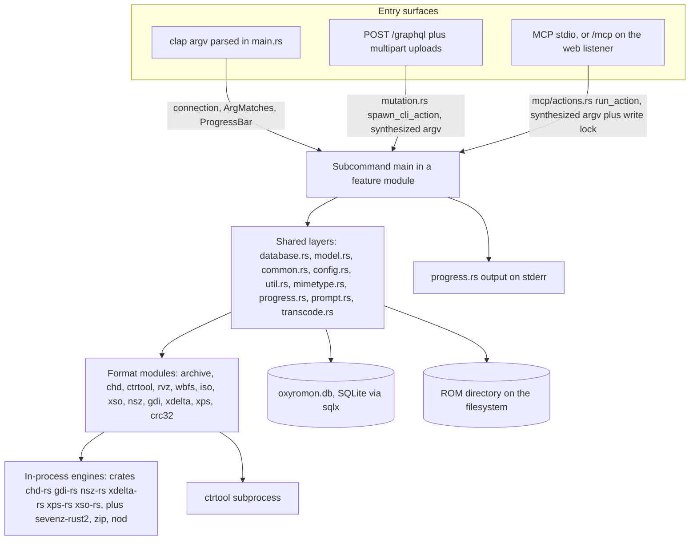
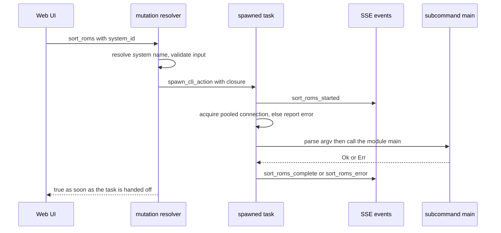

# System Architecture Overview

oxyromon is one Rust package that builds one binary (`oxyromon`) and can wear
three hats: a batch CLI, a web server carrying a GraphQL API and an embedded SPA,
and an MCP server. Those hats are not parallel implementations. Every mutation of
the library — importing DATs, importing ROMs, sorting, converting, checking,
purging — exists exactly once, as a subcommand module's `main()`, and the server
and MCP surfaces reach it by synthesizing argv and calling that function. The
layers below are ordered by who calls whom, not by directory.

## The layers

*Caption: the layer stack and the three places a request can enter — argv, GraphQL, and MCP — converging on the same subcommand `main()`, with every codec now running in-process except the one `ctrtool` subprocess.*

**Entrypoint.** `src/main.rs` is the root package's only binary target. It builds the clap
`Command` from each module's `subcommand()`, runs the process-wide startup
(`dotenv`, the `OXYROMON_LOG_LEVEL` logger bridged onto the global
`MultiProgress`, the data directory, `oxyromon.db`, the pool, the ROM and tmp
directory defaults), and then dispatches on the matched subcommand name. Batch
subcommands run inside a block that holds the single pooled connection; `mcp` and
`server` are dispatched *after* that block and are handed a cloned `SqlitePool`
because they must multiplex requests. See
[CLI Entrypoint and the Subcommand Contract](cli-entrypoint-and-subcommands.md).

**Subcommand modules.** One module per user-facing action (`import_dats`,
`import_roms`, `sort_roms`, `convert_roms`, `check_roms`, `export_roms`,
`rebuild_roms`, `purge_*`, `generate_playlists`, `download_dats`, `config`,
`info`, `benchmark`), all obeying `pub fn subcommand() -> Command` plus
`pub async fn main(connection, matches, progress_bar)`. `subcommand()` is a pure
argv-shape declaration with no I/O — which is precisely what lets a non-CLI host
build an `ArgMatches` itself.

**Shared layers.** `database.rs` holds every SQL statement as a standalone
`pub async fn` taking `&mut SqliteConnection`; `model.rs` holds the row types
those queries materialize, the enums stored as integers, and the Logiqx XML
deserialization types. `common.rs` defines `CommonRomfile` (a path plus optional
system id) and the trait system that abstracts over file formats. `config.rs`
reads and writes the `settings` table with per-system override falling back to
the global row; `util.rs` wraps filesystem operations and the directory layout;
`mimetype.rs` sniffs ROM magic bytes; `progress.rs` owns the progress bars and all
categorized output; `prompt.rs` supplies interactive selection.

**The decode layer.** `transcode.rs` is the one place that turns a stored romfile
into something a conversion can consume. Each helper returns
`Decoded<T> { source, inner }`: `source` is the romfile as the database knows it
— the path and size a conversion must be committed against — and `inner` is the
same content in a neutral format (`CommonRomfile`, `IsoRomfile`, `CueBinRomfile`,
`NspRomfile`) written into the caller's `TempDir`. `archive_to_common` extracts an
archive's single file, `common_as_source` views a plain file as its own source,
`xso_to_iso`/`nsz_to_nsp`/`rvz_to_iso` decode a compressed container, and
`archive_to_cue_bin`/`assemble_cue_bin` build a CUE/BIN set from an archive or from
loose romfiles. Because every path into a neutral format passes here, parent-CHD
resolution lives in one function: `romfile_as_chd` follows `romfile.parent_id` and
calls `as_chd_with_parent`, so `check_roms`, `convert_roms` and `export_roms` never
re-implement it, and `chd_to_iso` layers the DVD-only step on top — returning
`Ok(None)` for a non-DVD CHD so a caller can skip the chain rather than branch on
the type itself.

**Format modules.** Each builds a format-specific romfile struct and `As*` /
`To*` / `Check` traits around `CommonRomfile`. Every codec is now an in-process
engine: `chd.rs` drives `chd-rs` (a port of chdman, for CDs, DVDs, hard disks and
LaserDiscs), `xso.rs`/`nsz.rs`/`gdi.rs`/`xdelta.rs`/`xps.rs` drive the matching
`crates/*` member, `archive.rs` uses sevenz-rust2 and zip, and `rvz.rs`/`wbfs.rs`
use `nod`. Each runs its crate's synchronous entry point on the blocking pool —
`run_blocking` for the crate codecs that report byte progress, `spawn_blocking`
directly in `archive.rs`, `rvz.rs` and for the CHD header read — so the runtime is
never blocked by a compress or a hash. These modules report `"built-in"` from
`get_version()`; `nsz.rs` adds when `prod.keys` is missing so that is not first
discovered mid-compression. **`ctrtool.rs` is the only module left that spawns an
external process**, and only for CIA: `parse_cia` and `extract_files_from_cia` run
`ctrtool -p -v` and parse its listing, and `import_roms` checks
`ctrtool::get_version()` and prints `Required tool not found: ctrtool` instead of
failing deeper in. Details in
[Format Modules and Format Crates](../concepts/format-modules-and-format-crates.md).

**Storage.** One SQLite file. `establish_connection` shapes the pool from the
Cargo feature set — one connection with `PRAGMA locking_mode = EXCLUSIVE` for a
default CLI build, five with `NORMAL` when `server` or `mcp` is compiled in —
applies the tuning pragmas, and runs the compile-time-embedded `MIGRATOR`. Every
query is verified against the schema at compile time. See
[Data Model, SQLite Usage and Migrations](data-model-and-migrations.md).

## One implementation per action

This is the invariant to preserve when adding a capability. The subcommand's
`main(&mut SqliteConnection, &ArgMatches, &ProgressBar)` is the unit of work, and
the non-CLI hosts adapt to it rather than the reverse:

- **GraphQL.** `src/mutation.rs`'s `spawn_cli_action` takes a closure over a
  connection, spawns a task, sends `{prefix}_started` over SSE, acquires its own
  pooled connection (reporting an acquire failure as `{prefix}_error` rather than
  panicking), then runs the closure. Each mutation's closure builds an argv vec,
  parses it with the module's own `subcommand().try_get_matches_from(...)`, and
  calls that module's `main()` with a `ProgressBar::hidden()`.
- **MCP.** `src/mcp/actions.rs`'s `run_action` does the same thing synchronously:
  acquire the process-wide `write_lock`, acquire one connection, create a hidden
  progress bar, then drive the subcommand. Mutating tools such as `sort_roms`,
  `check_roms`, `convert_roms` and `purge_roms` build argv and hand it to
  `sort_roms::main`, `check_roms::main`, and so on.
- **HTTP uploads.** `server.rs`'s upload handlers stream the body to a temp
  directory and then drive the same work on a spawned task — `import_roms::main`
  and `import_irds::main` through synthesized argv, `POST /dats` through
  `import_dats`'s own `process_dat_upload` helper — reporting progress over SSE.

*Caption: the GraphQL path hands work to the subcommand layer and returns; the outcome arrives asynchronously over `/events`.*

Because argv is the interchange format, both hosts push the non-interactive flags
a human would answer at a prompt — `-y`/`--yes` for `confirm()` on destructive
subcommands, `-u`/`--unattended` for ambiguous ROM matches, `--system <name>` to
skip the system multiselect. Where argv is the wrong shape the host still does not
get a second implementation: it calls the module's exported helper directly —
`purge_systems::purge_system` for the GraphQL purge, `download_dats::download_redump_system`
for the MCP `download_dats` tool. A subcommand that grows a prompt that cannot be
bypassed, or that reads process state outside its three arguments, breaks both
servers and the test suite at once.

The hosts differ only around the shared core: GraphQL actions run *asynchronously*
and report only start/complete/error over SSE, while MCP actions run to completion
inside the request, hold the write lock for the whole action so SQLite writer
serialization is ordered instead of surfacing as `SQLITE_BUSY`, poll the bar
roughly twice a second into `notifications/progress`, and race the work against
per-request and server-shutdown cancellation tokens. MCP read tools take no lock
at all, and in `--read-only` mode the write routes are disabled so they never
appear in `tools/list`. See [MCP Server](../server/mcp-server.md) and
[HTTP Server and GraphQL API](../server/http-server-and-graphql-api.md).

## Entry surfaces and what they own

| Surface | Entered at | Owns |
| --- | --- | --- |
| CLI | `main.rs` clap dispatch, scoped connection | interactive selection, styled terminal output |
| GraphQL + uploads + SSE | `server.rs` axum router, `query.rs` / `mutation.rs` | schema, DataLoaders, `/events` broadcast, embedded assets |
| MCP | `mcp.rs` (`oxyromon mcp` stdio, or `/mcp` nested by `server.rs`) | tool/resource/prompt catalog, write lock, progress bridging |

`server.rs` builds one axum `Router`: `POST /graphql`, `GET /events`, multipart
`POST /dats`, `/roms`, `/patches`, `/irds`, `GET /romfiles/{id}` for downloads,
the nested `/mcp` Streamable HTTP service, then the embedded SPA from
`target/assets` via `rust-embed`. The MCP endpoint shares the listener and the
same trust level as `/graphql`; when mounted this way, its mutating actions also
fan their outcome into the SSE stream, so a browser watching `/events` reacts to
work started over MCP.

The desktop app adds no layer: `desktop/src/server.rs` reserves a loopback port,
spawns the same binary as a Tauri sidecar running `server --address 127.0.0.1
--port <port>`, polls until it accepts connections, and points a webview at it.

## Workspace and build boundaries

The repository is a Cargo workspace whose members are the root `oxyromon` package
plus `crates/*` — the format crates (`chd-rs`, `gdi-rs`, `nsz-rs`, `xdelta-rs`,
`xps-rs`, `xso-rs`) that replaced the external tools oxyromon used to shell out to.
They share one lockfile and CI but are versioned and published independently, and
oxyromon depends on them by `path` + `version` with `default-features = false`.

`frontend/` and `desktop/` are **not** workspace members. Each declares its own
`[workspace]` table so cargo does not walk up to the root package: the
WebAssembly toolchain of the Leptos SPA and the Tauri/webkit dependencies stay
out of the native CLI build entirely. They are reached at build time instead —
`build.rs` runs `trunk build --release` in `frontend/` when the `server` feature
is on (`SKIP_TRUNK=true` skips it) and the output is embedded by `rust-embed`.

Cargo features decide which surfaces exist at all. `server` implies `mcp`;
`mcp` alone compiles only the stdio server. `src/main.rs` gates whole modules
(`mcp`, `mutation`, `query`, `server`, `validator`) behind those features, so a
default build never compiles the HTTP stack — and `#[cfg(feature = "server")]`
on the `model.rs` types is what turns the same structs into GraphQL
`SimpleObject`s without duplicating them. See
[Feature Flags and Build Topology](feature-flags-and-build-topology.md).

## Cross-cutting invariants

- **`romfiles.path` is relative to the `ROM_DIRECTORY` setting.** Strip on write,
  join on read; `CommonFile::get_relative_path` and the `download_romfile`
  handler are the two ends of that rule.
- **stdout may be a protocol channel.** Under `oxyromon mcp` (or `/mcp`) stdout
  carries MCP JSON-RPC. All user-facing output goes through the `print_*` helpers
  in `progress.rs`, which write through the `MultiProgress` on stderr, and
  `log::*` records are bridged there too.
- **Blocking work stays off the async runtime.** Format-crate entry points are
  synchronous and take a `&mut dyn FnMut(u64)` progress callback;
  `run_blocking` runs them on the blocking pool, resetting the bar to a bytes
  style with the input size as its length and feeding that callback into it. The
  one external process, `ctrtool`, is spawned with `tokio::process::Command`
  directly, and `util::tool_version` is the only place a version probe shells out.
- **Availability is reported, not guessed.** `info`, the GraphQL `dependencies`
  query and the MCP `status` payload all walk the same `get_version()` set —
  `sevenz-rust2`, `chd-rs`, `ctrtool`, `xps-rs`, `xso-rs`, `nsz-rs`, `xdelta-rs`,
  and `nod` for RVZ/WBFS. An in-process engine always succeeds with `built-in`, so
  only `ctrtool` can come back missing, and a missing `ctrtool` is surfaced as a
  skip rather than a failure deep inside an import.
- **Shutdown is housekeeping.** `optimize_database` (incremental vacuum, optimize,
  WAL checkpoint truncate) runs after the CLI batch finishes, and
  `server.rs`'s `shutdown_signal` runs it before cancelling in-flight work, so a
  server exits with a checkpointed database.
- **The directory tree is reclaimed as well as the rows.** `util::get_kept_directories`
  names the ROM, system and `Trash` directories that must survive, and
  `util::remove_empty_directories` climbs from a deleted file's directory up to a
  kept or non-empty one — the rule `purge-roms` and DAT/IRD updates follow so an
  emptied game folder does not linger. `util::compute_system_completion` is the
  counterpart on the database side: import, sort, check, rebuild and purge all end
  by recomputing game and system completion rather than patching the counter
  themselves.
- **Tests use the same front door.** A test builds a temp database with
  `establish_connection`, points the ROM and tmp settings at `TempDir`s, parses
  argv with the module's `subcommand()`, calls `main(&mut connection, &matches,
  &ProgressBar::hidden())`, and asserts on database plus filesystem state, with
  the `cfg(test)`-only `MUTEX` from `config.rs` serializing shared state. There is
  no CLI harness — which is why the subcommand signature must stay host-agnostic.
