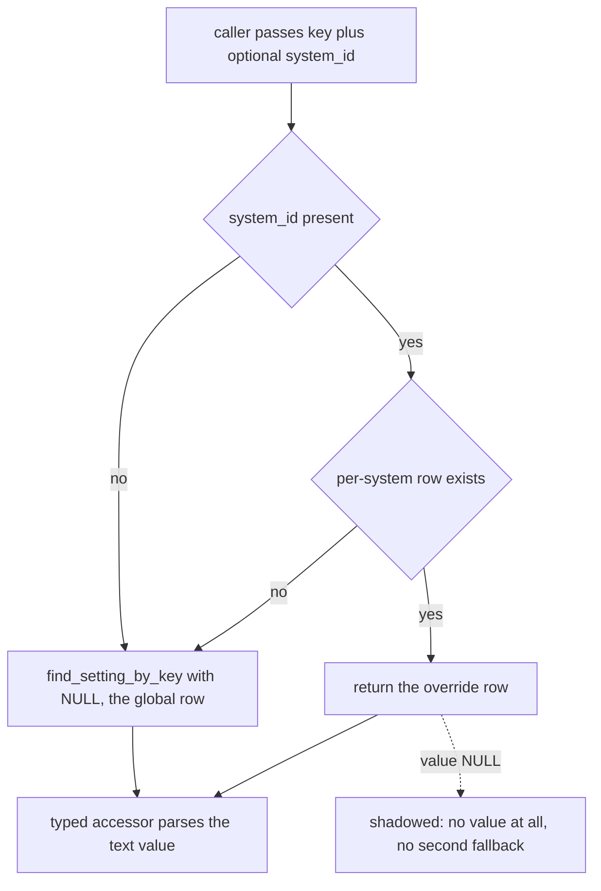
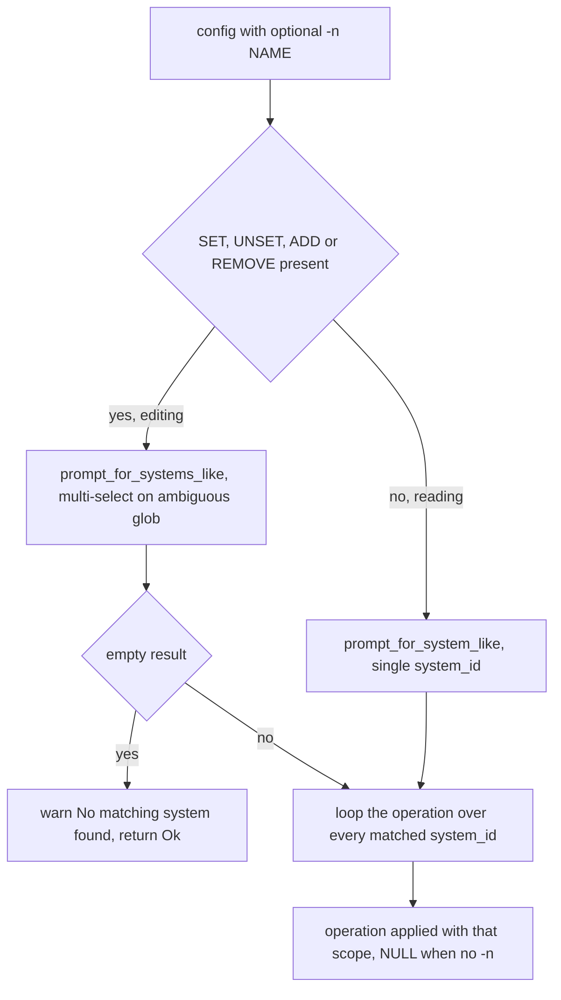
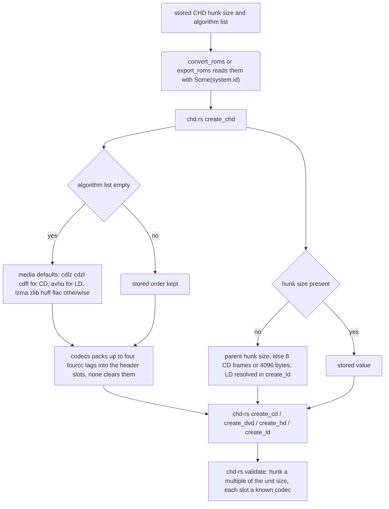
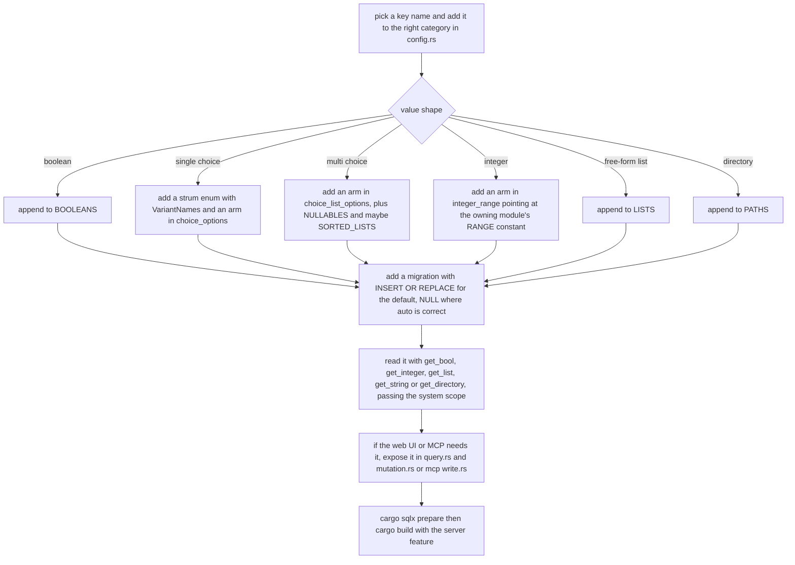

# Settings and Configuration Model

oxyromon has no configuration file. Every user preference is one row of the
`settings` table in `oxyromon.db`, and `src/config.rs` is the single place that
knows what each key means: which category it belongs to, what values are legal,
and how the stored text becomes a Rust type. Format code, the `config`
subcommand, the GraphQL schema and the MCP tools all go through this module
rather than re-implementing their own notion of a setting.

The row itself is deliberately dumb (`src/model.rs`): `id`, `key`,
`value: Option<String>`, `system_id: Option<i64>`. Values are always text or
`NULL`; `system_id` is the scope. Type conversion, validation and defaults are
all the caller-side contract in `config.rs` plus the seeded rows in
`migrations/`.

## Storage, scoping and the two partial indexes

`migrations/20260317000001_add_system_id_to_settings.sql` added the scope column
by rebuilding the table through `settings_new` (SQLite cannot alter a uniqueness
constraint) and installing two partial unique indexes:

```sql
CREATE UNIQUE INDEX settings_key_global_unique ON settings(key) WHERE system_id IS NULL;
CREATE UNIQUE INDEX settings_key_system_unique ON settings(key, system_id) WHERE system_id IS NOT NULL;
```

So at most one global row exists per key, and at most one row per (key, system).
The migration copies the pre-existing rows in with `system_id` left `NULL`,
meaning an upgraded database behaves exactly as before until someone scopes a
key. Because `settings.system_id` is `REFERENCES systems(id) ON DELETE CASCADE`,
purging a system takes its overrides with it — see
[Data Model, SQLite Usage and Migrations](data-model-and-migrations.md).

Reads resolve scope with `IS ?` binding (`src/database.rs`), which treats a
bound `NULL` as "the global rows" instead of never matching:

```rust
pub async fn get_setting(connection, key, system_id) -> Option<Setting> {
    if let Some(id) = system_id
        && let Some(setting) = find_setting_by_key(connection, key, Some(id)).await
    { return Some(setting); }
    find_setting_by_key(connection, key, None).await
}
```



*Caption: `get_setting` resolves the override first and falls back to the global row; a per-system row that exists with a NULL value shadows the global instead of inheriting it.*

Writes funnel through one helper, `upsert_setting`: `find_setting_by_key` on the
exact scope, `update_setting(connection, id, value)` when the scoped row exists,
`create_setting(connection, key, value, system_id)` otherwise
(`src/database.rs`). No caller inserts directly, so the partial indexes never see
a duplicate.

Note the asymmetry the fallback creates. `unset_setting` writes `NULL` into the
row *for the requested scope* (`find_setting_by_key(connection, key, system_id)`),
so a per-system unset of a nullable key leaves a NULL row that `get_setting`
returns for that system — the global value is not consulted again, and a
`get_string` caller sees `None` while a `get_bool` caller would panic on the
missing value. Overrides win on read; clearing them is not the same as deleting
them.

`list_settings` and the GraphQL/MCP "effective settings" reads implement the
same precedence as a merge instead of a lookup: build a map keyed by `key` from
the global rows, overwrite with `find_settings(connection, Some(id))`, sort by
key. That is why `config --list -n <system>` prints the whole configuration as
that system sees it, not just its overrides.

## Typed accessors and their failure semantics

| Accessor | Missing row | NULL value | Written by |
| --- | --- | --- | --- |
| `get_bool` | panics (`.unwrap()`) | panics | `set_bool` |
| `get_integer` | panics | `None` | `set_integer` |
| `get_string` | panics | `None` | `set_string` |
| `get_list` | `vec![]` | `vec![]` | `add_to_list` / `remove_from_list` / `set_list` |
| `get_directory` | `None` | panics | `set_directory` |

`get_directory` also returns `None` when the stored path no longer resolves,
because it canonicalizes on read (`get_canonicalized_path`); `set_directory`
stores the string as given. `src/config/test_set_new_directory_when_old_is_missing.rs`
pins exactly that recovery path: after the stored directory is deleted, setting
a new one yields a readable value again. `get_list` splits on
`LIST_SEPARATOR = "|"`, and `set_list` stores an empty list as `NULL` rather than
an empty string; a `|` separator migration
(`20230528135145_use_pipe_as_separator_in_settings.sql`) rewrote the earlier `,`
values.

The panics are load-bearing rather than sloppy: a key that has a global row can
never be missing, because the default is seeded by a migration, so `get_bool` /
`get_integer` / `get_string` unwrapping the `Setting` is a "this key was added
without its default row" bug detector. Two consequences follow. `benchmark`
bypasses the accessors and reads `ROM_DIRECTORY` / `TMP_DIRECTORY` with
`find_setting_by_key(...).unwrap().value.unwrap()` because it wants the raw
text, and `config --get <unknown key>` panics for the same reason
(`print_setting` unwraps).

Consumers always pass a scope when one exists. `sort_roms::main` reads the whole
1G1R vocabulary per system (`PREFER_PARENTS`, `PREFER_REGIONS`,
`PREFER_VERSIONS`, `PREFER_FLAGS`, `REGIONS_ONE_STRICT`, the region/language/
discard lists) with `system_id = Some(system.id)`, and `convert_roms` /
`export_roms` do the same for the format-tuning keys. See
[Sorting and the 1G1R Election](../workflows/sorting-and-1g1r-election.md).

## Category constants: how a key is classified

`config.rs` classifies keys by membership tests, not by per-key metadata:

| Category | Form | Effect |
| --- | --- | --- |
| `BOOLEANS` | const slice | `--set` parses a bool; stored `"true"`/`"false"` |
| `choice_options(key)` | fn returning `Option<&[&str]>` | `--set` accepts only a listed variant |
| `choice_list_options(key)` | private fn returning `Option<&[&str]>` | `--add` validates each entry |
| `integer_range(key)` | fn returning `Option<&[usize; 2]>` | `--set` parses and range-checks |
| `LISTS` | const slice | `--add`/`--remove` only; `--set` refused |
| `PATHS` | const slice | canonicalize, create, store |
| `NULLABLES` | const slice | only these keys accept `--unset` |
| `SORTED_LISTS` | const slice | list order is *preserved*; others are re-sorted on add |

`choice_options` and `choice_list_options` are functions precisely because their
option sets are not local to config: `PREFER_FORMAT` borrows
`convert_roms::ALL_FORMATS`, `RVZ_/SEVENZIP_/ZIP_COMPRESSION_ALGORITHM` borrow
`VariantNames::VARIANTS` from `rvz.rs` and `archive.rs`, the four
`CHD_*_COMPRESSION_ALGORITHMS` keys borrow them from the
`ChdCd/Dvd/Hd/LdCompressionAlgorithm` enums in `chd.rs`, and the
`REGIONS_*_SUBFOLDERS` / `PREFER_REGIONS` / `PREFER_VERSIONS` choices come from
the `SubfolderScheme`, `PreferredRegion` and `PreferredVersion` strum enums
declared in `config.rs` itself. Value casing follows those enums
(`serialize_all = "lowercase"`, so `none`/`broad`/`narrow`), except
`PREFER_FORMAT`, whose choices are the uppercase format names `ORIGINAL`, `7Z`,
`CHD`, `CSO`, `NSZ`, `RVZ`, `ZIP`, `ZSO`. `config.rs` also still exports
`HashAlgorithm`, which is no longer a setting — its row was deleted by
`20241227212749_drop_hash_algorithm_setting.sql` — but remains the hash-selection
enum threaded through `get_hash_and_size` by import and DAT creation.

`SORTED_LISTS` is easy to misread. `add_to_list` sorts the list after inserting
unless the key is in `SORTED_LISTS`, so membership means "this list's order is
semantic". It names `REGIONS_ONE`, a region *priority* order, and the four
`CHD_*_COMPRESSION_ALGORITHMS` keys, whose entries are laid out in order into
the four compression slots of a CHD header, where earlier slots win a tie.
`NULLABLES` likewise covers every CHD tuning key, hunk sizes and algorithm lists
for CDs, DVDs, hard disks and LaserDiscs alike, so each can be unset back to the
writer's automatic choice. Both slices once listed only the CD and DVD keys,
which left the hard disk and LaserDisc keys impossible to unset and the hard
disk codecs alphabetized on `--add`; `src/config/test_chd_settings.rs` now pins
both behaviours for all four media types.

Category membership also determines which mutators accept a key, and the paths do
not overlap uniformly. `set_setting` dispatches in the order `PATHS` →
`BOOLEANS` → `choice_options` → `integer_range` → `LISTS` → unknown-key error, so
a choice-list key (`CHD_CD_COMPRESSION_ALGORITHMS`, `REGIONS_ONE_ARCADE`) is
reported as `Unknown setting` by `--set` and can only be edited with `--add`.
Conversely `--set` refuses every `LISTS` key with "Lists can't be set directly".

## Every key at a glance

A freshly migrated database holds exactly these global rows. "Auto" means the
row is seeded `NULL` and the consumer picks a value itself.

| Key | Category | Default | Unsettable |
| --- | --- | --- | --- |
| `ROM_DIRECTORY` | `PATHS` | `OXYROMON_ROM_DIRECTORY`, else `~/Emulation` | no |
| `TMP_DIRECTORY` | `PATHS` | `OXYROMON_TMP_DIRECTORY`, else the system temp dir | no |
| `REGIONS_ALL` | `LISTS` | empty | yes |
| `REGIONS_ONE` | `LISTS`, `SORTED_LISTS` | empty | yes |
| `REGIONS_ALL_SUBFOLDERS`, `REGIONS_ONE_SUBFOLDERS` | `choice_options` (`none`, `alpha`) | `none` | no |
| `REGIONS_ONE_STRICT` | `BOOLEANS` | `false` | no |
| `REGIONS_ALL_ARCADE`, `REGIONS_ONE_ARCADE` | `choice_list_options` (`bios`, `clone`, `parent`) | empty | yes |
| `PREFER_PARENTS` | `BOOLEANS` | `true` | no |
| `PREFER_REGIONS` | `choice_options` (`none`, `broad`, `narrow`) | `none` | no |
| `PREFER_VERSIONS` | `choice_options` (`none`, `new`, `old`) | `new` | no |
| `PREFER_FLAGS`, `DISCARD_FLAGS`, `DISCARD_RELEASES`, `LANGUAGES` | `LISTS` | empty | yes |
| `PREFER_FORMAT` | `choice_options` (`convert_roms::ALL_FORMATS`) | unset | yes |
| `GROUP_SUBSYSTEMS` | `BOOLEANS` | `true` | no |
| `CHD_PARENTS` | `BOOLEANS` | `false` | no |
| `CHD_CD/DVD/HD/LD_HUNK_SIZE` | `integer_range` | auto | yes |
| `CHD_CD/DVD/HD/LD_COMPRESSION_ALGORITHMS` | `choice_list_options`, `SORTED_LISTS` | auto | yes |
| `RVZ_BLOCK_SIZE` | `integer_range` | `128` | no |
| `RVZ_COMPRESSION_ALGORITHM` | `choice_options` | `zstd` | no |
| `RVZ_COMPRESSION_LEVEL` | `integer_range` | `5` | no |
| `RVZ_SCRUB` | `BOOLEANS` | `false` | no |
| `SEVENZIP_COMPRESSION_ALGORITHM` | `choice_options` (`lzma2`, `zstd`) | `lzma2` | no |
| `SEVENZIP_COMPRESSION_LEVEL`, `SEVENZIP_ZSTD_COMPRESSION_LEVEL` | `integer_range` | `9`, `19` | yes |
| `SEVENZIP_SOLID_COMPRESSION` | `BOOLEANS` | `false` | no |
| `ZIP_COMPRESSION_ALGORITHM` | `choice_options` (`deflate`, `zstd`) | `deflate` | no |
| `ZIP_COMPRESSION_LEVEL`, `ZIP_ZSTD_COMPRESSION_LEVEL` | `integer_range` | `9`, `19` | yes |

The region, language, discard and preference keys are consumed by `sort-roms`;
see [Sorting and the 1G1R Election](../workflows/sorting-and-1g1r-election.md).
The format keys are consumed by conversion and export, below.

## The `config` subcommand

`config::subcommand()` registers one `-n/--system <NAME>` flag (percent globs,
resolved through `find_systems_by_name_like`) and six mutually exclusive
operations — `--list`, `--get KEY`, `--set KEY VALUE`, `--unset KEY`,
`--add KEY VALUE`, `--remove KEY VALUE` — each declared `conflicts_with_all` of
the others, so an ambiguous invocation is rejected by clap instead of silently
ordering.

`main` then decides how many scopes the operation touches:



*Caption: one glob can fan out to many systems for edits, while reads always collapse to a single system.*

Validation results inside `set_setting` are reported, not returned as errors: an
illegal choice prints `Valid choices: [...]`, an out-of-range integer prints
`Valid range: [...]`, and an unknown key prints an error line — yet `main` still
returns `Ok(())` and the previous value stays untouched
(`src/config/test_cli.rs` asserts each of these non-destructive rejections).
The one path that can fail the process is `PATHS`: `get_canonicalized_path`
errors on a path that does not exist, so `--set ROM_DIRECTORY /nope` returns an
`Err` from `set_setting` before `create_directory` runs.

`unset_setting` prints `Setting "..." cannot be unset` for anything outside
`NULLABLES`; `add_to_list` rejects a duplicate with a skip, validates choice-list
entries against their `VARIANTS`, and refuses non-list keys; `remove_from_list`
warns when the value is absent rather than erroring.

## Defaults live in migrations, not in code

There is no default table in Rust. Adding a key's default means a new migration
using the repository's idempotent insert style:

```sql
INSERT OR REPLACE INTO settings ("key", value) VALUES ('SEVENZIP_COMPRESSION_ALGORITHM', 'lzma2');
```

`migrations/20210323000007_create_settings.sql` created the table and its first
rows; later migrations added the compression, CHD, arcade and `PREFER_FORMAT`
defaults, some seeded as `NULL` on purpose ("auto"). The same statement style is
used for retcons: `20230103125145_add_compression_settings.sql` lowercased the
subfolder-scheme values that earlier migrations had seeded as `"NONE"`, and
`20260808000001_rename_rvz_bzip_compression.sql` rewrote the RVZ algorithm value
`bzip` → `bzip2` because dolphin-tool would otherwise refuse to parse it. Two
consequences for readers: a "default" the README quotes can be stale in an old
database (`INSERT OR REPLACE` only touches the row at migration time), and the
only in-code fallbacks are the directory bootstrap and `archive.rs`'s
`DEFAULT_COMPRESSION_LEVEL` / `DEFAULT_ZSTD_COMPRESSION_LEVEL` used when a level
row is `NULL`.

The directory keys are the exception to migration seeding. `main.rs` calls
`get_rom_directory` and `get_tmp_directory` at startup purely for the side effect
of persisting the first-run value (`OXYROMON_ROM_DIRECTORY`, else
`~/Emulation`; `OXYROMON_TMP_DIRECTORY`, else `env::temp_dir()`). Both are
`PATHS` keys read globally (`system_id = None`) by the bootstrap, while
`util::get_system_directory` and `common::get_relative_path` read them with the
system's scope and fall back to the global helper, so a single system can be
relocated to another volume — `src/import_roms/test_per_system_rom_directory.rs`
sets two per-system `ROM_DIRECTORY` values and asserts each system's files land
under its own root. `server.rs`'s download handler reads the *global*
`ROM_DIRECTORY` directly and returns 500 when the row is absent.

## Format tuning keys: declared here, ranges owned elsewhere

Every `CHD_*`, `RVZ_*`, `SEVENZIP_*` and `ZIP_*` key is declared in `config.rs` —
in `choice_options` / `choice_list_options` and, for the integers, in
`integer_range` — but no range or algorithm vocabulary is defined there. The
`integer_range` arms point at constants owned by the modules that do the work:

| Key | Range owner |
| --- | --- |
| `CHD_CD/DVD/HD/LD_HUNK_SIZE` | `chd::CHD_HUNK_SIZE_RANGE` = 16..1048576 |
| `RVZ_BLOCK_SIZE` | `rvz::RVZ_BLOCK_SIZE_RANGE` = 32..2048 (KiB) |
| `RVZ_COMPRESSION_LEVEL` | `rvz::RVZ_COMPRESSION_LEVEL_RANGE` = 1..22 |
| `SEVENZIP_COMPRESSION_LEVEL`, `ZIP_COMPRESSION_LEVEL` | `archive.rs` `_RANGE` = 1..9 |
| `SEVENZIP_ZSTD_COMPRESSION_LEVEL`, `ZIP_ZSTD_COMPRESSION_LEVEL` | `archive::ZSTD_COMPRESSION_LEVEL_RANGE` = 1..22 |

Likewise the algorithm choices are the `VARIANTS` of `ChdCd/Dvd/Hd/LdCompressionAlgorithm`
(`chd.rs`), `RvzCompressionAlgorithm` (`rvz.rs`), and
`SevenzipCompressionAlgorithm` / `ZipCompressionAlgorithm` (`archive.rs`). Each CHD
key is pinned to the codec list its media type supports, so the four keys are not
interchangeable vocabularies:

| Key | Enum (`chd.rs`) | Accepted values |
| --- | --- | --- |
| `CHD_CD_COMPRESSION_ALGORITHMS` | `ChdCdCompressionAlgorithm` | `none`, `cdfl`, `cdlz`, `cdzl`, `cdzs` |
| `CHD_DVD_COMPRESSION_ALGORITHMS` | `ChdDvdCompressionAlgorithm` | `none`, `flac`, `huff`, `lzma`, `zlib`, `zstd` |
| `CHD_HD_COMPRESSION_ALGORITHMS` | `ChdHdCompressionAlgorithm` | `none`, `flac`, `huff`, `lzma`, `zlib`, `zstd` |
| `CHD_LD_COMPRESSION_ALGORITHMS` | `ChdLdCompressionAlgorithm` | `none`, `avhu` |

These are the codecs the in-tree `chd-rs` writer can actually encode
(`crates/chd-rs/src/codec.rs`), so an entry `--add` accepts is a codec the writer
supports for that media type — a CD key never offers the plain `zlib`/`lzma`
codes and LaserDisc only ever `avhu`.
Validation therefore cannot drift from what the writers accept, and a format
module changing its range or its enum changes what `config --set` / `--add` will
accept. Note that these keys tune an *in-process library call*, not a subprocess:
CHD comes from the in-workspace `chd-rs` crate (`crates/chd-rs`), 7z and ZIP from
`sevenz-rust2` and `zip`, RVZ and WBFS from `nod`, so CHD has **no external
dependency** and there is no tool-path or tool-version setting anywhere — `PATHS`
holds only `ROM_DIRECTORY` and `TMP_DIRECTORY`, and `info` reports `chd-rs` as
`built-in`. The `sevenz` and `nod` Cargo features that once gated the external
binaries are gone, and with them any notion of a missing or too-old binary; the
only Cargo features left that gate settings surfaces are `server` and `mcp`.

Reading happens per system at conversion time: `convert_roms` pulls all four CHD
hunk sizes and algorithm lists for `Some(system.id)`, plus `CHD_PARENTS` — the
only reader of that key, which decides whether a conversion clones a parent CHD
(`--parents` prompts instead) — while `export_roms` reads
only the CD and DVD pairs and clones whatever parent the database already
records, so the HD and LD tuning keys and `CHD_PARENTS` itself affect
`convert-roms` alone. `archive::get_archive_compression` maps an archive type onto its
(algorithm, level, zstd-level) key triple and produces an `ArchiveCompression`
that carries the level on the chosen algorithm's own scale. The consumers apply
the units and per-algorithm limits the setting layer deliberately does not:
`rvz.rs` multiplies `RVZ_BLOCK_SIZE` by 1024 because nod wants bytes, clamps the
level with `level.clamp(1, 9)` for bzip2/lzma/lzma2 and `clamp(1, 22)` for zstd
(the `integer_range` entry is the union 1..22), and prints a warning that
`RVZ_SCRUB is unsupported by nod, writing unscrubbed` rather than failing.

CHD tuning is resolved inside `chd.rs::create_chd` as arguments to the `chd-rs`
writer, not on a command line. An empty algorithm list is not "no compression":
it selects the media defaults `create_chd` applies itself — `cdlz, cdzl, cdfl`
for CDs, `avhu` for LaserDiscs, `lzma, zlib, huff, flac` for DVDs and hard disks
— while a populated list is packed by `codecs()` into the four compression slots
of the header, in stored order, with `none` alone clearing all four slots.
Each hunk is then compressed with every slot in turn and the smallest result
wins, ties going to the earliest slot, which is why the list's order matters.
Likewise a `None` hunk size takes the parent CHD's hunk size when cloning, and
otherwise 8 CD frames or 4096 bytes; a LaserDisc hunk size is passed through as
an `Option` and resolved by `create_ld`, which takes the parent's or one field.
So an unset (NULL) tuning key is a meaningful "auto" value, not an absent
setting.



*Caption: how a CHD tuning row becomes header slots and a hunk size; the defaults and the geometric checks live in the format layer, not in `config.rs`.*

Because config's checks are only "is this a member of the enum" and "is this
inside the byte range", the format layer still owns the rejections that a valid
configuration can hit. `codecs()` errors with *"At most four CHD compression
algorithms can be used"* when a key holds more than four entries, chd-rs rejects
a hunk size that is not a multiple of the media's unit size (2448 for a CD frame,
2048 for a DVD, 512 for a hard disk) even though `CHD_HUNK_SIZE_RANGE` admits it,
and an explicit `none` in `CHD_LD_COMPRESSION_ALGORITHMS` reaches
`create_ld`'s refusal of an uncompressed LaserDisc CHD. Changing the settings
layer to be stricter about those cases would be a behaviour change for existing
databases, so today they surface as a conversion error on the affected ROM.

`PREFER_FORMAT` is also written from outside `config`. `convert-roms --save`
persists the format it just converted to through `set_string` directly, and
`import-roms` auto-converts the games it imported whenever the setting is set.
The arcade restriction — `convert_roms::format_supported_for_system` allows only
`ORIGINAL`/`ZIP` — is enforced by the three validated entry points
(`config::set_setting`, `mutation::set_prefer_format`, and the MCP tool), each of
which refuses and leaves the stored value untouched;
`src/import_roms/test_prefer_format.rs` asserts that
`set_setting(.. "PREFER_FORMAT", "CHD", Some(arcade))` yields `None` while `ZIP`
sticks. `convert-roms --save` skips that check, so a per-system `PREFER_FORMAT`
that no validated surface would accept is reachable and will be honored by the
next import's auto-conversion pass.
See [Format Conversion and Export](../workflows/format-conversion-and-export.md).

## The non-CLI surfaces

Three other entry points read and write the same rows, and the interesting
question for any change is whether they reuse config's classification:

- **GraphQL** (`query.rs`, `mutation.rs`, behind the `server` feature).
  `settings` returns global rows only; `systemSettings(systemId)` returns the
  merged effective view the frontend needs. Mutations are thin wrappers over the
  same config functions — `addToList`, `removeFromList`, `setBool`,
  `setDirectory`, `setSubfolderScheme`, `setPreferRegions`, `setPreferVersions`,
  `setPreferFormat`, `unsetPreferFormat`. Choice validation moves into
  `src/validator.rs`: `VariantValidator<E>` checks a string against
  `E::VARIANTS` (the very slices `choice_options` exposes),
  `PreferFormatValidator` checks `ALL_FORMATS`, and `DirectoryValidator` requires
  an existing directory — so a bad value becomes a GraphQL error rather than the
  CLI's printed warning. `setPreferFormat` repeats the arcade check as an error.
  The generic-key mutations (`setDirectory`, `setSubfolderScheme`, `setBool`)
  take any key string, so they do not consult `PATHS` / `BOOLEANS` at all.
- **MCP** (`src/mcp/read.rs`, `src/mcp/write.rs`, behind the `mcp` feature).
  `get_settings` merges globals with the requested system's overrides and tags
  each output entry with the `system_id` it came from. `set_setting` imports
  `BOOLEANS`, `LISTS`, `NULLABLES`, `PATHS`, `choice_options` and `integer_range`
  and re-runs the config validation as actionable tool errors, with one deliberate
  divergence: a list value is the *complete desired set*, comma-separated, and the
  tool diffs it against `get_list` and issues `remove_from_list` / `add_to_list`
  per entry instead of a wholesale write.
- **Web UI** (`frontend/`). `get_raw_settings(system_id)` chooses
  `{ settings { key value } }` or `{ systemSettings(systemId: …) }`, and
  `split_list` splits the stored value on `|` — a second implementation of
  `LIST_SEPARATOR` that a separator change must keep in step.

## Adding a setting

The repository's own checklist (`AGENTS.md`, "New setting") and the shape of
`config.rs` agree on the procedure: six categories, three of them const slices
(`BOOLEANS`, `LISTS`, `PATHS`) and three of them functions (`choice_options`,
`choice_list_options`, `integer_range`), plus `NULLABLES` and `SORTED_LISTS` as
orthogonal flags.



*Caption: the path from a new key's category to a consumed, exposed setting.*

Concretely:

1. **Category.** Append the key to `BOOLEANS`, `LISTS`, `PATHS`, `NULLABLES` or
   `SORTED_LISTS` as needed, or add a `match` arm to `choice_options`,
   `choice_list_options`, or `integer_range`. If a new choice enum is needed,
   derive `EnumString` + `VariantNames` with `serialize_all = "lowercase"` so the
   stored value matches what `--set` and `VariantValidator` accept.
2. **Default.** Add a `migrations/<timestamp>_add_<name>_setting.sql` with
   `INSERT OR REPLACE INTO settings ("key", value) VALUES (…)`. Omitting this
   step is how a `get_bool` unwrap later panics. `cargo sqlx prepare --
   --features server` afterwards, per the migration workflow.
3. **Consume.** Read it with the typed accessor, threading the `system_id` you
   already have so the override/fallback path is exercised; consumers pass
   `Some(system.id)` even for keys that are conceptually global.
4. **Expose.** Add a query in `query.rs` and a mutation in `mutation.rs` (with a
   `validator(custom = ...)` for choices) if the web UI needs it; the MCP
   `set_setting` tool picks the key up automatically once the category functions
   know it, and `get_settings` lists it as soon as the row exists.
5. **Retcon existing values** with an `UPDATE settings …` migration if you are
   renaming a stored value, following the `bzip` → `bzip2` precedent.

## Tests worth knowing

`src/config/` holds one test per behaviour rather than a suite, each building a
throwaway database with `establish_connection` on a `NamedTempFile`:

- `test_system_bool_fallback.rs` — a global `PREFER_PARENTS = false` is what a
  system with no override reads back.
- `test_system_bool_override.rs` — with both scopes set, `Some(system.id)` reads
  the override and `None` still reads the global; the two rows coexist.
- `test_cli.rs` — drives the subcommand end to end through
  `subcommand().get_matches_from([...])`: valid choice, invalid choice leaving
  the old value, direct list `--set` refused, `--add`, invalid choice-list entry,
  `--remove`, `--unset` of a nullable list, `--unset` of a non-nullable bool,
  `--get`/`--list`, and an unknown key returning `Ok`.
- `test_add_to_list.rs`, `test_add_to_list_already_exists.rs`,
  `test_remove_from_list.rs`, `test_remove_from_list_does_not_exist.rs` — list
  add/remove and their no-op cases.
- `test_chd_settings.rs` — every CHD hunk size and algorithm list, for all four
  media types, can be unset back to `NULL`, and `--add` keeps the hard disk
  codecs in the order given.
- `test_directory.rs` and `test_set_new_directory_when_old_is_missing.rs` — the
  canonicalize-on-read contract and recovery from a vanished directory.
- `test_directory` siblings outside the module (`src/validator/test_*`,
  `src/server/test_mutations.rs`, `src/server/test_queries.rs`) cover the
  GraphQL-side validators and the merged `systemSettings` query.

Tests that touch the global `ROM_DIRECTORY` take `config::MUTEX` (a
`cfg_if`-gated test-only lock) and point the settings at `TempDir`s, because the
directory bootstrap writes to a process-wide location otherwise.
