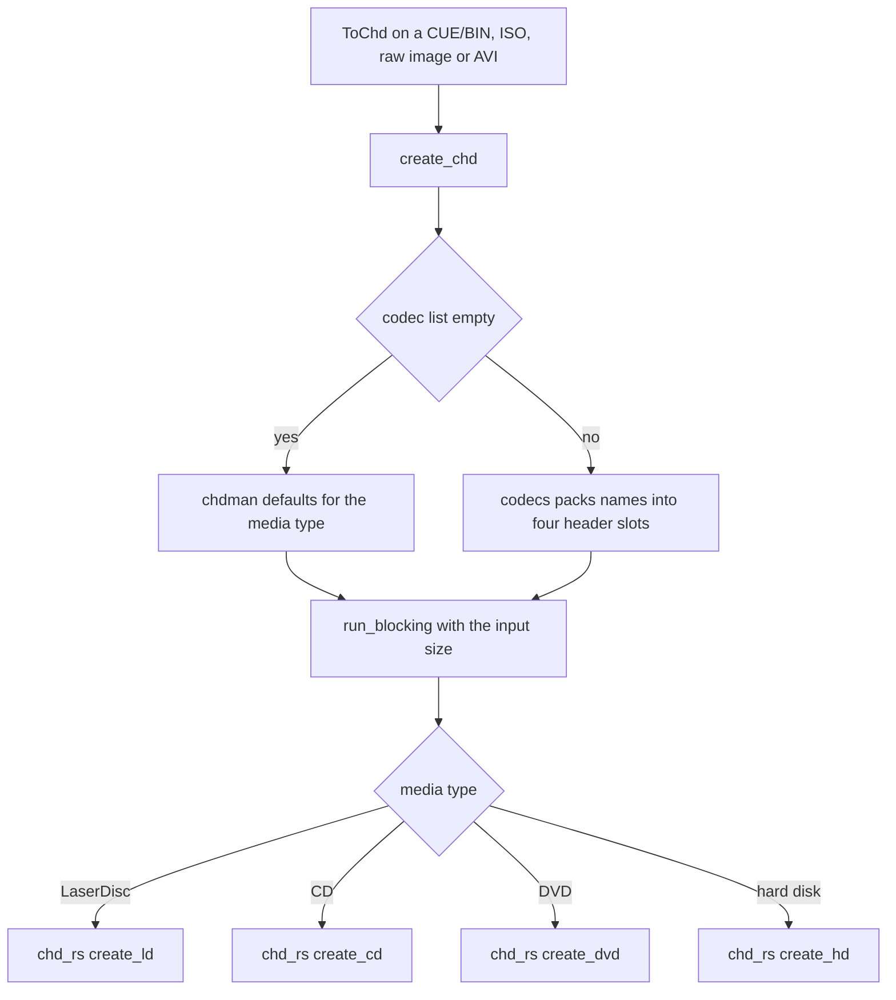

# CHD Format and the chd-rs Crate

A CHD ("Compressed Hunks of Data") holds the logical contents of a CD, a DVD, a
hard disk or a LaserDisc, split into fixed-size hunks that are each compressed
with one of up to four codecs named in the header, and covered by SHA-1 hashes.
oxyromon reads, writes and extracts CHDs entirely in process through the
`chd-rs` crate in `crates/chd-rs`, which began as a port of MAME's `chdman`.
Nothing is spawned: `src/chd.rs` reports its version as the literal
`"built-in"`, so `info` can never find it missing.

The split of responsibilities is deliberate:

- **`crates/chd-rs`** knows the file format: containers v3 to v5, every codec,
  CD frame layout, CUE/GDI/TOC parsing, LaserDisc AVI handling, parents. It is
  synchronous and file-to-file, like every format crate (see
  [Format Crates in crates/](../integrations/format-crates.md)).
- **`src/chd.rs`** knows oxyromon: which media type a romfile is, which settings
  apply, where temporary files go, how progress reaches the bar, and how a CHD
  becomes something the hashing layer can compare against a DAT.

## Media types and detection

`chd.rs` mirrors the crate's four content types in its own `ChdType` (`Cd`,
`Dvd`, `Hd`, `Ld`), and each maps to a different intermediate format on the
oxyromon side:

| `ChdType` | Created from | Extracted to | Hashed as |
| --- | --- | --- | --- |
| `Cd` | CUE/BIN (`CueBinRomfile`) | CUE plus one BIN per track | each BIN track |
| `Dvd` | ISO (`IsoRomfile`) | ISO | the data, or the ISO |
| `Hd` | raw disk image (`RdskRomfile`) | raw image | the data, or the image |
| `Ld` | AVI capture (`RiffRomfile`) | AVI | the data, or the AVI |

`AsChd::parse_chd` opens the file with `Chd::open` on `spawn_blocking` and turns
the crate's `ChdInfo` into a tuple: type, logical size, data SHA-1, the CHD's
own SHA-1, the parent's SHA-1 if any, and the track count. A CD carries no
single size or data hash — only its tracks do — so `parse_chd` returns size `0`
and an empty data SHA-1 for it, and the track count drives extraction instead.
Any content type the crate does not call CD, DVD or LaserDisc is treated as a
hard disk.

`as_chd` then looks for the parent itself: when the header names a parent
SHA-1, it scans the CHD's own directory for another `.chd` whose CHD SHA-1
matches. `as_chd_with_parent` takes the parent from the caller instead and
bails with "Parent CHD SHA1 mismatch" when the header disagrees.

## Hashing, size and integrity

`ChdRomfile` implements the shared `Size`, `HashAndSize` and `Check` traits
(see [Romfile Trait System](romfile-trait-system.md)). Two shortcuts keep
them cheap:

- When SHA-1 is the hash in use and the header already supplied the data
  SHA-1 and size, `get_hash_and_size` returns them without decompressing
  anything. Otherwise DVD, hard disk and LaserDisc CHDs are extracted to a
  temporary directory and the extracted file is hashed.
- A CD cannot be hashed as a whole (`bail!("Not possible")`): import and
  check extract it to CUE/BIN and hash each track against its own ROM.

Import adds one more fallback for MAME: its CHD DATs carry no size and list
the CHD's own SHA-1, so when the data hash finds nothing, `import_roms`
retries the match with `chd_sha1` and size `0`. See
[ROM Import Pipeline](../workflows/rom-import-pipeline.md).

## Writing: codecs, hunk sizes and their defaults

Every `ToChd` implementation funnels into one private `create_chd`, which
resolves the settings into arguments to the crate and runs the crate entry
point through `run_blocking`, so the crate's byte-progress callback drives the
progress bar:

- **Codecs.** An empty list means chdman's defaults: `cdlz, cdzl, cdfl` for
  CDs, `avhu` for LaserDiscs, `lzma, zlib, huff, flac` otherwise. A populated
  list goes through `codecs()`, which packs the four-character names, in
  order, into the header's four compression slots, leaves all four empty for
  `none` alone, and bails beyond four entries.
- **Hunk size.** A LaserDisc's hunk size is passed through as an `Option` and
  resolved by `create_ld`, one field a hunk by default. For the other types an
  unset size takes the parent's hunk size when there is one, and otherwise 8
  CD frames for a CD or 4096 bytes for a DVD or hard disk.
- **Entry points.** `create_cd` reads a CUE (its input size is measured with
  `cd_input_size`), `create_dvd` and `create_ld` read their image, and
  `create_hd` reads a raw image in 512-byte units.

The values come from per-system settings that `convert-roms` reads for each
system: `CHD_CD/DVD/HD/LD_COMPRESSION_ALGORITHMS` and `CHD_*_HUNK_SIZE`, each
seeded `NULL` ("auto"), each unsettable, and with their codec order preserved
because the slot order decides ties. The accepted codecs are the variants of
the `ChdCd/Dvd/Hd/LdCompressionAlgorithm` enums in `chd.rs`, so the CD keys
offer only the CD codecs and LaserDisc only `avhu`. See
[Settings and Configuration Model](../architecture/settings-and-configuration.md).

Within the crate, each hunk is compressed with every codec in the header and
the shortest result kept, falling back to storing the hunk raw when none
saves space, as chdman does. Hunks are compressed on every core and laid out
in order, so the output does not depend on the thread count.

*Caption: every CHD write goes through create_chd, which resolves codecs and hunk size before handing one crate call to the blocking pool.*

## Extracting

`extract_chd` opens the CHD on `spawn_blocking`, with `Chd::open_with_parent`
when the romfile has a parent, and then runs one crate call through
`run_blocking` sized by the logical size:

- **CD:** `extract_cd` writes a CUE and the BIN tracks. A multi-track game is
  split into one BIN per track, named with a `%t` placeholder that `to_cue_bin`
  then renames to each ROM's name from the DAT. The CUE is written hidden
  (a leading dot), so a caller keeping the original sheet can delete it.
- **LaserDisc:** `extract_ld` writes the AVI.
- **DVD and hard disk:** `Chd::extract` writes the raw image.

## Parent CHDs

A parent CHD lets a clone store only the hunks that differ, which pays off
for the discs of one multi-disc game. oxyromon picks a parent in three ways:

- **On read**, as above, from the parent SHA-1 in the header.
- **On `convert-roms`**, `find_parent_chd` prompts for one with `--parents`,
  or, when the system's `CHD_PARENTS` is true, takes the CHD of the first game
  of the same M3U playlist. That is why parents need
  `generate-playlists` first. Converting CHDs to another format handles
  clones before their parents, so a parent is never converted away while a
  clone still depends on it.
- **On `export-roms` to CHD**, the same playlist lookup always applies,
  without consulting `CHD_PARENTS`: the library CHD of the playlist's first
  game becomes the parent of the exported one.

The database caches the parent SHA-1 in `romfiles.parent_id`, so the link
survives without reopening files. See
[Data Model, SQLite Usage and Migrations](../architecture/data-model-and-migrations.md)
and [Arcade Rebuilds and M3U Playlists](../workflows/arcade-rebuild-and-playlists.md).

## The crate's surface

`crates/chd-rs/src/lib.rs` re-exports a small API on top of its internal
modules (container, codecs, CD-ROM layout, LaserDisc, extraction, writer):

- `Chd::open` / `Chd::open_with_parent`, `info()`, `verify()`, `extract()`.
- `create`, `create_hd`, `create_dvd`, `create_cd`, `create_ld` for writing
  CHD v5, with an optional parent.
- `extract_cd` and `extract_ld` for the CD and LaserDisc layouts.
- `ChdType`, `ChdInfo`, `sha1_hex`, `fourcc`, `CD_FRAME_SIZE` and
  `cd_input_size`.

The `chdrs` CLI, behind the default `cli` feature, wraps the same calls with
the shared format-crate shell. Reading covers CHD v3 to v5; writing emits v5.
Compatibility targets chdman 0.289: CUE and GDI parsing, the CD frame layout
and metadata, and extraction follow that version. Most codec bitstreams match
chdman's by construction, while LZMA goes through `lzma-rust2` and produces
different, equally decodable bytes. The crate's tests compare against chdman
when it is installed and skip otherwise; see
[Format Crate Test Strategy](../testing/format-crate-tests.md).

## Focused tests

- `src/chd/test_ld.rs` takes the LaserDisc fixture
  `tests/Test Game (USA, Europe) (LD).riff` to a CHD, checks it parses as
  `Ld` with a size, extracts it back to an AVI, and checks a CHD made from that
  AVI comes out the same.
- `src/convert_roms/` and `src/export_roms/` hold the CD round trips, including
  multi-track CUE/BIN to CHD and back, CHDs inside 7z archives, and the
  `test_chd_parents_to_chd_should_not_touch_parent` case.
- `src/import_roms/test_multiple_tracks_chd.rs` and
  `src/check_roms/test_multiple_tracks_chd.rs` cover per-track hashing.
- `src/config/test_chd_settings.rs` covers unsetting every CHD key and the
  preserved codec order.

## Related

- [Format Modules and Their Crate Backends](format-modules-and-format-crates.md)
- [Format Conversion and Export](../workflows/format-conversion-and-export.md)
- [Settings and Configuration Model](../architecture/settings-and-configuration.md)
- [Format Crates in crates/](../integrations/format-crates.md)
