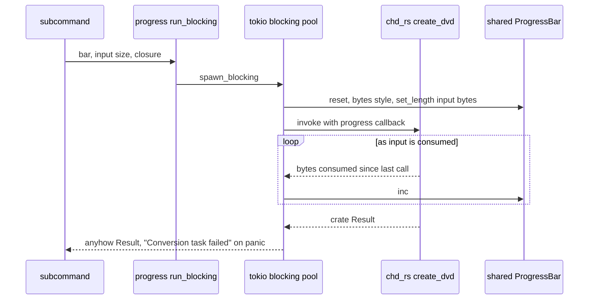
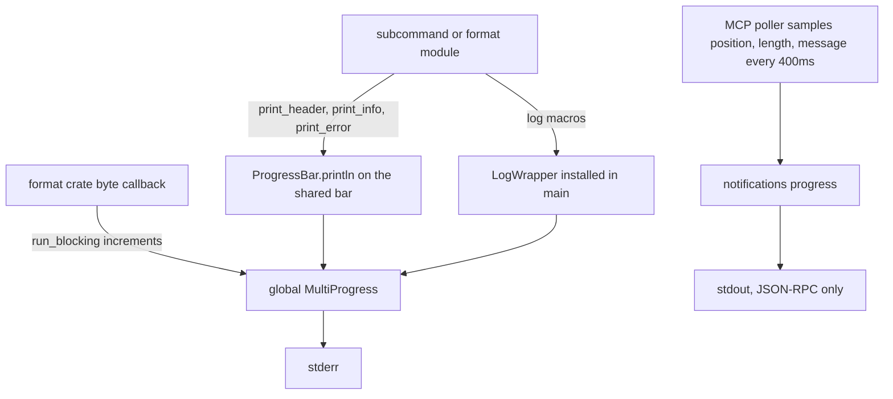
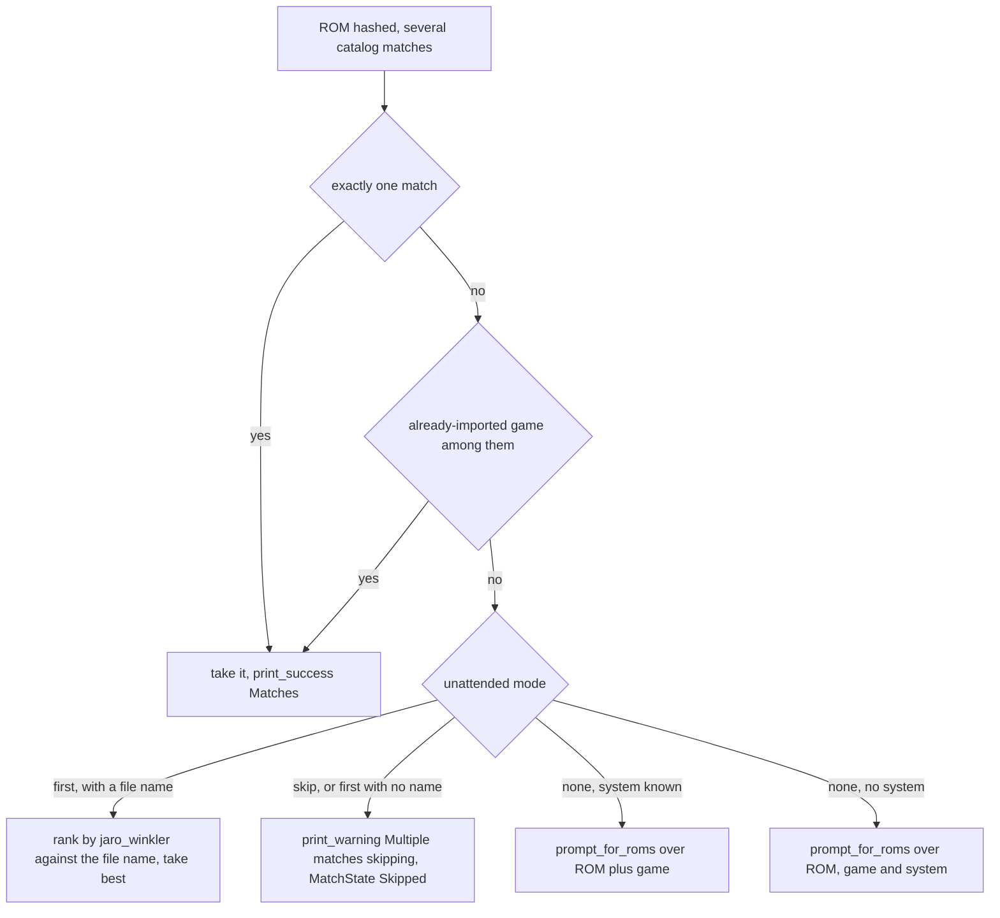
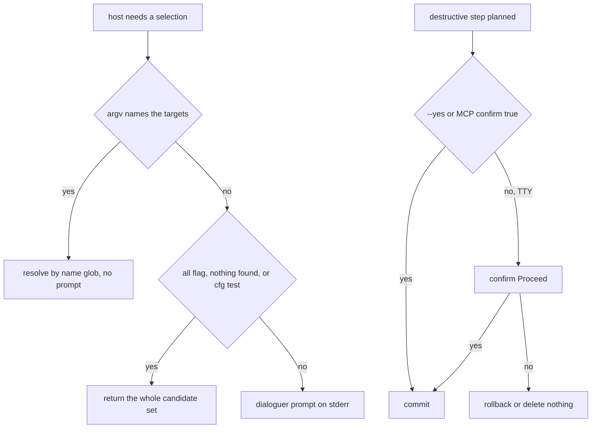

# Progress Bars, Categorized Output and Prompts

Three small modules own everything a user sees while oxyromon works:
[`src/progress.rs`](../../src/progress.rs) (one global `MultiProgress`, the bar
styles, and the categorized `print_*` helpers),
[`src/prompt.rs`](../../src/prompt.rs) (dialoguer selection, confirmation and
text entry), and the `indicatif_log_bridge::LogWrapper` installed once in
[`src/main.rs`](../../src/main.rs). Everything they emit lands on **stderr**.
That is not a stylistic choice: under `oxyromon mcp` stdout is the JSON-RPC
transport, so a stray `println!` corrupts the protocol stream. The same modules
carry the escape hatches — `-y/--yes`, `--unattended`, `--all`, `--system`,
`--rom`, `cfg!(test)` — that let a run finish with nobody at the keyboard.

## One global MultiProgress, one shared bar

`MULTI_PROGRESS` is a `static LazyLock<MultiProgress>` and
`get_progress_bar(length, style)` is the only way a bar joins it: bars from a
subcommand, from a GraphQL mutation and from an MCP action all stack in one
render. No code calls `MultiProgress::remove`, and only `mcp::run_action` and
`info::main` call `finish_and_clear()`, so on a long-lived host each action adds
a line that stays until the process exits.
`progress.rs` also re-exports `MultiProgress`, `ProgressBar` and
`ProgressStyle` so that `use super::progress::*;` is enough for a consumer.

The CLI entrypoint creates exactly one bar at startup
(`get_progress_bar(0, get_none_progress_style())`), prints the version banner
through it, and passes that same `&ProgressBar` down the whole call graph —
subcommands, format modules, `CommonRomfile` helpers, `compute_system_completion`.
Subcommands are free to restyle it, change its length and tick it; the entrypoint
never touches it again. Format crates and hosts that have no TTY in mind instead
build their own bar, either `get_progress_bar(0, get_none_progress_style())`
(GraphQL settings mutations, MCP actions) or `ProgressBar::hidden()` (spawned
GraphQL actions, the web upload handlers, most unit tests).

### Bar styles

Three styles, all sharing the `⠋⠙⠹⠸⠼⠴⠦⠧⠇⠏` spinner and the `━╸━` progress
chars:

| Style | Template shape | Used by |
| --- | --- | --- |
| `get_none_progress_style()` | spinner + `wide_msg`, no bar | default for every bar; `start_action` restores it |
| `get_count_progress_style()` | spinner + msg, then `pos/len [bar] speed elapsed (ETA)` | `import_dats`, which counts catalog rows |
| `get_bytes_progress_style()` | same, with `bytes/total_bytes` | `run_blocking`, plus the paths that drive `spawn_blocking` themselves: hashing in `common.rs`, CUE/BIN extraction in `iso.rs`, and `nod` reads and writes in `rvz.rs` |

`start_action(bar, Some(msg))` sets the message, forces the none style and
starts a 100 ms steady tick, giving an animated "spinner + what we are doing"
line for work with no measurable progress. `stop_action(bar)` clears the message
and disables the tick. Because the tick is state on the shared bar, callers that
start one are responsible for stopping it — `archive`, `chd`, `cia`, `gdi`,
`iso`, `nsz`, `xso` and `util::compute_system_completion` all pair the two.
Two modules take the tick without the message: `sort_roms` and `purge_systems`
call `enable_steady_tick` / `disable_steady_tick` directly around their long
loops, and `rvz` / `wbfs` set a message with `set_message` before calling
`stop_action`.

```rust
pub async fn run_blocking<T, E>(
    progress_bar: &ProgressBar,
    length: u64,
    work: impl FnOnce(&mut dyn FnMut(u64)) -> Result<T, E> + Send + 'static,
) -> anyhow::Result<T>
```

`run_blocking` is the bridge between a synchronous, CPU-bound format crate and
the async bar. It clones the bar, moves the closure to `spawn_blocking`, resets
the bar to the bytes style with `length` (the input bytes the crate will
consume), and hands the crate a callback that increments the bar. A blocking
task that panics surfaces as `"Conversion task failed"` from the `JoinError`,
distinct from the crate's own error, which is mapped with
`anyhow::Error::from`.

Callers: `chd` (both `create_chd` and `extract_chd`), `gdi`, `nsz`, `xdelta`,
`xps` and `xso`. CHD is the main path this replaced: through 0.24 the format
module shelled out to the external `chdman` binary, whose stdout gave no
measurable progress, so the only thing to draw was a spinner. Now
`src/chd.rs` sizes the bar itself — `chd_rs::cd_input_size(&input)` for a CUE's
BINs, otherwise `input.metadata()?.len()` on create, and
`chd.info().logical_size` on extract — and lets `chd-rs` report the input bytes
it consumes into `bar.inc(n)` ([chd.rs](../../src/chd.rs#L734-L788)). `cia`,
which ran `ctrtool` and drew only the spinner, now runs `cia-rs` through
`run_blocking` too, so CIA parsing and unpacking report real byte progress, and
no subprocess-backed spinner-only path remains. `archive` is in-process too but edits
archive entries rather than streaming a byte count. `rvz`/`wbfs` drive `nod` on
`spawn_blocking` directly because that crate exposes a `Read`er and a
writer callback rather than a bytes-consumed closure.



*Caption: the crate-to-blocking-pool bridge every in-process conversion (CHD included) uses to feed one shared bar.*

## The categorized output helpers

Every user-facing line is one of nine helpers, each a `ProgressBar::println`
with a fixed icon, indent and `console::Style`:

| Helper | Icon | Purpose |
| --- | --- | --- |
| `print_header` | `◆` bold cyan | section titles, system names |
| `print_subheader` | `▸` bold | steps inside a section, `Summary:`, `Wanted:` |
| `print_info` | `ℹ` dim | informational lines |
| `print_success` | `✔` green | completed work, a catalog match |
| `print_warning` | `⚠` yellow | non-fatal problems |
| `print_error` | `✖` red bold | failures |
| `print_skip` | `↪` dim | nothing to do, duplicate, already current |
| `print_action` | `→` dim | file operations |
| `print_separator` | (blank line) | section spacing |

**Hard rule: never call `progress_bar.println(...)` directly from a subcommand
or format module.** Go through the `print_*` helpers, which route through the
MultiProgress and therefore never tear an animating bar in half or interleave
with another bar's redraw. [`AGENTS.md`](../../AGENTS.md#L616-L632) records the
same rule for contributors, and its "Common Pitfalls" list repeats it as the
reason nothing may `println!` on a path the MCP server can reach
([AGENTS.md](../../AGENTS.md#L676-L676)).
The only surviving direct calls outside `progress.rs` are the two
donation-footer lines in `info::main`, which are printed after the useful output
and immediately followed by `finish_and_clear()` — an exception, not a pattern
to copy.

Shared helpers take the bar so the categorization stays uniform:
`util::is_update` expresses version comparison entirely as
`print_skip`/`print_info`, `config` reports invalid setting values with
`print_warning` / `print_error`.

## Logs are bridged onto the same renderer

Startup builds an `env_logger` from `OXYROMON_LOG_LEVEL`, reads its filter, then
wraps it: `LogWrapper::new(multi, logger).try_init().unwrap()` replaces the
global logger with one that draws log records through the MultiProgress, and
`log::set_max_level(level)` re-applies the captured level so the environment
variable, not the bridge, decides verbosity. The result is that `log::info!`,
`log::warn!` and `log::error!` interleave safely with active bars instead of
scrambling them, and that the servers' diagnostics (MCP actions log every action
outcome) reach the terminal rather than the protocol stream.

## Why stdout stays empty



*Caption: every rendered line reaches stderr through the MultiProgress; stdout carries only JSON-RPC frames.*

`indicatif` and `env_logger` both draw to stderr by default, and nothing in
`src/` sets a `ProgressDrawTarget` of its own, so the invariant rests on those
defaults plus the ban on direct printing. `src/mcp.rs` states it at the top of
the module, and `import_roms` carries a guard comment at the one place a
`println!` used to live: per-file import errors are reported with `print_error`
followed by `print_info("Continuing")` so the run proceeds without touching
stdout.
The stdio integration test relies on the same split — it spawns the real binary
with `stderr(Stdio::null())`, `OXYROMON_LOG_LEVEL=off`, and parses every line of
stdout as a JSON-RPC message.

Under MCP the bar is not shown to the client, but it is not decorative either:
`run_action` builds a bar, labels it with `start_action`, and a poller task
samples `position()`, `length()` and `message()` twice a second, forwarding only
changes as `notifications/progress` when the caller passed a `progressToken`.
Subcommands own the bar (they set style, length, message); the bridge only reads
it, then `stop_action` + `finish_and_clear` clean up.

## Prompts: dialoguer selection over the database

`src/prompt.rs` wraps four dialoguer primitives — `FuzzySelect` (fuzzy feature),
`MultiSelect`, `Confirm`, `Editor` — in thin functions with distinct failure
semantics:

- `select_opt(items, prompt, default, max_length)` → `Result<Option<usize>>`;
  `None` means the prompt was dismissed, not that nothing matched.
- `select(...)` is the hard variant: it turns that `None` into
  `bail!("Failed to get user input")`.
- `multiselect(items, prompt, defaults, max_length)` → the selected indices.
- `confirm(default)` renders `Proceed?`, and `editor(prompt)` opens `$EDITOR`
  for free text (used only by `import-patches --name`).
- Every wrapper attaches `"Failed to get user input"`, which is what a user sees
  when there is no TTY at all; `FuzzySelect` takes `max_length` for long game
  lists, which is why the game and ROM prompts pass `Some(10)`.
- Under `cfg(test)`, `select_opt` never reaches dialoguer: it pops the next
  answer from `SCRIPTED_SELECTIONS`, a queue a test fills beforehand, and panics
  with `Unscripted prompt "…"` when the queue is empty. Without a terminal
  `FuzzySelect` spins instead of failing, so an unexpected prompt would otherwise
  hang the test run. `select` goes through `select_opt` and is scripted the same
  way.

On top of these, the domain helpers share one shape: resolve candidates from the
database, and only ask when there is something to choose.

| Helper | Candidates | Short-circuits | On zero |
| --- | --- | --- | --- |
| `prompt_for_systems` | all, arcade-only, empty-only, or by DAT url | `all` flag, or empty list | returns the empty list |
| `prompt_for_system` / `prompt_for_system_like` | all systems / name glob | exactly one match | `bail!("No available system")` |
| `prompt_for_systems_like` | name glob | zero or one match | returns `vec![]` |
| `prompt_for_games` | resolved `--game` matches | `all`, or `len() <= 1` | returns as-is |
| `prompt_for_game` / `prompt_for_rom` | games / ROMs of a game | exactly one match | `bail!` |
| `prompt_for_roms` | any `T` with a caller label | never | prepends a `None` entry |
| `prompt_for_parent_romfile` | parentless romfiles with the given extension in the game's system | never | returns `Ok(None)` |

`prompt_for_parent_romfile` sorts candidates by descending
`jaro_winkler(path, game name)` before rendering, so the likeliest parent CHD
sits under the cursor. `prompt_for_roms` is the odd one out: it inserts the
literal `None` at index 0 with that index as the default, and shifts the chosen
index back with `roms.remove(i - 1)`. Its three call sites are all in
`import_roms`, and each handles the `Ok(None)` it can legitimately return:
answering "None" (or dismissing the list) turns into a `Skipped` match, so the
file is left where it is. The hash-algorithm loops that drive matching stop at a
skip and forget earlier "no match" results, so the same prompt is not asked
again for the next hash and the file is not trashed. Anything new that reuses
this helper must handle `None` the same way.

Selection sits behind a consistent gate in the batch subcommands that can act on
many systems: if argv names systems, they are resolved by name-glob and deduped
(`resolve_systems_by_name_like` in `sort-roms`, `check-roms`, `convert-roms` and
`purge-systems`; an inline find-and-dedup in `export-roms`) and no prompt
happens; only the absence of `--system` falls through to `prompt_for_systems` —
which `purge-systems` narrows to empty systems with `--empty`, and
`generate-playlists` restricts to Redump systems by passing the DAT url. Other
choices prompt independently of that gate:
`rebuild-roms` asks for arcade-only systems, warns and stops when there are
none, and `select`s a merge strategy when `--merging` is absent, `convert-roms` and `export-roms` `select` a format when
`--format` is absent, `download-dats` `multiselect`s Redump systems unless
`--all`, `import-irds` and `purge-irds` resolve `%PlayStation 3%` when they get
no `--system`, `config` resolves a named system through
`prompt_for_system_like` / `prompt_for_systems_like`, and `import-patches` walks
the full `prompt_for_system` → `prompt_for_game` → `prompt_for_rom` chain when
nothing identifies the target — a chain `--rom <id>` short-circuits entirely,
which is how the web server's patch upload reaches `import_patch`.



*Caption: the resolution ladder in `import_roms` that decides between auto-pick, skip and prompt for an ambiguous ROM.*

## Unattended and headless paths

Destructive CLI work asks before it commits. `sort-roms` prints a `Summary:` of
every planned move and then `if answer_yes || confirm(true)?` — a yes runs the
moves and commits the transaction, a no rolls it back; `print_skip("Already
sorted, nothing to do")` covers the empty plan. `purge-roms` does the same
around its `--trash` / `--orphan` / `--foreign` deletions, simply deleting
nothing when the answer is no. Both read `-y/--yes` once at the top of `main()`
into `answer_yes`.

`rebuild-roms` also declares `-y/--yes`, but `main()` never reads it — and when
`--merging` is absent it calls `select()` for the merge strategy, so a
non-interactive `rebuild-roms` still blocks on the strategy prompt. Treat the
flag as declared-but-inert there.

`import-roms` uses a different knob, `--unattended <none|skip|first>` (default
`none`), which decides what happens to files that would otherwise need a human:
ambiguous ROMs are ranked by name distance under `first`, skipped with
`Multiple matches, skipping` under `skip`, and prompted under `none`. A
PlayStation 3 jukebox folder with no `--system` warns and skips when unattended,
otherwise it prompts. `import-irds` and `purge-irds` derive a `headless` boolean
from the presence of `--system`: headless picks the single parent ROM directly,
bails when no game matches the IRD title (`unattended_game` requires an exact
tag-stripped title match rather than a fuzzy best match, which would silently
write an IRD onto the wrong game), and purges every remaining IRD game;
interactive walks `prompt_for_system_like` → `prompt_for_game` →
`prompt_for_rom`, with `purge-irds` looping until the list is exhausted.

The non-CLI hosts lean on the same switches rather than on new code. The GraphQL
mutations and the MCP write tools both synthesize argv with `--yes` for
`sort-roms` and `purge-roms`, and the import paths always pass `--unattended`:
MCP maps a missing `unattended` parameter to `first`, and the web
upload/URL import defaults to `first` for the same reason — no one is at a
terminal. `import-irds` / `purge-irds` are reached the same way with `--system`
supplying `headless`. MCP adds its own confirmation layer on top — the
destructive tools are refused with `need_confirm` unless the call carries
`confirm: true`, which defaults to false when omitted (`purge_roms` asks for it
only when `trash` or `foreign` would delete files) — so `--yes` only answers the
CLI prompt, it does not authorize the tool.

`prompt_for_games` receives its bypass from the compiler rather than from argv:
`check_roms` and `common::select_games` call it as
`prompt_for_games(games, cfg!(test))`, so a `cargo test` run that names several
games resolves them all instead of hanging on a multiselect nobody can answer.
The single-match short-circuit is covered directly by
`src/prompt/test_prompt_for_games_single_match.rs`, which asserts that a
one-element list comes back unchanged with `all = false` — the property that
keeps narrow interactive runs quiet.



*Caption: the two independent gates — selection bypasses and confirmation — that keep headless runs from blocking.*

## Extending the layer

- Print with the helper that matches the outcome, not with a new one: the icon
  vocabulary is what users scan. Add `use super::progress::*;` (or `crate::`)
  to reach them.
- A new measurable workload should reuse the caller's bar through
  `run_blocking` rather than creating a bar of its own, so the byte counter
  stays aligned with the message the subcommand set.
- A new prompt belongs in `src/prompt.rs` as a wrapper that short-circuits on
  zero-or-one candidates, and any module that can run headless needs a way to
  skip it: an existing flag (`--all`, `--system`, `--yes`, `--unattended`) in
  production, and `cfg!(test)` where a unit test can otherwise reach it. Each
  such switch is also a contract with the MCP and GraphQL hosts, which will
  synthesize it into argv rather than answer the prompt.

See [CLI Entrypoint and the Subcommand Contract](../architecture/cli-entrypoint-and-subcommands.md),
[MCP Server](../server/mcp-server.md), and
[SSE and Progress Bridge](../server/sse-and-progress-bridge.md).
