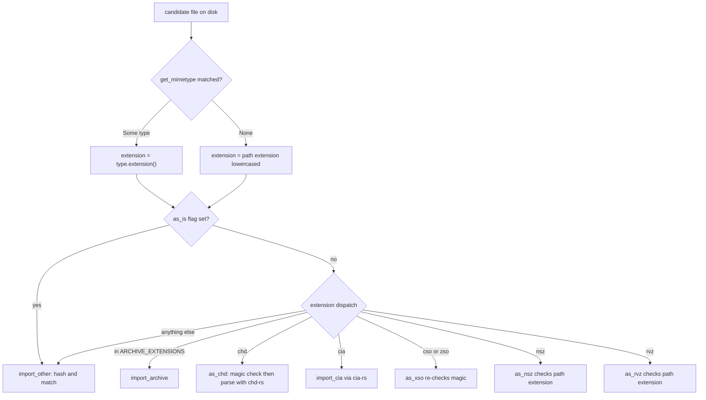

# File Type Detection and Extension Constants

[`src/mimetype.rs`](../../src/mimetype.rs) is 143 lines, but it is the vocabulary
every other module speaks. It owns three things and nothing else:

1. **Extension constants** — one `pub const` per format, always lowercase, always
   without the dot (`ISO_EXTENSION`, `RVZ_EXTENSION`, `SEVENZIP_EXTENSION = "7z"`, …).
2. **Content detection** — a single lazily built `infer::Infer` matcher extended
   with ten ROM-specific magic-byte matchers, exposed as `get_mimetype(path)`.
3. **Extension groups** — `ARCHIVE_EXTENSIONS`, `PS3_EXTENSIONS` and
   `NON_ORIGINAL_EXTENSIONS`, the three sets that downstream control flow tests
   membership against.

Every consumer pulls all of it in with `use super::mimetype::*;` — twenty modules,
from `import_roms` and `convert_roms` down to `wbfs` and `xso` — so there is exactly
one place where `"rvz"` is spelled. There is no registry, no trait and no config
entry: adding a format means editing these lists.

One format deliberately sits *below* this vocabulary. `.chd` is a single extension
covering four logically different containers, so its real type is resolved by
parsing the file with chd-rs, not by sniffing its first bytes. That split is
described in [CHD: one extension, four types](#chd-one-extension-four-types) below.

## Magic-byte matchers

`MATCHER` is a `static LazyLock<Infer>` built once by `init_matcher()`, which starts
from `Infer::new()` (so the crate's built-in container detection — zip, 7z, gzip —
is available too) and layers ten custom matchers on top:

| Matcher | Magic | Registered as | Notes |
| --- | --- | --- | --- |
| `bps_matcher` | `42 50 53 31` `"BPS1"` | `application/x-bps` → `bps` | |
| `chd_matcher` | `4D 43 6F 6D 70 72 48 44` `"MComprHD"` | `application/x-chd` → `chd` | 8 bytes, mixed case |
| `cso_matcher` | `43 49 53 4F` `"CISO"` | `application/x-cso` → `cso` | |
| `ips_matcher` | `50 41 54 43 48` `"PATCH"` | `application/x-ips` → `ips` | 5 bytes |
| `ird_matcher` | `33 49 52 44` `"3IRD"` | `application/x-ird` → `ird` | |
| `rdsk_matcher` | `52 44 53 4B` `"RDSK"` | `application/x-rdsk` → `rdsk` | Saturn HD image |
| `riff_matcher` | `52 49 46 46` `"RIFF"` | `application/x-riff` → `riff` | Saturn/LaserDisc container |
| `rvz_matcher` | `52 56 5A 01` `"RVZ"` + `0x01` | `application/x-rvz` → `rvz` | version byte pinned to 1 |
| `xdelta_matcher` | `D6 C3 C4` | `application/x-xdelta` → `xdelta` | 3 bytes |
| `zso_matcher` | `5A 49 53 4F` `"ZISO"` | `application/x-zso` → `zso` | note the magic is `ZISO`, not `ZSO` |

Each matcher is a pure `&[u8] -> bool` that checks the buffer length before indexing,
so a truncated header returns `false` rather than panicking. `RVZ` pins the fourth
byte to `0x01`: a future RVZ version would not be detected by magic and would fall
through to extension-based handling.

`get_mimetype` is the only public entry point:

```rust
pub async fn get_mimetype<P: AsRef<Path>>(path: &P) -> Result<Option<Type>>
```

It borrows the shared static matcher, so one table serves every caller, and it maps
I/O problems to `"Failed to infer MIME type"`. `Ok(None)` means "no matcher fired" —
that is a normal answer, not an error, and callers are expected to fall back to the
file name. The returned `Type`'s `extension()` is the exact constant registered above,
which is why the whole codebase can compare `mimetype.extension()` against
`CHD_EXTENSION` and friends.

Because built-in matchers share the table, `gz`, `zip` and `7z` can come back from
`get_mimetype` even though none of them is registered in `init_matcher()`. That is
load-bearing: `import_irds::parse_ird` accepts a gzipped IRD precisely because
`mimetype.extension()` reports `gz` and it wraps the reader in a `GzDecoder`, and the
`ARCHIVE_EXTENSIONS.contains(&mimetype.extension())` tests in `import_roms` and
`rebuild_roms` would otherwise never fire.

## The three extension groups

```rust
pub static ARCHIVE_EXTENSIONS: [&str; 2] = [SEVENZIP_EXTENSION, ZIP_EXTENSION];
pub static PS3_EXTENSIONS: [&str; 3] = [PKG_EXTENSION, PUP_EXTENSION, RAP_EXTENSION];
pub static NON_ORIGINAL_EXTENSIONS: &[&str] = &[
    CHD_EXTENSION, CSO_EXTENSION, NSZ_EXTENSION, RVZ_EXTENSION, ZSO_EXTENSION,
    SEVENZIP_EXTENSION, ZIP_EXTENSION,
];
```

These are not documentation; they are the predicates that decide real behavior.

| Group | Read by | What membership changes |
| --- | --- | --- |
| `ARCHIVE_EXTENSIONS` | `import_roms::main` (`--extract`), `import_rom`, `rebuild_roms`, `check_roms`, `CommonRomfile::get_sorted_path` | the file is unpacked and its entries matched individually instead of being hashed as one file; arcade games stop getting a per-game subfolder |
| `PS3_EXTENSIONS` | `import_roms::import_archive` | a single-file archive whose inner ROM is `pkg`/`pup`/`rap` is renamed `{game.name}.{archive ext}` rather than `{rom name}.{archive ext}` |
| `NON_ORIGINAL_EXTENSIONS` | `import_dats`, `CommonRomfile::get_sorted_path` | a DAT ROM with such an extension is stored with `roms.original = false`; sorted paths name the file after the *game* instead of the DAT rom name |

`NON_ORIGINAL_EXTENSIONS` is the seam between "the file the DAT describes" and "a
recompression of it". `import_dats` sets `original = !NON_ORIGINAL_EXTENSIONS.contains(ext)`,
and `convert-roms` then loads its work through `load_rom_data(connection, games, true)`,
which filters on `original = true` (`export-roms` passes `false` and takes everything).
Drop a format out of this list and conversion starts treating its compressed containers
as catalog originals. Note the corollary for MAME: its DATs list CHDs as `<disk name="game">`
with **no extension at all**, so those rows are non-original because no extension is
present, not because the list matched — `original` is computed with `is_some_and`, and a
missing extension is itself a "not an original" answer.

`get_sorted_path` takes an explicit `extension` override that production callers pass
as `None`, falling back to the file's own extension, and then applies the same group:
a non-original extension yields `{game.name}.{ext}` (or `{rom.name}.{ext}` for arcade
non-archives), while an original keeps `rom.name` unless the system defines a
`custom_extension`.

## Two dispatch styles, and why they differ

The single most important rule when changing formats: **only the import path looks at
file content; the batch paths look at the stored path.**



Import dispatch in `import_rom()`: resolve one extension string from content or file
name, then pick the per-format handler unless `--as-is` bypasses it.

*Import resolves one unknown file, so it prefers content.* `import_rom` computes
`get_mimetype(&romfile.path)` and uses `mimetype.extension()` when a matcher fired,
falling back to `path.extension()` lowercased when it did not — that single resolved
string then drives the archive / CHD / CIA / CSO / NSZ / RVZ / ZSO / plain cascade in
[`import_roms.rs`](../../src/import_roms.rs). Everything in that cascade
is also gated on `!as_is`, so `--as-is` routes any container straight to
`import_other` regardless of what it contains. `import_roms::main` uses the same
detection twice more: to give CHDs that declare a parent import priority over their
parents — a priority computed by parsing each candidate with `parse_chd`, not by
looking at the name — and to unpack top-level archives under `--extract` before
walking them.

*Conversion and export partition thousands of known DB rows,* so they never touch the
filesystem for type information: `partition_games_by_extensions` and
`partition_games_by_all_extensions` in [`src/common.rs`](../../src/common.rs) split an
`IndexMap<i64, Vec<Rom>>` by testing `romfile.path.ends_with(extension)` against the
stored `romfiles.path` string. The same string-suffix idiom appears in
`generate_playlists` and in `util`'s parent-CHD lookup. `check_roms` goes one step
further and dispatches on `Path::extension()` of the resolved path. The consequence is
a real invariant: once a file is in the database, **its recorded extension, not its
bytes, selects the pipeline.** A CHD renamed `.iso` is converted as an ISO.

Where that is not enough, the conversion code re-queries the mimetype locally. Two
representative spots in [`src/convert_roms.rs`](../../src/convert_roms.rs): after
extracting a single file out of an archive, the extension is taken from the extracted
name and *overridden by the mimetype* unless it is `iso`, then matched against
`iso` / `rdsk` / `riff` to pick the CD/HD/LD CHD settings; and the leftover `others`
partition (everything that is not archive, CUE/BIN, ISO, CSO, ZSO or CHD) is typed
entirely by `get_mimetype`, because arcade RDSK and RIFF payloads carry no usable
extension. Anything unmatched prints `"Unsupported file type, skipping"` rather than
failing the run. RDSK and RIFF matter here and nowhere else in dispatch: no import,
check or export branch keys on those two constants, so content sniffing is the only
route to them.

## CHD: one extension, four types

`mimetype` can only ever answer `chd` — every CHD shares the `MComprHD` magic. The
actual type is resolved one level down, by opening the container with chd-rs:
`AsChd::parse_chd` in [`src/chd.rs`](../../src/chd.rs) runs `Chd::open` on the
blocking pool and returns `(ChdType, size, data sha1, chd sha1, parent sha1,
track_count)` from the header and metadata chain, mapping `chd_rs::ChdType::{Cd, Dvd,
Ld}` to the local `ChdType` and everything else to `Hd`. Nothing in this step consults
an external tool, and there is no version or capability gate any more: `chd::get_version()`
returns the literal `built-in`.

This has three consequences worth internalising:

- **A CHD's hash and size come from the header, not from a read pass.** A CD reports
  size `0` and an empty data SHA-1 because a CD has no single logical size or hash;
  the other three types report `logical_size` and `data_sha1`, and `track_count` is
  taken from the CD table of contents (`1` for everything else).
- **Parent resolution is content-driven too.** `as_chd` scans the file's own directory
  for a sibling CHD whose file SHA-1 equals the header's `parent_sha1`;
  `as_chd_with_parent` accepts a caller-supplied parent and bails with
  `Parent CHD SHA1 mismatch` when it disagrees. `transcode::romfile_as_chd` picks
  between the two depending on whether the database records a `parent_id`, and it is
  the single entry point `check_roms`, `convert_roms` and `export_roms` all use.
- **Each type round-trips through its own neutral format.** `ChdType::Dvd` extracts to
  `.iso`, `ChdType::Hd` to `.rdsk`, `ChdType::Ld` to `.riff` (a RIFF/AVI, not a
  sheet-and-BIN layout), and `ChdType::Cd` to a CUE plus per-track BINs. The extracted
  file is then re-validated through `as_iso` / `as_rdsk` / `as_riff`, so the magic
  matchers for `rdsk` and `riff` are what make a CHD extraction verifiable — the LD
  route in particular goes through RIFF on the way out and back in again.

After import has typed the container, the *naming* still follows the extension rules:
`import_chd` renames the CHD to `{rom.name}.chd` for DVD/HD/LD (with a `{game.name}/`
subfolder on arcade systems, and `{game.name}.chd` for a CD whose tracks all matched
one game).

## Format-entry guards are not uniform

The `As*` traits that turn a `CommonRomfile` into a typed romfile validate in two
different ways, and the difference is visible from the outside:

- **Content-gated:** `as_chd`, `as_riff`, `as_rdsk` and `as_xso` call `get_mimetype`
  and `bail!("Not a valid …")` when nothing matches; `as_chd` then goes further and
  parses the container. `as_xso` even derives its `XsoType` from
  `XsoType::from_str(mimetype.extension())`, so `cso` and `zso` share one romfile type.
  `import_patches::parse_patch` is content-only as well:
  `PatchType::from_str(mimetype.extension())`, with no fallback at all, so a bogus
  patch file is simply reported as `"Unsupported patch format"`.
- **Extension-gated:** `as_iso`, `as_cue_bin`, `as_rvz`, `as_nsz` and `as_nsp` compare
  `path.extension()` lowercased to the constant, and `AsArchive::as_archive` maps the
  extension through `ArchiveType::from_str`.

`rvz` therefore has a magic-byte matcher that its own entry guard never consults — the
matcher exists for the batch partitioning and for content-first callers — while `nsz`
and `nsp` have no matcher at all and are typed by name alone. A mislabeled `.rvz` is
accepted by `as_rvz` and fails later inside the format library, while a mislabeled
`.chd` is rejected at the guard.

That distinction has a cost in `check_roms`, which is the one dispatcher that does not
tolerate a failed format entry. `check_system` dispatches the resolved path's extension
to archive / CHD / CSO / NSZ / RVZ / ZSO / plain checks **without lowercasing it**, so
`game.CHD` never reaches the CHD branch; and inside the CHD, CSO and ZSO branches the
guard calls use `?` (`romfile_as_chd`, `as_xso`, and likewise `as_nsz` / `as_rvz`), so a
container that fails to open or whose bytes are not `CISO`/`ZISO` aborts the whole
system's check rather than being reported as one failed file and moved to Trash. Only
errors returned from a completed `check()` call take the report-and-trash path.

## Checklist for adding a new format

`AGENTS.md` prescribes the module work; the detection-and-dispatch side is the list
below, and skipping any one of its first four steps produces silent misbehaviour rather
than a compile error.

1. **Add the extension constant** in `mimetype.rs`: `pub const FOO_EXTENSION: &str = "foo"`,
   lowercase, no dot. Lowercase matters — the fallback paths lowercase the file name
   before comparing, so a constant with a capital letter never matches.
2. **Add and register a matcher** if the format has magic bytes: a `fn foo_matcher(buf: &[u8]) -> bool`
   that checks `buf.len()` first, plus `matcher.add("application/x-foo", FOO_EXTENSION, foo_matcher)`
   in `init_matcher()`. Without the registration, content detection is impossible and
   `--as-is`-style misnamed files are mis-routed.
3. **Update the extension groups that downstream dispatch reads:**
   - add to `NON_ORIGINAL_EXTENSIONS` if the format is a recompression no DAT lists —
     otherwise DAT rows for it are marked `original = true` and `convert-roms` starts
     selecting them;
   - add to `ARCHIVE_EXTENSIONS` only if it is a multi-entry container whose members
     must be hashed individually (this also changes arcade folder placement);
   - add to `PS3_EXTENSIONS` only for PS3 package siblings.
4. **Wire the dispatch** — a branch in `import_rom()` on the resolved extension, a
   matching `As*` guard, a branch in `check_roms`, and a `partition_games_by_extensions`
   split in each `convert_roms` / `export_roms` per-format function. Remember that these
   batch sites match the stored path as a **string suffix**, not a parsed extension.
5. **Sub-dispatch on the parsed type if the format has several.** CHD is the precedent:
   one extension, then `match chd_romfile.chd_type` in `import_chd`, `Check::check`, and
   every conversion and export loop, each arm choosing its own neutral format and its
   own settings group (`CHD_CD_*`, `CHD_DVD_*`, `CHD_HD_*`, `CHD_LD_*`).
6. **Register the module** in `src/main.rs` and add matcher tests.

## Focused tests

Each matcher has its own module — `src/mimetype/test_bps_matcher.rs` through
`test_zso_matcher.rs`, wired in with `#[cfg(test)] mod test_*;` at the bottom of
`mimetype.rs` — and each asserts the same three cases: `test_valid` (exact magic),
`test_invalid` (right length, wrong bytes) and `test_too_short` (the magic minus one
byte). There is no test for `get_mimetype` itself; end-to-end detection is covered
indirectly by the per-format import tests (`test_zip_single_file`, `test_iso_chd`,
`test_rvz`, `test_cso`, `test_zso`, `test_cia`) which copy fixtures from `tests/` and
assert where the romfile landed. When you change a group membership, these are the
tests that catch it, since they exercise the dispatch the group drives rather than the
list itself.

The LD and HD CHD paths are covered by fixtures rather than by an import test of their
own. `tests/Test Game (USA, Europe) (LD).riff` feeds
[`src/chd/test_ld.rs`](../../src/chd/test_ld.rs), the round-trip test that asserts a
RIFF → CHD → RIFF → CHD cycle yields a byte-identical second CHD and that the parsed
container reports `ChdType::Ld` with a non-zero size.
`tests/Test Game (USA, Europe) (RDSK).chd` feeds `import_roms/test_mame_chd.rs` and
`test_mame_mixed.rs`, which import an arcade `<disk>` entry and assert the file lands
at `{system}/{game}/{rom}.chd` — the HD-with-arcade-subfolder rule. Both run entirely
in process; no test resolves a `chdman` binary, which survives only as the reference
the chd-rs crate compares itself against.
