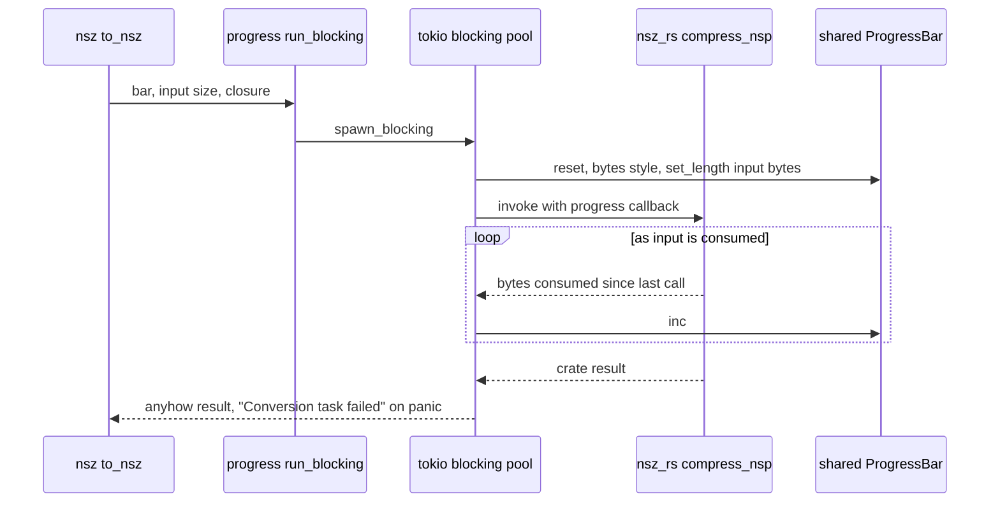
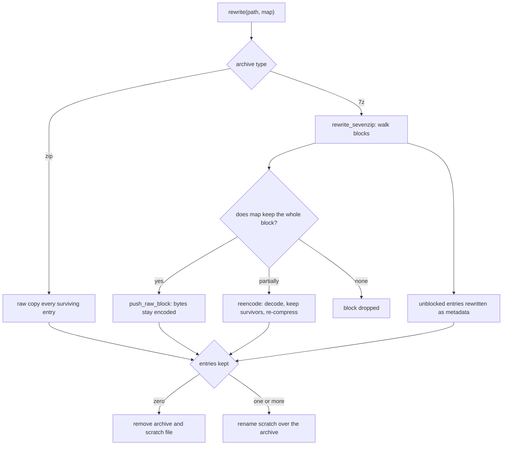

# Format Modules and Their Crate Backends

oxyromon keeps one module per format family in `src/`. Each module is a thin,
opinionated adapter between the [CommonRomfile trait system](romfile-trait-system.md)
and one backend: an in-process Rust crate, or an external executable found on
`${PATH}`. The distinction is visible from three places — `oxyromon info`, the
GraphQL `dependencies` query and the MCP `status` tool — and it decides what a
user must install, how progress is reported, and whether a format works at all
when a dependency is missing.

## Module → backend → formats

| Module | Backend | Formats | `get_version()` |
| --- | --- | --- | --- |
| `archive` | `sevenz-rust2` + `zip` (in-process) | 7z, ZIP | `"built-in"` |
| `rvz` | `nod` (in-process) | RVZ | `"built-in"` |
| `wbfs` | `nod`, via `rvz::write_disc` | WBFS | none — reported under `nod` |
| `xso` | `xso-rs` (`crates/xso-rs`) | CSO, ZSO | `"built-in"` |
| `nsz` | `nsz-rs` (`crates/nsz-rs`) | NSP, NSZ | `"built-in"`, or `"built-in, prod.keys not found"` |
| `gdi` | `gdi-rs` (`crates/gdi-rs`) | GDI + track BINs | none |
| `xdelta` | `xdelta-rs` (`crates/xdelta-rs`) | XDELTA patches | `"built-in"` |
| `xps` | `xps-rs` (`crates/xps-rs`) | IPS, BPS patches | `"built-in"` |
| `iso` | in-module Rust, a port of bchunk | CUE/BIN → ISO; vendored ISO 9660 reader | none |
| `crc32` | `crc32fast` behind `digest` traits | CRC32 hashing primitive | none |
| `chdman` | external `chdman` executable | CHD (CD/DVD/HDD/LD) | version parsed from its output |
| `ctrtool` | external `ctrtool` executable | CIA | version parsed from its output |

Every built-in backend returns the literal string `"built-in"` from
`get_version()` because a linked library has no runtime version to query; the
function exists only so the dependency table has one uniform shape. `nsz` is the
exception with content: it appends `prod.keys not found`, since keys are needed
only when compressing an NSP whose members include NCAs, and the warning exists
so a user does not discover the missing file mid-compression. `gdi`, `iso`,
`wbfs` and `crc32` export no `get_version()` at all, so they appear in no
dependency table.

Only two entries can actually fail, and only one of them is load-bearing for the
conversion path. `convert_roms::format_available` and `export_roms::main` treat
every format as available except `"CHD"`, which is probed through
`util::tool_available(chdman::get_version, …)`; `ctrtool` is probed separately
where CIA files are imported. `info` prints a failing probe as
`<name>: not found`, GraphQL and MCP report it as a null version.

`chdman` additionally gates features on its *version*, not just its presence:
`MIN_SPLITBIN_VERSION = "0.265"` for multi-track CHDs and
`MIN_DREAMCAST_VERSION = "0.264"` for creating Dreamcast CHDs. Callers compare
the parsed version string and skip the game with a warning rather than
attempting a command the installed tool cannot run. See
[External Tool Integration](../integrations/external-tools.md) for the
shelling-out recipe itself.

## The shape every module shares

A format module is a wrapper type over `CommonRomfile` plus a small set of
trait impls. The naming convention is fixed: `As*` parses a file that already
exists into the wrapper, `To*` converts *from* another format into it.

- `As*` validates and wraps. `as_rvz` checks the extension against
  `RVZ_EXTENSION`; `as_xso` and `as_chd` call `get_mimetype` so the content has
  to match, not just the name; `as_gdi` additionally rejects track files whose
  extension is neither `bin` nor `raw`; `as_xps` accepts `bps` or `ips`. A
  wrapper is a claim about the file, so an `As*` that does not verify anything
  would let a misnamed file through to a decoder.
- `To*` produces a file. It picks the destination name (`file_name()` with
  `with_extension`), prints an action line, drives the backend, and returns the
  new wrapper — built by running `CommonRomfile::from_path` through the matching
  `As*` so the result is re-validated on the way out.
- `HashAndSize` and `Check` for a compressed format decode into a temp
  directory and delegate to the decoded format, deleting the decoded file
  afterwards. `NszRomfile` decompresses to NSP, `XsoRomfile` decompresses to
  ISO, `ChdRomfile` dispatches on `ChdType`. This is the shared cost of the
  design: verification means a full decode unless the module can hash the
  decoded stream directly.

The modules themselves hold no I/O policy for the temp directory — that comes
from `config::create_tmp_directory` — and no argument parsing; per-system
settings are read by the workflow layer (`convert_roms`, `export_roms`) and
passed in as plain parameters such as compression algorithm, level and block
size.

## `run_blocking`: the in-process crate adapter

The format crates are synchronous and CPU-bound by convention. Handing one a
tokio worker thread would stall the runtime for the length of a several-gigabyte
compression, so `progress::run_blocking` is the single adapter:

```rust
pub async fn run_blocking<T, E>(
    progress_bar: &ProgressBar,
    length: u64,
    work: impl FnOnce(&mut dyn FnMut(u64)) -> Result<T, E> + Send + 'static,
) -> anyhow::Result<T>
```

It clones the shared bar, moves the closure to `spawn_blocking`, resets the bar
to the bytes style with `length` — the input bytes the crate will consume, which
its `progress: &mut dyn FnMut(u64)` callback reports incrementally — and maps a
`JoinError` to `"Conversion task failed"`, distinct from the crate's own error.
Callers supply `length` as `input.metadata()?.len()`, or as
`gdi_rs::input_size(&cue)` where the input is a CUE and its BINs. It is used by
`gdi`, `nsz`, `xdelta`, `xps` and `xso`.



*Caption: how a synchronous format crate runs behind the async progress bar.*

Subprocess-backed modules cannot do this. `chdman` drives its commands through
`util::run_tool`, which waits for exit and bails with the tool's stderr, and
`ctrtool` calls `Command::output` directly only so it can exclude one tolerated
tool error (below); neither reports measurable progress, so both modules use
`start_action`/`stop_action` for a spinner-plus-message line instead. `nod` sits
in between: `rvz.rs` drives it directly on `spawn_blocking` rather than through
`run_blocking`, because the crate exposes a `Read`er and a writer callback with
its own progress semantics rather than a bytes-consumed closure.

## `archive.rs`: entry-level edits that must not re-encode

`archive.rs` is the only module that edits an existing container in place, and
its design goal is to never re-compress bytes it did not have to. Renaming,
deleting and appending all route through `rewrite`, which copies entries **raw**:

- **ZIP** — `by_index_raw` plus `raw_copy_file` / `raw_copy_file_rename`. The
  compressed data and its CRC are moved verbatim into a new central directory.
- **7z** — `rewrite_sevenzip` walks the archive block by block. A block whose
  entries all survive `map` is copied with `push_raw_block`, so its already
  encoded bytes and `pack_sizes` are bit-identical to the source. Only a **solid
  block that loses some of its entries** is decoded, kept entries written to a
  scratch `TempDir` beside the archive, and re-encoded. A block that loses every
  entry is dropped entirely. Entries with no block — directories and empty
  files — are rewritten as metadata only.



*Caption: `archive.rs` copy-on-write rewrite; only a partially pruned solid 7z block is re-encoded.*

Three consequences worth knowing before changing this file:

1. **A rewrite that empties an archive deletes it.** `replace` removes both the
   scratch file and the original when `kept == 0`, and
   `ArchiveRomfile::delete_file` additionally removes the archive file itself
   once it parses empty. Deleting an archive's last entry is therefore the way
   the archive disappears; callers still own the database row.
2. **Scratch files are `<whole archive name>.oxyromon-tmp` in the same
   directory.** `temporary_path` keeps the entire original name so that
   `game.7z` and `game.zip` being rewritten in one directory simultaneously
   cannot collide on one scratch file.
3. **Appending is an append, not a rebuild.** `create` opens an existing archive
   with `ZipWriter::new_append`, or runs `rewrite_sevenzip` with an `add` closure
   that writes the new entry. Either way the existing blocks keep their original
   encoded bytes. The `solid` parameter is deliberately unused here — one entry
   arrives per call — and the file carries a TODO to batch `to_archive` so a
   game's files land in one solid block.

**Zstandard is readable and writable in `archive.rs` and nowhere else.** The
`zip` dependency is built with `deflate` + `zstd` and `sevenz-rust2` with
`zstd`, and neither crate is used outside this module. `get_archive_compression`
maps the settings keys onto an `ArchiveCompression` variant with the algorithm's
own scale: `SEVENZIP_COMPRESSION_ALGORITHM` / `ZIP_COMPRESSION_ALGORITHM` select
`lzma2`, `deflate` (ZIP only) or `zstd`, with `SEVENZIP_ZSTD_COMPRESSION_LEVEL` /
`ZIP_ZSTD_COMPRESSION_LEVEL` on a 1–22 scale defaulting to 19 — the level
RomVault writes — while `SEVENZIP_COMPRESSION_LEVEL` / `ZIP_COMPRESSION_LEVEL`
run 1–9 and default to 9. Unset algorithm means `ArchiveCompression::Default`.
Rewriting a 7z preserves its codec: `is_zstd` inspects the block coders and
re-applies Zstandard at the default level, so a zstd archive never silently
drifts back to LZMA2. LZMA2 is configured with a chunk size of 1, asking for the
finest split its dictionary allows.

Reading is per-entry: `extract` for 7z uses `BlockDecoder` and, because entries
in a solid block share one stream, drains the ones it is not after into
`io::sink()` rather than failing. `copy_files_between_archives` (used by
`rebuild-roms` when merging arcade sets between ZIPs) raw-copies between two
archives and calls `finish()` explicitly — dropping the writer would swallow a
central-directory write failure and leave a corrupt archive behind.

`ArchiveRomfile` also short-circuits hashing: it carries the entry's `size` and
`crc` as recorded when the archive was parsed, so a CRC check of a file inside a
container needs no extraction at all.

## `rvz.rs` and `wbfs.rs`: one disc pipeline, two containers

WBFS is only about forty lines because it borrows everything from `rvz.rs`. The
shared pieces are `open`, which pins `PartitionEncryption::Original` with four
preloader threads so a decoded disc reproduces the source exactly — partition
hashes and encryption left as they are, making an extracted ISO byte-for-byte
what went in — and `write_disc`, which builds a `DiscWriter` for a caller-supplied
`FormatOptions`, streams output to a file, and applies `finalization.header` by
rewinding and rewriting the file start, because RVZ and WBFS only know their
header once every block has been written. WBFS calls
`write_disc(.., FormatOptions::new(Format::Wbfs))` and adds nothing: no
compression, no block size, no settings keys.

`write_disc` also sizes the machine to the job: `processor_threads` maps the
writer's own `DiscWriterWeight` to 0, `min(available, 4)`, or all cores, and
progress is bounded by `writer.progress_bound()` — progress through the
*source*, which for a compressing format bears no relation to bytes written out.
All five `digest_*` options are off; oxyromon hashes discs itself.

`RvzRomfile` is the only wrapper in the module set that avoids the
decode-to-temp-directory cost: `hash_disc` treats the `DiscReader` as a plain
`Read`er and feeds `common::hash_reader` directly, so a dual-layer Wii disc is
verified without writing several gigabytes to the temp directory and reading them
back. `Check` follows the same path unless a DAT declares a header — no GameCube
or Wii DAT does — in which case it falls back to extracting an ISO so header
stripping can happen.

**`RVZ_SCRUB` is accepted and ignored, with a warning.** It is a real settings
key (a boolean read by `export_roms`), but `write_disc` hardcodes
`ScrubLevel::None` because nod cannot scrub RVZ. `ToRvz for IsoRomfile` prints
`RVZ_SCRUB is unsupported by nod, writing unscrubbed` and proceeds rather than
failing the export. The setting is not entirely inert: `export_roms::to_rvz`
still distinguishes the cases — an already-RVZ source is copied verbatim when
scrub is off, and re-encoded through a temp ISO when it is on, which is the only
way to honour the intent. `convert_roms` never reads the key at all and passes
`false`.

Compression mapping is the other defensive spot: `RVZ_COMPRESSION_LEVEL` ranges
1–22, but only Zstandard accepts that range, so `compression()` **clamps**
rather than rejects for `bzip2`, `lzma` and `lzma2` (1–9), keeping an existing
configuration working instead of failing the conversion. `RVZ_BLOCK_SIZE` is
stored in KiB and multiplied by 1024 for nod.

## `chdman.rs`: one tool, four CHD personalities

`ChdType` (`Cd`, `Dvd`, `Hd`, `Ld`) is the module's controlling fact. It comes
from parsing `chdman info -i` output — the `Metadata:` fourcc, `Logical size`,
`Data SHA1`, `SHA1`, optional `Parent SHA1` and a `TRACK:` count — and it
determines what a CHD converts to and out of: CD ↔ CUE/BIN, DVD ↔ ISO,
HD ↔ RDSK, LD ↔ RIFF. The four destination traits (`ToCueBin`, `ToIso`,
`ToRdsk`, `ToRiff`) and their `As*` counterparts all live here, and the command
subcommand is derived from the same enum (`createcd`/`createdvd`/`createhd`/
`createld`, and `extractcd`/… on the way back).

Two behaviours are easy to break:

- **A CD-type CHD has no size or hash of its own.** `Size` and `HashAndSize`
  `bail!("Not possible")` for `ChdType::Cd`; the caller must go through
  `to_cue_bin` and check each BIN against its own DAT row.
- **Parents are resolved by content, not name.** `as_chd` reads `Parent SHA1`
  and scans sibling files, running `parse_chd` on each candidate CHD until one
  reports a matching SHA1; `as_chd_with_parent` takes an explicit parent
  (from the database's `romfile.parent_id`, via `transcode::romfile_as_chd`)
  and fails loudly on a mismatch. Extract and create then pass `-ip` / `-op`.

Multi-track extraction uses chdman's splitbin mode: the output pattern carries a
`%t` placeholder, and the module expands it per track and renames each BIN to
its DAT rom name.

## `ctrtool.rs`: CIA is a listing plus a TMD patch-up

The CIA path is a parse followed by an extract, both shelling to `ctrtool -p -v`.
`parse_cia` scrapes stdout for `TitleVersion`, `TitleMetaSize` and each
`ContentId`/`Size` pair, then appends a synthetic entry named `tmd.{version}`
whose size is the TMD plus the 0x300 TMD cert and the 0x400 CA cert.
`extract_files_from_cia` re-runs the tool with `--certs`, `--tmd` and
`--contents`, scrapes *stderr* for the saved content names, and then performs the
certificate surgery itself: it appends the TMD cert and the CA cert to the
extracted `tmd` file so the result matches what the size implied.

Both calls tolerate one specific failure — `NcchHeader is corrupted (Bad struct
magic)` on stdout — because it is the expected result of `-p` on a non-homebrew
title. Removing that allowance makes retail CIA imports fail. Note that neither
call goes through `util::run_tool`: they inspect status themselves precisely so
the tolerated error can be excluded.

## `nsz.rs`: keys as a lazy loader

`nsz_rs` takes a keys *loader* rather than a key set, and oxyromon exploits that.
`load_keys` reads `~/.switch/prod.keys` with CRC verification — matching the
external tool's own sanity check, so a tampered file is rejected instead of
producing garbage — and is handed to the crate as a function that runs only if
the pipeline needs it. Decompression is unverified and never needs keys;
compression needs them only for NSPs holding NCAs, so homebrew NSPs need no
`prod.keys` at all.

The module documents its equivalence to the `nsz` subprocess calls it replaced:
`to_nsp` corresponds to `nsz -D -F` (`fix_padding = true`, `verify = false`,
`strict = false`), and `to_nsz` to `nsz -C -K -L -P` — a solid stream
(`block_size_exponent = None`), long-distance matching on, the nsz default level
18, `fix_padding = false`, with `-K` inherent to the crate (incompressible
members are copied verbatim) and `-P` only needed by the Python tool for
metadata.

## Patches, CUE/BIN, GDI and CRC

`iso.rs`, `gdi.rs`, `xdelta.rs`, `xps.rs` and `crc32.rs` round out the set with
behaviour that is not visible from a format table.

- **`iso.rs` is not a crate** — it is a port of the part of bchunk oxyromon used.
  It reads a CUE the way bchunk does (last `INDEX` of track 1, ending one sector
  before the next track's first index or with its BIN) and copies only the 2048
  bytes of user data per 2352-byte sector, from the first track only. It refuses
  anything that is not `MODE1/2352` (offset 16) or `MODE2/2352` (offset 24), and
  rejects a BIN too short for the range the CUE describes. The module also owns
  the vendored `iso9660` reader that `import-irds` walks.
- **`gdi.rs`** converts Redump CUE/BIN to the GDI set that Dreamcast drive
  emulators load, via `gdi_rs::convert`, reporting `gdi_rs::input_size` as the
  bar length since a CUE pulls in several BINs. It is reachable only from
  `export-roms` (and only for Dreamcast systems, enforced there), not from
  `convert-roms`.
- **`xdelta.rs` and `xps.rs` implement `common::Patch`, which is not wired up
  yet.** Both structs and `As*` traits are `#[allow(dead_code)]`, and the only
  callers are their own tests. `XpsRomfile::patch` does surface one
  backend-specific signal: `xps_rs::apply` returns an optional warning that the
  patch still succeeded under, printed as `Patched, but …`.
- **`crc32.rs`** is not a ROM format at all. It adapts `crc32fast` to the
  `digest` traits *and* to `std::io::Write`, which is what lets
  `common::hash_reader` pipe any decoder's output through
  `progress_bar.wrap_write(&mut digest)` for `HashAlgorithm::Crc`. That
  `Write` impl is the reason a disc image can be hashed while it decodes.

## Adding or changing a format

The seams are narrow and consistent: extension constants and magic-byte matchers
live in [File Type Detection and Extension Constants](file-type-detection-and-extensions.md);
the wrapper traits and `get_version()` entry point live in the format module;
the `ALL_FORMATS` list, per-format settings keys and source partitioning live in
`convert_roms`/`export_roms`; and a new in-process backend goes under
`crates/` following the shared synchronous, file-to-file, `progress`-callback
contract described in [Format Crates in crates/](../integrations/format-crates.md),
then joins the dependency lists in `info.rs`, `query.rs` and `mcp/read.rs` so it
is reportable.
