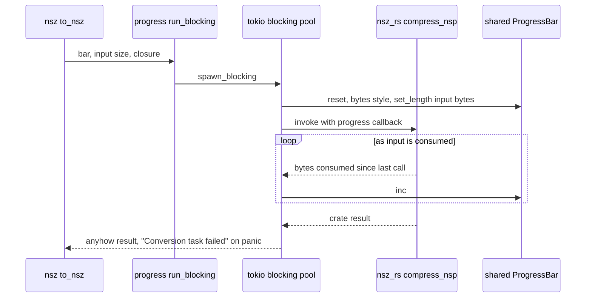
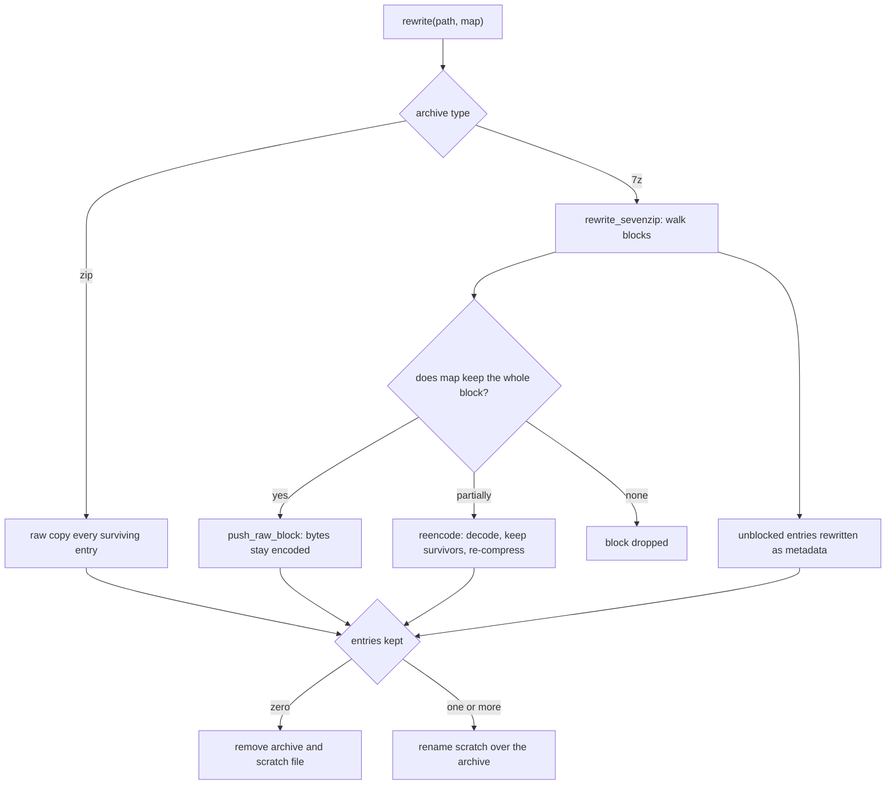

# Format Modules and Their Crate Backends

oxyromon keeps one module per format family in `src/`. Each module is a thin,
opinionated adapter between the [CommonRomfile trait system](romfile-trait-system.md)
and one backend, always an in-process Rust crate: no format module spawns a
process, and oxyromon needs nothing installed on `${PATH}`. The backends are
listed in three places — `oxyromon info`, the GraphQL `dependencies` query and
the MCP `status` tool.

## Module → backend → formats

| Module | Backend | Formats | `get_version()` |
| --- | --- | --- | --- |
| `archive` | `sevenz-rust2` + `zip` (in-process) | 7z, ZIP | `"built-in"` |
| `rvz` | `nod` (in-process) | RVZ | `"built-in"` |
| `wbfs` | `nod`, via `rvz::write_disc` | WBFS | none — reported under `nod` |
| `chd` | `chd-rs` (`crates/chd-rs`) | CHD (CD/DVD/HDD/LD) | `"built-in"` |
| `xso` | `xso-rs` (`crates/xso-rs`) | CSO, ZSO | `"built-in"` |
| `nsz` | `nsz-rs` (`crates/nsz-rs`) | NSP, NSZ | `"built-in"`, or `"built-in, prod.keys not found"` |
| `gdi` | `gdi-rs` (`crates/gdi-rs`) | GDI + track BINs | none |
| `xdelta` | `xdelta-rs` (`crates/xdelta-rs`) | XDELTA patches | `"built-in"` |
| `xps` | `xps-rs` (`crates/xps-rs`) | IPS, BPS patches | `"built-in"` |
| `iso` | in-module Rust, a port of bchunk | CUE/BIN → ISO; vendored ISO 9660 reader | none |
| `crc32` | `crc32fast` behind `digest` traits | CRC32 hashing primitive | none |
| `cia` | `cia-rs` (`crates/cia-rs`) | CIA | `"built-in"` |

Every built-in backend returns the literal string `"built-in"` from
`get_version()` because a linked library has no runtime version to query; the
function exists only so the dependency table has one uniform shape. `nsz` is the
exception with content: it appends `prod.keys not found`, since keys are needed
only when compressing an NSP whose members include NCAs, and the warning exists
so a user does not discover the missing file mid-compression. `gdi`, `iso`,
`wbfs` and `crc32` export no `get_version()` at all, so they appear in no
dependency table.

None of these can fail, so no dependency can be reported missing. CHD and CIA
used to be the two exceptions, each spawning an external tool (`chdman`,
`ctrtool`) and scraping its version; `src/chd.rs` now drives the in-process
`chd-rs` crate and `src/cia.rs` the `cia-rs` crate, so both return
`"built-in"` like the others ([CHD Format and chd-rs](chd-format-and-chd-rs.md)).

Because every conversion target is now linked in, availability is a static
question rather than a runtime probe: `convert_roms::format_available` is a
`matches!` over the eight formats `convert-roms` lists, and `export_roms` accepts
one longer list, adding `GDI`, `ISO` and `WBFS`. Neither consults a tool version,
and `import_roms` dispatches a `.cia` without any probe either.

The version gates that used to guard CHD features are gone with the subprocess.
There is no `MIN_SPLITBIN_VERSION` (0.265, multi-track CHDs) or
`MIN_DREAMCAST_VERSION` (0.264, Dreamcast CHD creation) anywhere in `src/`:
multi-track extraction and GDI-bound Dreamcast conversions are simply features
of `chd-rs`, so no caller has to skip a game because the installed binary is too
old. [External Tools](../integrations/external-tools.md) lists which tool each
crate replaced and which reference tools the crate tests still use.

## The shape every module shares

A format module is a wrapper type over `CommonRomfile` plus a small set of
trait impls. The naming convention is fixed: `As*` parses a file that already
exists into the wrapper, `To*` converts *from* another format into it.

- `As*` validates and wraps. `as_rvz` checks the extension against
  `RVZ_EXTENSION`; `as_xso` and `as_chd` call `get_mimetype` so the content has
  to match, not just the name; `as_gdi` additionally rejects track files whose
  extension is neither `bin` nor `raw`; `as_xps` accepts `bps` or `ips`. A
  wrapper is a claim about the file, so an `As*` that does not verify anything
  would let a misnamed file through to a decoder.
- `To*` produces a file. It picks the destination name (`file_name()` with
  `with_extension`), prints an action line, drives the backend, and returns the
  new wrapper — built by running `CommonRomfile::from_path` through the matching
  `As*` so the result is re-validated on the way out.
- `HashAndSize` and `Check` for a compressed format decode into a temp
  directory and delegate to the decoded format, deleting the decoded file
  afterwards. `NszRomfile` decompresses to NSP, `XsoRomfile` decompresses to
  ISO, `ChdRomfile` dispatches on `ChdType`. This is the shared cost of the
  design: verification means a full decode unless the module can hash the
  decoded stream directly.

The modules themselves hold no I/O policy for the temp directory — that comes
from `config::create_tmp_directory` — and no argument parsing; per-system
settings are read by the workflow layer (`convert_roms`, `export_roms`) and
passed in as plain parameters such as compression algorithm, level and block
size.

## `run_blocking`: the in-process crate adapter

The format crates are synchronous and CPU-bound by convention. Handing one a
tokio worker thread would stall the runtime for the length of a several-gigabyte
compression, so `progress::run_blocking` is the single adapter:

```rust
pub async fn run_blocking<T, E>(
    progress_bar: &ProgressBar,
    length: u64,
    work: impl FnOnce(&mut dyn FnMut(u64)) -> Result<T, E> + Send + 'static,
) -> anyhow::Result<T>
```

It clones the shared bar, moves the closure to `spawn_blocking`, resets the bar
to the bytes style with `length` — the input bytes the crate will consume, which
its `progress: &mut dyn FnMut(u64)` callback reports incrementally — and maps a
`JoinError` to `"Conversion task failed"`, distinct from the crate's own error.
Callers supply `length` as `input.metadata()?.len()`, as `gdi_rs::input_size(&cue)`
where the input is a CUE and its BINs, or as `chd_rs::cd_input_size(&input)` for a
CD CHD, where the bar must track the sheet and its tracks rather than the
container. It is used by `chd`, `gdi`, `nsz`, `xdelta`, `xps` and `xso`.



*Caption: how a synchronous format crate runs behind the async progress bar.*

No module is subprocess-backed any more; `cia.rs`, the last one, runs
`cia_rs::Cia::parse` and `cia_rs::unpack` through `run_blocking` like the others.
`nod` sits in between: `rvz.rs` drives it
directly on `spawn_blocking` rather than through `run_blocking`, because the
crate exposes a `Read`er and a writer callback with its own progress semantics
rather than a bytes-consumed closure. `chd.rs` uses `run_blocking` for both
directions, but not for metadata: `parse_chd` opens the container on
`spawn_blocking` directly, since a header read has no progress to draw.

## `archive.rs`: entry-level edits that must not re-encode

`archive.rs` is the only module that edits an existing container in place, and
its design goal is to never re-compress bytes it did not have to. Renaming,
deleting and appending all route through `rewrite`, which copies entries **raw**:

- **ZIP** — `by_index_raw` plus `raw_copy_file` / `raw_copy_file_rename`. The
  compressed data and its CRC are moved verbatim into a new central directory.
- **7z** — `rewrite_sevenzip` walks the archive block by block. A block whose
  entries all survive `map` is copied with `push_raw_block`, so its already
  encoded bytes and `pack_sizes` are bit-identical to the source. Only a **solid
  block that loses some of its entries** is decoded, kept entries written to a
  scratch `TempDir` beside the archive, and re-encoded. A block that loses every
  entry is dropped entirely. Entries with no block — directories and empty
  files — are rewritten as metadata only.



*Caption: `archive.rs` copy-on-write rewrite; only a partially pruned solid 7z block is re-encoded.*

Three consequences worth knowing before changing this file:

1. **A rewrite that empties an archive deletes it.** `replace` removes both the
   scratch file and the original when `kept == 0`, and
   `ArchiveRomfile::delete_file` additionally removes the archive file itself
   once it parses empty. Deleting an archive's last entry is therefore the way
   the archive disappears; callers still own the database row.
2. **Scratch files are `<whole archive name>.oxyromon-tmp` in the same
   directory.** `temporary_path` keeps the entire original name so that
   `game.7z` and `game.zip` being rewritten in one directory simultaneously
   cannot collide on one scratch file.
3. **Appending is an append, not a rebuild.** `create` opens an existing archive
   with `ZipWriter::new_append`, or runs `rewrite_sevenzip` with an `add` closure
   that writes the new entry. Either way the existing blocks keep their original
   encoded bytes. The `solid` parameter is deliberately unused here — one entry
   arrives per call — and the file carries a TODO to batch `to_archive` so a
   game's files land in one solid block.

**Zstandard is readable and writable for ROM containers in `archive.rs` and
nowhere else.** The `zip` dependency is built with `deflate` + `zstd` and
`sevenz-rust2` with `zstd`; `sevenz-rust2` is confined to this module, while
`zip` also appears in `download_dats.rs` and `import_dats.rs`, where it only ever
*unpacks* a downloaded DAT archive and never chooses a codec.
`get_archive_compression` maps the settings keys onto an `ArchiveCompression`
variant with the algorithm's own scale: `SEVENZIP_COMPRESSION_ALGORITHM` /
`ZIP_COMPRESSION_ALGORITHM` select `lzma2`, `deflate` (ZIP only) or `zstd`, with
`SEVENZIP_ZSTD_COMPRESSION_LEVEL` / `ZIP_ZSTD_COMPRESSION_LEVEL` on a 1–22 scale
defaulting to 19 — the level RomVault writes — while
`SEVENZIP_COMPRESSION_LEVEL` / `ZIP_COMPRESSION_LEVEL` run 1–9 and default to 9.
Unset algorithm means `ArchiveCompression::Default`.
Rewriting a 7z preserves its codec: `is_zstd` inspects the block coders and
re-applies Zstandard at the default level, so a zstd archive never silently
drifts back to LZMA2. LZMA2 is configured with a chunk size of 1, asking for the
finest split its dictionary allows.

Reading is per-entry: `extract` for 7z uses `BlockDecoder` and, because entries
in a solid block share one stream, drains the ones it is not after into
`io::sink()` rather than failing. `copy_files_between_archives` (used by
`rebuild-roms` when merging arcade sets between ZIPs) raw-copies between two
archives and calls `finish()` explicitly — dropping the writer would swallow a
central-directory write failure and leave a corrupt archive behind.

`ArchiveRomfile` also short-circuits hashing: it carries the entry's `size` and
`crc` as recorded when the archive was parsed, so a CRC check of a file inside a
container needs no extraction at all.

Finding a ROM's entry goes through `rom_entries`. `parse` always lists every
entry, and `as_archive(Some(rom))` then keeps those whose path is the ROM's name
or ends in `/<name>`, the way a merged arcade set files a clone's ROM whose name
its parent already uses. When several remain, the ones matching the ROM's CRC
win, and an exact name sorts first. Because every lookup goes through it, the
`<folder>/<name>` arm applies to any archive, not only merged arcade sets.

## `rvz.rs` and `wbfs.rs`: one disc pipeline, two containers

WBFS is only about forty lines because it borrows everything from `rvz.rs`. The
shared pieces are `open`, which pins `PartitionEncryption::Original` with four
preloader threads so a decoded disc reproduces the source exactly — partition
hashes and encryption left as they are, making an extracted ISO byte-for-byte
what went in — and `write_disc`, which builds a `DiscWriter` for a caller-supplied
`FormatOptions`, streams output to a file, and applies `finalization.header` by
rewinding and rewriting the file start, because RVZ and WBFS only know their
header once every block has been written. WBFS calls
`write_disc(.., FormatOptions::new(Format::Wbfs))` and adds nothing: no
compression, no block size, no settings keys.

`write_disc` also sizes the machine to the job: `processor_threads` maps the
writer's own `DiscWriterWeight` to 0, `min(available, 4)`, or all cores, and
progress is bounded by `writer.progress_bound()` — progress through the
*source*, which for a compressing format bears no relation to bytes written out.
All five `digest_*` options are off; oxyromon hashes discs itself.

`RvzRomfile` is the only wrapper in the module set that avoids the
decode-to-temp-directory cost: `hash_disc` treats the `DiscReader` as a plain
`Read`er and feeds `common::hash_reader` directly, so a dual-layer Wii disc is
verified without writing several gigabytes to the temp directory and reading them
back. `Check` follows the same path unless a DAT declares a header — no GameCube
or Wii DAT does — in which case it falls back to extracting an ISO so header
stripping can happen.

**`RVZ_SCRUB` is accepted and ignored, with a warning.** It is a real settings
key (a boolean read by `export_roms`), but `write_disc` hardcodes
`ScrubLevel::None` because nod cannot scrub RVZ. `ToRvz for IsoRomfile` prints
`RVZ_SCRUB is unsupported by nod, writing unscrubbed` and proceeds rather than
failing the export. The setting is not entirely inert: `export_roms::to_rvz`
still distinguishes the cases — an already-RVZ source is copied verbatim when
scrub is off, and re-encoded through a temp ISO when it is on, which is the only
way to honour the intent. `convert_roms` never reads the key at all and passes
`false`.

Compression mapping is the other defensive spot: `RVZ_COMPRESSION_LEVEL` ranges
1–22, but only Zstandard accepts that range, so `compression()` **clamps**
rather than rejects for `bzip2`, `lzma` and `lzma2` (1–9), keeping an existing
configuration working instead of failing the conversion. `RVZ_BLOCK_SIZE` is
stored in KiB and multiplied by 1024 for nod.

## `chd.rs`: one module, four CHD personalities

`src/chd.rs` owns CHD end to end on top of the in-process `chd-rs` crate: the
`ChdType` enum (`Cd`, `Dvd`, `Hd`, `Ld`), the `ChdRomfile` wrapper with its cached
`size`/`sha1`/`chd_sha1`/`track_count`/`parent_romfile`, the `AsChd` and `ToChd`
traits, the RDSK and RIFF pairs it declares itself (`ToRdsk`/`AsRdsk`,
`ToRiff`/`AsRiff`), the `ToCueBin`/`ToIso` impls for `ChdRomfile` (those two
traits come from `common`), and the two private functions that actually move
bytes — `create_chd` and `extract_chd`. `ChdType`
comes from `Chd::open(...).info()` rather than from parsing any tool's text
output: the crate's `chd_type`, `logical_size`, `data_sha1`, `sha1` and optional
`parent_sha1`, with `chd.track_count()` for the track count
(`chd_rs::sha1_hex` renders the digests).

`ChdType` remains the controlling fact. It picks which `chd_rs` entry point runs
(`create_cd` / `create_dvd` / `create_hd` / `create_ld`, and `extract_cd`,
`extract_ld`, or `Chd::extract` on the way back), which format a CHD converts to
(CD ↔ CUE/BIN, DVD ↔ ISO, HD ↔ RDSK, LD ↔ RIFF), and the defaults substituted
when a system names no codecs — chdman's own lists: `cdlz, cdzl, cdfl` for a CD,
`avhu` for a LaserDisc, `lzma, zlib, huff, flac` for DVDs and hard disks.
`codecs()` packs up to four names into the header's four big-endian fourcc slots.

Two behaviours are easy to break:

- **A CD-type CHD has no size or hash of its own.** `parse_chd` returns size 0
  and an empty data SHA-1 for `ChdType::Cd` because only its tracks have them,
  and `Size` and `HashAndSize` `bail!("Not possible")` on that type; `Check`
  instead extracts and verifies each BIN against its own DAT row. A SHA-1 request
  on a non-CD CHD is answered straight from the cached header hash, with no
  decode at all.
- **Parents are resolved by content, not name.** `as_chd` reads `parent_sha1`
  and scans sibling files in the same directory, running `parse_chd` on each
  candidate CHD until one reports a matching file SHA-1; `as_chd_with_parent`
  takes an explicit parent (from the database's `romfile.parent_id`, via
  `transcode::romfile_as_chd`) and fails loudly on a mismatch. On the way out,
  `create_chd` opens the parent so a clone inherits its hunk size when none is
  configured, and `extract_chd` opens through `Chd::open_with_parent`.

Multi-track extraction asks `extract_cd` for a split layout: the output pattern
carries a `%t` placeholder, which the module expands per track and renames each
BIN to its DAT rom name. CD creation sizes the progress bar from
`chd_rs::cd_input_size` rather than the CHD's logical size, since a sheet pulls
in several BINs.

The module also owns the vocabulary behind the CHD settings: four strum enums
(`ChdCd/Dvd/Hd/LdCompressionAlgorithm`) supply the valid choices for
`CHD_*_COMPRESSION_ALGORITHMS`, and `CHD_HUNK_SIZE_RANGE` bounds the four
`CHD_*_HUNK_SIZE` keys — `config` imports both from this module rather than
defining them (the only other CHD setting is the `CHD_PARENTS` boolean, which the
workflow layer reads directly). See
[CHD Format and chd-rs](chd-format-and-chd-rs.md) for what each codec slot and
hunk size does inside the crate.

## `cia.rs`: CIA is a parse plus a TMD patch-up

The CIA path is a parse followed by an unpack, both on the `cia-rs` crate, whose
layout arithmetic and `--plain` extraction reproduce ctrtool's byte for byte so
extracted contents hash the way DATs recorded them. `parse_cia` runs
`cia_rs::Cia::parse`, rejects a SimpleCIA (no title metadata) with `Not a retail
CIA`, and lists each content in file-offset order, named by its content ID as
eight lowercase hex digits — the spelling ctrtool printed and DATs use — then
appends a synthetic entry named `tmd.{version}`.
`extract_files_from_cia` calls `cia_rs::unpack` without the ticket and footer,
then performs the certificate surgery itself: it reads the CA cert (0x400 bytes
at offset 0) and the TMD cert (0x300 bytes at 0x700) from the extracted `certs`
file and appends them, TMD cert first, to the extracted `tmd` file, which is what
the DAT's `tmd.{version}` entry hashes. A missing or short certificate chain is
an error naming the file, not a panic. The two lists come back in the same order,
so `import_cia` zips them.

## `nsz.rs`: keys as a lazy loader

`nsz_rs` takes a keys *loader* rather than a key set, and oxyromon exploits that.
`load_keys` reads `~/.switch/prod.keys` with CRC verification — matching the
external tool's own sanity check, so a tampered file is rejected instead of
producing garbage — and is handed to the crate as a function that runs only if
the pipeline needs it. Decompression is unverified and never needs keys;
compression needs them only for NSPs holding NCAs, so homebrew NSPs need no
`prod.keys` at all.

The module documents its equivalence to the `nsz` subprocess calls it replaced:
`to_nsp` corresponds to `nsz -D -F` (`fix_padding = true`, `verify = false`,
`strict = false`), and `to_nsz` to `nsz -C -K -L -P` — a solid stream
(`block_size_exponent = None`), long-distance matching on, the nsz default level
18, `fix_padding = false`, with `-K` inherent to the crate (incompressible
members are copied verbatim) and `-P` only needed by the Python tool for
metadata.

## Patches, CUE/BIN, GDI and CRC

`iso.rs`, `gdi.rs`, `xdelta.rs`, `xps.rs` and `crc32.rs` round out the set with
behaviour that is not visible from a format table.

- **`iso.rs` is not a crate** — it is a port of the part of bchunk oxyromon used.
  It reads a CUE the way bchunk does (last `INDEX` of track 1, ending one sector
  before the next track's first index or with its BIN) and copies only the 2048
  bytes of user data per 2352-byte sector, from the first track only. It refuses
  anything that is not `MODE1/2352` (offset 16) or `MODE2/2352` (offset 24), and
  rejects a BIN too short for the range the CUE describes. The module also owns
  the vendored `iso9660` reader that `import-irds` walks.
- **`gdi.rs`** converts Redump CUE/BIN to the GDI set that Dreamcast drive
  emulators load, via `gdi_rs::convert`, reporting `gdi_rs::input_size` as the
  bar length since a CUE pulls in several BINs. It is reachable only from
  `export-roms` (and only for Dreamcast systems, enforced there), not from
  `convert-roms`.
- **`xdelta.rs` and `xps.rs` implement `common::Patch`, which is not wired up
  yet.** Both structs and `As*` traits are `#[allow(dead_code)]`, and the only
  callers are their own tests. `XpsRomfile::patch` does surface one
  backend-specific signal: `xps_rs::apply` returns an optional warning that the
  patch still succeeded under, printed as `Patched, but …`.
- **`crc32.rs`** is not a ROM format at all. It adapts `crc32fast` to the
  `digest` traits *and* to `std::io::Write`, which is what lets
  `common::hash_reader` pipe any decoder's output through
  `progress_bar.wrap_write(&mut digest)` for `HashAlgorithm::Crc`. That
  `Write` impl is the reason a disc image can be hashed while it decodes.

## Adding or changing a format

The seams are narrow and consistent: extension constants and magic-byte matchers
live in [File Type Detection and Extension Constants](file-type-detection-and-extensions.md);
the wrapper traits and `get_version()` entry point live in the format module;
the `ALL_FORMATS` list, per-format settings keys and source partitioning live in
`convert_roms`/`export_roms`; and a new in-process backend goes under
`crates/` following the shared synchronous, file-to-file, `progress`-callback
contract described in [Format Crates in crates/](../integrations/format-crates.md),
then joins the dependency lists in `info.rs`, `query.rs` and `mcp/read.rs` so it
is reportable.
