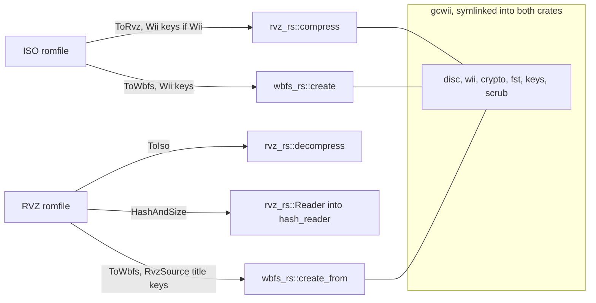

# GameCube and Wii formats: rvz-rs, wbfs-rs and gcwii

oxyromon keeps GameCube and Wii discs as RVZ, Dolphin's compressed disc image,
and can export them as WBFS for the Wii's USB loaders. Both formats are handled
in-process by two format crates of this repository, `rvz-rs` and `wbfs-rs`,
which replaced `dolphin-tool`, `wit` and, after them, the `nod` crate. The disc
specifics both need — layout, Wii partitions and their encryption, the file
system, the common keys, which clusters a disc uses — live in a third crate,
`gcwii`, which is never published and never depended on: it is embedded.

| Piece            | Role                                                                         | Port of                                                                 |
| ---------------- | ---------------------------------------------------------------------------- | ----------------------------------------------------------------------- |
| `crates/rvz-rs`  | RVZ compression, decompression, an RVZ `Reader`, scrubbing; `rvzrs` CLI      | Dolphin's WIA/RVZ code (`WIARVZFileReader`, `LaggedFibonacciGenerator`) |
| `crates/wbfs-rs` | WBFS creation and extraction; `wbfsrs` CLI                                   | `wit copy --wbfs`                                                       |
| `crates/gcwii`   | disc layout, Wii partitions, AES-CBC, FST, keys, scrubbing (`used_clusters`) | Dolphin's `VolumeGC`/`VolumeWii`, `FileSystemGCWii`, `DiscScrubber`     |
| `src/rvz.rs`     | `RvzRomfile`, settings mapping, key loading, hashing without an ISO          | —                                                                       |
| `src/wbfs.rs`    | `ToWbfs` for ISO and RVZ romfiles, `RvzSource`                               | —                                                                       |

## rvz-rs

An RVZ is a disc cut into chunks compressed with Zstandard, bzip2, LZMA, LZMA2
or nothing; a Wii partition's data is stored decrypted and without the hashes
that recomputing gives back, and the padding a disc is filled with is stored as
the seed of the lagged Fibonacci generator that produced it. rvz-rs writes files
interchangeable with Dolphin's in both directions, and with Zstandard, bzip2 or
no compression byte for byte.

The crate follows the format-crate shape: `compress(input, output, &Options,
&keys, progress)` and `decompress(input, output, progress)` are synchronous,
file to file, write to `<output>.part` and rename on success (the shared
`gcwii::io::part`/`finish` helpers). `decompress` reads the disc a Wii group at
a time through a `Reader` and scales its progress from the disc to the input
file, so the calls still add up to the RVZ's size. `Reader::open` exposes the
RVZ as the disc it holds — `size()`, `read_at()`, and `title_keys()`, the title
key of each Wii partition, which an RVZ keeps.

That last point decides where keys are needed. Writing an RVZ from a Wii ISO
must decrypt its partitions, which needs the Wii common key; nothing ships one.
Reading an RVZ, or rewriting one, needs none, and neither does a GameCube disc.
`load_keys` reads a text file of hex keys, a Wii's or a Wii U's `otp.bin`, or a
BootMii `keys.bin`.

Hostile headers are bounded where they cost memory. `writer::is_valid_chunk_size`
accepts a power of two up to a group, or a group multiple up to
`MAX_CHUNK_SIZE` — 16 groups, 32 MiB, well past Dolphin's 2 MiB ceiling — and
`Reader::open` runs the header's chunk size through that same predicate, so a
crafted header cannot make the reader allocate gigabytes for one chunk.

## wbfs-rs

A WBFS is a disc cut into 2 MiB blocks, only those holding something stored,
behind a table mapping each disc block to where it is stored. wbfs-rs writes
one as `wit copy --wbfs` does: the 32 KiB clusters nothing on the disc points to
are left out, or zeroed where they share a block with something used. A WBFS is
therefore scrubbed — no longer the disc it was — which is why oxyromon offers it
as an export format only. The output is wit's byte for byte, but for a leftover
free-block table no reader looks at, and for discs without a boot DOL (Swiss's,
for instance), which wit breaks and wbfs-rs keeps whole.

Finding what a disc uses is `gcwii::scrub::used_clusters`, which must read a Wii
disc's encrypted partitions. `wbfs_rs::create(input, output, &keys, progress)`
takes a raw ISO and the common keys for that. `wbfs_rs::create_from(&mut source,
output, &keys, progress)` takes any `gcwii::disc::Source` — `size`, `read_at`,
and an optional `title_key(data_offset)` — so a source that keeps its title
keys needs no common key at all. `extract` writes a WBFS back out as a disc, its
scrubbed clusters as zeros; it rejects a WBFS whose version is not 1 or whose
disc table holds more than one disc.

## gcwii, the embedded crate

rvz-rs and wbfs-rs both need the same disc code, but a format crate may depend
on no other crate of this repository: each must publish standalone. `gcwii`
resolves that by being embedded rather than depended on:

- `crates/rvz-rs/src/gcwii` and `crates/wbfs-rs/src/gcwii` are symlinks to
  `../../gcwii/src`, declared as `#[path = "gcwii/lib.rs"] mod gcwii;`. `cargo
package` follows the symlink, so each published crate carries a copy.
- The shared test fixtures go the same way: each crate's `tests/common` links
  to `crates/gcwii/tests/common`.
- Within gcwii, paths go through `super::`, never `crate::`, because embedded,
  its root is the host's.
- gcwii's `error::Error` (`Io`, `BadMagic`, `Unsupported`, `InvalidOption`,
  `Corrupt`, `MissingKey`) is each host's `Error`, re-exported. The two hosts'
  errors are then distinct types with the same variants, so oxyromon wraps one
  into the other where they meet.
- gcwii's own manifest is `publish = false`, version `0.0.0`; its dependencies
  (`aes`, `rayon`, `sha1`, `thiserror`) are declared again in each host.

The disc parsers bound what crafted images can demand: the FST validator carries
a `depth` through its recursion and rejects the table past 256 directory levels,
far beyond any real disc, where a chain of nested directories could otherwise
nest as deep as the table is long.

- `tests/crates.rs` enforces the arrangement: `embedded_crates_are_symlinked_in`
  checks that every link listed in `EMBEDDED` resolves to gcwii's `src` or
  `tests/common`, and `embedded_crates_never_name_their_root` fails on any
  `crate::` in gcwii's source. A change to gcwii is a change to both hosts, each
  getting a changelog entry and a release.

## The oxyromon side

`src/rvz.rs` wraps an RVZ in `RvzRomfile` and implements `HashAndSize`,
`Check`, `ToIso`, `AsRvz`, and `ToRvz` for an `IsoRomfile`:

- **Hashing** opens an `rvz_rs::Reader` on the blocking pool, sizes the bar to
  the disc and feeds the reader to `common::hash_reader`. No ISO is written, so
  checking a dual-layer Wii disc does not cost several gigabytes of temp space.
  `Check` extracts an ISO only if a DAT declares a header, which no GameCube or
  Wii DAT does.
- **Compressing** maps the settings in `options()`: `RVZ_COMPRESSION_ALGORITHM`
  onto `Compression`, `RVZ_COMPRESSION_LEVEL` clamped to that codec's
  `levels()` (1–9 but for Zstandard's 1–22), `RVZ_BLOCK_SIZE` from KiB to bytes,
  and `scrub: false` always, as a scrubbed RVZ no longer holds the original
  disc.
- **Keys** come from `load_wii_keys()`: `wiiu_keys.txt` in the data directory,
  where `import-keys` stores the Wii common key along with the Wii U keys, or an
  empty list when the file is missing. Only a Wii disc then fails, and rvz.rs
  turns rvz-rs's `MissingKey` into the hint `A Wii disc needs the Wii common
key: run import-keys`.

`src/wbfs.rs` implements `ToWbfs` for both disc romfiles. From an ISO it calls
`wbfs_rs::create` with `load_wii_keys()`. From an RVZ it wraps the
`rvz_rs::Reader` in `RvzSource`, whose `title_key` looks up the RVZ's stored
title keys, and calls `create_from` with no keys: no common key, and no ISO
decoded on the way. Since wbfs-rs then counts the disc's bytes while the bar
holds the RVZ's size, the progress callback is rescaled from one to the other.
The same `MissingKey` hint applies to an ISO export.

`export-roms` reaches these through `to_rvz` and `to_wbfs` in
`src/export_roms.rs`, each partitioning games into single-ISO archives
(extracted to a temp directory first), ISOs and RVZs. `to_rvz` copies an
existing RVZ verbatim; `to_wbfs` converts all three. `info`, GraphQL and MCP
list both crates as `built-in`.

_Caption: which oxyromon trait reaches which crate entry point, and the shared embedded disc code._

## Tests

Each crate checks itself against its reference implementation and skips rather
than fails when it is missing. `crates/rvz-rs/tests/interop.rs` runs
`dolphin-tool`, found through `$DOLPHIN_TOOL` or `PATH`: a GameCube RVZ must be
Dolphin's byte for byte, Dolphin must read the crate's Wii RVZs, and each must
read the other's LZMA. The synthetic Wii disc is encrypted with a made-up
common key Dolphin does not know, so only a real disc shows that the crate's
Wii RVZs are Dolphin's byte for byte. `crates/wbfs-rs/tests/interop.rs` runs `wit`, through
`$WIT`, and compares the WBFS and the extracted disc with wit's. Real dumps are
opt-in, through `$RVZ_RS_REAL` and `$WBFS_RS_REAL`. Neither tool is installed in
CI. `roundtrip.rs` in each crate covers what needs no reference tool, on the
synthetic discs from the shared `tests/common`. On the oxyromon side, the
`export_roms` and `convert_roms` tests (`test_iso_to_rvz`, `test_rvz_to_rvz`,
`test_iso_to_wbfs`, `test_rvz_to_wbfs`, `test_rvz_to_rvz_should_copy`) run the
real pipeline.

See also [Format Modules and Format Crates](format-modules-and-format-crates.md),
[Format Crates](../integrations/format-crates.md),
[Format Conversion and Export](../workflows/format-conversion-and-export.md),
[Wii U Formats and wux-rs](wii-u-formats-and-wux-rs.md) and
[Format Crate Tests](../testing/format-crate-tests.md).
