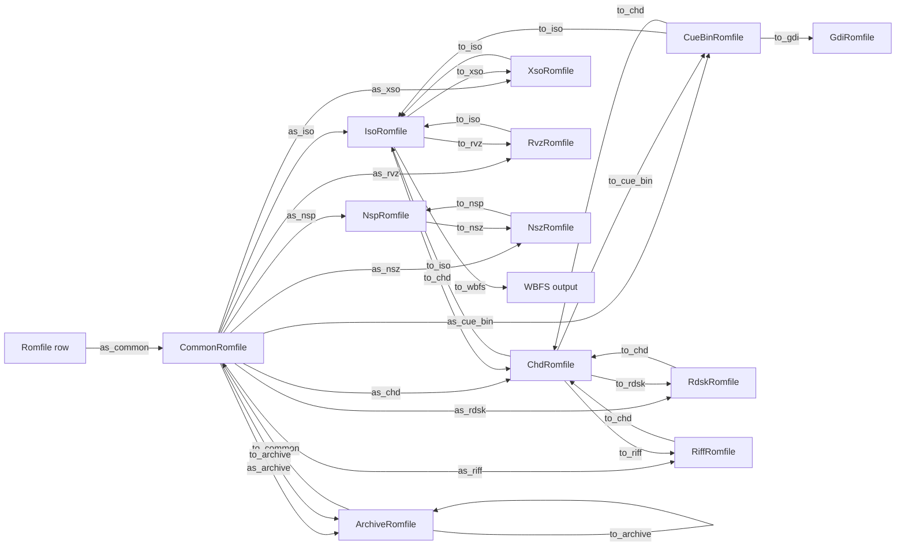
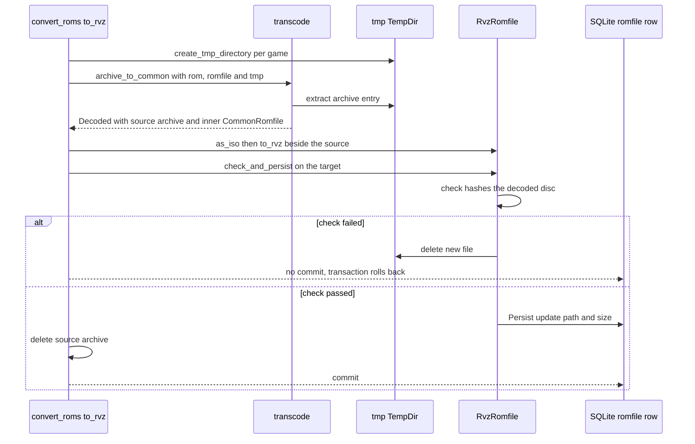

# Romfile Trait System

`src/common.rs` is the layer that lets `import-roms`, `sort-roms`, `convert-roms`,
`export-roms`, `check-roms` and `purge-roms` talk about "a ROM file" without
knowing whether it is a `.7z`, a DVD CHD, a PSP CSO or a CUE/BIN set. The layer is
deliberately thin: one struct holding a path, plus traits that each own one verb
(naming, hashing, checking, persisting, converting). Format modules add behaviour
by implementing those traits for a wrapper type; the workflows only ever choose
which wrapper to build, and stay format-agnostic after that.

## The core types

```rust
pub struct CommonRomfile { pub path: PathBuf, pub system_id: Option<i64> }
pub struct IsoRomfile    { pub romfile: CommonRomfile }
pub struct CueBinRomfile { pub cue_romfile: CommonRomfile, pub bin_romfiles: Vec<CommonRomfile> }
```

`CommonRomfile` is *not* a parser and holds no I/O state — it is an absolute path
plus an optional system scope, and `Display` prints the path. Every other wrapper
is a `CommonRomfile` plus whatever a format needs (`ChdRomfile` carries `ChdType`,
`track_count`, the data and file SHA1s and an optional `parent_romfile`;
`ArchiveRomfile` carries the entry name, archive type, size and CRC recorded when
the archive was parsed).

`FromPath::from_path` is the only constructor and never touches the filesystem;
`with_system` attaches a system id so that later path math can honour a
per-system `ROM_DIRECTORY` override instead of the global one. The database's
`Romfile` row, by contrast, stores a path *relative* to the ROM directory, and
`AsCommon` is the single bridge between the two worlds: it joins the row path onto
`get_rom_directory`. Every workflow starts a chain with `romfile.as_common(connection)`.

## Naming: `As*` parses, `To*` converts

The convention is fixed and documented at the top of `main.rs`, which carries
`#![allow(clippy::wrong_self_convention)]` for it: `As*` turns an existing file
into a wrapper, `To*` produces a new file converted *from* another format. Clippy
would object that a method named `as_*` should not consume `self`, and the file
says so explicitly — the wrappers **take `self` by value on purpose**
(`as_iso(self)`, `as_chd(self)`, `as_rvz(self)`, `as_cue_bin(self, bins)`, …),
because the wrapper *becomes* the path it validated. The exceptions prove the
ownership rule: `as_common` and `as_archive` take `&self`, since an
`ArchiveRomfile` keeps a clone of the container it points into and many entries of
one archive must be able to coexist. `To*` traits all borrow `&self` — the source
file has to survive its own conversion.

- `As*` validates and wraps, and the validation depth is the safety property.
  `as_iso`, `as_rvz`, `as_nsp`, `as_nsz`, `as_cue_bin` (and its BINs) and `as_gdi`
  (and its track files) check the lowercased extension against the constants in
  `mimetype.rs`; `as_xso`, `as_riff`, `as_rdsk` and `as_chd` call `get_mimetype` so
  the *content* must match, and `as_chd` goes further still: after the magic bytes
  it opens the container with `chd_rs::Chd::open` and caches what it finds —
  `ChdType`, logical `size`, the data and file SHA1s, the parent's SHA1 and the
  track count ([src/chd.rs](../../src/chd.rs#L541-L650)). A wrapper is a claim
  about the file, so a weakly validating `As*` would let a misnamed file reach a
  decoder.
- `To*` writes a file: it picks the destination name (`file_name()` with
  `with_extension`), prints an action line, drives the backend, and returns the new
  wrapper built by running `CommonRomfile::from_path` **back through the matching
  `As*`**, so the output is re-validated on the way out
  (`to_iso` → `as_iso`, `to_riff` → `as_riff`, `to_rdsk` → `as_rdsk`, `to_xso` →
  `as_xso`, `to_nsp`/`to_nsz` → `as_nsp`/`as_nsz`). `to_chd` is the deliberate
  exception: the four `ToChd` impls build the `ChdRomfile` directly with `size: 0`
  and empty SHA1s, because the freshly written container's facts are not known
  until something reopens it — a caller that needs them calls `as_chd` on the
  result ([src/chd.rs](../../src/chd.rs#L279-L416)). `to_wbfs` returns `Result<()>`
  for the same reason: WBFS is an export target, never a wrapper anything converts
  from.



*Caption: format-to-format conversion paths — `As*` edges parse a file into a wrapper, `To*` edges convert from one format into another, and `CommonRomfile`, `IsoRomfile` and `CueBinRomfile` are the three hubs nearly every route passes through.*

`IsoRomfile` and `CueBinRomfile` live in `common.rs` because they are the neutral
targets: almost every disc format converts to or from ISO, and CUE/BIN is the
multi-file neutral shape. `CommonRomfile` is itself a member of the graph — it is
both the source of every `As*` and the destination of `ToCommon for
ArchiveRomfile` (extraction).

## Where the blocking pool begins

The traits are `async`, but the format crates behind them are synchronous and CPU
bound. The boundary is `progress::run_blocking`: it clones the `ProgressBar`,
resets it to a bytes style with the `length` the caller supplies, moves the closure
onto `tokio::task::spawn_blocking`, and turns each crate progress callback into
`bar.inc(n)` ([src/progress.rs](../../src/progress.rs#L72-L97)). So the contract is
that a `To*`/`Check` implementation never decodes on the async executor, and the
bar gets a real denominator instead of a spinner.

`src/chd.rs` is the clearest case now that CHD handling runs in process through
`chd-rs` rather than by shelling out to `chdman`:

- `create_chd` (behind every `ToChd`) computes the bar length as
  `chd_rs::cd_input_size(&input)` for a CD — the total of the files the CUE/GDI/ISO
  names — and `input.metadata()?.len()` for every other type, then calls
  `run_blocking` around `create_cd` / `create_dvd` / `create_hd` / `create_ld`
  ([src/chd.rs](../../src/chd.rs#L729-L790)). The distinction matters: for a CD the
  CHD's logical size is not the input size once padding and subcode are added.
- `extract_chd` (behind `to_iso`, `to_cue_bin`, `to_rdsk`, `to_riff`) opens the
  container with `Chd::open` / `Chd::open_with_parent` inside its own
  `spawn_blocking`, then drives the extraction through `run_blocking` with
  `chd.info().logical_size` as the length
  ([src/chd.rs](../../src/chd.rs#L844-L870)).
- `parse_chd` uses `spawn_blocking` directly, without `run_blocking`, because
  reading a header has no progress to draw; a failure there is wrapped as
  `Failed to open "<path>"` ([src/chd.rs](../../src/chd.rs#L548-L556)).

The same `run_blocking` shape appears in `xso.rs`, `nsz.rs` and `gdi.rs`, each with
the input file's length (or `gdi_rs::input_size` for a CUE's BINs), so nothing in
the conversion layer blocks the runtime regardless of which backend a format uses.
See [CHD Format and the chd-rs Crate](chd-format-and-chd-rs.md) and
[Format Modules and Their Crate Backends](format-modules-and-format-crates.md).

## File verbs: `CommonFile`

`CommonFile` is implemented **only for `CommonRomfile`**, so any wrapper that needs
to be moved, copied or deleted is first reduced to its inner file (via
`GetRomfile::romfile`). It owns five operations:

- `get_relative_path` strips the ROM directory — chosen per system through
  `get_directory(connection, "ROM_DIRECTORY", self.system_id)` with a fallback to
  the global `ROM_DIRECTORY` — and fails with a "Failed to convert … to relative
  path" context error when the file lives outside it. This is the exact string
  `romfiles.path` is written with and the exact string `purge-roms` walks the tree
  and matches against, so it is the system's file↔row identity.
- `get_sorted_path` computes where a file *should* live: 1G1R vs system vs Trash
  directory by `Game.sorting`, an optional alpha subfolder from
  `REGIONS_ONE_SUBFOLDERS` / `REGIONS_ALL_SUBFOLDERS`, a per-game directory for
  jbfolders, for arcade titles whose extension is not an archive, and for Wii U
  NUS titles (games whose ROMs include a TMD, per `wux::is_nus_title`), again
  unless the extension is an archive, and finally the filename. NUS titles need
  the folder because every update and DLC names its contents alike, `00000000`
  and on. The extension override
  argument matters: for extensions in `NON_ORIGINAL_EXTENSIONS` (chd, cso, nsz,
  rvz, wua, wux, zso, 7z, zip) the file is named after the *game*, not the DAT rom, because
  those containers are derived files; otherwise `System.custom_extension` wins over
  `rom.name`. `sort-roms` diffs this against the current path, and the
  `src/common/test_path_*.rs` suite pins it.
- `rename` is a no-op when the target equals the current path and otherwise returns
  a new `CommonRomfile`; `copy` flattens into the destination directory using only
  `file_name()`; `delete` removes the file.

Both `rename` and `copy` rebuild through `from_path`, which resets `system_id` to
`None`. Callers that persist after a move must re-apply `with_system` — exactly
what `import_roms::trash_or_delete_romfile` does before its `create`/`update`, so a
per-system ROM directory still resolves on the next path computation.

## The verification stack

`Size`, `HashAndSize` and `Check` are the three rungs every format module must
implement.

- `Size::get_size` on a `CommonRomfile` is a plain `metadata().len()`, unwrapped —
  so a file that vanished underneath the workflow panics rather than reporting an
  error. `ArchiveRomfile` and `ChdRomfile` return the size recorded at parse time
  and fall back to decoding into a temp directory; `ChdRomfile` refuses outright for
  `ChdType::Cd`, which has no meaningful single-file size.
- `HashAndSize for CommonRomfile` funnels through the free function `hash_reader`,
  which hashes *anything that implements `Read`* while advancing the progress bar.
  That is the seam that lets a decoder be hashed without being written to disk:
  `RvzRomfile::hash_disc` feeds the `nod` `DiscReader` straight into it, so a
  dual-layer Wii disc is verified without several gigabytes of temporary ISO.
  `XsoRomfile` and `NszRomfile` do the opposite — decode to a temp directory, hash
  the decoded file, delete it. `ChdRomfile` short-circuits only the SHA1 it already
  read from the container header (`sha1` plus `size`), and decodes to a temp
  directory for CRC or MD5 — or bails for `ChdType::Cd`, which has no single hash
  ([src/chd.rs](../../src/chd.rs#L171-L230)).
- `get_hash_algorithm` picks CRC, then MD5, then SHA1 from whichever checksum the
  DAT row holds (else `bail!("Not possible")`), and `compare_hash_and_size` fails
  with `Size mismatch` (only when the DAT declares a non-zero size) or `Checksum
  mismatch`. These two strings plus the wrapper's own errors are all
  `check-roms` sees: it counts a `Check` error as one bad file and moves it to
  Trash.
- `Check for CommonRomfile` verifies `roms[0]` only. Multi-file cases decompose:
  `ChdRomfile::check` extracts CUE/BIN and zips each BIN with its own DAT rom;
  `check_roms::check_archive` pairs each entry with the ROMs whose name it holds
  (exactly or as `<folder>/<name>`, narrowed by CRC), checks it against one of
  them, and fails when an entry matches no ROM, when same-name ROMs match it but
  none by CRC, or when a ROM is left without an entry. One entry can back several
  ROMs, which a merged arcade set relies on when sibling clones share a file.

A nuance worth knowing before optimising: `ArchiveRomfile` short-circuits
`HashAndSize` with the entry's stored CRC and size, so *import* of a file inside a
container needs no extraction — but `Check for ArchiveRomfile` always extracts and
delegates. Integrity checking of an archive entry is therefore a real decode.

## Header handling: `HeaderedHashAndSize`

Headered systems (old NES-era DATs) declare a header in the DAT's header detector;
`import-dats` writes it to `headers` (name, version, `size`, `system_id`) with one
`rules` row per byte pattern (a hex value plus a `start_byte` parsed from the
detector's hex offset). `find_header_by_system_id` returns at most one header per
system, and `check-roms` and `import-roms` fetch it once per system and thread it
down as `&Option<Header>`.

`get_file_and_header_size` performs the detection: it reads the first
`header.size` bytes, and for every rule compares the hex encoding of the buffer
from `start_byte` onward against the rule's lowercase hex prefix. **Only when every
rule matches** is `header_size` returned as `header.size` — and the file handle is
left positioned *past* the header, so the caller hashing that handle hashes the
header-stripped content. On any mismatch the handle is rewound to 0 and
`header_size` is 0, which is why the same ROM file hashes correctly whether or not
the header is actually present. `get_headered_size` subtracts the header from the
on-disk length, and `get_headered_hash_and_size` sets the bar to that stripped
length before digesting. `Check for CommonRomfile` branches on `&Option<Header>`
between the headered and plain paths, and wrappers with no header semantics (RVZ)
fall back to extracting a decodable ISO when a header unexpectedly shows up.

## `transcode.rs`: the neutral decoded shape and the tmp contract

`convert_roms` and `export_roms` need the same thing over and over: "give me this
database file in a format I can convert *from*, and tell me what file it originally
came from." That is `Decoded<T>`:

```rust
pub struct Decoded<T> { pub source: CommonRomfile, pub inner: T }
```

`inner` is the decoded wrapper; `source` is the file the row actually points at —
the archive, or the same file when nothing needed decoding
(`common_as_source`). Constructors are `archive_to_common` (extracts the single
file an archive holds), `chd_to_iso` (DVD CHDs only; returns `None` for other
`ChdType`s so the caller skips), `xso_to_iso`, `nsz_to_nsp`, `rvz_to_iso`,
`archive_to_cue_bin`, plus `romfile_as_chd` which resolves a CHD's parent from
`romfile.parent_id` before wrapping.

`romfile_as_chd` is the only place the two parent strategies meet, and the
difference in failure mode is deliberate
([src/transcode.rs](../../src/transcode.rs#L57-L78)):

- With no `parent_id`, `as_chd` validates the magic bytes with `get_mimetype`,
  parses the header, and — when the header names a `parent_sha1` — scans the CHD's
  own directory for another CHD whose file SHA1 matches, silently yielding no
  parent if none is found ([src/chd.rs](../../src/chd.rs#L584-L650)).
- With a `parent_id`, `as_chd_with_parent` re-parses the caller-supplied parent and
  **bails** with `Parent CHD SHA1 mismatch: expected …, got …` rather than quietly
  decoding a clone against the wrong base
  ([src/chd.rs](../../src/chd.rs#L651-L680)).

`import-roms` relies on the same `parse_chd` header field to order its input list
so children are imported before their parents
([src/import_roms.rs](../../src/import_roms.rs#L169-L214)).

Every constructor takes a `&TempDir`, and the contract around it is
`util::create_tmp_directory`: `TempDir::new_in(get_tmp_directory(connection))`,
where `TMP_DIRECTORY` comes from settings, else `OXYROMON_TMP_DIRECTORY`, else the
system temp dir. Three consequences:

1. The scratch space is always inside the *configured* tmp directory, never the
   default `std::env::temp_dir()` on another volume, and `benchmark` measures that
   directory specifically because decode-then-convert throughput is bounded by it.
2. The `TempDir` is deleted when dropped, so a converted file is disposable unless
   it is written elsewhere. Hence the pattern in `convert_roms`: decode into the
   temp directory, then run the `To*` conversion again with
   `decoded.source.path.parent()` as the destination so the deliverable lands next
   to the original — never the temp file itself.
3. Workflows create one temp directory per game (`let tmp_directory =
   create_tmp_directory(connection).await?` inside the loop), so a large conversion
   never accumulates several decoded discs.

`check_and_persist` closes the loop and is where the trait system's requirements
are visible in a signature: `async fn check_and_persist<T: Check + GetRomfile>(…)`.
A wrapper must implement `Check` (verify the output) *and* `GetRomfile` (reach the
file to delete or rename) to participate. On check failure it prints
`Integrity check failed, reverting conversion`, deletes the new file and returns
`false`, and the caller leaves the transaction to roll back; on success it updates
the `romfile` row and deletes the source — optionally renaming the target onto the
source path when recompressing in place. Note that the multi-file wrappers
`CueBinRomfile` and `GdiRomfile` implement neither `GetRomfile` nor `Check`: they
are handled file-by-file by the caller, archiving each CUE and BIN separately.



*Caption: one conversion through the trait system — `Decoded` separates the original file from its decoded form, the temp directory holds only the intermediate, and `Check` gates whether the row update and source deletion are committed.*

## Persistence and playlists

`Persist` is implemented **only for `CommonRomfile`**: `create` computes the
relative path and size and inserts a row with a `RomfileType` (`Romfile`,
`Playlist` or `Patch`), returning its id; `update` rewrites path and size. It is
the sole writer of `romfiles.path`, always reached at the end of a
`CommonFile::rename` chain (`sort-roms`, `check-roms`'s trash move,
`generate-playlists`, `import-roms`). The filesystem is therefore mutated before
the row, and conversions wrap both in a transaction so a failed `Check` reverts the
row while the code explicitly deletes the file it produced.

`Playlist` is the odd one out: it is implemented for `Game`, not for a romfile,
because the M3U path is a function of the game's sorting and subfolder scheme
mirroring `get_sorted_path`, with `DISC_REGEX` stripping ` (Disc N)…` from the name
to get the shared `<game>.m3u`.

## How a format module plugs in

Adding a format means adding a wrapper and filling in traits, then telling the
workflows about it — nothing in `common.rs` changes:

1. Wrapper struct over `CommonRomfile`, plus `GetRomfile`.
2. `Size`, `HashAndSize`, `Check` — usually by decoding to the temp directory and
   delegating to the decoded format's impl.
3. `As*` (validate + wrap) and `To*` (write + re-validate through `As*`). Drive a
   synchronous backend through `run_blocking`, with the bar length derived from
   whatever the crate says its input is (`chd_rs::cd_input_size`,
   `gdi_rs::input_size`, or the file's own length).
4. Extension constants and, if the format has magic bytes, a matcher in
   `mimetype.rs`; see
   [File Type Detection and Extension Constants](file-type-detection-and-extensions.md).
5. Registration in the workflow layers: an extension branch in
   `check_roms::check_system`, source partitioning plus a target function in
   `convert_roms`/`export_roms`, and an import branch in `import_roms`
   ([src/check_roms.rs](../../src/check_roms.rs#L149-L221),
   [src/import_roms.rs](../../src/import_roms.rs#L518-L682)). The Wii U module
   `src/wux.rs` is the newest example of the full set.
   See [Format Conversion and Export](../workflows/format-conversion-and-export.md)
   and [Integrity Check and Purge](../workflows/integrity-check-and-purge.md).

The backend choice — in-process crate or external executable — is invisible from
here; see [Format Modules and Their Crate Backends](format-modules-and-format-crates.md).

## Focused tests

`src/common/` is a directory of single-purpose path tests rather than a
`#[cfg(test)] mod`. Each builds `System`/`Game`/`Rom`/`Romfile` values in memory,
calls `as_common().get_sorted_path()` and compares against an expected path — no ROM
bytes involved, which is why the naming rules can be changed with confidence.
`test_path_archive_single_file` and `test_path_archive_multiple_files` pin the
"derived containers are named after the game" rule;
`test_path_archive_custom_extension` pins the sharper edge — a `.7z` still becomes
`game name.7z` even when the system declares `custom_extension = cci`, because a
non-original extension outranks it — while `test_path_custom_extension` shows the
plain `.3ds` file becoming `game name.cci`. `test_path_original` keeps the
original-extension case at `rom name.rom`; `test_path_cso` and `test_path_rvz` pin
those formats; `test_path_chd_single_track` / `test_path_chd_multiple_tracks` pin CHD
naming; `test_path_subfolder_alpha_letter` / `test_path_subfolder_alpha_other` pin
the alpha subfolder; and `test_path_playlist` and
`test_path_playlist_subfolder_alpha` pin `Playlist`. Format-level behaviour is
pinned next to the modules: `src/chd/test_ld.rs` round-trips a LaserDisc RIFF
through `to_chd` → `as_chd` → `to_riff` → `to_chd` and asserts the two CHDs are
byte-identical, and the unit tests in `src/iso.rs` pin the CUE parsing that
`ToIso for CueBinRomfile` depends on (pregap start, next-track end, per-track BINs,
and that only MODE1/2352 and MODE2/2352 convert). Header behaviour is covered by
integration tests instead: `check_roms/test_original_with_header`,
`check_roms/test_sevenzip_with_header`, `import_roms/test_original_headered` and
`import_dats/test_dat_headered*`; CHD checking by `check_roms/test_iso_chd` and
`check_roms/test_multiple_tracks_chd`.
