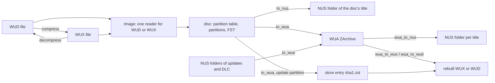

# Wii U Formats and the wux-rs Crate

Wii U support lives in two places. The in-tree crate
[`crates/wux-rs`](../../crates/wux-rs/README.md) does all the format work,
synchronously and file to file like every other format crate. The module
[`src/wux.rs`](../../src/wux.rs) adapts it to the
[romfile traits](romfile-trait-system.md) and adds what only a library manager
can do: find the keys, find a disc's updates and DLC in the database, and keep
each system's shared update partitions.

Unlike the other crates, wux-rs is not a port of a tool oxyromon used to run.
It follows wudd for the WUX container and Cemu for the disc layout and the WUA
archive, and it keeps wudd's GPL-3.0+ licence.

## The four shapes

| Shape | What it is | In oxyromon |
| --- | --- | --- |
| **WUD** | Raw disc dump, 25,025,314,816 bytes for a full disc. Redump lists it as an `.iso` | Original. Imported as a plain file. Converting back to ORIGINAL writes the DAT's name, an `.iso` |
| **WUX** | The same bytes, each distinct 32 KiB sector stored once | Non-original. Imported, checked, converted to and from, exported |
| **WUA** | Cemu's ZArchive of decrypted files, one `<title id>_v<version>` folder per title | Non-original when lossless. Imported, checked, converted to and from, exported, and a `PREFER_FORMAT` |
| **NUS folder** | A title as Nintendo's servers deliver it: TMD, ticket, certificates, one encrypted file per content | Updates and DLC are imported as NUS folders. A disc can also be exported to one |

A WUX starts with a 32-byte little-endian header (`WUX0` plus a second magic,
the sector size `0x8000`, the uncompressed size), then one `u32` per disc
sector naming the stored sector that holds it, then the distinct sectors in
first-use order. Sectors are told apart by SHA-256, as wudd does. A disc is
mostly padding, so a WUX is often a small fraction of its WUD.

A WUD carries no magic at offset 0, and Redump names it `.iso`. So `as_wud`
accepts a `.wud` or `.iso` only when the image has no WUX header and carries
the Wii U disc magic `CC 54 9E B9` at `0x10000`, which tells it from any
other ISO.

## Lossless WUA

A WUA Cemu writes drops the disc's encryption and layout, so it can never
become a disc image again. A WUA wux-rs writes from a disc keeps two extra
hidden folders that Cemu ignores:

- **`.nus/`, the revert data.** Each title's TMD, ticket, certificates,
  encrypted FST and a small *residue* of bytes that are neither file data nor
  recomputable hashes. `wua_to_nus` replays it into one NUS folder per title,
  byte for byte what the WUA was made from.
- **`.wud/`, what rebuilds the disc.** A big-endian `layout` holding the disc's
  size, CRC32, MD5 and SHA-1, every partition's header and regions, and the
  few sectors kept whole.

The rebuild rests on one observation about mastering. Every disc sector is the
disc header, a partition header, a region (an FST, or a cluster or content the
FST lists), or a repeat of the region before it, period that region's length,
up to the next region or the partition's end. That repeat is how free space is
filled, and free space is most of a disc. The game partition's contents come
back from the WUA's game title and its revert data. Every other partition's
regions come from a stream of their bytes, decrypted when the disc key
encrypts them. The rule is checked on every sector as the disc is read, and a
sector it gets wrong is kept whole, so the rebuild is exact either way.

`wua_to_wux` and `wua_to_wud` rebuild the disc and fail with a `Corrupt` error
when the result does not match the SHA-1 the layout keeps. `disc_info` returns
the layout's size and hashes, or `None` for a WUA without a `.wud/` folder.
That `None` is how oxyromon tells a lossless WUA from one Cemu wrote: `as_wua`
bails with "Not a lossless wua" and the file is treated as plain.

### The update-partition store

Every Wii U disc carries a system update partition of about 1.3 GB. Once the
disc key's encryption is off, it is the same on every disc carrying that
update. Inside it, wux-rs also decrypts each title's contents with their own
title keys, which is what lets them compress.

Given a store folder, `to_wua` writes that stream there once, as a zstd stream
at level 19 with a 128 MiB window (`2^27`), named `<sha1>.zst` after the
stream's SHA-1. That is about 600 MB per update. Without a store, the stream
goes into the WUA itself. `store_entries` lists the names a WUA needs.

oxyromon keeps one store per system: a hidden `.update-partitions` folder
(`wux_rs::STORE_DIR`) in the system's directory, from `store_directory`. A WUA
finds its store with `find_store`, the nearest `.update-partitions` folder in
any directory above it. A store entry that is missing or damaged makes the
rebuild fail.

## Inside wux-rs



*Caption: wux-rs's public entry points and the data each consumes.*

| Module | Role |
| --- | --- |
| `wux.rs` | The WUX container: `compress`, `decompress`, `Header`, `MAGIC`, `SECTOR_SIZE` |
| `image.rs` | `Image`, which reads a WUD or a WUX the same way, so hashing and conversion never need the WUD on disk |
| `disc.rs` | The disc as Cemu reads it: a partition table encrypted with the disc key, partitions, and an FST whose files are split into raw, hashed or per-block encrypted clusters, the last used by the update partition |
| `nus.rs` | TMD parsing and the `tmd_path` / `ticket_path` lookups, which accept a downloader's names (`title.tmd`, `title.tik`) or No-Intro's (`tmd.<version>`, `cetk.<version>`) |
| `install.rs` | `to_nus`: copies the game partition's encrypted contents as they are, checks each against the TMD, and takes the TMD, ticket and certificates from the SI partition |
| `wua.rs` | `to_wua` and `title_id`, for a disc or a NUS folder. A WUA holds at most one disc |
| `lossless.rs` | Writes the `.wud/` layout and the partition streams, and exposes `disc_info`, `store_entries`, `DISC_DIR` and `STORE_DIR` |
| `rebuild.rs` | `wua_to_wux` and `wua_to_wud`, checked against the disc's SHA-1 |
| `zarchive.rs` | A streaming ZArchive writer and reader: 64 KiB blocks compressed with zstd in parallel on rayon, then the offset records, name table and file tree |
| `revert.rs` | Collects the `.nus/` revert data while writing a WUA, and `wua_to_nus` to replay it |
| `keys.rs` | `parse_keys` / `load_keys` for Cemu's `keys.txt` format, and `cemu_keys_path` |

A disc's contents in its game partition are the CDN's byte for byte, except
content 0, the FST. A NUS folder exported from a disc therefore matches
No-Intro's CDN DAT for every `.app` and `.h3`. Only `title.tmd` differs,
because Nintendo signed one TMD for the disc and another for its servers.

Some limits remain. Only a disc's first GM partition becomes a WUA title
folder. Updates stay in their own folder next to the game rather than being
merged over it. Only a WUA written from one disc can rebuild it. Split wudd
dumps of 2 GiB parts must be joined first.

The `wuxrs` CLI turns a WUA back into its WUX by default, or into NUS folders
with `-f nus`. Its `--updates DIR` flag names the store, which defaults to the
`.update-partitions` folder next to each WUA.

## Keys

Neither the disc key nor the Wii U common key ships with oxyromon or wux-rs.
The crate takes a list of candidate keys and tries each, as Cemu does. The disc
key is the one that decrypts the partition table's padding to zeros. The common
key is the one whose decrypted title key opens the game partition's FST. Disc
keys and the common key can therefore sit in one file.

Keys reach oxyromon through the `import-keys` subcommand in
[`src/import_keys.rs`](../../src/import_keys.rs):

```sh
oxyromon import-keys ~/.local/share/Cemu/keys.txt
```

It parses each file in Cemu's format: one 32-digit hex key per line, with text
after `#` or `;` ignored and spaces, tabs, dashes and underscores dropped. It
merges the keys into `wiiu_keys.txt` in the data directory, keeping each key
once in first-seen order. The file is written to a `.part` file with mode
`0600` and renamed into place, so a failed write leaves the old keys intact.
The subcommand reports a warning for a file with no keys and does nothing when
no key is new.

WUA and NUS need keys, including rebuilding a disc from a WUA. WUD, WUX and
importing a WUA work without them. `wux::get_version`, shown by `info`, says
`built-in, no Wii U keys imported` until the keys file exists, so a missing
key shows up before a conversion fails with `No Wii U keys imported`. Under
`cfg(test)` the keys come from `tests/Test Game (USA).keys.txt`, the made-up
keys of the synthetic disc.

## How oxyromon wires it

**Import.** A `.wux`, and a `.wua` that `as_wua` accepts, both go to
`import_wiiu_disc`. A WUX is hashed by streaming its decompressed bytes
through `wux_rs::Image`. A WUA's hash and size come straight from its disc
info, without reading the disc. Either is matched against the DAT's disc row
and moved into the system directory under the ROM's name with its own
extension. For a WUA, `copy_store_entries` first copies the store entries it
needs from the store found next to the source into the system's store. Each
entry found in neither place gets a warning that the disc can't be rebuilt.
A `.wua` name wins over any magic-byte matcher, because a WUA begins with a
zstd block and keeps its magic at its end. A `.wud` or `.iso` has no branch and
goes through `import_other` like any plain file. The directory walk skips
`.update-partitions` folders.

**Updates and DLC.** No-Intro's CDN DAT lists each update or DLC as a game
whose ROMs are the title's files. `import-roms` recognises a folder holding a
TMD, at the top level or anywhere in the walk, and hands the whole folder to
`import_nus`. That function matches the TMD first, because a TMD names exactly
one title at one version. It then matches the folder's other files only within
that game, since a game and its update can hold identical files. Files the DAT
does not list, such as a downloader's `title.cert`, stay where they are.

Every NUS title names its contents alike, `00000000` and on. So
`get_sorted_path` gives a game its own folder when `wux::is_nus_title` finds a
TMD among its ROMs, and the ORIGINAL export copies such a game into a folder
named after it. `is_tmd_name` accepts `title.tmd`, `tmd` and `tmd.<digits>`.

**Check.** `check-roms` has a WUX branch and a WUA branch. The WUX branch
hashes the decompressed stream directly, or extracts a WUD first when the DAT
declares a header, though no Wii U DAT does. The WUA branch compares the disc
info with the DAT, then rebuilds a WUX into the temp directory, which checks it
against the disc's SHA-1 and its store entries. A `.wua` that is not lossless
is checked as a plain file.

**Convert.** `WUA` and `WUX` are both `convert-roms` formats and
`PREFER_FORMAT` values. The WUX target takes WUDs, single-WUD 7Z or ZIP
archives, and WUAs, which it rebuilds. The WUA target takes WUDs, single-WUD
archives and WUXs, writing each WUA beside its source and its update partition
to the system's store. Conversion does not bundle updates or DLC. Converting a
WUX or WUA to ORIGINAL writes the disc under the DAT's ROM name, an `.iso`
for Redump, and converting to 7Z or ZIP goes through that WUD in the temp
directory. Neither format has settings, so each target skips files already in
it.

**Export.** `export-roms` gathers discs in every form through `wiiu_discs`: a
`.wud` or `.iso` that `as_wud` accepts, a single-WUD archive, a WUX, or a
lossless WUA. `WUX` writes WUXs, copies existing ones as they are, and
rebuilds WUAs. `NUS` writes a disc's title as a NUS folder for WUP Installer
GX2. From a WUA it replays the revert data and keeps only the game's title,
the one whose ID starts `00050000`. `WUA` writes Cemu's archive and bundles
the library's updates and DLC, with the update partitions in a
`.update-partitions` store in the destination. A WUA source is rebuilt to a
WUX in the temp directory first, so updates added to the library since it was
written get bundled. Updates and DLC are already NUS folders, so they are
exported as ORIGINAL.

**Bundling.** With `bundle` set, as export sets it, `ToWua` reads the disc's
title ID, then scans every romfile that is a TMD across all systems. It keeps
titles that share the disc ID's low 32 bits and whose high half is `0005000E`
(update) or `0005000C` (DLC), and takes the highest version of each. A title
without a ticket is skipped with a warning, because No-Intro lists DLC without
the ticket needed to decrypt it. The progress bar length is the disc's size
plus the bundled folders' sizes.

**Purge.** `purge-roms -f` treats store files as foreign unless a WUA in the
library still lists them in `store_entries`. So update partitions no WUA needs
are deleted, and those still needed are kept.

**create-dats.** A `.wux` is listed as the `.iso` it holds, hashed as it
decompresses. A lossless `.wua` is listed as its `.iso` from its disc info,
with nothing to read. So the generated DAT matches the disc in every format.
A folder holding a TMD becomes one game whose ROMs are its files, and
`.update-partitions` folders are skipped. Every file is hashed for CRC, MD5
and SHA-1 in a single pass.

## Tests

No Wii U disc can ship in the repository, so every test uses a synthetic one.
The crate's `tests/common` lays out a small encrypted disc with an SI
partition, an update partition holding a system title with a raw and a hashed
content, a game partition with raw and hashed clusters, and an update as a NUS
folder. `tests/wua.rs` reads the WUAs back with `zarust`, an independent
ZArchive reader. `tests/revert.rs` checks the round trip through revert data
byte for byte. `tests/disc.rs` rebuilds the disc from its WUA as a WUD and as a
WUX. It also checks that two discs with the same update under different disc
keys share one store entry, that without a store the update stays in the WUA,
that a missing or damaged entry fails the rebuild, and that a sector off the
layout is kept whole. `tests/real.rs` runs only when `WUXRS_DISC` points at a
real disc and is `#[ignore]`d otherwise. It now also rebuilds the disc from
its WUA.

In oxyromon, `tests/Test Game (USA).wud`, its `.wux`, the update folder
`tests/Test Game (USA) (Update)/` and the WUD and CDN DATs drive the
`test_wux*`, `test_wud*`, `test_wua*` and `test_nus*` cases under
`import_roms`, `check_roms`, `convert_roms`, `export_roms` and `create_dats`,
plus `purge_roms/test_foreign_store.rs`. `check_roms/test_wua_without_its_update.rs`
checks that a WUA whose store entry is gone fails its check. See
[Format Crate Tests](../testing/format-crate-tests.md) and
[Test Fixtures](../testing/test-fixtures.md).

## Related pages

- [Format Modules and Their Crate Backends](format-modules-and-format-crates.md)
- [Format Crates in crates/](../integrations/format-crates.md)
- [Format Conversion and Export](../workflows/format-conversion-and-export.md)
- [ROM Import Pipeline](../workflows/rom-import-pipeline.md)
- [Integrity Check and Purge](../workflows/integrity-check-and-purge.md)
