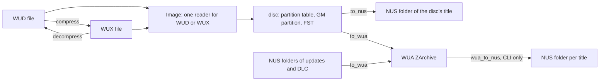

# Wii U Formats and the wux-rs Crate

Wii U support lives in two places. The in-tree crate
[`crates/wux-rs`](../../crates/wux-rs/README.md) does all the format work,
synchronously and file to file like every other format crate. The module
[`src/wux.rs`](../../src/wux.rs) adapts it to the
[romfile traits](romfile-trait-system.md) and adds what only a library manager
can do: find the keys, and find a disc's updates and DLC in the database.

Unlike the other crates, wux-rs is not a port of a tool oxyromon used to run.
It follows wudd for the WUX container and Cemu for the disc layout and the WUA
archive, and it keeps wudd's GPL-3.0+ licence.

## The four shapes

| Shape | What it is | In oxyromon |
| --- | --- | --- |
| **WUD** | Raw disc dump, 25,025,314,816 bytes for a full disc | Original. Imported as a plain file, since the DAT lists it |
| **WUX** | The same bytes, each distinct 32 KiB sector stored once | Non-original. Imported, checked, converted to and from WUD, exported |
| **WUA** | Cemu's ZArchive of decrypted files, one `<title id>_v<version>` folder per title | Export only. Never imported or converted from |
| **NUS folder** | A title as Nintendo's servers deliver it: TMD, ticket, certificates, one encrypted file per content | Updates and DLC are imported as NUS folders. A disc can also be exported to one |

A WUX starts with a 32-byte little-endian header (`WUX0` plus a second magic,
the sector size `0x8000`, the uncompressed size), then one `u32` per disc
sector naming the stored sector that holds it, then the distinct sectors in
first-use order. Sectors are told apart by SHA-256, as wudd does. A disc is
mostly padding, so a WUX is often a small fraction of its WUD.

Going to WUA drops the disc's encryption and layout. A WUA can never become a
disc image again. A WUA written by wux-rs does keep revert data under a hidden
`.nus/` folder that Cemu ignores: each title's TMD, ticket, certificates,
encrypted FST and a small *residue* of bytes that are neither file data nor
recomputable hashes. That is under 0.1% of the archive. With it, the `wuxrs`
CLI turns a WUA back into one NUS folder per title, byte for byte what it was
made from. oxyromon itself never reads a WUA.

## Inside wux-rs



*Caption: wux-rs's public entry points and the data each consumes.*

| Module | Role |
| --- | --- |
| `wux.rs` | The WUX container: `compress`, `decompress`, `Header`, `MAGIC`, `SECTOR_SIZE` |
| `image.rs` | `Image`, which reads a WUD or a WUX the same way, so hashing and conversion never need the WUD on disk |
| `disc.rs` | The disc as Cemu reads it: a partition table encrypted with the disc key, partitions, and an FST whose files are split into raw or hashed clusters |
| `nus.rs` | TMD parsing and the `tmd_path` / `ticket_path` lookups, which accept a downloader's names (`title.tmd`, `title.tik`) or No-Intro's (`tmd.<version>`, `cetk.<version>`) |
| `install.rs` | `to_nus`: copies the game partition's encrypted contents as they are, checks each against the TMD, and takes the TMD, ticket and certificates from the SI partition |
| `wua.rs` | `to_wua` and `title_id`, for a disc or a NUS folder |
| `zarchive.rs` | A streaming ZArchive writer and reader: 64 KiB blocks compressed with zstd in parallel on rayon, then the offset records, name table and file tree |
| `revert.rs` | Collects the `.nus/` revert data while writing a WUA, and `wua_to_nus` to replay it |
| `keys.rs` | `parse_keys` / `load_keys` for Cemu's `keys.txt` format, and `cemu_keys_path` |

A disc's contents in its game partition are the CDN's byte for byte, except
content 0, the FST. A NUS folder exported from a disc therefore matches
No-Intro's CDN DAT for every `.app` and `.h3`. Only `title.tmd` differs,
because Nintendo signed one TMD for the disc and another for its servers.

The crate's scope is deliberately narrow. Only a disc's first GM partition
becomes a WUA folder, so the console update a disc carries is left out. Updates
stay in their own folder next to the game rather than being merged over it.
Split wudd dumps of 2 GiB parts must be joined first.

## Keys

Neither the disc key nor the Wii U common key ships with oxyromon or wux-rs.
The crate takes a list of candidate keys and tries each, as Cemu does. The disc
key is the one that decrypts the partition table's padding to zeros. The common
key is the one whose decrypted title key opens the game partition's FST. Disc
keys and the common key can therefore sit in one file.

Keys reach oxyromon through the `import-keys` subcommand in
[`src/import_keys.rs`](../../src/import_keys.rs):

```sh
oxyromon import-keys ~/.local/share/Cemu/keys.txt
```

It parses each file in Cemu's format: one 32-digit hex key per line, with text
after `#` or `;` ignored and spaces, tabs, dashes and underscores dropped. It
merges the keys into `wiiu_keys.txt` in the data directory, keeping each key
once in first-seen order. The file is written to a `.part` file with mode
`0600` and renamed into place, so a failed write leaves the old keys intact.
The subcommand reports a warning for a file with no keys and does nothing when
no key is new.

Only WUA and NUS exports need keys. WUD, WUX, import and check work without
them. `wux::get_version`, shown by `info`, says `built-in, no Wii U keys
imported` until the keys file exists, so a missing key shows up before an
export fails with `No Wii U keys imported`. Under `cfg(test)` the keys come
from `tests/Test Game (USA).keys.txt`, the made-up keys of the synthetic disc.

## How oxyromon wires it

**Import.** A `.wux` dispatches to `import_wux`, which hashes the decompressed
stream through `wux_rs::Image` and matches it against the DAT's `.wud` row.
On a match the file moves to the system directory, named after the DAT's
`.wud` row with a `.wux` extension. A `.wud` has no branch and goes through
`import_other` like any plain file. There is no magic-byte matcher for either
format: `as_wud` and `as_wux` check the extension, case-insensitively.

**Updates and DLC.** No-Intro's CDN DAT lists each update or DLC as a game
whose ROMs are the title's files. `import-roms` recognises a folder holding a
TMD, at the top level or anywhere in the walk, and hands the whole folder to
`import_nus`. That function matches the TMD first, because a TMD names exactly
one title at one version. It then matches the folder's other files only within
that game, since a game and its update can hold identical files. Files the DAT
does not list, such as a downloader's `title.cert`, stay where they are.

Every NUS title names its contents alike, `00000000` and on. So
`get_sorted_path` gives a game its own folder when `wux::is_nus_title` finds a
TMD among its ROMs, and the ORIGINAL export copies such a game into a folder
named after it. `is_tmd_name` accepts `title.tmd`, `tmd` and `tmd.<digits>`.

**Check.** `check-roms` has a WUX branch. Without a DAT header it hashes the
decompressed stream directly. With one it extracts a WUD to the temp directory
first, though no Wii U DAT declares a header.

**Convert.** `WUX` is one of `convert-roms`' formats. WUDs, and 7Z or ZIP
archives holding a single WUD, become WUX. Converting to ORIGINAL turns a WUX
back into a WUD, and converting to 7Z or ZIP goes through a WUD in the temp
directory. Recompressing a WUX would change nothing, so a WUX target skips
existing WUXs.

**Export.** `export-roms` adds three targets. `WUX` writes WUXs and copies
existing ones as they are. `NUS` writes a disc's title as a NUS folder for WUP
Installer GX2. `WUA` writes Cemu's archive and bundles the library's updates
and DLC. Updates and DLC are already NUS folders, so they are exported as
ORIGINAL.

**Bundling.** `ToWua` reads the disc's title ID, then scans every romfile that
is a TMD across all systems. It keeps titles that share the disc ID's low 32
bits and whose high half is `0005000E` (update) or `0005000C` (DLC), and takes
the highest version of each. A title without a ticket is skipped with a
warning, because No-Intro lists DLC without the ticket needed to decrypt it.
The progress bar length is the disc's size plus the bundled folders' sizes.

**create-dats.** A `.wux` is listed as the `.wud` it holds, hashed as it
decompresses, so the generated DAT matches the disc in either format. A folder
holding a TMD becomes one game whose ROMs are its files. Every file is hashed
for CRC, MD5 and SHA-1 in a single pass.

## Tests

No Wii U disc can ship in the repository, so every test uses a synthetic one.
The crate's `tests/common` lays out a small encrypted disc with an SI
partition, a game partition with raw and hashed clusters, and an update as a
NUS folder. `tests/wua.rs` reads the WUAs back with `zarust`, an independent
ZArchive reader. `tests/revert.rs` checks the round trip through revert data
byte for byte. `tests/real.rs` runs only when `WUXRS_DISC` points at a real
disc and is `#[ignore]`d otherwise.

In oxyromon, `tests/Test Game (USA).wud`, its `.wux`, the update folder
`tests/Test Game (USA) (Update)/` and the WUD and CDN DATs drive the
`test_wux*`, `test_wud*` and `test_nus*` cases under `import_roms`,
`check_roms`, `convert_roms`, `export_roms` and `create_dats`. See
[Format Crate Tests](../testing/format-crate-tests.md) and
[Test Fixtures](../testing/test-fixtures.md).

## Related pages

- [Format Modules and Their Crate Backends](format-modules-and-format-crates.md)
- [Format Crates in crates/](../integrations/format-crates.md)
- [Format Conversion and Export](../workflows/format-conversion-and-export.md)
- [ROM Import Pipeline](../workflows/rom-import-pipeline.md)
