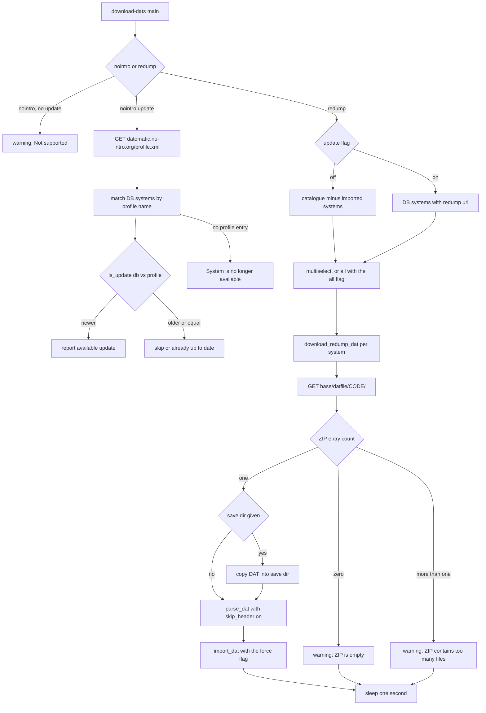

# DAT Providers and Naming Conventions

oxyromon never talks to a catalog except through a Logiqx DAT file. Three provider
families feed it, and only one of them can be reached over the network.

| Provider | Contents | How it enters oxyromon |
| --- | --- | --- |
| No-Intro (dat-o-matic) | cartridge consoles, older computers | `import-dats` with a hand-downloaded DAT; `download-dats -n -u` can **only check for updates** |
| Redump | CD/DVD optical systems | `import-dats`, or `download-dats -r` which **fetches and imports** brand-new and refresh DATs |
| MAME / FBNeo | arcade | `import-dats` only (Progetto-Snaps for MAME, the libretro FBNeo repo for FBNeo); never fetched |

The asymmetry is documented in the README (where "Find a way to automatically download
No-Intro DAT files" is still an open TODO) and encoded in `download_dats::main`:
No-Intro publishes a summary (`profile.xml`) but no direct DAT links, so the No-Intro
branch prints `Not supported` unless `-u` is passed; Redump publishes direct
`/datfile/<code>/` ZIPs but no summary, so it can both download and update. The
`-n/--nointro` and `-r/--redump` flags conflict with each other and one of them is
required (`required_unless_present`). Of the remaining flags, `-u` and `-a` reach both
providers, but `-f/--force` and `-s/--save` are only passed down the Redump branches —
on the No-Intro path clap accepts them and nothing consumes them.

Nothing in the DAT path shells out to an external program: the Redump ZIP is read by
the in-tree `zip` crate, and the README's *External programs* section now lists a single
entry, `ctrtool`, which belongs to `import-roms` (CIA extraction) and has no part in DAT
download or parsing. The format tools oxyromon once launched — `chdman` among them — were
replaced by the crates under `crates/`; see
[External Tool Integration](external-tools.md).

Arcade versus console is not a provider switch but a DAT-shape switch: a DAT whose
entries are `<machine>` rather than `<game>` sets `systems.arcade = true`
(`!datfile_xml.machines.is_empty()` in `import_dat`). That flag later disables
name-based region parsing at import and routes sorting through `REGIONS_*_ARCADE`
instead of regions.

## Provider identity is stored on the system

Two constants define provider provenance and they are written into `systems.url`
verbatim from the DAT header (`<url>` of a No-Intro DAT is `www.no-intro.org`, of a
Redump DAT `http://redump.org/`):

```rust
pub const NOINTRO_SYSTEM_URL: &str = "www.no-intro.org";
pub const REDUMP_SYSTEM_URL: &str = "http://redump.org/";
```

`find_systems_by_url` is then the only way the code asks "which of my systems came
from this provider", and it scopes three distinct behaviours: the No-Intro update
check's candidate list, the Redump update list, and `generate-playlists`, which
restricts its system picker to Redump because multi-disc `Disc N` games only exist
there. Provenance therefore depends on the DAT header being truthful, not on how the
DAT was obtained — a Redump DAT imported by hand is just as "Redump" as one fetched
by `download-dats`.

## The Redump system-code catalogue

`REDUMP_SYSTEMS_CODES` is a compile-time `phf_map!` of the exact Redump system name
to the Redump system code used in the datfile URL (`Nintendo - GameCube` => `gc`,
`Sony - PlayStation` => `psx`, `Arcade - Sega - Naomi 2` => `naomi2`, …). It is the
whole set of systems oxyromon can fetch, and it is wrapped in `cfg_if!`:

```rust
cfg_if! {
    if #[cfg(test)] {
        static REDUMP_SYSTEMS_CODES: phf::Map<&str, &str> = phf_map! {
            "Test System" => "ts"
        };
    } else {
        static REDUMP_SYSTEMS_CODES: phf::Map<&str, &str> = phf_map! { /* ~52 systems */ };
    }
}
```

Under `cfg(test)` the catalogue collapses to a single `Test System` => `ts` entry.
That is what keeps the download tests offline and deterministic: a `download_redump_dats`
run with `-a` iterates exactly one system and therefore fetches exactly one URL, and the
failure tests can hard-code that URL as `/datfile/ts/`. No production code path differs —
only the data. Adding a Redump system means adding one line to the production half of
this map; nothing else needs to change.

Both consumer lists are drawn **from the catalogue**, intersected with the database:

- `find_redump_systems(connection, update)` keeps catalogue keys whose name is absent
  from (`update = false`) or present in (`update = true`) the set of systems whose
  `url` is `REDUMP_SYSTEM_URL`, then sorts by name. The two halves are complementary,
  which is why the web UI's *Update only* switch simply re-reads the list.
- `download_redump_dats` recomputes the same "not yet imported" set locally before
  offering the multiselect.

Because a name is only ever offered if the catalogue holds its code, a system
imported from a hand-downloaded Redump DAT under a name the catalogue does not know
is never offered for a download. Note the asymmetry: the *update* list
(`update_redump_dats`) is built from the database via `prompt_for_systems(..., Some(REDUMP_SYSTEM_URL), ...)`, not from the catalogue, so every name it yields must have a catalogue code — `download_redump_dat` looks it up with `REDUMP_SYSTEMS_CODES.get(system_name).unwrap()`. A Redump system whose DAT header name has drifted out of the catalogue is a panic, not a skip.

## Fetch control flow



Per-system fetch is `download_redump_dat`: `GET {base}/datfile/{code}/` into memory,
`ZipArchive::new` over the bytes, extraction into a `TempDir` under `TMP_DIRECTORY`,
then `parse_dat(..., skip_header = true)` and `import_dat(..., None, None, force)`.
The ZIP must contain exactly one file; empty and multi-entry ZIPs are reported as
warnings and skipped without touching the database, which the failure test asserts by
checking `find_systems` stays empty after each shape. A body that is not a ZIP at all
(an HTML error page from a 404, for instance) surfaces as an `Err` from the
`ZipArchive::new` context, aborting the loop of the caller.

Pacing and failure handling are deliberately simple:

- **Rate limiting** is one unconditional `sleep(Duration::from_secs(1))` at the end of
  every system, on success and on the warning paths alike. There is no retry, no
  backoff and no status-code check anywhere in the download path.
- **Transport failures panic**: `reqwest::get(zip_url).await.expect("Failed to download ZIP")`
  and, on the No-Intro side, `.expect("Failed to download No-Intro profiles")`. A DNS or
  connect error kills the process rather than returning `Err`; only failures *after*
  the response body is in hand become recoverable results.
- **`-s/--save <DIRECTORY>`** copies the extracted `.dat` (not the ZIP) into a
  directory created on demand, preserving its provider file name. This is the only way
  to keep a fetched DAT: the extraction `TempDir` is dropped when `download_redump_dat`
  returns. The Redump test asserts the saved `Test System (20200721).dat` exists.

`-f/--force` is threaded only into the update path (`download_redump_dats` always
passes `force = false`), where it overrides the version gate below.

## Version gates and update checks

`is_update` is a plain lexicographic `new_version.cmp(old_version)`: `Less` prints
`Skipping older version`, `Equal` prints `Already up to date`, `Greater` prints
`Updating from x to y` and returns `true`. Both the No-Intro update check and the DAT
import gate use it — `create_or_update_system` returns `None` (skip the whole import)
unless `is_update(...) || force`. Because the comparison is textual, providers'
fixed-width date stamps (`20200721`) are what make it correct; `create-dats` follows
the same convention by defaulting a DAT version to the creation datetime. The tests
`test_dat_outdated_should_do_nothing` (6 games survive an older DAT) and
`test_dat_outdated_forced` (the same older DAT, with `force`, replaces the catalog
with its 3 games) pin both sides.

The same `force` flag also decides what happens to a system's custom name and extension.
On a plain update the stored customizations win — `custom_name.or(system.custom_name)`
— while a forced import applies the customizations exactly as given, so an omitted
`-n`/`-e` reverts to the DAT header value. `test_dat_custom_name_updated`,
`test_dat_custom_name_forced` and `test_dat_custom_name_revert` pin the three
combinations.

`update_nointro_dats` fetches `https://datomatic.no-intro.org/profile.xml`,
deserializes it into `ProfileXml` (a wrapper aliasing each `<datfile>` element to a
`SystemXml`, so only name and version matter) and, for each system in the database
whose url is `NOINTRO_SYSTEM_URL`, looks up the profile entry by exact name:

- found → `is_update(progress_bar, &system.version, &system_xml.version)` prints the verdict;
- not found → `System is no longer available`;
- nothing is ever downloaded, and a body that fails to deserialize is reported as
  `Failed to parse No-Intro profiles`.

## Server and MCP surfaces

The same two primitives are reused by the `server` and `mcp` features, guarded by
`#[cfg(any(feature = "server", feature = "mcp"))]`:

- `find_redump_systems` backs the GraphQL `downloadableSystems(update:)` query, the
  MCP `downloadable_systems` tool, and the Leptos *Download DATs* modal, which re-reads
  the list whenever it opens or flips *Update only*.
- `download_redump_system` backs the GraphQL `download_dats` mutation and the MCP
  `download_dats` tool. Unlike the CLI — which can only offer names it already holds —
  these callers accept arbitrary strings, so the function checks
  `REDUMP_SYSTEMS_CODES.contains_key(system_name)` first and bails with
  `Unknown Redump system "..."`.
- The GraphQL mutation returns immediately and runs the fetches on a `tokio::spawn`
  task, reporting `download_dats_started`, then `download_dats_complete` or
  `download_dats_error` with the list of failed system names over SSE. Per-system
  events are deliberately suppressed: the selection can be the whole catalogue and each
  event is a UI toast. Individual failures are logged and collected rather than aborting
  the batch. The MCP tool is refused by `read_only_denial` when the server runs read-only.

## shiratsu-naming: one parser behind regions, languages, flags, versions

`import_dats`, `sort_roms`, the GraphQL `game_information` resolver and the MCP
`parse_game_name` tool all parse game names with the `shiratsu-naming` crate rather
than each keeping its own regex. This is the single source of truth for what a token
means; changing region or language handling means changing this crate, not four
call sites.

**At import time** only regions are extracted, via `get_regions_from_game_name`:
`NoIntroName::try_parse` is tried first, and only if it fails does `TOSECName::try_parse`
run. The first `Region` token found is normalized with
`Region::to_normalized_region_string`, which yields hyphen-joined codes —
`Test Game (World)` → `US-JP-EU`, `Test Game (France, Germany)` → `FR-DE` — and stored
in `games.regions`. Two rules matter:

- Arcade systems skip parsing entirely and store an empty region string; arcade names
  are not No-Intro names.
- If both parsers fail, the game is **skipped with a warning** (`Failed to parse name: …`)
  after bumping the progress bar — not imported with empty regions, and not a fatal error.

**At sort time** the same tokens drive selection and ordering:

- `trim_ignored_games` partitions games out of the election when a `Languages` token
  contains no language in `LANGUAGES` (codes filtered by `LANGUAGE_REGEX` `[A-Z][a-z]`
  and variants by `VARIANT_REGEX` `[A-Z]{2}`), when a `Release` token's status is in
  `DISCARD_RELEASES`, or when a `Flag` token — split on `", "` — matches `DISCARD_FLAGS`.
  For arcade systems the same function ignores `comment` substrings instead, because
  arcade names carry no tokens.
- `sort_games_by_weight` scores a candidate +1 each for being a parent
  (`PREFER_PARENTS`), for matching the `PREFER_REGIONS` `broad`/`narrow` preference by
  comparing the number of regions parsed back with `Region::try_from_tosec_region`, for
  winning the `PREFER_VERSIONS` comparison, and once per `PREFER_FLAGS` match. Higher
  weight sorts first.
- `compare_versions` reads `NoIntroVersion` tokens numerically (`major`/`minor` parsed
  as `u64`, unparseable or absent treated as `0`), and a game that *has* a version token
  always beats one that does not: `Game (USA) (Rev 2)` outranks `Game (USA)` under
  `new` and is outranked by it under `old`.

Because the stored `games.regions` string is itself a shiratsu-norm region string,
sorting round-trips it through `Region::try_from_tosec_region` — a DAT that imports
with an unparseable region string silently sorts as no regions at all.

The parser is also exposed read-only: GraphQL `game_information` and the MCP
`parse_game_name` tool both return `title`, `regions`, `languages`, `release` and
`flags` from the same token walk, so an agent or UI can reason about disc and region
variants without importing anything.

## Header detectors that ride along with a DAT

A DAT may point at a header-skipping detector through `<clrmamepro header="..."/>`.
`parse_dat` looks for the first `clrmamepro` element that has a `header` attribute
(multiple `clrmamepro` elements are legal — one with `header`, another with
`forcenodump`), then resolves the file next to the DAT, and falls back to an
**embedded** copy shipped from `data/` via `#[derive(RustEmbed)] struct Assets`. That
is why a No-Intro NES DAT referencing `No-Intro_NES.xml` imports with a header even
when the detector file was not downloaded; `tests/header.xml` is the sibling-file form,
with its `start_offset` and `<data offset value>` rules persisted as a `Header` plus
`Rule` rows by `create_or_update_header`. `-s/--skip-header` suppresses all of it, and
the Redump download path passes `skip_header = true` unconditionally — optical images
have no cartridge header.

## Focused tests

The download module keeps its tests next to the code behind `#[cfg(test)] mod`
declarations and uses `wiremock` so no request leaves the machine:

| Test | What it pins |
| --- | --- |
| `src/download_dats/test_redump.rs` | mocks `^/datfile/[a-z0-9-]+/$` with `tests/Test System (20200721).zip`, asserts 1 system / 6 games / 8 ROMs imported and the `-s` copy written |
| `src/download_dats/test_redump_failures.rs` | empty ZIP and two-entry ZIP leave the database empty; a non-ZIP 404 body returns `Err` |
| `src/download_dats/test_nointro.rs` | mocks `/profile.xml` with `tests/profile.xml` and runs the update check against a DAT-imported system |
| `src/import_dats/test_regions_world.rs`, `test_regions_france_germany.rs` | the normalized region string produced by token parsing |
| `src/sort_roms/test_order_*` | weight ordering for parents, broad/narrow regions, new/old versions and preferred flags, each with the arguments swapped |

Together with the `cfg(test)` catalogue swap, these tests are the reason the whole
provider layer is exercisable without network access — and the reason the catalogue's
production contents are never asserted.

See also [DAT Ingestion](../workflows/dat-ingestion.md),
[ROM Import Pipeline](../workflows/rom-import-pipeline.md), and
<!-- openwiki: broken internal link [../workflows/sorting-and-1g1r-election.md] file "../workflows/sorting-and-1g1r-election.md" does not exist. Fix the href or restore the target, then delete this comment. -->
[Sorting and the 1G1R Election](../workflows/sorting-and-1g1r-election.md) for the
`sort-roms` election that consumes the regions and version tokens described above.
