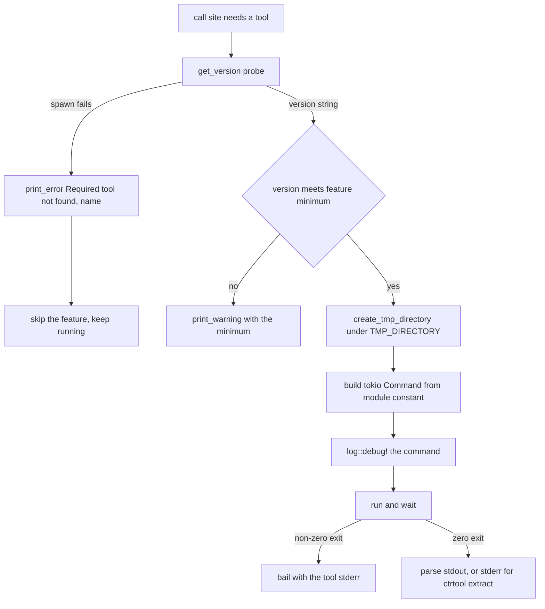

# External Tool Integration

Nearly every format oxyromon handles is decoded in-process — see
[Format Modules and Format Crates](../concepts/format-modules-and-format-crates.md)
and [Format Crates in crates/](format-crates.md). Two still run as child
processes: **`chdman`** (CHD, from MAME) and **`ctrtool`** (CIA, from
Project_CTR). Both are optional, neither is bundled, and both are looked up by
bare name on `${PATH}` — the README lists them under "External programs". CI and
the Arch Linux container install `chdman` (via `mame-tools`); nothing in the repo
installs `ctrtool`.

Because a missing or misbehaving executable is an everyday condition rather than
an edge case, the shelling-out path has a fixed shape: probe availability through
`get_version()`, build a `tokio::process::Command` from a module constant, log it
at debug level, and treat the child's stderr as the user-facing error text.

## The canonical recipe

`src/util.rs` owns the shared half of the pattern.

**`run_tool`** is the single place a tool command is executed and its result
interpreted:

```rust
pub async fn run_tool(command: &mut tokio::process::Command) -> Result<std::process::Output> {
    log::debug!("{:?}", command);
    let program = command.as_std().get_program().to_string_lossy().to_string();
    let output = command.output().await
        .with_context(|| format!("Failed to spawn {}", program))?;
    if !output.status.success() {
        bail!("{}", String::from_utf8_lossy(&output.stderr));
    }
    Ok(output)
}
```

Four invariants follow from those twelve lines:

- The command is logged **before** it runs, via `log::debug!("{:?}", command)`.
  Debug output only reaches the terminal when `OXYROMON_LOG_LEVEL` allows it, so
  the exact argv used against `chdman` is always recoverable when a conversion
  produces a surprising result.
- A failure to **spawn** (no such program) is an `anyhow` context error naming
  the program; a failure to **run** (non-zero exit) is `bail!` carrying the tool's
  own stderr verbatim, with no wrapper text. oxyromon never paraphrases a tool's
  error, and never discards it.
- `run_tool` is given `&mut Command` rather than an owned command precisely so the
  debug log sees the fully assembled argument list.
- stdout is returned untouched and is the **caller's** problem: parsing it is
  format-specific, and a non-zero exit that carries useful stdout (the CIA case
  below) cannot be expressed through `run_tool` at all.

**`tool_version`** is the availability probe. It runs the tool with a fixed
argument list and pulls a version out of one stream:

```rust
pub async fn tool_version(
    command: impl AsRef<OsStr>, name: &str, args: &[&str],
    stdout: bool, line: usize, regex: Option<&Regex>,
) -> Result<String>
```

It reads `stdout` or `stderr` according to `stdout`, takes the `line`-th line, and
applies `regex`; the version is whatever the regex *matches*, not the whole line.
Crucially, it converts a non-zero exit into a version string too — status is never
checked — so the `Err` path exists only for a spawn failure. That makes
`get_version(): Result<String>` an availability test rather than a version
report:

| Module | Probe | Stream | Regex |
| --- | --- | --- | --- |
| `chdman::get_version()` | `chdman` (no args) | stdout, line 0 | `\d+\.\d+` |
| `ctrtool::get_version()` | `ctrtool` (no args) | stderr, line 0 | `\d+\.\d+\.\d+` |

`chdman` prints its banner on stdout and wants no arguments; `ctrtool` prints on
stderr and wants three version components. Both use
`std::sync::LazyLock<Regex>` so the regexes are compiled once.

Note what `tool_version` does **not** do: it does not call `run_tool`, and it does
not `log::debug!` the command. A probe is deliberately invisible in the debug log —
otherwise every availability check would emit a line, since `get_version()` is
called repeatedly inside conversion loops.

**`tool_available`** wraps a probe for call sites that must tell the user why work
stopped, printing `Required tool not found: <name>` through `print_error` and
returning `false`.

**`create_tmp_directory`** is the other shared piece: a `tempfile::TempDir`
created **inside** `config::get_tmp_directory(connection)`, not in the OS default.
That keeps intermediate disc images on the filesystem the user chose —
`TMP_DIRECTORY`, initialised from `OXYROMON_TMP_DIRECTORY` or `env::temp_dir()` —
so a multi-gigabyte decode does not silently fill a small `/tmp`. Dropping the
`TempDir` removes it, which is why modules hold it across the whole
extract-verify-convert sequence instead of creating one per command.

## What each module shells out for

`chdman` is reached through three call sites, all in `src/chdman.rs`, all built
with `Command::new(CHDMAN)` where `CHDMAN` is a module constant:

- `parse_chd` runs `chdman info -i <file>` and scrapes stdout for `Metadata:`,
  `SHA1:`, `Parent SHA1:`, `Logical size:`, `Data SHA1:` and a count of `TRACK:`
  lines. This is the *only* way a `.chd` is understood — see
  [Format Modules and Format Crates](../concepts/format-modules-and-format-crates.md)
  for how `ChdType` falls out of it.
- `create_chd` runs `createcd`/`createdvd`/`createhd`/`createld` with `-i`/`-o`,
  plus `--hunksize` and `--compression` when the per-system settings supply them,
  and `-op <parent>` for a CHD with a parent.
- `extract_chd` runs the matching `extract*` command, writing a CUE plus
  `%t`-patterned BINs for CD images, and `-ip <parent>` / `-sb` as needed.

`create_chd` and `extract_chd` assemble a `Command`, `log::debug!` it themselves,
then hand it to `run_tool`, which logs it a second time before running it;
`parse_chd` builds its command inline and relies on `run_tool`'s logging alone.
Either way the argv is in the log before the child starts, and failure text comes
from one place.

`ctrtool` is reached from `parse_cia` and `extract_files_from_cia` in
`src/ctrtool.rs`, both running `ctrtool -p -v [flags] <cia>`, the second with
`--certs`, `--tmd`, `--contents` and `current_dir(directory)` set so the tool
writes into the caller's temp directory rather than the process cwd.

**The one deliberate deviation from `run_tool`.** Both CIA calls invoke
`Command::output()` directly and then check status *with an exception*: a
non-zero exit is tolerated when stdout ends with
`[ctrtool::NcchProcess ERROR] NcchHeader is corrupted (Bad struct magic).`,
which is what `-p` produces for a non-homebrew (retail) title. Anything else
becomes `bail!("{}", stderr)`. Re-routing these two calls through `run_tool` for
consistency would break retail CIA imports — the tolerated error and its useful
stdout would be discarded together. The trade-off is visible in the spawn path:
where `run_tool` turns a failed spawn into an `anyhow` error, these two use
`.expect("Failed to parse cia")` / `.expect("Failed to extract cia")`, so a
`ctrtool` binary that disappears between the probe and the call panics instead of
returning an error. `extract_files_from_cia` also reads the saved content names
from **stderr** (`[ctrtool::CiaProcess LOG] Saving content …`), so stderr here is
data as well as diagnostics.

Progress reporting follows from the process boundary: a subprocess gives oxyromon
no measurable byte count, so both modules bracket their work with
`start_action`/`stop_action` (a spinner plus a message such as `Creating chd`)
instead of the byte-progress bars the in-process crates drive through
`run_blocking`. A long `chdman createdvd` looks stalled; it is not.



*Caption: the shared probe → log → run → parse path, with the two ways a tool run ends in an error.*

## Feature degradation when a tool is missing

The rule is consistent: **a missing tool disables the format, it does not abort
the command.** Each entry point reports once and continues, so a library with no
CIA tool installed still imports everything else.

| Entry point | Probe site | Behaviour when absent |
| --- | --- | --- |
| `import-roms` | per file, before dispatch | `.chd` and `.cia` files are skipped with `Required tool not found: …`; the file stays on disk and no database row is written. |
| `convert-roms` | `format_available`, once per system | `CHD` as a destination format is refused up front and the system is skipped; every other format is assumed available. |
| `export-roms` | `tool_available` before the loop | the CHD export target is refused and the command returns without exporting. |
| `check-roms` | inside the CHD loop | prints the error and `break`s out of the loop. |
| `info`, GraphQL `dependencies`, MCP `status` | always | reported as missing, never an error. |

Two rough edges follow from probing inside a loop rather than before it, and are
worth knowing when reading output. In `check-roms`, the `break` leaves every
romfile from that point on unchecked, but the unchecked ones are not counted as
errors: unless some earlier file already failed, the summary prints
`All N files passed integrity check` using the full romfile count. A missing
`chdman` during `check-roms` therefore looks like a clean pass, not a failure.
In `convert-roms` and `export-roms`, the same `break` skips the remaining CHDs of
that pass while the command carries on.

`chdman` features also degrade on **version**, not just presence, by comparing
the probe result with `Ordering::Less` against a minimum and skipping with a
warning:

- `MIN_DREAMCAST_VERSION = "0.264"` — converting to CHD for any system whose name
  contains `Dreamcast`, which is the `createld` path.
- `MIN_SPLITBIN_VERSION = "0.265"` — anything touching a multi-track CD CHD,
  which needs chdman's splitbin mode (`-sb`).

Both compare with `str::cmp`, a plain lexicographic ordering on the version text.
That is correct only while the installed version and the minimum have the same
digit widths, which holds for MAME's current `0.NNN` numbering; the consequence of
getting it wrong is a skipped game plus a warning, never a damaged file.

## How dependency versions are reported

Three surfaces enumerate dependencies, and each one calls every module's
`get_version()` at request time — there is no cache, so installing a tool is
picked up by the next `oxyromon info` without a restart:

- `src/info.rs` prints the **Dependencies** section, sorting by name, rendering
  `Ok` as `✔ <name>: <version>` and `Err` as `↪ <name>: not found`.
- `src/query.rs` exposes the same list as the GraphQL `dependencies` query, with a
  missing tool as a `null` version rather than an error.
- `src/mcp/read.rs` builds the identical list for the MCP `status` tool and the
  `oxyromon://status` resource, again with `version: Option<String>`.

Only `chdman` and `ctrtool` in those lists can produce `not found`; the in-process
backends return the literal `"built-in"`. `nsz` adds `prod.keys not found` when
the Switch key file is absent, which is a *content* warning on a dependency that
is always present.

## Configuration surface

oxyromon has no setting that names a tool path or overrides `${PATH}`: the
executable name is a compile-time constant in the format module
(`const CHDMAN: &str = "chdman";`, `const CTRTOOL: &str = "ctrtool";`). The
settings that do reach the tools are passed to `chdman` as arguments, read per
system by `convert_roms` / `export_roms` and handed to the module as plain
parameters:

- `CHD_CD_COMPRESSION_ALGORITHMS`, `CHD_DVD_COMPRESSION_ALGORITHMS`,
  `CHD_HD_COMPRESSION_ALGORITHMS`, `CHD_LD_COMPRESSION_ALGORITHMS` — validated
  against the `Chd*CompressionAlgorithm` strum enums and joined with `,` into
  `--compression`.
- `CHD_CD_HUNK_SIZE` and per-type equivalents, validated against
  `CHD_HUNK_SIZE_RANGE` (16 … 1048576) and passed as `--hunksize`.
- `CHD_PARENTS` — whether to reuse a parent CHD, which turns into `-op` / `-ip`.

`TMP_DIRECTORY` (and its `OXYROMON_TMP_DIRECTORY` bootstrap) is the operational
knob that matters most: every CHD decode and every CIA extract lands there.

## Environment and CI

- **CI installs `mame-tools` (for `chdman`) and `xdelta3`** in the single
  `Install dependencies` step, after `apt-get update` with retries.
  `xdelta3` is *not* a runtime dependency: `crates/xdelta-rs` is an in-process
  implementation, and the binary exists only so `crates/xdelta-rs/tests/interop.rs`
  can generate patches with the reference tool and decode them. That test probes
  `xdelta3 -V` itself and skips when it is missing.
- **`ctrtool` is never installed in CI**, so `src/import_roms/test_cia.rs` returns
  early on `ctrtool::get_version().is_err()` and the CIA path is untested on the
  runner.
- Tests that exercise multi-track CHDs guard on both presence and version,
  returning early when the installed `chdman` predates
  `MIN_SPLITBIN_VERSION` — the same comparison production code makes, which is
  what keeps a runner with an older `mame-tools` green.
- The Arch Linux container installs `mame-tools` as a runtime package; the Alpine
  container installs neither tool, so CHD support there is absent by construction.

## Adding a tool

The seam is small and the existing modules are the template:

1. A single `const NAME: &str` for the executable, in the format module.
2. `pub async fn get_version() -> Result<String>` calling `tool_version` with the
   right stream, line and regex for that tool's banner.
3. Build a `tokio::process::Command`, then either hand it to `run_tool` (the
   default) or, only if a specific non-zero exit must be tolerated with its
   stdout intact, call `.output()` and check `status.success()` yourself while
   bailing with stderr.
4. Probe with `tool_available` or a `get_version().is_err()` check at the entry
   point, print `Required tool not found: <name>`, and degrade the feature rather
   than failing the command.
5. Work only inside `create_tmp_directory()`, holding the `TempDir` for the whole
   operation.
6. Bracket the call with `start_action`/`stop_action` — there is no byte progress
   to report from a child process.
7. Add the tool to the dependency list in `info.rs`, `query.rs` and
   `mcp/read.rs`, and to CI's `apt-get install` line if tests need it.
8. Make the tests that need it skip when the probe fails, so a developer without
   the tool still gets a green run.
