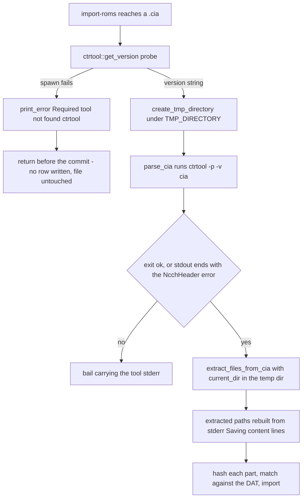

# External Tool Integration

Every format oxyromon handles is now decoded in-process except one. **`ctrtool`**
(CIA, from Project_CTR) is the only external program the binary looks for at
runtime; the README lists it alone under "External programs". Everything else that
once went through a child process has an in-tree replacement: `chdman` →
<!-- openwiki: broken internal link [../concepts/chd-format-and-chd-rs.md] file "../concepts/chd-format-and-chd-rs.md" does not exist. Fix the href or restore the target, then delete this comment. -->
[chd-rs](../concepts/chd-format-and-chd-rs.md), `flips` → `xps-rs`, `xdelta3` →
`xdelta-rs`, `nsz` → `nsz-rs`, `maxcso` → `xso-rs`, `gdidrop` → `gdi-rs`, 7-Zip →
`sevenz-rust2` + `zip`, and `dolphin-tool`/`wit` → `nod`
([CHANGELOG.md](../../CHANGELOG.md#L11-L15),
[AGENTS.md](../../AGENTS.md#L184-L199)). In particular there is no
`src/chdman.rs` any more — CHD work lives in [`src/chd.rs`](../../src/chd.rs) and
<!-- openwiki: broken internal link [../concepts/chd-format-and-chd-rs.md] file "../concepts/chd-format-and-chd-rs.md" does not exist. Fix the href or restore the target, then delete this comment. -->
[`crates/chd-rs`](../concepts/chd-format-and-chd-rs.md).

Because a missing `ctrtool` is an everyday condition rather than an edge case, the
shelling-out path has a fixed shape: probe availability through `get_version()`,
build a `tokio::process::Command` from a module constant, and treat the child's
stderr as the user-facing error text.

## The canonical recipe

`src/util.rs` owns the probe half of the pattern.

**`tool_version`** is the availability probe. It runs the tool with a fixed
argument list and pulls a version out of one stream:

```rust
pub async fn tool_version(
    command: impl AsRef<OsStr>, name: &str, args: &[&str],
    stdout: bool, line: usize, regex: Option<&Regex>,
) -> Result<String>
```

It reads `stdout` or `stderr` according to `stdout`, takes the `line`-th line, and
applies `regex`; the version is whatever the regex *matches*, not the whole line.
Crucially, it converts a non-zero exit into a version string too — status is never
checked — so the `Err` path exists only for a spawn failure, wrapped in an `anyhow`
context error naming the program (`Failed to spawn ctrtool`). That makes
`get_version(): Result<String>` an availability test rather than a version report.
When the regex simply does not match, it degrades to the literal `"unknown"` rather
than failing.

| Module | Probe | Stream | Regex |
| --- | --- | --- | --- |
| `ctrtool::get_version()` | `ctrtool` (no args) | stderr, line 0 | `\d+\.\d+\.\d+` |

`ctrtool` prints its banner on stderr and wants three version components; the
regex is a `std::sync::LazyLock<Regex>` so it is compiled once.

One helper rounds out the shared surface — and it is worth naming the helpers that
are *no longer* there, since older notes and changelogs refer to them:

- **`create_tmp_directory`** is a `tempfile::TempDir` created **inside**
  `config::get_tmp_directory(connection)`, not in the OS default. That keeps
  intermediate files on the filesystem the user chose — `TMP_DIRECTORY`,
  initialised from `OXYROMON_TMP_DIRECTORY` or `env::temp_dir()` — so a
  multi-gigabyte extract does not silently fill a small `/tmp`. Dropping the
  `TempDir` removes it, which is why `import_cia` holds one across the whole
  parse-extract-hash sequence instead of creating one per command.
- There is **no `run_tool` helper and no `tool_available` helper** any more, and
  nothing on this path emits a `log::debug!` of the assembled command. With
  `chdman` gone, `ctrtool` is the only caller, so status handling and the
  missing-tool message live at the call sites; the exact argv is not recoverable
  from the debug log. The spawn-failure context error and the stderr-as-error
  convention are what remains of the shared recipe.

## What each module shells out for

`ctrtool` is reached from `parse_cia` and `extract_files_from_cia` in
`src/ctrtool.rs`, both built with `Command::new(CTRTOOL)` where
`const CTRTOOL: &str = "ctrtool";` is a module constant. Both run
`ctrtool -p -v [flags] <cia>`, the second with `--certs`, `--tmd`, `--contents` and
`current_dir(directory)` set so the tool writes into the caller's temp directory
rather than the process cwd.

**The deliberate deviation from a plain status check.** Both CIA calls invoke
`Command::output()` directly and then check status *with an exception*: a
non-zero exit is tolerated when stdout ends with
`[ctrtool::NcchProcess ERROR] NcchHeader is corrupted (Bad struct magic).`,
which is what `-p` produces for a non-homebrew (retail) title. Anything else
becomes `bail!("{}", stderr)`. A generic "fail on non-zero exit" wrapper cannot
express that case — the tolerated error and the useful stdout would be discarded
together, breaking retail CIA imports. The trade-off is visible in the spawn path:
these two use `.expect("Failed to parse cia")` / `.expect("Failed to extract cia")`,
so a `ctrtool` binary that disappears between the probe and the call panics instead
of returning an error. `extract_files_from_cia` also reads the saved content names
from **stderr** (`[ctrtool::CiaProcess LOG] Saving content …`), so stderr here is
data as well as diagnostics.

Progress reporting follows from the process boundary: a subprocess gives oxyromon no
measurable byte count, so both CIA calls bracket their work with
`start_action`/`stop_action` (a spinner plus a message such as `Parsing cia` or
`Extracting files`). The in-process crates are the opposite case — their
`&mut dyn FnMut(u64)` progress callbacks feed `run_blocking`, which switches the bar
to a real byte-progress style, so CHD, CSO/ZSO, NSZ and patch work now reports
actual throughput where it used to spin.



*Caption: the CIA path end to end — probe, tolerated-error run, and the two ways a tool run ends in an error.*

## Feature degradation when a tool is missing

The rule is unchanged: **a missing tool disables the format, it does not abort the
command.** With one tool left, there is exactly one probe site.

| Entry point | Probe site | Behaviour when absent |
| --- | --- | --- |
| `import-roms` | per file, just before dispatching `.cia` | prints `Required tool not found: ctrtool` and returns before the transaction commits; the `.cia` stays untouched on disk, no database row is written, and the rest of the import continues. |
| `convert-roms` | none | `format_available` is a static list of the built-in destination formats (`7Z`, `CHD`, `CSO`, `NSZ`, `ORIGINAL`, `RVZ`, `ZIP`, `ZSO`); nothing is probed, so an unknown format string returns `Ok(())` and every real format runs. |
| `export-roms` | none | the format string is validated against the static export list and `bail!("Not supported")` otherwise; no tool check. |
| `check-roms` | none | CHDs, archives, CSOs, NSZs and RVZs are re-hashed in process. |
| `info`, GraphQL `dependencies`, MCP `status` | always | reported as missing, never an error. |

The old rough edges that came from probing inside a loop are gone with the probes.
`check-roms` no longer `break`s out of its romfile loop on a missing binary, so its
`All N files passed integrity check` summary can no longer be a masked skip; and
`convert-roms`/`export-roms` can no longer silently stop a CHD pass halfway because
a tool vanished.

Version-based degradation is gone too. `MIN_DREAMCAST_VERSION` (`0.264`) and
`MIN_SPLITBIN_VERSION` (`0.265`) no longer exist: chd-rs implements the LaserDisc
and multi-track CD paths itself, so no caller compares a probe string against a
minimum and no game is skipped with a "needs a newer chdman" warning
([CHANGELOG.md](../../CHANGELOG.md#L15)).

## How dependency versions are reported

Three surfaces enumerate dependencies, and each one calls every module's
`get_version()` at request time — there is no cache, so installing a tool is picked
up by the next `oxyromon info` without a restart:

- `src/info.rs` prints the **Dependencies** section, sorting by name, rendering
  `Ok` as `✔ <name>: <version>` and `Err` as `↪ <name>: not found`.
- `src/query.rs` exposes the same list as the GraphQL `dependencies` query, with a
  missing tool as a `null` version rather than an error.
- `src/mcp/read.rs` builds the identical list once in `build_status`, shared by the
  MCP `status` tool and the `oxyromon://status` resource, again with
  `version: Option<String>`.

The list is `sevenz-rust2`, `chd-rs`, `ctrtool`, `nod`, `nsz-rs`, `xps-rs`,
`xso-rs`, `xdelta-rs`. Every entry except **`ctrtool`** reports the literal
`"built-in"`, because a linked library has no version to query at runtime; only
`ctrtool` can come back `not found`. `nsz-rs` is the one built-in that carries extra
information: `built-in, prod.keys not found` when the Switch key file is absent,
which is a *content* warning on a dependency that is always present — keys are only
needed to compress NSPs containing NCAs.

## Configuration surface

oxyromon has no setting that names a tool path or overrides `${PATH}`: the one
executable name left is a compile-time constant (`const CTRTOOL: &str = "ctrtool";`).
The CHD settings still exist and still take effect, but they are arguments to a
library call now, not argv to a child process — `convert_roms`/`export_roms` read
them per system and hand them to `src/chd.rs` as plain parameters:

- `CHD_CD_COMPRESSION_ALGORITHMS`, `CHD_DVD_COMPRESSION_ALGORITHMS`,
  `CHD_HD_COMPRESSION_ALGORITHMS`, `CHD_LD_COMPRESSION_ALGORITHMS` — validated
  against the `Chd*CompressionAlgorithm` strum enums (up to four), packed into the
  header's fourcc slots; an empty list falls back to chdman's own defaults.
- `CHD_CD_HUNK_SIZE` and per-type equivalents, validated against
  `CHD_HUNK_SIZE_RANGE` (16 … 1048576), defaulting to the parent's hunk or the
  per-type default.
- `CHD_PARENTS` — whether to reuse a parent CHD.

`TMP_DIRECTORY` (and its `OXYROMON_TMP_DIRECTORY` bootstrap) remains the operational
knob that matters most: every extract and every CIA unpack lands there.

## Environment and CI

- **CI installs `mame-tools`, `xdelta3` and `ffmpeg`** in the single
  `Install dependencies` step, after `apt-get update` with retries — and, per the
  workflow's own comment, **all three are only for the format crates' tests**, which
  compare against `chdman` and `xdelta3`, make LaserDisc AVIs with `ffmpeg`, and
  **skip without them**. None is a runtime dependency: `chdman` and `xdelta3` patch
  generation live in `crates/chd-rs/tests/write.rs` and
  `crates/xdelta-rs/tests/interop.rs` respectively.
- **Nothing installs `ctrtool`.** CIA import therefore degrades with a printed
  error on the runner, and `src/import_roms/test_cia.rs` returns early on
  `ctrtool::get_version().is_err()`, so the one remaining subprocess path is the one
  CI never exercises.
- Reference-binary tests skip rather than fail, each with its own probe: chd-rs
  resolves `chdman` through `$CHDMAN` then `$PATH` and its LaserDisc suite also
  requires `ffmpeg` (`$FFMPEG`), printing `skipping: …`; `xdelta3` is probed with
  `xdelta3 -V`. The `maxcso` and `flips` interop suites resolve `$MAXCSO`/`$PATH`
  and are not installed either, so they skip in CI.
- **Neither container installs `chdman` or `ctrtool`**: the Arch Linux image installs
  only `base-devel curl rustup`, and the Alpine image only
  `build-base curl gcompat musl-dev rustup` (`gcompat` is there to run Trunk's
  prebuilt glibc wasm tools under musl); both delete the toolchain layers
  afterwards. CHD works in both images because
  it is built in; CIA support is absent in both by construction.

## Adding a tool

The seam is small, and `src/ctrtool.rs` is the only remaining template:

1. A single `const NAME: &str` for the executable, in the format module.
2. `pub async fn get_version() -> Result<String>` calling `tool_version` with the
   right stream, line and regex for that tool's banner. Treat `Err` as "not
   installed", never as "wrong version".
3. Build a `tokio::process::Command` and call `.output()`. Check
   `status.success()` yourself and `bail!` with the child's stderr, carving out any
   expected non-zero exit *with its stdout intact* — there is no shared wrapper to
   delegate that to. Prefer an `anyhow` context error over `.expect()` on the spawn
   so a disappearing binary degrades instead of panicking.
4. Probe with `get_version().is_err()` at the entry point, print
   `Required tool not found: <name>`, and degrade the feature rather than failing the
   command — return before the transaction commits so the file is left untouched.
5. Work only inside `create_tmp_directory()`, holding the `TempDir` for the whole
   operation.
6. Bracket the call with `start_action`/`stop_action` — there is no byte progress to
   report from a child process.
7. Add the tool to the dependency list in `info.rs`, `query.rs` and `mcp/read.rs`,
   and to CI's `apt-get install` line if tests need it.
8. Make the tests that need it skip when the probe fails, so a developer without the
   tool still gets a green run.

Before reaching for step 1, though: the direction of travel is the other way. Every
format added or touched since 0.25 has gone into a crate under `crates/` with a
synchronous, file-to-file API and a `progress: &mut dyn FnMut(u64)` callback, driven
from `src/` through `run_blocking`
([Format Modules and Their Crate Backends](../concepts/format-modules-and-format-crates.md),
[Format Crates in crates/](format-crates.md)).
