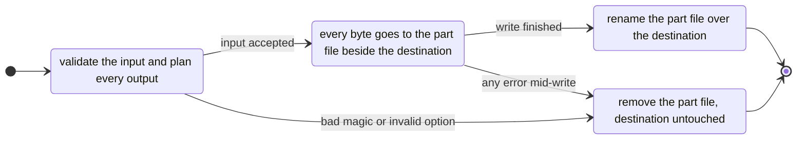
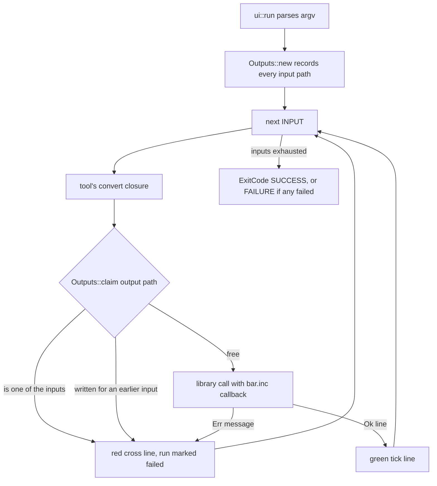

# Format Crates in crates/

`crates/` holds the five format crates oxyromon wrote to replace the external
programs it used to shell out to. Each began as a port of one upstream tool,
keeps that tool's license, and stays a standalone library plus its own CLI
published to crates.io; oxyromon is the workspace root and depends on them as
path dependencies. The result is that the formats in this table have no runtime
dependency to install, report `"built-in"` from `get_version()`, and can report
real byte-level progress instead of a spinner.

| Crate | Began as a port of | CLI | License | oxyromon module |
| --- | --- | --- | --- | --- |
| `gdi-rs` | gdidrop | `gdirs` | BSD-2-Clause | `gdi` |
| `nsz-rs` | nsz (nicoboss) | `nszrs` | MIT | `nsz` |
| `xdelta-rs` | xdelta3 | `xdeltars` | Apache-2.0 | `xdelta` |
| `xps-rs` | Flips | `xpsrs` | GPL-3.0-or-later | `xps` |
| `xso-rs` | maxcso | `xsors` | ISC | `xso` |

The crates are workspace members (`members = ["crates/*"]`), so they share one
lockfile, one CI run and one set of conventions; `frontend/` and `desktop/` are
deliberately *not* members so their wasm and webview dependencies stay out of
the native build. Which formats still run as child processes
(`chdman`, `ctrtool`) is covered in
[External Tool Integration](external-tools.md); the `src/` adapters that call
into these crates are covered in
[Format Modules and Their Crate Backends](../concepts/format-modules-and-format-crates.md).

## The entry-point contract

Every crate's public entry point is synchronous, takes an input path, an output
path, a settings struct, and `progress: &mut dyn FnMut(u64)`. There is no async
runtime, no `Read`/`Write` handed to the caller, and no thread spawning visible
from outside (the crates that parallelise build their own rayon pools).

The progress callback takes **bytes of the input consumed since the last call**,
not a position, and the calls add up to the input size — where "input" means the
thing whose bytes dominate the work:

- `xso_rs::compress` / `xso_rs::decompress`: the ISO or CSO/ZSO being read.
- `xdelta_rs::decode` / `xps_rs::apply`: the **patch** size, reported window by
  window or action by action, since a patch is small and the source read is
  driven by it.
- `gdi_rs::convert`: the BINs behind the CUE, which is why the crate also
  exports `input_size(cue)` — a caller cannot know that total from the CUE's own
  size, and `gdi_rs` counts a track's dropped pregap as consumed too.
- `nsz_rs::pipeline::compress_nsp` / `decompress_nsz`: the container being read;
  an internal `member_progress` adapter converts per-member positions into
  deltas so each byte is reported exactly once even when a member is read out of
  order (an update NCA's BKTR table is seeked to before the sequential pass
  reaches it).

oxyromon adapts that contract in exactly one place,
`progress::run_blocking(progress_bar, length, work)`, which clones the shared
bar, moves the closure to `tokio::spawn_blocking`, resets the bar to the bytes
style with `length`, and wires `bar.inc` into the crate's callback. `length` is
therefore always what the crate's calls sum to: `input.metadata()?.len()` for
`xso`, `nsz`, `xdelta` and `xps`, and `gdi_rs::input_size(&cue)` for `gdi`. A
`JoinError` becomes `"Conversion task failed"`, kept distinct from the crate's
own error. Running these on a runtime worker instead would stall it for the
length of a several-gigabyte compression.

```rust
pub async fn run_blocking<T, E>(
    progress_bar: &ProgressBar,
    length: u64,
    work: impl FnOnce(&mut dyn FnMut(u64)) -> Result<T, E> + Send + 'static,
) -> anyhow::Result<T>
```

The same signature is what makes a new backend drop-in: `src/xso.rs`, `src/nsz.rs`,
`src/gdi.rs`, `src/xdelta.rs` and `src/xps.rs` differ only in the settings they
build and the length they pass.

## `.part` output discipline

Every crate writes to `<output>.part` **next to the destination** (same
directory, so the finish step is a rename, not a copy) and only renames it into
place once the write completed. On any failure the `.part` is removed. Two
guarantees follow, and each crate tests them: an existing output is replaced
only by a complete new one, and a failed run leaves nothing behind.



*Caption: the write lifecycle every format crate shares; nothing at the destination path changes until the whole output is complete.*

The halves are literally the same code, duplicated per crate:
`xso-rs` factors it into `crate::io::{part, finish}`, while `nsz-rs`,
`xdelta-rs`, `xps-rs` and `gdi-rs` each carry a private `part`/`finish` pair.
Two crate-specific variations matter:

- **`gdi-rs` stages a whole set.** A GDI is one descriptor plus one file per
  track, so it writes every `.part` first and renames them all only after the
  last one succeeds, then removes all of them if anything failed. Validation —
  the CUE layout, the output directory, and the rule that no track may be
  written over a BIN the CUE reads — happens in `plan`, before any file opens,
  so a rejected input is "not ours to delete".
- **`nsz-rs` back-patches its header.** `with_output` creates the `.part`, seeks
  past the reserved PFS0 header, lets the caller stream members, then rewinds
  and writes the header from the recorded `(name, offset, size)` layout. It
  drops the `File` before renaming or removing, which Windows requires.

`nsz-rs` additionally `create_dir_all`s the output's parent before opening the
`.part` — the only crate that creates directories for you.

## Errors: shared wording, per-crate additions

Each crate has one `thiserror` enum named `Error` plus a `Result<T>` alias, and
the shared variants keep identical `#[error(...)]` strings so a message reads the
same whichever backend produced it:

| Variant | Text | In |
| --- | --- | --- |
| `Io` | `io error: …` | all five, `#[from] std::io::Error` |
| `BadMagic { expected, found }` | `bad magic: expected …, found …` | `xso-rs`, `nsz-rs`, `xdelta-rs`, `xps-rs` |
| `Unsupported` | `unsupported format: …` | `xso-rs`, `nsz-rs`, `xdelta-rs`, `xps-rs` |
| `Corrupt` | `corrupt data: …` | all five |
| `InvalidOption` | `invalid option: …` | `xso-rs`, `gdi-rs`, `xdelta-rs` |
| `WrongSource` | `wrong source: …` | `xdelta-rs`, `xps-rs` only |

`WrongSource` exists only in the two patch crates and is the interesting one:
it means *the patch is fine and this is not its file*. BPS raises it after
checking the patch's own CRC, then the source's size and CRC — with a distinct
message when the "source" is actually the patch's output already — and xdelta
raises it when a window's Adler-32 does not match what it rebuilt. Crates add
only what their format needs: `nsz-rs` has `MissingKey`, `InvalidKey`,
`Verification`, `Compression` and `Hex`; `xso-rs` has nothing beyond the shared
five.

Errors are the *only* failure channel — no panics on malformed input. Crafted
inputs are tested explicitly in `nsz-rs/tests/malformed.rs`: an `NCZSECTN`
section count of `1 << 40`, `i64::MAX` or `-1`, a PFS0 with `u32::MAX` file
count, or a `u64::MAX` member offset must all fail rather than drive a huge
allocation. `xso-rs` bounds a block's stored span so a corrupt index cannot ask
for gigabytes, and `nsz-rs` refuses an implausibly large Meta NCA before
decompressing it.

The one exception to "error means nothing was applied" is `xps_rs::apply`'s
`Option<Warning>`: IPS carries no checksum, so Flips' three suspicions
(`NotThis`, `AlreadyApplied`, `Scrambled`) are reported while still applying the
patch. oxyromon prints it as `Patched, but …`.

## One identical CLI shell, checked by a test

Each crate's `[[bin]]` is gated on `required-features = ["cli"]` and consists of
a `main.rs` with a clap builder `cli()` plus one `convert(input, matches,
outputs)` closure, and a `ui.rs` that is **byte-identical across all five**.
`tests/crates.rs` reads `crates/xso-rs/src/bin/xsors/ui.rs` and asserts the
copies in `gdirs`, `nszrs`, `xdeltars` and `xpsrs` equal it, so the shared shell
must be changed in all five at once.



*Caption: the per-input loop `ui.rs` provides; only the `convert` closure is crate-specific.*

What `ui.rs` fixes for every tool: `<cli> [OPTIONS] <INPUT>...` with each input
converted in the direction its extension implies; `-o DIR` defaulting to next to
each input and created on demand; output names `<input stem>.<extension>`
keeping dots in the stem; oxyROMon's own progress-bar template, hidden when
stderr is not a terminal; one `✔`/`✖` result line per input on stdout/stderr;
`AFTER_HELP` pointing back at the project; and a non-zero exit as soon as any
input failed. `Outputs::claim` compares `std::path::absolute` paths, so
`xsors -o out/ a/game.iso b/game.iso` fails on the second input instead of
silently writing `out/game.cso` twice, and an input can never be overwritten by
its own output. The patch tools add a further guard in their own `convert`: the
output may not land on `-s`'s source file.

Flag meanings are fixed across tools that share them — `-o DIR`, `-b SIZE` in
**bytes** (`nszrs` converts it to the zstd block exponent the library wants and
rejects anything not a power of two in 16384..=4294967296), and `-s FILE` for the
patch crates' source — with lowercase short forms reserved for common options.
`--`-only long flags carry no short alias.

## Library-first manifests

Every manifest is written so the library is the product and the CLI is an
optional extra:

- `[features] default = ["cli"]`, `cli = ["dep:clap", "dep:console", "dep:indicatif"]`;
  `clap`, `console` and `indicatif` are `optional = true` and used only by
  `src/bin/<cli>/`.
- oxyromon depends on each crate with `default-features = false`, so it links
  the library and none of the CLI's UI stack.
- `edition`, `rust-version` and `repository` come from `[workspace.package]`, and
  shared dependencies (`clap`, `console`, `crc32fast`, `indicatif`, `rayon`,
  `tempfile`, `thiserror`) from `[workspace.dependencies]`.
- No crate declares `[profile]`: only the root's applies, and the root sets
  `opt-level = 3` for dependencies in dev builds precisely because these codecs
  are unreadable at opt-level 0.
- Each carries its own `version`, `license` (the upstream's), `description`,
  `keywords`, `categories` and an `include` list.

## Releases and distribution

Releases are **per crate**: its own version number, its own `CHANGELOG.md` in
oxyromon's format, and git tags named `<crate>-<version>` (e.g. `nsz-rs-0.3.0`).
A crate must be published before any oxyromon release that needs its new
version, since the root pins each dependency by `path` **and** `version`. The
root's own `0.x` tags are a separate series.

```sh
cargo build --release -p gdi-rs -p nsz-rs -p xdelta-rs -p xps-rs -p xso-rs  # the five CLIs
cargo test -p xso-rs                            # one crate
cargo test --release -p xso-rs -- --ignored     # its slow tests
```

`dist.sh` cross-compiles the five CLIs alongside oxyromon for every target and
packages each binary separately (`gdirs`, `nszrs`, `xdeltars`, `xpsrs`, `xsors`
per target triple), so a standalone tool is installable without the organizer.

## Per-crate entry points worth knowing

- **`gdi_rs::convert(cue, output_dir, progress) -> Gdi`** plus
  `input_size(cue)`. `output_dir` must already exist, and the returned `Gdi`
  names the `.gdi` descriptor and each track file so the caller can wrap them.
- **`nsz_rs::pipeline::compress_nsp(input, output, keys, compression, fix_padding, progress)`**
  and **`decompress_nsz(input, output, keys, fix_padding, verify, strict, progress) -> Report`**.
  Keys arrive as a *loader* (`impl FnOnce() -> Result<Keys>`), invoked only when
  the pipeline actually needs one: compression calls it as it reaches the first
  `.nca` member, decompression only when verifying against a CNMT.
- **`xdelta_rs::decode(source, patch, output, progress)`** — `source` may be
  `None` only for a patch that copies from none — and `read_header(patch)`, which
  exposes the `target_name` a patch records (the CLI uses it for the output name,
  reduced to a bare file name so a recorded path cannot escape the output dir).
- **`xps_rs::identify(patch) -> Format`** and `apply(source, patch, output, progress)
  -> Option<Warning>`. `identify` reads five bytes of magic to choose IPS or BPS,
  and the CLIs call it before opening a progress bar.
- **`xso_rs::compress` / `decompress` / `probe`**, with `Stats { input_size,
  output_size }` back for reporting a ratio. `probe` reads only the 24-byte
  header.

## nsz-rs and `prod.keys`

`nsz-rs` is the only crate that needs user secrets, and only in one narrow case.
`nszrs` defaults to `~/.switch/prod.keys` (overridable with `-k`), and
oxyromon uses the same path via `dirs::home_dir()`. Keys are CRC32-verified
against the checksums of the legitimate sources and master keys — the same
sanity check the Python tool performs, so a tampered or truncated `prod.keys`
fails loudly instead of producing garbage; `--skip-key-check` exists for
synthetic test keys, and keys absent from the table are accepted unverified.

Because loading is lazy, **`prod.keys` is needed only to compress NSPs
containing NCAs**: unverified decompression never loads it, and containers
without NCAs (homebrew, for instance) never need it in either direction. That is
why oxyromon's `nsz::get_version()` returns `"built-in"` but
`"built-in, prod.keys not found"` when the file is missing — it can never fail,
and the warning exists so a user does not discover the missing file
mid-compression. oxyromon's own decompression path runs
`decompress_nsz(..., fix_padding = true, verify = false, strict = false)`, so
checking and extracting an NSZ works with no keys at all. Key-reading errors name
the file, since a lazily loaded key can fail far from where the path was given.

## How these crates are tested

The convention is *agreement with the reference implementation*, not
self-consistency: `tests/interop.rs` in `xso-rs`, `xdelta-rs` and `xps-rs` runs
the upstream binary (maxcso via `$MAXCSO`/`$PATH`, `xdelta3`, `flips`) and checks
that each reads the other's output, and that our CSO is byte-identical to
`maxcso --only-zlib`. Those tests **skip rather than fail** when the tool is
absent; CI installs `xdelta3` specifically so the xdelta-rs comparison runs, and
slow cases are `#[ignore]`d. `nsz-rs` leans on generated known-answer vectors
(`tests/vectors.rs`, produced by `scripts/gen_vectors.py`) plus round-trip and
malformed-input suites.

Two suites specifically pin the `.part` contract: `xso-rs/tests/roundtrip.rs`
truncates a CSO so decompression fails mid-write and asserts the pre-existing
output still says `keep me` and no `.part` survives, and
`gdi-rs/tests/convert.rs` blocks one track's `.part` with a directory to prove a
half-written set is neither committed nor cleaned up beyond what the crate
created. CI covers the crates and oxyromon in one pass
(`cargo llvm-cov --workspace --features oxyromon/server`), so `tests/crates.rs`
runs alongside them.

## Adding or changing a crate

The seams are narrow and fixed by the conventions above:

1. Add the crate under `crates/` (it joins `members = ["crates/*"]`
   automatically), library-first, with the `cli` feature and
   `required-features = ["cli"]` on its `[[bin]]`.
2. Copy `src/bin/<cli>/ui.rs` verbatim — `tests/crates.rs` will fail otherwise —
   and write only `cli()` and `convert()`.
3. Keep the shared `Error` variants and their exact wording; add a variant only
   for something the shared set cannot say.
4. Write to `<output>.part` and rename on success; validate everything before
   the first file is created so an output you did not make is never removed.
5. Report input bytes consumed as deltas summing to the length a caller can
   compute up front; export a helper like `gdi_rs::input_size` when you cannot.
6. Add the dependency to the root `Cargo.toml` with `path` + `version` +
   `default-features = false`, then wire the module behind
   `progress::run_blocking` and list it in `info`, the GraphQL dependency query
   and the MCP status tool so it stays reportable.
