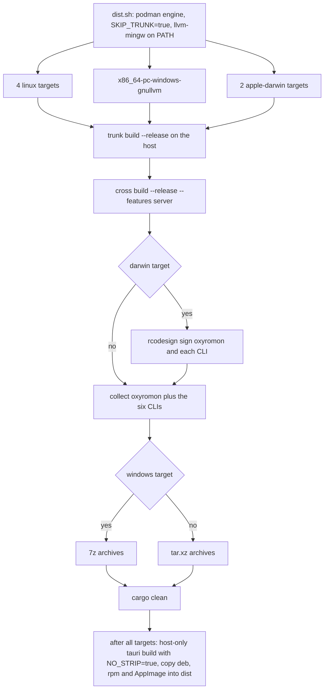
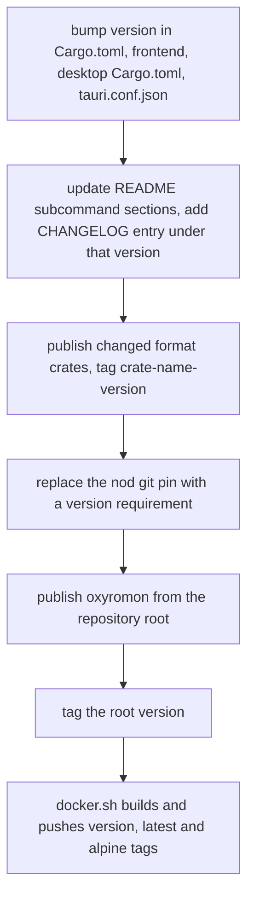

# Builds, Distribution and Releases

One root Cargo package yields five shipped artifact families: a headless CLI, the
same binary built with `--features server` (web server plus embedded UI and MCP),
the six standalone format-crate CLIs (`chdrs`, `gdirs`, `nszrs`, `xdeltars`,
`xpsrs`, `xsors`), a Tauri desktop bundle, and two container images. The mechanics
are split across five small shell scripts at the repository root, a `Cross.toml`
for the cross images, and a per-crate publishing convention that has a hard
ordering constraint. Feature-flag semantics — what `server`, `mcp`, `use-rustls`
and `use-native-tls` change — live in
[Feature Flags and Build Topology](../architecture/feature-flags-and-build-topology.md);
this page covers how those builds are actually produced, packaged, signed and
released.

Since 0.25.0 the release matrix is a six-crate matrix: CHD support moved from the
external `chdman` binary to the `chd-rs` crate in `crates/`, and "Its CLI
(`chdrs`) ships in the release archives too" is how the changelog records each of
these ports. The same is true of `gdirs`, `nszrs`, `xdeltars`, `xpsrs` and `xsors`,
which arrived in 0.24.0 and 0.25.0 as replacements for `gdidrop`, `nsz`, `xdelta3`,
`flips` and `maxcso`.

## The helper scripts

All five run from the repository root.

| Script | What it builds | Environment it assumes |
| --- | --- | --- |
| `build.sh` | `trunk build --release` in `frontend/`, then `cargo build --release --features server` | trunk plus the `wasm32-unknown-unknown` target on `PATH`; it does **not** set `SKIP_TRUNK`, so whenever `build.rs` runs it repeats that same trunk build |
| `desktop.sh` | `cargo tauri build` in `desktop/` (the `oxyromon-desktop` binary and its installers) | Tauri CLI and the platform's webview development packages; host triple only; exports `NO_STRIP=true`; `beforeBuildCommand` stages the server sidecar first |
| `dist.sh` | Everything, for the full release matrix, into `dist/`: `oxyromon` and the six format CLIs for seven targets, then the host's desktop bundles | `cross` with `CROSS_CONTAINER_ENGINE=podman`, trunk, `rcodesign` on the host, `7z`, `tar`/`xz`, `llvm-mingw` at `/opt/llvm-mingw/llvm-mingw-ucrt/bin`, plus a full desktop toolchain for the host |
| `docker.sh` | `alucryd/oxyromon:<version>` + `:latest` from `Dockerfile.archlinux`, and `<version>-alpine` + `:alpine` from `Dockerfile.alpine`, then pushes all four | `docker` usable via `sudo`, `tomlq` to read `.package.version` out of `Cargo.toml`, and push access to Docker Hub |
| `test.sh` | Coverage into `lcov.info` (gitignored) over the whole workspace | `cargo-llvm-cov` with `llvm-tools-preview`; one pass, matching CI |

`test.sh` is now a single line — `cargo llvm-cov --workspace --features
oxyromon/server --lcov --output-path lcov.info` — which is byte-for-byte the command
CI runs. The old second pass that added `oxyromon/nod` and `oxyromon/sevenz` is
gone, along with the features themselves: 0.25.0 made RVZ/WBFS (`nod`) and 7z/ZIP
(`sevenz-rust2`, `zip`) unconditional, so those feature names no longer exist. The
full workspace is still exercised, because `--workspace` includes the format crates
under `crates/`.

## The cross-compilation matrix

`dist.sh` loops over three target families:

- **Linux**: `aarch64-unknown-linux-gnu`, `aarch64-unknown-linux-musl`,
  `x86_64-unknown-linux-gnu`, `x86_64-unknown-linux-musl`.
- **Windows**: `x86_64-pc-windows-gnullvm` — a GNU/LLVM target, not MSVC, built
  against the `llvm-mingw` toolchain. This sidesteps the MSVC limitation the
  README documents for asm-hashes, which otherwise forces
  `--no-default-features --features use-rustls` or a `-gnu` target.
- **macOS**: `aarch64-apple-darwin` and `x86_64-apple-darwin`, which have no
  upstream cross images, so `Cross.toml` points them at locally built
  `ghcr.io/cross-rs/<target>-cross:local` images.

Inside each family, per target, the sequence is the same: build the wasm bundle on
the host, `cross build --release --target <t> --features server`, package
`oxyromon`, then `cross build --release --target <t> -p chd-rs -p gdi-rs -p nsz-rs
-p xdelta-rs -p xps-rs -p xso-rs` and package `chdrs`, `gdirs`, `nszrs`,
`xdeltars`, `xpsrs` and `xsors` as separate archives, then `cargo clean` so the
next target starts from a clean tree. Each crate's binary lives behind a default
`cli` feature (`required-features = ["cli"]`), so the root's
`default-features = false` path dependency keeps the CLI out of the oxyromon build
while this loop builds it explicitly. Archives are named after the target triple
with the vendor field trimmed (`${target/-unknown/}` for Linux and macOS,
`${target/-pc/}` for Windows), so a Linux artifact is
`oxyromon.aarch64-linux-gnu.tar.xz` and its CHD tool is
`chdrs.aarch64-linux-gnu.tar.xz`, while a macOS one keeps `aarch64-apple-darwin`
intact. Linux and macOS ship `.tar.xz`, Windows ships `.7z` (with `.exe`
suffixes); seven archives per target, landing flat in `dist/`, which is gitignored.



*Caption: `dist.sh`'s per-target pipeline, and where signing and archive format diverge.*

Three environment decisions make the matrix tractable:

- `SKIP_TRUNK=true` is exported once and `Cross.toml` lists it under
  `[build.env] passthrough`, so `build.rs` never tries to compile the UI inside a
  cross image. Instead `(cd frontend && trunk build --release)` runs on the host
  at the top of every loop iteration — the wasm payload is target-independent, so
  one host build serves the native and all cross builds of that iteration.
- `CROSS_CONTAINER_ENGINE=podman` is exported for the whole script, so `cross`
  drives podman rather than docker.
- The Windows loop overrides `PATH` inline
  (`PATH=/opt/llvm-mingw/llvm-mingw-ucrt/bin/:/usr/bin cross build …`) rather than
  relying on the exported prefix, pinning the linker search order to the mingw
  toolchain for that target.

**Signing** covers only Apple targets: `rcodesign sign` runs on each macOS binary —
`oxyromon` and each of the six CLIs — after the build and before it is tarred
(`oxyromon` first, then each CLI inside the packaging loop). Linux and Windows
artifacts are unsigned. Separately, the root `[profile.release]` (`lto = "thin"`,
`codegen-units = 1`, `strip = true`, `panic = "abort"`) applies to every `oxyromon`
and format-CLI binary in the matrix; `frontend/` and `desktop/` carry their own
size-oriented `opt-level = "z"` profiles because they are standalone crates outside
the workspace.

## The desktop bundle is host-only

`dist.sh` builds the desktop app once, at the end, for the host only, and says so
in a comment: Tauri links against the platform's own webview, which the cross
images do not carry and for which no cross toolchain exists. Producing a Windows or
macOS bundle means running the script on that operating system. The same constraint
plus a concrete bug motivates `NO_STRIP=true`: linuxdeploy bundles a binutils too
old to read the `.relr.dyn` sections modern distributions ship, and it fails the
AppImage on the first library it tries to strip. `desktop.sh` exists as the
standalone entry point and carries the identical comment and export. The final
`cp desktop/target/release/bundle/*/*.{deb,rpm,AppImage} dist/` is therefore a
host-arch copy, and it is the only non-archive artifact in `dist/`.

The bundle is not a separate backend. `tauri.conf.json` declares
`externalBin: ["binaries/oxyromon"]` and runs
`desktop/scripts/stage-sidecar.sh` as both `beforeDevCommand` and
`beforeBuildCommand`. That script resolves the target triple from `TARGET_TRIPLE`
(or `rustc -vV`), runs `cargo build --release --features server` **from the
repository root**, and copies the result to
`desktop/binaries/oxyromon-<triple>[.exe]` — the suffixed name Tauri's sidecar
mechanism requires. Because it is an ordinary root build, it inherits the exported
`SKIP_TRUNK=true` and embeds the assets the loop already built instead of
recompiling the UI. The generated `desktop/binaries/` directory is gitignored.

## Container images

`Dockerfile.archlinux` and `Dockerfile.alpine` are self-contained build-and-run
images: they copy the whole tree, install a Rust toolchain, the
`wasm32-unknown-unknown` target and trunk 0.21.14, then run
`cargo install --features server --root /usr --path .`, and finish by deleting the
toolchain, cargo caches and the source tree. Neither image sets `SKIP_TRUNK`, so
unlike `dist.sh` the UI is compiled inside the image. Alpine additionally installs
`gcompat` because trunk downloads prebuilt wasm-bindgen/wasm-opt binaries compiled
against glibc, which must run under musl; Arch Linux instead disables pacman
signature checking (`SigLevel = Never`) to keep the build scripted.

Neither image installs an external format tool any more. The Alpine package list is
`build-base curl gcompat musl-dev rustup` and the Arch one is `base-devel curl
rustup`: no `chdman`/`mame-tools`, no `xdelta3`, no `p7zip`/7-Zip, no `flips`, no
`maxcso`, no `dolphin-tool`. Those codecs are now Rust crates linked into the
binary, so the images need only a compiler; the CI runner is the remaining place
that installs `mame-tools` and `xdelta3`, and it does so purely to run the crates'
reference-implementation tests.

Both images end with `OXYROMON_DATA_DIRECTORY=/data`,
`OXYROMON_ROM_DIRECTORY=/roms`, `VOLUME [ "/data", "/roms" ]` and `CMD
["oxyromon"]`. The data and ROM directories are therefore fixed by environment
rather than by a user's platform data directory, but the default command carries no
subcommand — and `src/main.rs` only does work inside
`if let Some((subcommand, …)) = matches.subcommand()` — so `docker run
alucryd/oxyromon` as-is is a no-op; a subcommand such as `server` has to be
appended.

Tagging is done by hand in `docker.sh`, which derives `<version>` from
`Cargo.toml` with `tomlq` and pushes four tags. The GitHub workflow
`.github/workflows/docker.yml` is a different, narrower path: it triggers on push
to `develop`, and builds and pushes only `Dockerfile.archlinux` with tags derived
by `docker/metadata-action` from the git ref. So automated pushes never produce
the version-pinned `<version>` or `<version>-alpine` tags, and never refresh the
Alpine image at all; those exist only after someone runs `docker.sh`.

Release archives still do not bundle everything oxyromon can use, but the list has
shrunk to one entry: `oxyromon info` reports `ctrtool` as the only dependency that
can come back "not found", alongside the built-in `chd-rs`, `xso-rs`, `xps-rs`,
`xdelta-rs`, `nsz-rs`, `sevenz-rust2` and `nod` (whose `get_version()` returns the
literal string `built-in`). The README's supported-formats table likewise names
only ctrtool as an external backend, for CIA support; see
[External Tools](../integrations/external-tools.md).

## Publishing order and the remaining git pin

`crates/` members share oxyromon's lockfile and CI but are versioned and published
to crates.io independently, each with its own `version`, its own `CHANGELOG.md` in
oxyromon's format, and its own `<crate>-<version>` git tag (for example
`nsz-rs-0.3.0`). The root's `0.x` tags are a separate series. This creates a hard
ordering rule: **a format crate must be published before any oxyromon release that
needs its new version**, because the root declares each dependency with `path`
*and* `version` (`chd-rs = { path = "crates/chd-rs", version = "0.1.0", … }`), and
`cargo publish` rewrites that into a crates.io version requirement that has to
resolve. A `cargo publish` of oxyromon against an unpublished crate version fails,
and the root's `exclude` list keeps `crates/` out of its tarball, so nothing in the
released package can fill the gap. Current crate versions are `nsz-rs 0.3.0` and
`chd-rs`, `gdi-rs`, `xdelta-rs`, `xps-rs`, `xso-rs` at `0.1.0`.

One `ponytail` comment in `Cargo.toml` records the last publishing gate: the
package cannot be published while this dependency points at git, because crates.io
rejects git dependencies.

- `nod = { git = "https://github.com/encounter/nod", tag = "v2.0.0-alpha.12" }` —
  waiting for `nod` to publish past 2.0.0-alpha.9, then back to a version
  requirement before a release.

That pin is a mandatory dependency, not an optional feature (0.25.0 deleted the
`nod` feature when RVZ/WBFS stopped requiring `dolphin-tool` and `wit`), so it must
return to a plain version requirement before release. The sibling case is already
resolved: `sevenz-rust2` is back to a normal `version = "0.24.0"` requirement with
the `zstd` feature, no longer a fork pinned by revision, so `nod` is the only
git-sourced dependency left. Relatedly, `frontend/` and `desktop/` are
`publish = false` and declare their own `[workspace]`, and `Cargo.toml` excludes
`.github/`, `crates/`, `dist/` and `tests/`; cargo also leaves the nested
`frontend/` package out of the tarball. Installing from crates.io therefore builds
without the workspace's integration tests and without `frontend/` — which is
exactly the case `build.rs` guards with its "build from a git checkout, or set
`SKIP_TRUNK=true`" assertion and its unconditional `target/assets` creation.



*Caption: the release sequence, including the two steps that must happen before oxyromon itself can be published.*

## Release bookkeeping

- **Version strings live in four manifests** — `Cargo.toml`, `frontend/Cargo.toml`,
  `desktop/Cargo.toml` and `desktop/tauri.conf.json` (all at `0.25.0`) — and
  nothing in the workspace checks that they agree. A release bumps them by hand, in
  step with `docker.sh`, which reads only the root's value.
- **Documentation is part of the change, not of the release.** `AGENTS.md` requires
  every notable change to update the relevant `README.md` subcommand section so the
  usage block matches real `--help` output, and to add a `CHANGELOG.md` entry under
  the current version's `## Features` / `## Changes` / `## Improvements` /
  `## Fixes` section, creating that version's block at the top of the file if it
  does not exist yet. "Current version" means the `version` field in `Cargo.toml`.
  Format crates keep their own changelogs in the same shape.
- **Offline query data must be committed.** `sqlx` verifies queries at compile time,
  so `migrations/` and query changes require `cargo sqlx prepare -- --features
  server` to refresh `.sqlx/`. Without it the build needs a live `DATABASE_URL`,
  which cross containers and the Docker builds do not have — a query change left
  unprepared breaks the release matrix rather than just the developer's machine.
- **The pre-release gate is CI, not a release workflow.**
  `.github/workflows/continuous_integration.yml` runs on pushes and pull requests to
  `master` and `develop` with `SKIP_TRUNK: "true"` and a pinned `TRUNK_VERSION` of
  0.21.14: it builds the web UI once, then runs two clippy passes —
  `--workspace --all-targets --features oxyromon/server` and
  `--no-default-features --features use-rustls,mcp --all-targets`, the latter
  existing so `mcp`-only builds cannot rot — a `cargo build --release --features
  server`, and workspace coverage with `cargo llvm-cov`, uploaded to Codecov. It
  installs `mame-tools`, `xdelta3` and `ffmpeg` because the crates' interop tests
  compare against chdman and xdelta3, make LaserDisc AVIs with ffmpeg, and skip
  rather than fail when those are absent. Nothing in CI runs `dist.sh`, `docker.sh`
  or `cargo publish`.

```sh
./build.sh                                                        # UI + server CLI for this machine
./test.sh                                                         # workspace coverage into lcov.info
cargo build --release -p chd-rs -p gdi-rs -p nsz-rs -p xdelta-rs -p xps-rs -p xso-rs   # the six CLIs: chdrs, gdirs, nszrs, xdeltars, xpsrs, xsors
./desktop.sh                                                      # host desktop bundles
./dist.sh                                                         # full release matrix into dist/
./docker.sh                                                       # push both images, four tags
```

*Caption: the everyday commands, from the cheapest host build to the full release matrix. Note that `-p` takes the crate names while the produced binaries are `chdrs`, `gdirs`, `nszrs`, `xdeltars`, `xpsrs` and `xsors`.*

See also [Feature Flags and Build Topology](../architecture/feature-flags-and-build-topology.md),
[Format Crates](../integrations/format-crates.md),
[External Tools](../integrations/external-tools.md), and
[Architecture Overview](../architecture/overview.md).
