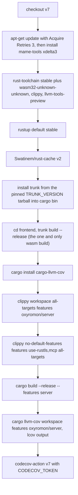
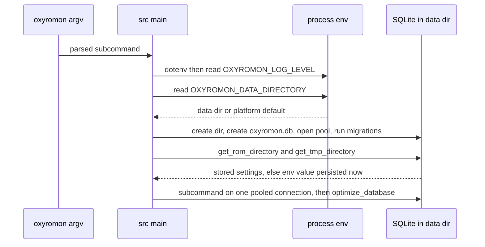

# CI Pipelines and Runtime Environment

Three workflows live in `.github/workflows/`, and each guards a different thing:
`continuous_integration.yml` is the change gate for the code and the feature
matrix, `docker.yml` publishes a container image, `openwiki-update.yml` keeps
this documentation current. None of them is a release workflow — nothing here
runs `dist.sh`, `docker.sh`, `desktop.sh` or `cargo publish` (see
[Builds, Distribution and Releases](build-and-release.md)).

The runtime side is small and worth pinning down exactly: six variables read at
three sites (`src/main.rs`, `src/config.rs`, `build.rs`) plus one compile-time
consumer (`sqlx`), and they do not share a lifetime. `OXYROMON_DATA_DIRECTORY`
and `OXYROMON_LOG_LEVEL` are honored on every run; `OXYROMON_ROM_DIRECTORY` and
`OXYROMON_TMP_DIRECTORY` are consulted only until a settings row exists;
`SKIP_TRUNK` and `DATABASE_URL` never reach the running binary at all.

## Workflow trigger matrix

| Workflow | Trigger | Runs on | What it produces |
| --- | --- | --- | --- |
| `continuous_integration.yml` | `push` and `pull_request` to `master` | `ubuntu-26.04` | clippy verdicts, a release `server` binary, `lcov.info` uploaded to Codecov |
| `docker.yml` | `push` to `develop` | `ubuntu-latest` | `alucryd/oxyromon` image pushed to Docker Hub, tags from the git ref |
| `openwiki-update.yml` | `schedule` at `0 8 * * *` plus `workflow_dispatch` | `ubuntu-latest` | a pull request from branch `openwiki/update` touching `openwiki/`, `AGENTS.md`, and the workflow itself |

CI and Docker publish watch **different branches**: code is gated on `master`,
images are pushed from `develop`. Because `docker/metadata-action` derives its
tags from the git ref, a push to `develop` publishes an image before the change
has ever passed the CI gate.

## The CI job, step by step

The job is a single `build` job with no matrix; the feature matrix is expressed
as separate cargo invocations instead. Job-level `env` sets `CARGO_TERM_COLOR`,
`SKIP_TRUNK: "true"` and `TRUNK_VERSION: "0.21.14"`.



*Caption: the CI job as a single linear pipeline — one wasm build, two clippy passes, one release build, one coverage run.*

Why each step exists:

- **`apt-get update` before any install, with `-o Acquire::Retries=3`.** The
  runner image bakes its apt lists at image-build time and they go stale within
  days; Ubuntu rolls superseded `.deb`s out of the pool when a newer point
  version lands, so installing against the cached lists 404s. The retries cover
  transient mirror failures on the refresh itself, not just the install.
- **`mame-tools`** provides `chdman`, and **`xdelta3`** is installed purely for
  the `xdelta-rs` tests, which compare against the reference binary and skip
  rather than fail when it is missing
  (`crates/xdelta-rs/tests/interop.rs` returns early on `xdelta3 -V`). CI
  installs both so those interop paths actually execute instead of silently
  skipping. `ctrtool` is *not* installed, so CIA tests skip in CI, and neither
  `maxcso` nor `flips` is installed, so the `xso-rs` and `xps-rs` interop suites
  also skip there — those two are a local responsibility.
- **`wasm32-unknown-unknown` on the toolchain** is needed by the "Build web UI"
  step: `frontend/` is a standalone crate with its own `[workspace]`, so no
  `cargo` invocation in the job compiles the Leptos app — only `trunk` does, and
  it needs the wasm target installed. **`llvm-tools-preview`** is required by
  `cargo-llvm-cov`. `rustup default stable` makes the freshly installed toolchain
  the one every later `cargo` invocation resolves to.
- **Toolchain pinning is asymmetric.** There is no `rust-toolchain.toml`
  anywhere in the tree, so `dtolnay/rust-toolchain@stable` installs whatever
  stable is current on the day the workflow runs; the only MSRV anchor in the
  manifests is `rust-version = "1.94.0"` in `Cargo.toml`, shared with the format
  crates through `[workspace.package]` (`AGENTS.md` still says "Rust 1.88.0+",
  and nothing in CI enforces either number). Trunk is pinned to a specific
  release by `TRUNK_VERSION` — the same `0.21.14` both Dockerfiles download — so
  the bundled UI is reproducible across CI and the published images without
  paying for a source build of trunk, while `cargo-llvm-cov` is installed
  unpinned from crates.io on every run. In practice a new stable release can
  break CI with no repository change.
- **A dedicated "Build web UI" step** (`cd frontend && trunk build --release`)
  is the whole reason the workflow sets `SKIP_TRUNK: "true"` at job level. The
  wasm bundle is target- and feature-independent, so it is compiled once into
  `target/assets` (`frontend/Trunk.toml` sets `dist = "../target/assets"`, where
  the `rust-embed` derive in `src/server.rs` looks for it) and every later cargo
  invocation — two clippy runs, a release build, and a workspace test run that
  rebuilds the `server` feature many times over — reuses those assets instead of
  recompiling wasm. `build.rs` honors the variable only when `server` is enabled,
  and `SKIP_TRUNK` is **not** declared with `cargo:rerun-if-env-changed`, so
  flipping it does not itself re-run the script. Because the trunk step runs
  before any cargo invocation, its `pre_build` hook — which fetches Web Awesome
  into the gitignored `frontend/vendor/` — executes exactly once per job instead
  of once per `build.rs` run.
- **Two clippy passes** — see the next section.
- **`cargo build --release --features server`** builds the artifact users
  actually get (server implies `mcp`, and the release profile uses
  `lto = "thin"`, `codegen-units = 1`, `panic = "abort"`, which ordinary debug
  builds never exercise).
- **`cargo llvm-cov --workspace --features oxyromon/server --lcov --output-path
  lcov.info`** runs the tests, not merely a coverage report of compilation: the
  whole workspace under the fullest feature set. `lcov.info` is gitignored; the
  `codecov/codecov-action@v7` step uploads it with `secrets.CODECOV_TOKEN`.

```sh
# the two commands CI treats as the compile gate, verbatim
cargo clippy --workspace --all-targets --features oxyromon/server
cargo clippy --no-default-features --features use-rustls,mcp --all-targets
```

## Feature-combination coverage, and what a change must keep compiling

The `--features oxyromon/server` name is package-qualified because
`--workspace` selects several packages, and cargo requires the qualifier once
more than one package is in scope.

The second pass is the interesting one. `server` implies `mcp`, so the first
pass can never catch a change that breaks the **mcp-without-server** build —
and that combination is a shipped artifact (`oxyromon mcp` over stdio, no web
server, no embedded UI). The dedicated
`--no-default-features --features use-rustls,mcp --all-targets` run exists
precisely so a refactor of `server`-gated code cannot silently rot it. Two
consequences for a change plan:

- Anything in `src/mcp/`, or any `#[cfg(feature = "mcp")]` region shared with
  server code, must compile with **no** `server` cfg active. Server-only items
  (`SseMessage`, the `sse_tx` field, `with_sse`, `mcp_http_service`, the
  `cfg_attr(feature = "server")` GraphQL derives in `model.rs`) are gated so the
  lean build never sees them; introducing a use of one outside a
  `#[cfg(feature = "server")]` boundary fails this pass.
- `--no-default-features` also drops `use-rustls` (the cargo default), so the
  pass names `use-rustls` explicitly and doubles as the documented
  non-default-features build path.

Note what the passes do and do not *run*: clippy `--all-targets` lints test
targets too but does not execute them, and the second pass has `server` off, so
the mcp-only combination is **linted, never executed**. Runtime coverage of the
stdio server comes from the `llvm-cov` run: `oxyromon/server` implies `mcp`, so
`tests/mcp_stdio.rs` (which opens with `#![cfg(feature = "mcp")]` and drives the
real binary over stdin/stdout with raw JSON-RPC) compiles and runs there.

A build with **neither** `mcp` nor `server` changes more than the subcommand
list: `src/database.rs` switches that case to `max_connections = 1` with
`PRAGMA locking_mode = EXCLUSIVE`, while either feature selects
`max_connections = 5` with `NORMAL`. Since the first clippy pass always turns
`server` on and the second always turns `mcp` on, **CI never compiles the
single-connection/EXCLUSIVE configuration**, and a `cfg_if` arm mistake on that
branch surfaces only for downstream packagers and `cargo build` without features.
Likewise `use-native-tls` and every Windows/macOS target are never compiled in CI
at all — the OpenSSL and cross-compiler paths are guarded only by `dist.sh` and
by packagers. Neither
clippy invocation passes `-D warnings`, and the manifests declare no `[lints]`
section, so this gate fails on hard errors in a feature combination, not on new
lint warnings. There is also no `cargo fmt` step: formatting is a convention,
not a CI check.

## Runtime environment variables

| Variable | Read at | Effect | Default |
| --- | --- | --- | --- |
| `OXYROMON_DATA_DIRECTORY` | `src/main.rs`, every run | Directory that holds `oxyromon.db`; created if missing | `dirs::data_dir()/oxyromon` |
| `OXYROMON_ROM_DIRECTORY` | `config::get_rom_directory` | Seeds `ROM_DIRECTORY` **only when no setting row exists**, then persisted | `dirs::home_dir()/Emulation` |
| `OXYROMON_TMP_DIRECTORY` | `config::get_tmp_directory` | Seeds `TMP_DIRECTORY` under the same first-run rule | `std::env::temp_dir()` |
| `OXYROMON_LOG_LEVEL` | `src/main.rs`, logger construction | `env_logger` filter (`off`, `debug`, `module=trace`, …) | unset, i.e. env_logger's own default filter |
| `SKIP_TRUNK` | `build.rs` only | Set to exactly `true` to skip `trunk build --release` for `server` builds | unset, i.e. build the UI |
| `DATABASE_URL` | `sqlx` macro expansion, compile time | Query verification when `.sqlx/` offline data is missing or stale | unset (relies on committed `.sqlx/`) |

One naming hazard: the README's Configuration section says the data directory
"may be overwritten using the `OXYROMON_DATA_DIR` environment variable", but no
such variable is read anywhere in the source — the spelling the binary honors is
`OXYROMON_DATA_DIRECTORY`. Setting `OXYROMON_DATA_DIR` is silently ignored, so a script that follows the README keeps
writing to the platform data directory instead.

Two lifetime distinctions matter more than the paths themselves:

**`OXYROMON_DATA_DIRECTORY` is re-read every run and never persisted.** It
selects the SQLite file location, and `main.rs` creates the directory
(`create_dir_all`, quiet), creates `oxyromon.db` if absent, and opens the pool —
which runs the embedded `sqlx::migrate!()` migrator — before any subcommand
runs. A failing migration therefore breaks every subcommand at startup, not just
migrations. The Docker images exploit this: both set
`OXYROMON_DATA_DIRECTORY=/data` and `OXYROMON_ROM_DIRECTORY=/roms` and declare
`VOLUME [ "/data", "/roms" ]`, so a container ignores the host's platform data
directory entirely.

**`OXYROMON_ROM_DIRECTORY` and `OXYROMON_TMP_DIRECTORY` are bootstrap-only.**
`main.rs` calls `get_rom_directory` and `get_tmp_directory` at startup purely for
the side effect of writing the first-run value into the `settings` table; on any
later run the DB row wins, so changing the environment variable has no effect on
an existing database. Use `oxyromon config --set ROM_DIRECTORY …` to move a
library, not the env var. Both are `PATHS` settings, and a stored path is
canonicalized on read — `get_directory` runs it through `canonicalize()`, so a
deleted or unmountable configured directory degrades to `None` and re-triggers
the bootstrap.

`OXYROMON_LOG_LEVEL` follows standard `env_logger` syntax and is consumed by
`Builder::from_env("OXYROMON_LOG_LEVEL")`; the resulting filter is then pushed
into `log::set_max_level` and the logger is wrapped in `indicatif_log_bridge`'s
`LogWrapper` over the process-wide `MultiProgress`, so log lines interleave with
progress bars instead of tearing them apart. This initialization lives *inside*
`if let Some((subcommand, …)) = matches.subcommand()`, together with
`dotenv().ok()`: with no subcommand (the container's bare `CMD ["oxyromon"]`) no
`.env` is loaded, no logger is installed, no database is opened, and the process
exits successfully. `dotenvy` reads a `.env` in the working directory before any
of the `OXYROMON_*` or `DATABASE_URL` lookups, and `.env` is gitignored.



*Caption: when each variable is consulted during startup, and which answers are persisted.*

Because both `OXYROMON_DATA_DIRECTORY` and `OXYROMON_LOG_LEVEL` are ordinary
process environment, a harness can point the CLI at a throwaway library and
still assert on the wire format. `tests/mcp_stdio.rs` does exactly that: it
spawns the built binary with `OXYROMON_DATA_DIRECTORY` set to a `TempDir` and
`OXYROMON_LOG_LEVEL=off`, so every migration and every catalog write lands in
the temp directory and nothing pollutes stderr or the developer's real database.

## sqlx, `.sqlx/` offline data, and `DATABASE_URL`

`Cargo.toml` declares `sqlx` with `default-features = false` and
`features = ["macros", "migrate", "runtime-tokio", "sqlite"]`, and the code uses
the `query!` macros, which are verified **at compile time**. Verification needs
either a live `DATABASE_URL` or the checked-in offline cache in `.sqlx/` (one
JSON file per query hash). CI sets no `DATABASE_URL` and no `SQLX_OFFLINE`
variable — with the variable absent, cargo finds the committed `.sqlx/` and the
macros check against those snapshots — as do the Docker builds and the cross
containers. That makes `cargo sqlx prepare -- --features server` part of any
change to `migrations/` or to a query: an unprepared query change does not merely
break the author's machine, it breaks the clippy passes, the release build and
every container build, because none of them has a database to introspect. The
root's `sqlx-data.json` (`{"db": "SQLite"}`) is the older companion file that
`AGENTS.md` says may also need updating.

## Windows and TLS build notes

The README tells Windows users not to build with the default feature set,
because `asm-hashes` does not work with the MSVC toolchain, and offers two
escapes:

```sh
cargo build --release --no-default-features --features use-rustls
cargo build --release --target x86_64-pc-windows-gnu
```

Either is documented as sufficient — the first drops the default set while
keeping rustls, the second fixes it by choosing a GNU target instead.
`dist.sh` goes further and ships `x86_64-pc-windows-gnullvm` against
`llvm-mingw` rather than MSVC. Note that the stated cause no longer checks out
against this tree: `asm-hashes` appears nowhere in `Cargo.lock` (the hashing
crates in use are `md-5`, `sha1` and `crc32fast`), so treat the workaround as
documented but unverified for the current dependency set — the CI pass that runs
`--no-default-features --features use-rustls` does so on Linux, and no CI job
builds any Windows target. The system-OpenSSL alternative
`--no-default-features --features use-native-tls` is documented but never
compiled in CI, so an OpenSSL-only break is invisible until someone builds it.
Nothing enforces that exactly one TLS backend is chosen; the flags are additive
and picking both is the operator's error to make.

## Docker publish workflow

`docker.yml` triggers on `push` to `develop`, logs in with
`secrets.DOCKER_USERNAME`/`DOCKER_PASSWORD`, derives tags and labels with
`docker/metadata-action@v6` for image `alucryd/oxyromon`, and builds **only
`./Dockerfile.archlinux`** via `docker/build-push-action@v7`. So automated
pushes never produce the version-pinned `<version>` tag and never rebuild the
Alpine image — those four tags exist only when someone runs `docker.sh` by hand.

The images themselves are self-contained build-and-run images: they install a
Rust toolchain, the wasm target and trunk 0.21.14, run
`cargo install --features server --root /usr --path .`, then delete the
toolchain, caches and source tree. Neither image sets `SKIP_TRUNK`, so unlike CI
they compile the wasm UI inside the image; Alpine adds `gcompat` because trunk
fetches glibc-linked `wasm-bindgen`/`wasm-opt` binaries that must run under musl,
and Arch disables pacman signature checking to keep the build scripted. Because
`CMD ["oxyromon"]` carries no subcommand, `docker run alucryd/oxyromon` alone is
a no-op — append `server` (or any other subcommand).

## OpenWiki update workflow

This page is produced by `.github/workflows/openwiki-update.yml`, whose
mechanics are worth knowing because they shape how documentation recovers from a
failed run:

- `fetch-depth: 0` on checkout — a shallow clone hides the commit last
  documented, so the update would run against an empty change summary.
- Actions are pinned by full commit SHA, and the toolchain is
  `openwiki@0.7.1` plus `mermaid` and `jsdom`, which add high-fidelity
  validation of the Mermaid diagrams embedded in these pages.
- The `openwiki code --update --print` step is `continue-on-error: true`, and
  the transient `openwiki/.run.json` is deleted afterwards (`if: !cancelled()`),
  so a mid-run failure still produces a pull request containing only the pages
  completed before the failure — merging it makes that progress the baseline for
  the next scheduled run. The workflow's own status is then re-failed at the
  last step (`Propagate OpenWiki failure`) so the run is still visibly red.
- `add-paths` is computed at run time: `openwiki,AGENTS.md,.github/workflows/openwiki-update.yml`,
  with `CLAUDE.md` appended **only when the file exists**, because `git add`
  fails on a missing path and then stages nothing.

## Practical checklist

- Touching a query or a migration? Run
  `cargo sqlx prepare -- --features server` and commit `.sqlx/`, or CI and every
  image build fails.
- Touching `src/mcp/` or code shared with the server? Verify
  `cargo clippy --no-default-features --features use-rustls,mcp --all-targets`.
- Touching `src/database.rs` pool setup or any `cfg_if` around `server`/`mcp`?
  Also compile the bare configuration with `cargo clippy --no-default-features
  --all-targets`; CI never builds that branch.
- Touching the frontend? CI rebuilds it once into `target/assets`; locally
  `cd frontend && trunk build --release` refreshes assets under `SKIP_TRUNK=true`.
- Writing to stdout from a code path the MCP server can reach? Don't — stdout is
  the JSON-RPC channel; use `log::*` or the `progress.rs` helpers.
- Debugging a container? Shell in with a subcommand
  (`docker run --rm -it alucryd/oxyromon server`) and check `/data` and `/roms`,
  which the image fixes by environment rather than by the host's platform paths.

See also [Feature Flags and Build Topology](../architecture/feature-flags-and-build-topology.md),
[Builds, Distribution and Releases](build-and-release.md),
[Settings and Configuration](../architecture/settings-and-configuration.md),
[Testing Conventions](../testing/testing-conventions.md), and
[External Tools](../integrations/external-tools.md).
