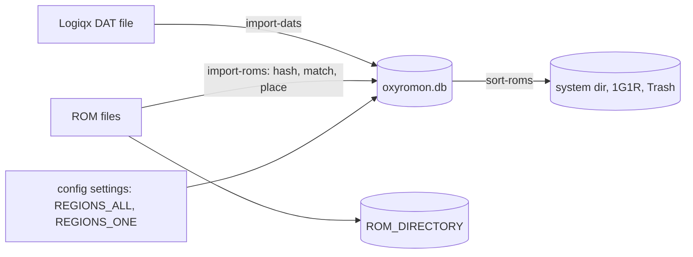

# Quickstart & Task Routing

oxyromon is a cross-platform, opinionated CLI ROM organizer written in Rust: it validates ROM
files against Logiqx DAT catalogs (No-Intro, Redump, MAME/FBNeo), imports them into a managed
directory tree, sorts them by region and 1G1R preference, and converts or exports them between
formats. Internally it sticks to original and lossless formats; lossy output happens only on
export. The same binary can also run as a web server (GraphQL API plus an embedded Leptos SPA)
and as a Model Context Protocol server — both optional Cargo features, and both thin wrappers
over the very same subcommand implementations the CLI runs.

Format handling is in-tree: seven of the eight crates under `crates/` (`chd-rs`, `cia-rs`,
`gdi-rs`, `nsz-rs`, `xdelta-rs`, `xps-rs`, `xso-rs`) are ports of the external tools oxyromon
used to shell out to, and the eighth, `wux-rs`, adds Wii U support following wudd and Cemu. So
**oxyromon needs no external program at runtime** and a plain build needs no format
toolchain installed. `mame-tools`/`chdman`, `xdelta3` and `ffmpeg` appear only in CI as reference
binaries for the crates' own tests.

## Shortest working path

```sh
cargo build --release                       # CLI only: needs a C toolchain
cargo build --release --features server     # plus GraphQL + web UI (needs trunk + wasm32 target)
```

Then the core loop, in order:

```sh
target/release/oxyromon info                                     # dependencies + library counts
target/release/oxyromon config -s ROM_DIRECTORY /path/to/Emulation
target/release/oxyromon config -s REGIONS_ALL US,EU,JP
target/release/oxyromon config -s REGIONS_ONE US,EU
target/release/oxyromon import-dats "Nintendo - Game Boy (20260101).dat"
target/release/oxyromon import-roms ./incoming
target/release/oxyromon sort-roms --system "Nintendo - Game Boy"
```

A system must exist in the database before ROMs can match anything, and `sort-roms` needs at
least one region in `REGIONS_ALL` or `REGIONS_ONE` (each can also be passed per run with
`-r/--regions` / `-o/--1g1r`). ROMs that check out land in the system's base directory; sorting
then distributes files across the system directory, `1G1R`, and `Trash`.



*Caption: the DAT → import → sort loop, and the two stores it writes — the SQLite catalog and the ROM directory on disk.*

## Where things live

- **Database**: `<data_dir>/oxyromon/oxyromon.db`, created on first run together with its parent
  directory, with embedded migrations applied automatically. Override the directory with
  `OXYROMON_DATA_DIRECTORY`.
- **ROMs**: the `ROM_DIRECTORY` setting, defaulting to `~/Emulation`. `TMP_DIRECTORY` defaults to
  the system temp directory and should have several GB free for DVD-sized extractions. Both are
  ordinary settings rows: on first use each is seeded from `OXYROMON_ROM_DIRECTORY` /
  `OXYROMON_TMP_DIRECTORY` if set, otherwise from the platform default, and then **persisted**, so
  later edits belong in the database, not the environment.
- **Configuration** lives in the database, not a config file. `oxyromon config` lists, gets, sets,
  unsets and edits list entries; `-n/--system` scopes an operation to one system, whose value wins
  over the global one with automatic fallback.

## Repository split

| Path        | What it is                                                                                                                                  |
| ----------- | ------------------------------------------------------------------------------------------------------------------------------------------- |
| root        | The `oxyromon` package: the binary, `build.rs`, `migrations/`, `.sqlx/` offline query data.                                                  |
| `crates/`   | Eight format crates (`chd-rs`, `cia-rs`, `gdi-rs`, `nsz-rs`, `wux-rs`, `xdelta-rs`, `xps-rs`, `xso-rs`), workspace members, standalone library + CLI, published independently. |
| `frontend/` | The Leptos SPA. **Not** a workspace member — it declares its own `[workspace]`.                                                              |
| `desktop/`  | The Tauri shell that spawns `oxyromon server` as a sidecar. Also standalone.                                                                  |
| `tests/`    | DAT and ROM fixtures plus the two integration targets: `tests/mcp_stdio.rs` and `tests/crates.rs`.                                            |

`frontend/` and `desktop/` keep their own workspace roots so WebAssembly and webview
dependencies never enter the native build; `build.rs` runs `trunk build --release` in `frontend/`
when the `server` feature is on (and aborts with a clear message if `frontend/` is absent, as it
is in the crates.io tarball), creating `target/assets/` either way so `rust-embed` always
compiles. Set `SKIP_TRUNK=true` to reuse prebuilt assets.

## Dependencies and tooling

The format crates are workspace members and are depended on by `path` + `version` with
`default-features = false` — oxyromon links the library, never the CLI — while each also builds a
standalone CLI with the same capabilities:

| Crate       | Began as a port of | CLI        | Used by oxyromon for  |
| ----------- | ------------------ | ---------- | --------------------- |
| `chd-rs`    | chdman             | `chdrs`    | CHD                   |
| `cia-rs`    | ctrtool            | `ciars`    | CIA                   |
| `gdi-rs`    | gdidrop            | `gdirs`    | GDI                   |
| `nsz-rs`    | nsz                | `nszrs`    | NSZ                   |
| `xdelta-rs` | xdelta3            | `xdeltars` | XDELTA patches        |
| `xps-rs`    | Flips              | `xpsrs`    | IPS and BPS patches   |
| `xso-rs`    | maxcso             | `xsors`    | CSO/ZSO               |
| `wux-rs`    | none (wudd, Cemu)  | `wuxrs`    | Wii U WUD/WUX, WUA and NUS export |

Archives go through `sevenz-rust2` and `zip`, RVZ and WBFS through `nod` (which builds its
compression libraries from source, so a C toolchain is required).
`chd-rs` takes its FLAC codec from the pure-Rust `rusty_flac`, so no CMake is needed.

```sh
cargo build --release -p chd-rs -p cia-rs -p gdi-rs -p nsz-rs -p xdelta-rs -p wux-rs -p xps-rs -p xso-rs   # the CLIs
cargo test -p xso-rs                              # one crate
cargo test --release -p xso-rs -- --ignored       # its slow tests
```

`dist.sh` cross-builds those CLIs next to `oxyromon` for every target and ships them in the
release archives.

`oxyromon info` is the dependency check: it probes every backend's `get_version()`, prints
`<name>: built-in` for every backend, all of which are linked crates, and special-cases two that need keys. A
missing `prod.keys` shows up as `built-in, prod.keys not found`, since only compressing NCAs needs it. Missing
Wii U keys show up as `built-in, no Wii U keys imported`; `oxyromon import-keys` stores them in the data
directory, and only WUA and NUS exports need them.

## Task routing

| If the task touches…                                                                                     | Go to                                                                          |
| -------------------------------------------------------------------------------------------------------- | ------------------------------------------------------------------------------ |
| how a command is wired, startup order, the shared subcommand contract                                     | [CLI Entrypoint and the Subcommand Contract](architecture/cli-entrypoint-and-subcommands.md) |
| the layered design and where GraphQL/MCP enter                                                            | [System Architecture Overview](architecture/overview.md)                       |
| schema, row types, migrations, `cargo sqlx prepare`                                                       | [Data Model, SQLite Usage and Migrations](architecture/data-model-and-migrations.md) |
| `mcp` / `server` / TLS features, `build.rs`, Trunk, `SKIP_TRUNK`                                          | [Feature Flags and Build Topology](architecture/feature-flags-and-build-topology.md) |
| setting keys, categories, global vs per-system scoping                                                    | [Settings and Configuration Model](architecture/settings-and-configuration.md) |
| progress bars, `print_*` output, interactive prompts                                                      | [CLI Output, Progress & Prompts](concepts/cli-output-progress-and-prompts.md)  |
| extension constants, magic-byte matchers                                                                  | [File Type Detection and Extension Constants](concepts/file-type-detection-and-extensions.md) |
| adding or changing a format module (`archive`, `chd`, `rvz`, `xso`, …)                                    | [Format Modules and Their Crate Backends](concepts/format-modules-and-format-crates.md) |
| CHD read/write, hunk and codec behavior, parent CHDs, `src/chd.rs` ↔ `crates/chd-rs`                      | [CHD Format and the chd-rs Crate](concepts/chd-format-and-chd-rs.md)           |
| Wii U WUD/WUX/WUA/NUS, `import-keys`, updates and DLC, `src/wux.rs` ↔ `crates/wux-rs`                     | [Wii U Formats and the wux-rs Crate](concepts/wii-u-formats-and-wux-rs.md)     |
| `CommonRomfile` and its trait system                                                                      | [Romfile Trait System](concepts/romfile-trait-system.md)                       |
| DAT parsing, header definitions, Redump/No-Intro downloads                                                | [Catalog Ingestion: DATs, Headers and Downloads](workflows/dat-ingestion.md)   |
| hashing, matching, placement, `PREFER_FORMAT` on import                                                   | [ROM Import Pipeline](workflows/rom-import-pipeline.md)                        |
| region and 1G1R election, discard filters, subfolder schemes, `Trash` placement                            | [Sorting and the 1G1R Election](workflows/sorting-and-1g1r-election.md)        |
| `convert-roms` / `export-roms` and the conversion matrix (CHD via in-process chd-rs)                       | [Format Conversion and Export](workflows/format-conversion-and-export.md)      |
| `check-roms`, the purge family, empty-directory cleanup                                                   | [Integrity Checking, Purging and Trash](workflows/integrity-check-and-purge.md) |
| arcade merging strategies and M3U playlists                                                               | [Arcade Rebuilds and M3U Playlists](workflows/arcade-rebuild-and-playlists.md) |
| PS3 IRD files and JB folders                                                                              | [PS3 IRD Files and JB Folders](workflows/ird-ps3-jbfolders.md)                 |
| routes, `AppState`, DataLoader, uploads, shutdown                                                         | [HTTP Server, GraphQL API and Uploads](server/http-server-and-graphql-api.md)  |
| SSE events and how a progress bar becomes a stream                                                        | [SSE Events and Progress Bridging](server/sse-and-progress-bridge.md)          |
| Leptos components, Web Awesome, the CSS cascade                                                           | [Web UI (Leptos SPA + Web Awesome)](server/web-ui-frontend.md)                 |
| MCP tools, resources, prompts, `run_action`, read-only mode                                               | [MCP Server: Tools, Resources and Prompts](server/mcp-server.md)               |
| the Tauri sidecar, port reservation, child cleanup                                                        | [Desktop App (Tauri Sidecar)](server/desktop-tauri-shell.md)                   |
| DAT provider URLs and No-Intro/TOSEC name tokens                                                          | [DAT Providers and Naming Conventions](integrations/dat-providers-no-intro-redump.md) |
| the `crates/` format crates, their shared CLI shape and release cadence                                   | [Format Crates in crates/](integrations/format-crates.md)                      |
| which tool each crate replaced, and the reference tools the crate tests use                              | [External Tools](integrations/external-tools.md)                               |
| helper scripts, cross-compilation, containers, per-crate publishing                                       | [Builds, Distribution and Releases](operations/build-and-release.md)           |
| CI jobs, `OXYROMON_*` variables, `DATABASE_URL`, TLS/Windows build notes                                  | [CI Pipelines and Runtime Environment](operations/ci-and-environment.md)       |
| writing or running tests, the `MUTEX`, temp DB/dirs                                                       | [Test Harness and Conventions](testing/testing-conventions.md)                 |
| fixture corpus, MCP stdio and CLI-parity end-to-end suites                                                | [Test Fixtures and End-to-End Suites](testing/test-fixtures.md)                |
| known-answer vectors and reference-tool parity/interop in `crates/`                                       | [Format Crate Test Strategy](testing/format-crate-tests.md)                    |

## Feature gates

| Feature          | Description                                              | Default |
| ---------------- | -------------------------------------------------------- | ------- |
| `mcp`            | the MCP server subcommand (stdio only)                    | Off     |
| `server`         | the web server subcommand (GraphQL + Leptos SPA)          | Off     |
| `use-rustls`     | rustls for TLS                                            | On      |
| `use-native-tls` | system OpenSSL for TLS                                    | Off     |

Default features are `["use-rustls"]`. `server` implies `mcp` and nests the same MCP handler at
`/mcp` on its own listener; `mcp` alone builds the stdio server with no web server. The pool
shape follows the same gate: with `server` or `mcp` compiled in, `establish_connection` opens a
5-connection pool with NORMAL locking, otherwise a single connection with EXCLUSIVE locking.

## Testing loop

```sh
cargo test --workspace --features oxyromon/server
cargo llvm-cov --workspace --features oxyromon/server --lcov --output-path lcov.info
./test.sh    # exactly the llvm-cov invocation above
```

`--features oxyromon/server` is required because a workspace selection spans several packages, so
a feature must name its package. CI runs clippy over the whole workspace with
`--all-targets --features oxyromon/server`, then clippy again with
`--no-default-features --features use-rustls,mcp` so the stdio-only MCP build stays covered, then
builds `--release --features server` and tests under `cargo llvm-cov`. The reference tools it
installs (`mame-tools` for `chdman`, `xdelta3`, `ffmpeg`) exist only so the crates' parity tests
can run; those suites skip rather than fail when the tool is absent.

## Invariants an agent hits immediately

- **`romfiles` paths are stored relative to `ROM_DIRECTORY`.** Strip the prefix on the way in, join
  it on the way out; treating the column as absolute silently corrupts the library.
- **All user-facing output goes through the `progress.rs` helpers** bound to the global
  `MultiProgress`. Never `println!` from a code path the MCP server can reach: with `oxyromon mcp`
  (or `/mcp`) stdout carries JSON-RPC.
- **Every notable change updates `README.md` and `CHANGELOG.md`** — new flags, behavior changes and
  fixes alike, under the current version's section.
- **One module per action, one interface.** `subcommand()` declares argv and does no I/O;
  `async main(connection, matches, progress_bar)` does the work. GraphQL and MCP both synthesize
  argv to reach it, so a new capability added anywhere else is invisible to two of the three
  surfaces.
- **Format modules do not spawn processes.** `src/chd.rs`, `cia.rs`, `archive.rs`, `nsz.rs`,
  `xso.rs`, `xdelta.rs`, `xps.rs`, `rvz.rs` call their crate and return `"built-in"` from
  `get_version()`; no module keeps a shell-out pattern.
- **Query changes require regenerating offline sqlx data** (`cargo sqlx prepare -- --features server`).
- **Validate the way CI does**: `cargo test --workspace --features oxyromon/server`, with the shared
  `MUTEX` held by anything touching global state.
