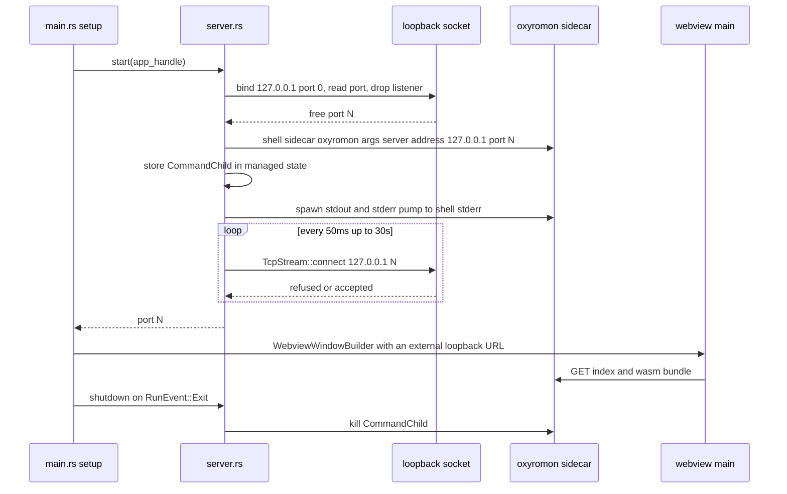
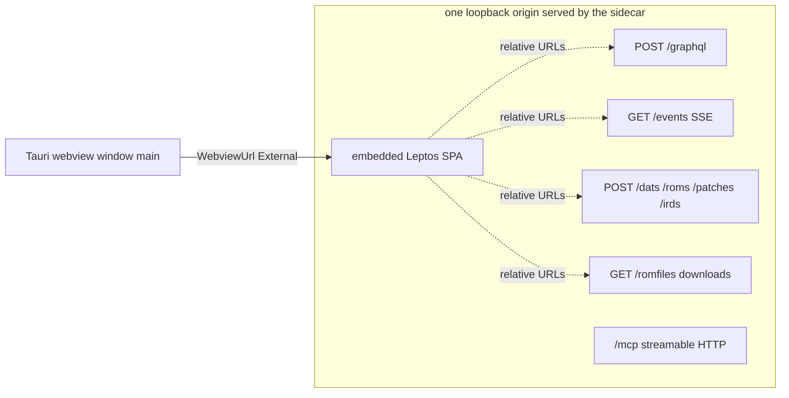
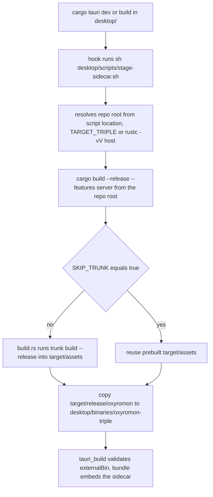
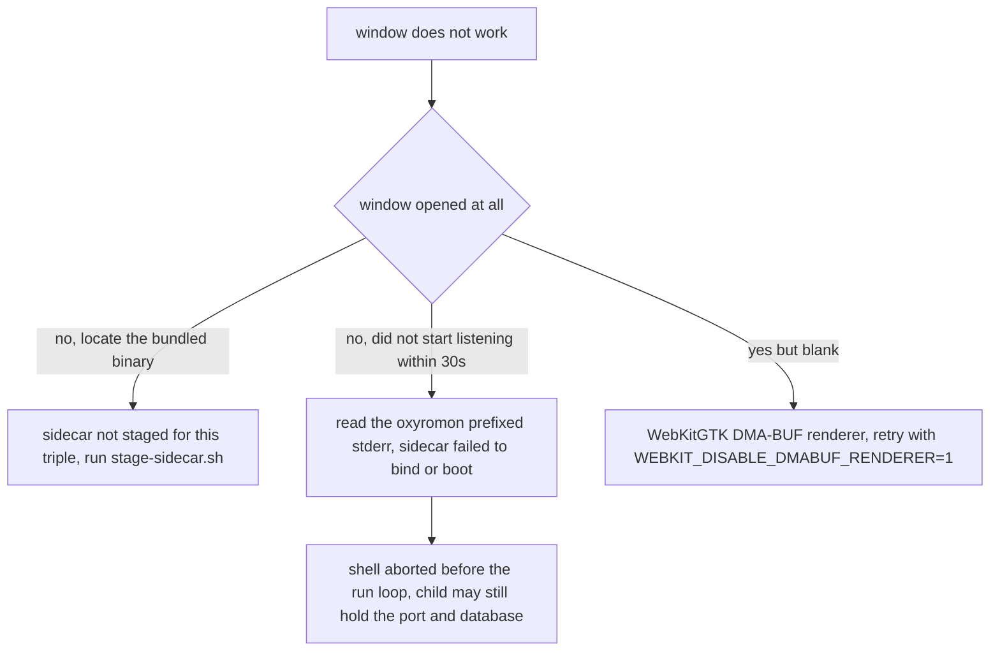

# Desktop App (Tauri Sidecar)

`desktop/` is a native window around the exact same web UI that `oxyromon server`
already serves. It contains no backend logic, no GraphQL client and no frontend
build: it locates a free loopback port, spawns the ordinary `oxyromon` binary (built
with `--features server`) as a Tauri **sidecar** in `server` mode, waits for that
port to accept connections, and opens a webview whose URL *is* the sidecar's origin.
Everything else — the SPA, `/graphql`, `/events`, uploads, downloads, the SQLite
database and the settings rows — is reused untouched, which is why the desktop crate
is roughly 150 lines of Rust plus a bundling config.

The consequence worth internalising before changing anything here: the desktop app is
**additive only**. Fixes belong in `src/server.rs` or `frontend/`, not in a
desktop-specific variant of either.

## Crate topology

`desktop/Cargo.toml` declares its own empty `[workspace]` so cargo does not walk up
to the root package, and `publish = false`. That separation is deliberate: `tauri`
and `tauri-plugin-shell` (the crate's only two dependencies) plus the platform
webview stay out of the CLI build, exactly as `frontend/` keeps the wasm toolchain
out of it. It also means `cargo clippy --workspace` and `cargo test --workspace`
run from the repository root never touch this crate — the desktop bundle is built
only by hand or by `dist.sh`. Its `[profile.release]` is size-oriented
(`opt-level = "z"`, `lto`, `codegen-units = 1`, `strip`), independent of the root
profile, and it keeps its own `Cargo.lock`.

That separation is also why CI never validates the shell: the single `CI` workflow
sets `SKIP_TRUNK: "true"` workflow-wide, builds the web UI once in its `Build web
UI` step (`cd frontend && trunk build --release`, with trunk pinned by
`TRUNK_VERSION` and the `wasm32-unknown-unknown` target installed), and then lets
`cargo clippy --workspace`, `cargo build --release --features server` and
`cargo llvm-cov --workspace` reuse those assets instead of recompiling the wasm.
That matrix builds and tests exactly the binary the sidecar is, but no CI step
installs the Tauri CLI or `webkit2gtk`, and the root workspace's members are only
`crates/*`, so `--workspace` skips `desktop/` entirely.

`desktop/build.rs` is a single `tauri_build::build()` call, which is what makes the
staged sidecar a build-time requirement rather than a runtime one (see
[Staging the sidecar](#staging-the-sidecar)).

Two other details in `tauri.conf.json` shape behaviour: `app.windows` is empty, so
the window exists only because `main.rs` builds it; and the crate carries
`#![cfg_attr(not(debug_assertions), windows_subsystem = "windows")]`, so release
builds on Windows attach no console alongside the GUI.

## Startup control flow

`setup` is synchronous and does all the work before any window appears:



*Caption: the whole desktop runtime — reserve a port, spawn the sidecar, block on TCP readiness, then load the window from that origin.*

Readiness is a bare `TcpStream::connect` to `127.0.0.1:<port>`, polled every 50 ms
with a 30-second deadline. That is weaker than an HTTP health check, but it is
sufficient here: `src/main.rs` establishes the SQLite pool, runs migrations and
initialises the ROM and tmp directories *before* `server::main` binds its listener,
so a port that accepts is a port already serving the full router and embedded asset
bundle. On timeout, `start` returns the error `the oxyromon server did not start
listening on port <port> within 30s` and the shell never opens a window. A slow
first-run migration counts against that same budget.

The port itself is reserved by binding `127.0.0.1:0` and reading back the assigned
port; the listener is dropped before the sidecar binds it, so the code documents a
small reuse race. The stated and actual consequence is contained: a collision does
not corrupt anything, it just fails the readiness check.

`server::start` also passes `--address 127.0.0.1` explicitly, matching the
`server` subcommand's own default. Address and port are the only arguments the shell
supplies, so any new sidecar flag is a one-line change in `desktop/src/server.rs`.

## No CORS, no Tauri IPC — because the window lives on the sidecar origin

`WebviewUrl::External` means the document's origin is `http://127.0.0.1:<port>`. The
Leptos SPA only ever issues relative URLs — `Request::post("/graphql")`,
`EventSource::new("/events")`, the `/dats` `/roms` `/patches` `/irds` upload forms,
and `href="/romfiles/{id}"` download links — so from inside the webview they resolve
straight to the sidecar:



*Caption: one origin serves the assets and every API path, so nothing in the frontend needs a base URL or a preflight.*

This is the load-bearing design decision of the whole feature. The release server
binary does not even install a `CorsLayer` — `src/server.rs` adds one only under
`#[cfg(debug_assertions)]` — so a design that loaded the page from a `tauri://` or
`asset://` origin would fail every request against a release sidecar. Conversely,
because the page never calls `window.__TAURI__`, `desktop/capabilities/default.json`
scopes the `"main"` window to an **empty permission set**, and
`app.withGlobalTauri` is false so the IPC bridge is not even injected. The shell
plugin is registered purely for the Rust-side `app.shell().sidecar(...)` call; page
scripts get no shell, filesystem or process surface. `app.security.csp` is `null`,
i.e. Tauri injects no CSP of its own.

The same relative-URL contract is what `frontend/Trunk.toml` mirrors with its
`trunk serve` proxies, which is why the frontend has no origin configuration at all.

## Staging the sidecar

`tauri.conf.json` declares `bundle.externalBin: ["binaries/oxyromon"]`, and Tauri
resolves a sidecar by that name only if the file exists with the **target triple
suffixed** — `binaries/oxyromon-x86_64-unknown-linux-gnu`, plus `.exe` on Windows.
Both `beforeDevCommand` and `beforeBuildCommand` run
`desktop/scripts/stage-sidecar.sh` to produce it:



*Caption: the staging hook, including the toolchain it drags in via the `server` feature.*

Three operational consequences follow from that script:

- **The hook runs from the repository root, not from `desktop/`**, and it computes
  its own root from `$0`, so it is safe to invoke by hand from anywhere
  (`sh desktop/scripts/stage-sidecar.sh`).
- **Because it builds with `--features server`, the desktop toolchain is the web UI
  toolchain too**: `build.rs` shells out to `trunk build --release` unless
  `SKIP_TRUNK=true`, so `trunk` and the `wasm32-unknown-unknown` target must be
  installed. In `dist.sh` the exported `SKIP_TRUNK=true` is inherited by the staging
  build, which then embeds the assets the release loop already produced.
- **`cargo build` inside `desktop/` alone fails until the sidecar has been staged at
  least once**, because `tauri_build::build()` checks the `externalBin` entries. The
  generated `desktop/binaries/`, along with `gen/` (Tauri's ACL schemas) and
  `target/`, is gitignored.

`cargo tauri dev` is therefore *not* a hot-reload setup: there is no `devUrl` and no
frontend dev server, so dev runs the same release sidecar with the same embedded
assets that users get. Rebuilding the UI means re-running the staging script.

## Child lifecycle and failure semantics

The sidecar is a real child process spawned through the shell plugin, and its
`CommandChild` handle is stored in Tauri managed state as
`Server(Mutex<Option<CommandChild>>)` **before** the readiness wait, so a handle
exists as soon as the process does. `Server::shutdown()` `take()`s the slot and
`kill()`s it, which makes it safe to call twice; failures are logged, never raised.

The shell is not the sidecar's process-group leader, so a signal delivered to the
desktop app does not reach the server. `main.rs` compensates by handling
`RunEvent::Exit` and shutting the child down explicitly, rather than leaving an
orphaned server holding the SQLite database.

That cleanup is the *only* kill path, and it runs from the run-loop callback. If
startup fails after the spawn — the readiness timeout above — `setup` returns an
error, `main`'s `.expect("failed to start oxyromon-desktop")` aborts before
`app.run` is ever entered, and nothing in this code path reaps the child. A leftover
`oxyromon` process still holding the port or the database after a failed launch is
therefore expected, not a mystery.

The child's output is forwarded, not discarded: a spawned task drains the
`CommandEvent` stream and writes every stdout/stderr line to the desktop process's
stderr with an `[oxyromon]` prefix, plus `server error: …` and `server exited with
<code>` events. On Windows release builds no console is attached at all, so this
channel is primarily for terminal-launched `cargo tauri dev` and `desktop.sh` runs.

## Shared state with the CLI

The sidecar is the ordinary `oxyromon` binary, so it resolves its database the same
way: `OXYROMON_DATA_DIRECTORY` if set, otherwise the platform data directory, with
`oxyromon.db` inside it. The desktop app and the CLI therefore read and write the
same database and the same settings rows — there is no separate desktop profile and
no data migration when switching between them.

It also inherits server-mode database semantics rather than the headless ones:
because the sidecar is built with `server` (or `mcp`), `establish_connection` opens a
five-connection pool with `PRAGMA locking_mode = NORMAL` and WAL, instead of the
single `EXCLUSIVE` connection a plain CLI build uses. That is what lets the long-lived
desktop server coexist with the CLI instead of locking the file.

The server-side trust model applies unchanged: the sidecar binds loopback only, and
it exposes the same upload endpoints (including the server-fetched URL import) and
the `/mcp` endpoint that the standalone `oxyromon server` does.

## Runtime dependencies: nothing but the bundled binary

The sidecar is self-sufficient. Every format oxyromon handles is now produced by an
in-tree crate under `crates/` or a Rust dependency — CHD via chd-rs, CSO/ZSO via
xso-rs, GDI via gdi-rs, XDELTA via xdelta-rs, BPS/IPS via xps-rs, NSZ via nsz-rs,
CIA via cia-rs, WUX/WUA/NUS via wux-rs, 7z/ZIP via sevenz-rust2 and zip, RVZ/WBFS
via nod — so the tools
oxyromon once shelled out to (`chdman`, `ctrtool`, `xdelta3`, `flips`, `maxcso`,
`dolphin-tool`, `wit`, 7-Zip/p7zip) are gone from the runtime entirely.
`src/info.rs` reflects that: its dependency list reports `chd-rs`, `cia-rs`, `nod`,
`nsz-rs`, `sevenz-rust2`, `wux-rs`, `xdelta-rs`, `xps-rs` and `xso-rs` as built-in
versions, and no external binary is needed for any format. Wii U keys for WUA and NUS
exports go in the shared data directory through `import-keys`, so the desktop app
and the CLI see the same keys.

That has two packaging consequences:

- **The bundled Debian package declares no external-tool dependency.**
  `desktop/tauri.conf.json` has no `bundle.linux.deb.depends` table at all, so the
  `.deb` carries only what Tauri derives itself (the webview stack and libraries
  linked at build time). The `p7zip` dependency the desktop package used to carry is
  gone, as recorded in the 0.25.0 changelog.
- **The container image confirms the same floor.** The Alpine-based `Dockerfile`
  installs only `build-base`, `curl`, `musl-dev`, `rustup` and `tar` to build,
  adds the
  `wasm32-unknown-unknown` target and `trunk` for the web UI, then removes the
  toolchain — no codec or archive tools are left in the image that runs
  `oxyromon server`.

## Building and running

```sh
cargo install --locked tauri-cli --version "^2"
cd desktop
cargo tauri dev     # stages the sidecar, then runs the shell
cargo tauri build   # bundle under desktop/target/release/bundle/
```

On Linux this additionally needs the platform webview packages — `webkit2gtk-4.1`,
`gtk3`, `librsvg`, `libayatana-appindicator` — on top of the web UI prerequisites.

The desktop bundle is **host-only**. `dist.sh` builds it once at the very end of the
release matrix with `NO_STRIP=true`, then copies the `.deb`, `.rpm` and `.AppImage`
artefacts into `dist/`; Tauri links the platform's own webview, which the cross
images do not carry and for which no cross toolchain exists, so a Windows or macOS
bundle must be produced on that operating system. `desktop.sh` is the standalone
equivalent.

The rest of the release matrix is CLI-only, and per target it emits **nine
binaries**: the server-enabled `oxyromon`, plus the eight format-crate CLIs built with
`cross build --release -p chd-rs -p cia-rs -p gdi-rs -p nsz-rs -p xdelta-rs -p wux-rs
-p xps-rs -p xso-rs` — `chdrs`, `ciars`, `gdirs`, `nszrs`, `wuxrs`, `xdeltars`, `xpsrs`,
`xsors` — packed as
`.tar.xz` on Linux and macOS (`7z` archives on `x86_64-pc-windows-gnullvm`), signed
with `rcodesign` on the Apple targets. `SKIP_TRUNK=true` is exported for the whole
script, so each target reuses the `trunk build --release` the loop runs first on the
host; `Cross.toml` passes that variable through into the cross images.
Release version strings for the desktop crate live in `desktop/Cargo.toml` and
`desktop/tauri.conf.json` and are bumped by hand alongside the root and `frontend/`
manifests — see
[Builds, Distribution and Releases](../operations/build-and-release.md).

## Recorded troubleshooting cases

| Symptom | Cause and check |
| --- | --- |
| Blank window on Linux | WebKitGTK's DMA-BUF renderer misbehaves on some GPU/driver combinations, notably NVIDIA under Wayland. Reproduce with `WEBKIT_DISABLE_DMABUF_RENDERER=1` before investigating anything else. |
| `failed to locate the bundled oxyromon binary` | `sidecar("oxyromon")` found no `desktop/binaries/oxyromon-<current triple>`: the staging step never ran, or ran for a different triple. Run `sh desktop/scripts/stage-sidecar.sh`. |
| Sidecar will not start, window never appears | Its output is on the shell's stderr prefixed with `[oxyromon]`; check there before assuming the shell is at fault. A `server exited with …` line means the child died on its own. |
| `failed to run linuxdeploy` while bundling an AppImage | linuxdeploy ships binutils too old to read the `.relr.dyn` sections modern distributions ship, and fails on the first library it strips. Build with `NO_STRIP=true`, which `desktop.sh` exports. |



*Caption: how a non-working window localises to staging, sidecar startup, or the renderer.*

## Where this connects

`desktop/` is a thin client of the HTTP surface that `src/server.rs` owns and of the
Leptos SPA in `frontend/`; both consume the same relative-URL contract described
above. The feature gates that make the sidecar binary exist at all are covered in
[Feature Flags and Build Topology](../architecture/feature-flags-and-build-topology.md),
and the packaging entry points in
[Builds, Distribution and Releases](../operations/build-and-release.md).
