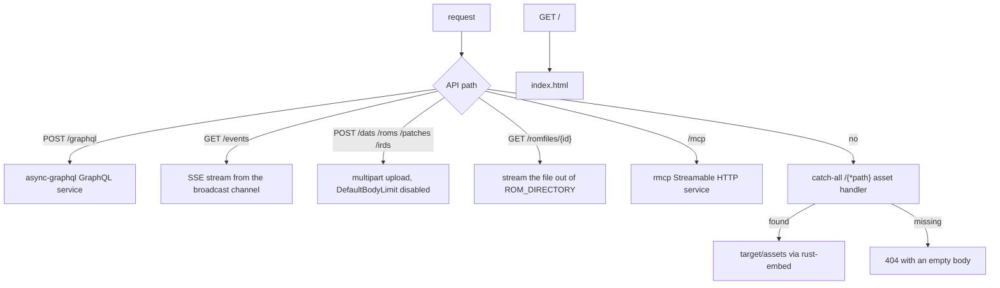
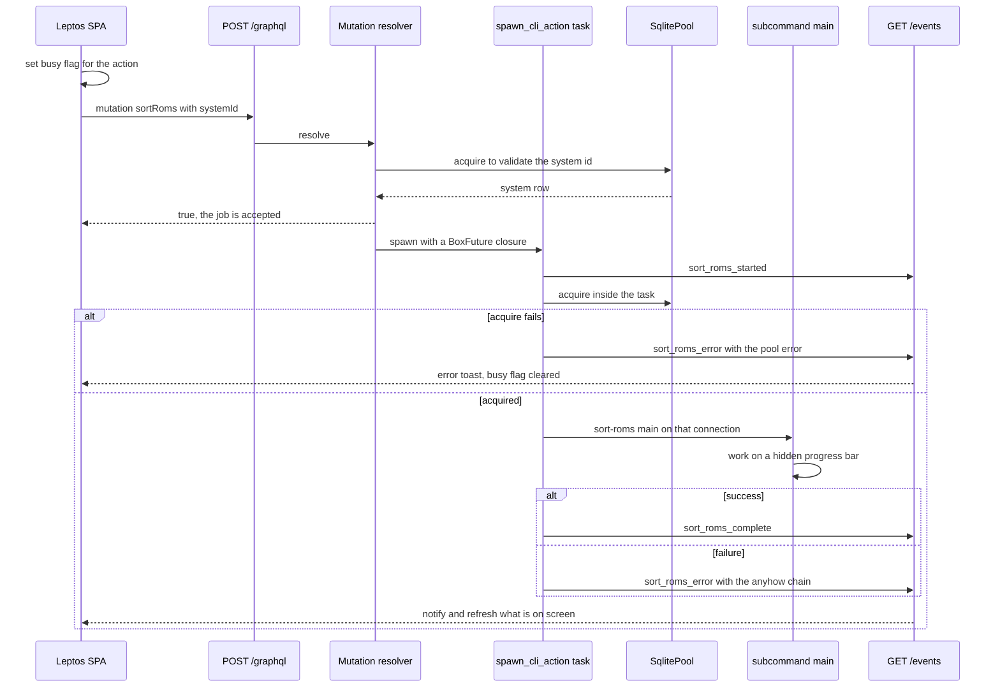

# HTTP Server, GraphQL API and Uploads

`oxyromon server` is a single axum `Router` on a single `TcpListener`. One port
serves the GraphQL API, the SSE progress stream, four multipart upload
endpoints, ROM-file downloads, the MCP Streamable HTTP endpoint and the embedded
Leptos SPA. Everything behind it is the same code the CLI runs: a GraphQL
mutation does not reimplement an action, it synthesises the subcommand's
`ArgMatches` and calls that subcommand's `main()` on a pooled connection.

The whole module tree (`src/server.rs`, `src/query.rs`, `src/mutation.rs`,
`src/validator.rs`) exists only under `#[cfg(feature = "server")]`; see
[Feature Flags and Build Topology](../architecture/feature-flags-and-build-topology.md).
`server` implies `mcp`, which is why `/mcp` is always present when the web
server is.

## AppState and the GraphQL schema

`AppState` is three cheap clones: the `SqlitePool`, a
`broadcast::Sender<SseMessage>` created with a capacity of 100, and a
`CancellationToken`. Every handler takes `State<AppState>`; the broadcast sender
is the only way server-side work reaches the browser, and the token is the only
way shutdown reaches an open stream.

The schema is `Schema::build(QueryRoot, Mutation, EmptySubscription)` with five
things in context data:

- `DataLoader<SystemLoader>`, `DataLoader<GameLoader>`, `DataLoader<RomfileLoader>`, each backed by the same pool and driven by `tokio::task::spawn`.
- the raw `SqlitePool`, for resolvers and mutations that need a connection of their own.
- the `broadcast::Sender<SseMessage>`, for mutations that fan progress out.

`EmptySubscription` is deliberate: GraphQL has no subscription type at all.
Long-running work reports through `/events` instead, so progress survives a
client that never touched the GraphQL socket.

The pool shape is feature-dependent, and it is what makes a long-lived server
possible at all: a `server` or `mcp` build opens **five** connections with
`PRAGMA locking_mode = NORMAL`, WAL and a 5-second `acquire_timeout`, where a
plain CLI build opens one with `EXCLUSIVE`. That is a real concurrency budget —
five connections, and spawned actions hold theirs for the entire run — and the
failure semantics below exist because that budget can genuinely be exhausted.

## Routing

*Caption: the fixed route table — API paths first, the embedded bundle as the fallback for everything else.*

Upload routes each install `DefaultBodyLimit::disable()`: a ROM is a disc image,
and axum's default body limit would reject it before the handler ever ran. The
root serves `index.html`; `/{*path}` serves any other embedded asset with a MIME
type sniffed from the bytes, falling back to the extension and then to
`application/octet-stream`, and answers 404 with an empty body for anything the
bundle does not contain. There is no SPA history fallback beyond `/` because the
frontend has no client-side router (`frontend/Cargo.toml` carries no
`leptos_router`); it is one page that re-renders.

`CorsLayer` is installed **only under `#[cfg(debug_assertions)]`**, allowing any
origin, method and header. A release binary therefore ships no CORS headers: the
page and the API must share an origin, which the embedded SPA and the Tauri
sidecar both do. The dev-time counterpart is the `[[proxy]]` block in
`frontend/Trunk.toml`, which forwards `/graphql`, `/events`, `/dats` and
`/romfiles/` to a locally running server on `127.0.0.1:8000`. See
[Desktop App (Tauri Sidecar)](desktop-tauri-shell.md).

Assets come from `target/assets` via `rust-embed`, which is why `build.rs` runs
`trunk build --release` (skippable with `SKIP_TRUNK=true`) and still creates the
folder when it does not: rust-embed needs the directory at compile time, and an
empty one yields a working API with no UI.

## The read surface

`QueryRoot` is the whole read API. Most fields take a fresh pooled connection:
`systemSettings(systemId)`, `systems`, `games(systemId, offset, limit)`,
`roms(gameId)`, `settings`, the counts, `downloadableSystems(update)` and the
size aggregates; `version`, `dependencies` and `gameInformation(gameName)` need
no database at all. There is no filtering, sorting or search beyond what those
arguments give: the games list is ordered by name, and `roms(gameId)` returns
the game's rows ordered by name with no completion or region filter.

Two of those fields are worth understanding rather than treating as lookups:

- **`dependencies` reports the format engines, and only one of them can be
  missing.** The eight entries are `sevenz-rust2`, `chd-rs`, `ctrtool`,
  `xps-rs`, `xso-rs`, `nsz-rs`, `xdelta-rs` and `nod` (which backs RVZ and
  WBFS), sorted by name. All but `ctrtool` are linked-in crates whose
  `get_version()` returns the literal `built-in` and cannot fail — `nsz-rs` is
  the one that adds detail, returning `built-in, prod.keys not found` when
  `~/.switch/prod.keys` is absent. `ctrtool` is the only external binary in the
  list: it is spawned with no arguments and its first stderr line matched against
  a `\d+\.\d+\.\d+` regex, so `version` comes back `null` exactly when the binary
  is not on `PATH` (`unknown` if it is there but says nothing parseable). It is
  the only dependency whose absence a client can detect here, and CIA import
  checks `ctrtool` again at import time rather than trusting this report. The
  same eight-entry list backs `oxyromon info` and the MCP read tool, so the three
  surfaces agree.
- **`systemSettings(systemId)` is the effective configuration, not a row
  lookup.** It loads the global settings and the system's overrides and merges
  them by key (override wins), sorted by key. A client that read `settings`
  alone would show defaults a system has already overridden.

`downloadableSystems(update)` returns the Redump catalogue names filtered
against what the database already holds: without `update` the systems that can
be fetched, with it the ones already imported whose DATs can be refreshed. It is
the same `find_redump_systems` the CLI's interactive picker uses, and names
outside that catalogue cannot be fetched at all — `downloadDats` bails with
`Unknown Redump system` before any request.

`gameInformation(gameName)` is pure computation: it parses a No-Intro-style name
into title, regions, languages, release status and flags and touches neither the
pool nor the filesystem.

## DataLoaders and N+1 prevention

`IdLoader<T>` is one generic loader over three table-row types, selected by the
`TableRow` trait: `TABLE`, a `SELECT` list, and `row_id()`. `load` receives the
whole batch of keys async-graphql collected for the current level and issues a
single `SELECT … WHERE id in (…)`, returning a `HashMap` keyed by id.

That is what keeps `{ roms(gameId) { romfile { … } game { system { … } } } }`
from degenerating into one query per row: `Rom::game`, `Rom::romfile` and
`Game::system` all call `load_one` on a loader rather than querying, so a page of
ROMs costs one query per edge regardless of how many ROMs it contains.

Two invariants make the generic loader safe to extend:

- **`System::SELECT` must keep matching the computed columns.** `System` carries
  `games_complete` / `games_total`, which are count subqueries rather than real
  columns, so the loader cannot use `*`. If those two subqueries drift from the
  ones in `database.rs`, a row loaded through `SystemLoader` fails to map — an
  error only visible on the GraphQL path, not on the CLI path.
- **The ids interpolated into the `IN` list come from the database**, not from
  client input: they are `i64` values already on loaded rows, which is why the
  raw `format!` behind `AssertSqlSafe` is acceptable here.

## Raw SQL for size and status aggregation

`query.rs` owns three places where SQL is built rather than delegated to the
`database.rs` helpers.

`system_size(ctx, system_id, actual, one_region)` is the whole size-reporting
surface, exposed as `totalOriginalSize`, `oneRegionOriginalSize`,
`totalActualSize` and `oneRegionActualSize`. Two booleans select the query:
`actual` sums `romfiles.size` over distinct `romfile_id`s (what is on disk,
deduplicated) while its absence sums `roms.size` (the catalog's idea of the
size); `one_region` splices in `AND g.sorting = 1` so the figure counts only the
games sorting kept for a single region. Both branches are aggregate subqueries
that would be wasteful to express as loaded rows.

`Rom::ignored(systemId)` mixes both styles: it resolves the system and the game
through the DataLoaders, short-circuits on `Sorting::Ignored`, and only for an
arcade system with a parent runs one raw query for the parent game's `bios` flag
— the answer depends on the system's `Merging` mode, which is why it cannot be a
plain column.

Response shape is tuned for payload size too: `Game::description` returns `null`
when it would only repeat `name` (the raw `description` field is `graphql(skip)`ped
in `model.rs`), and `games(systemId, offset, limit)` lets a client page a large
system instead of pulling a multi-megabyte response, falling back to the unpaged
query when `limit` is omitted.

## Pool-acquire failures must be errors, not panics

This is the invariant that most distinguishes the write path from the read path.

- **Request-path mutations** go through `acquire_connection()`, which maps a
  pool failure onto `async_graphql::Error("Failed to acquire database
  connection: …")`. A GraphQL error, not a 500 and not a panic.
- **Spawned actions** acquire *inside* the task, after `{prefix}_started` has
  already gone out. The ordering matters: the client has been told the work
  began, so it must also be told it failed. A failed acquire emits
  `{prefix}_error` and returns; nothing hangs forever waiting for a completion
  event that will never arrive.
- **Plain HTTP handlers** answer `unavailable(e)` — 503 with the error text —
  when `pool.acquire()` fails before any work is queued.
- **Query resolvers are the exception.** Most of `query.rs` still calls
  `pool.acquire().await.unwrap()`. Under saturation a read can therefore panic
  rather than degrade. Treat the typed-error discipline as a rule for anything
  you add on the mutation/upload side, and do not read the mutation helper as
  evidence that reads behave the same.

## Long-running actions: `spawn_cli_action`

`spawn_cli_action(pool, sse_tx, prefix, start_message, complete_message, fail_prefix, run)`
is the single template behind `sort_roms`, `check_roms`, `generate_playlists`,
`purge_roms`, `convert_roms` and `purge_irds`. It spawns a task, emits
`{prefix}_started`, acquires a connection, runs the caller's closure, then emits
`{prefix}_complete` or `{prefix}_error` — and the closure it runs is the CLI
subcommand's own `main()`, reached through a synthesised `ArgMatches`.

*Caption: a mutation is an acknowledgement, not a result — the outcome only ever arrives over SSE.*

Because the action is asked for from a browser, arguments that would prompt on a
TTY are pre-answered: `sort_roms` and `purge_roms` append `-y`, `import_rom_source`
always passes `-u` with the caller's mode (`first` when the upload omitted it),
and every bar is `ProgressBar::hidden()`. Anything that needs a human answer would
hang the task.

`purge_system` and `download_dats` predate the helper and inline the same shape.
They differ in one respect worth knowing: `purge_system` validates the id on the
request path, then the spawned task emits `purge_started` *after* acquiring, so
the generic `purge` prefix (not `purge_system`) is what the frontend listens for.

Mutations that only touch settings — `setBool`, `setString`-backed
`setPreferRegions` / `setPreferVersions` / `setPreferFormat` /
`setSubfolderScheme`, `setDirectory`, `addToList`, `removeFromList`,
`unsetPreferFormat` — run synchronously on the request path and return `true`.

## Validators and up-front rejection

`src/validator.rs` provides `VariantValidator<E>` over `strum::VariantNames`,
aliased to `PreferRegionValidator`, `PreferVersionValidator` and
`SubfolderSchemeValidator`, plus `PreferFormatValidator` (checked against
`convert_roms::ALL_FORMATS`) and `DirectoryValidator`, which canonicalises the
path and requires it to be an existing directory. They are attached with
`#[graphql(validator(custom = "…"))]`, so a bad value is rejected as an
input-value error before any resolver body or database write happens.

Semantic pre-checks sit alongside them and are deliberately placed *before* the
spawn: an unknown `system_id` returns `System {id} not found`, an unsupported
convert format lists the valid ones, `purgeRoms` with every flag false is refused
outright, `setPreferFormat` rejects a format the arcade system cannot hold, and
the upload endpoints resolve the target ROM or system first so the client gets a
400 rather than a background task that dies once it tries to resolve the id.

## Uploads and the URL-fetch path

All four endpoints accept `multipart`, drain unknown fields with a debug log
rather than erroring, and return **202 Accepted** as soon as the job is queued;
progress and outcome arrive over SSE, never in the HTTP response. They differ in
how they land the bytes and what they require:

| Route | Fields | Bytes | Extra validation |
| --- | --- | --- | --- |
| `/dats` | `file`, `update` | buffered in memory via `field.bytes()`, written to a temp dir inside the task | none; per-result SSE, with `skipped: true` for an already-current DAT |
| `/roms` | `file` **or** `url`, `system`, `unattended` | streamed chunk-by-chunk to a fresh `TempDir` | `unattended` must be `skip` or `first` (default `first`) |
| `/patches` | `file`, `rom` (ROM id) | streamed to a `TempDir` | the ROM must exist, else 400 |
| `/irds` | `file`, `system` (system id) | streamed to a `TempDir` | the system must exist; its **name** is kept for `--system` |

Streaming is the point for the last three: a ROM is a disc image, and buffering
one only to write it back out is an extra copy of gigabytes. `/dats` is the odd
one out because DATs are small XML.

`RomSource` carries a `tempfile::TempDir` alongside the path precisely so the
directory outlives the import — dropping it deletes the file being imported, which
is why the tuple binding is held for the whole of `import_rom_source` and why the
patch/IRD tasks drop it only at the end.

**The `/roms` URL field is fetched by the server, not the browser.** That is what
makes the feature useful — the file never passes through the client — and it is
also an SSRF surface: the server will reach anything it can reach, including hosts
on its own private network. The source comment says so twice, and the README
repeats it: fine on the default loopback bind, think twice before exposing the
server beyond it. The mitigations that *are* in place are narrow:

- scheme allow-list: `http://` and `https://` only, rejected before any request.
- a 30-second connect timeout, so a dead host cannot hang the import.
- the response is streamed and counted, with `MAX_ROM_DOWNLOAD_SIZE` at 100 GiB
  to stop a hostile or misconfigured host filling the disk.
- `error_for_status()` turns a non-2xx into a normal `import_rom_error`.

Client-chosen names are untrusted in the same way. `safe_filename` keeps only the
last non-empty, non-`.`/`..` segment split on both separators and falls back to
`download`; `url_filename` strips query and fragment, strips scheme and authority
so a path-less URL is not named after its host, percent-decodes, and *then* runs
the same sanitiser — decoding can itself introduce `%2F` or `..`, and the result
is joined onto a directory. The unit tests pin `%2E%2E%2F%2E%2E%2Fetc%2Fpasswd`
down to `passwd`.

`download_romfile` closes the loop in the other direction: it reads
`ROM_DIRECTORY`, joins `Romfile.path` onto it, and streams the file out with
`application/octet-stream` and an `attachment` disposition. A file that cannot be
opened is a 404.

## The `/events` stream

`sse_handler` subscribes to the broadcast channel and yields axum `Event`s built
straight from `SseMessage { event, data }`, with `KeepAlive::default()`. Three
outcomes matter:

- **A lagging client is skipped, not disconnected.** `RecvError::Lagged(n)` logs
  and continues; the missed events are gone, but the connection stays up.
- **A closed channel or a cancelled token ends the stream**, so shutdown does not
  leave sockets hanging.
- **`sse_send` ignores send failures.** With no subscriber, or a full channel, the
  message is dropped silently — progress is best-effort telemetry, not a queue.

The consequence for the UI is that `EventSource` reconnects without replaying, so
the frontend resets its in-flight flags on every `onopen` rather than leaving a
menu spinner stuck forever, and clears them on *either* `{prefix}_complete` or
`{prefix}_error`. Any new action must therefore emit both, and must emit one of
them on every code path — including the acquire-failure path.

Progress bars are not bridged into SSE. Subcommands tick an `indicatif` bar for
the terminal/log bridge; SSE carries only the lifecycle events and their
`message`. (The MCP transport is the one surface that does poll a bar and forward
movement, and only when mounted on the web server does it fan the same lifecycle
events into `sse_tx`.)

## Trust model

The server has no authentication and no authorisation of any kind. Concretely:

- it binds `127.0.0.1:8000` by default (`--address` / `--port`), and the default
  is load-bearing: `/roms` fetches caller-supplied URLs, `/dats` `/roms` `/patches`
  `/irds` write to the ROM library, `/romfiles/{id}` reads it, and
  `setDirectory` accepts any server-side directory that exists.
- CORS exists only in debug builds, so the release surface assumes one origin.
- `/mcp` is nested on the same listener with the same trust level as `/graphql`,
  and the HTTP-mounted MCP service is constructed **without** `--read-only`, so
  the mutating tools are live there. There is no bearer token; a non-loopback
  bind is the operator's risk, which the README states plainly.

If you change the default address, add a route, or expose the server through a
reverse proxy, that is a security-relevant change, not a configuration change.

## Shutdown

`shutdown_signal` waits on Ctrl+C or (on unix) SIGTERM, then runs
`optimize_database(pool)` — `PRAGMA incremental_vacuum; PRAGMA optimize;
PRAGMA wal_checkpoint(truncate)` — and only then calls `cancel.cancel()`. The
order is visible from the client side: SSE streams stay open for as long as the
checkpoint takes, then all terminate at once. `serve(...).with_graceful_shutdown`
does the rest, and `src/main.rs` runs `optimize_database` a second time once
`server::main` returns.

Because the token is also handed to the MCP service, one signal reaches in-flight
MCP actions too. Spawned CLI actions, however, are not watched for cancellation:
a running import keeps going until it finishes, which is why the checkpoint can
be the slow part.

## Operational failure modes

| Symptom | Cause and check |
| --- | --- |
| `POST /roms` returns 202 and nothing happens | The job was queued and the action failed. Read the `import_rom_error` on `/events` and the server log — pool-acquire and fetch failures both surface there, not in the HTTP status. |
| Import reports `Only http:// and https:// URLs can be imported` | Scheme allow-list on the `url` field; `file://`, `sftp://` and bare paths are refused by design. |
| `Download exceeds the 100 GiB limit` | `MAX_ROM_DOWNLOAD_SIZE`, enforced while streaming, not from `Content-Length`. |
| `GET /romfiles/{id}` returns 404 | The `romfiles` row exists but the file does not under `ROM_DIRECTORY`, or cannot be opened. A *nonexistent* id instead panics inside `find_romfile_by_id`, which is a different bug. |
| API works, `/` and assets do not | The binary was built without a UI: `SKIP_TRUNK=true` against an empty `target/assets`, or from the published crate where `frontend/` is absent. `serve_index` unwraps `index.html`. |
| `dependencies` reports a `null` version for `ctrtool` | It is the only external binary on that list; every other entry is a linked-in crate reporting `built-in`. CIA imports are refused with `Required tool not found: ctrtool` until it is on `PATH`. |
| A mutation fails with `Failed to acquire database connection` | Five-connection budget exhausted by long-running spawned actions. The mutation failed cleanly; retry once an action finishes. |
| A read query fails where a mutation would have errored cleanly | Query resolvers still `unwrap()` on pool acquire — a known asymmetry, not a new bug. |
| A `PREFER_FORMAT` or directory setting is rejected | `PreferFormatValidator` / `DirectoryValidator` ran before any write; the message lists the valid choices or says `Missing or invalid directory`. |

## Focused tests

The server tests boot the real binary's `main()` against a real listener and talk
to it over HTTP with `reqwest`, each file on its own port, serialised by the
test-only `config::MUTEX`. They are timing-based (`sleep` after the request, then
assert via GraphQL), so they exercise the queue-and-notify contract rather than
unit-testing handlers.

- `src/server/test_server.rs` (port 8000–8003) — the GraphQL shape of `systems`,
  `games`, `roms` with nested `romfile`/`game`/`system` (i.e. the DataLoader
  edges), the four size aggregates, DAT upload including the zipped and
  already-imported cases, `import_rom_source` unattended handling, and pure unit
  tests for `url_filename` and `safe_filename`.
- `src/server/test_uploads.rs` (port 8012) — the status-code contract: 400 for a
  missing file, missing `rom`, unknown ROM, missing `system`; 202 for accepted
  work.
- `src/server/test_mutations.rs` (port 8010) — settings round-trips, validator
  rejection surfacing as a GraphQL `errors` array rather than a panic, and the
  up-front refusals (`System 999 not found`, `No ROM files selected to purge`).
- `src/server/test_queries.rs` (port 8011) — `version`, the `dependencies` list
  (that `chd-rs` and `sevenz-rust2` are both reported — they are linked-in
  engines whose version is always `built-in` — and that the list is sorted by
  name), `downloadableSystems`, `systemSettings`, `gameInformation` name
  parsing, `ignored`.
- `src/validator/` — per-validator unit tests, including that a *file* is not a
  valid directory.

## Where this connects

The subcommands these mutations drive are catalogued in
[CLI Entrypoint and Subcommands](../architecture/cli-entrypoint-and-subcommands.md);
the settings rows the settings mutations write are described in
[Settings and Configuration](../architecture/settings-and-configuration.md);
the schema behind `RomfileLoader` and the size queries in
[Data Model and Migrations](../architecture/data-model-and-migrations.md); the
feature gates that make this module exist at all in
[Feature Flags and Build Topology](../architecture/feature-flags-and-build-topology.md);
and the desktop process that spawns this server as a sidecar in
[Desktop App (Tauri Sidecar)](desktop-tauri-shell.md).
