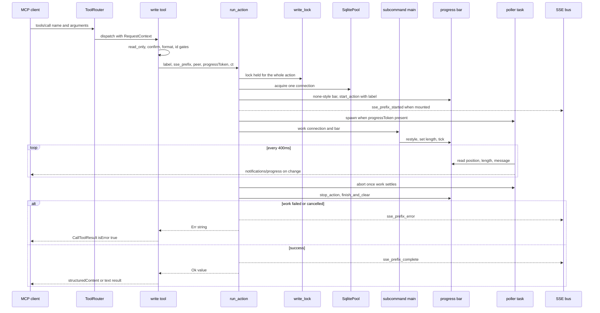

# MCP Server: Tools, Resources and Prompts

`oxyromon mcp` exposes the library's catalog and actions as MCP tools, resources
and prompts on top of the official Rust SDK (`rmcp` 3.5, `default-features =
false`, features `server`, `macros`, `transport-io`, `schemars`). One type,
`OxyromonMcp`, is the whole server: a cheap-to-clone handle holding the
`SqlitePool`, a `CancellationToken`, an `Arc<Mutex<()>>` write lock, the
`read_only` flag and — in server builds — an optional
`broadcast::Sender<SseMessage>`. Two transports serve that same handler: stdio
from the `mcp` subcommand, and the Streamable HTTP Tower service that
[`src/server.rs`](../../src/server.rs) nests at `/mcp`.

Tools do not reimplement actions. Seven of the ten write tools synthesize the
argv a human would type, hand it to the subcommand's own clap `Command` with
`try_get_matches_from`, and call that subcommand's `main()` on a pooled
connection — the exact trick the GraphQL mutations use, so CLI, GraphQL and MCP
cannot drift apart per surface. `download_dats`, `purge_systems` and
`set_setting` skip the argv step and call the same library entry points the
subcommands call
(`download_redump_systems`, `purge_system`, `config::set_setting` /
`unset_setting` / `add_to_list` / `remove_from_list`), and the read tools go
straight to `database.rs` helpers.

## stdout is the JSON-RPC channel

The constraint every contributor must respect, verbatim from
[`AGENTS.md`](../../AGENTS.md):

> **stdout can be a protocol channel.** With `oxyromon mcp` (or `/mcp`), stdout
> carries MCP JSON-RPC: never `println!`/`print!` from any code path the MCP
> server can reach — log (`log::*`) or use the `progress.rs` helpers, which
> write to stderr.

`src/mcp.rs` records the same rule where the last offender used to live, and
[`src/import_roms.rs`](../../src/import_roms.rs#L309-L312) keeps a guard comment
at the site of the former stray `println!`. Progress bars, the
`indicatif_log_bridge` logger and every `print_*` helper already land on stderr;
see [Progress Bars, Categorized Output and Prompts](../concepts/cli-output-progress-and-prompts.md).

## Transports and lifecycle

`mcp::subcommand()` registers `mcp` with a single flag, `--read-only`.
`mcp::main(pool, matches)` builds a handler, calls
`service.serve(rmcp::transport::stdio())` — the point at which stdout becomes the
protocol channel — and then blocks in `tokio::select!` on `server.waiting()`
(stdin EOF or a transport error, which is how the tests observe a clean exit)
against `tokio::signal::ctrl_c()` and, on Unix, SIGTERM. Either signal cancels
the token, which unwinds any in-flight mutating action; dropping the running
service stops the transport.
`src/main.rs` runs the long-lived server *outside* the single-connection scope
used by ordinary subcommands, then `optimize_database(pool)` after it returns.

`mcp_http_service(pool, cancel, sse_tx)` returns rmcp's
`StreamableHttpService`. rmcp serves protocol `2026-07-28` clients statelessly
(no session id), so the service factory runs per request and all state must live
in the cloneable handler. `/mcp` therefore shares the web server's loopback
listener, its pool and its cancellation token — and the same trust level as
`/graphql`; see [HTTP Server, GraphQL API and Uploads](http-server-and-graphql-api.md).

`get_info()` advertises tools, prompts and resources, names the server `oxyromon`
with `CARGO_PKG_VERSION`, and ships an `INSTRUCTIONS` string that tells the model
where ids come from, that changes run synchronously and stream progress, that the
purge tools need `confirm: true`, and that in read-only mode the mutating tools
"are not registered at all".

## Tool surface

Two `#[tool_router]`s — `read_router` in [`src/mcp/read.rs`](../../src/mcp/read.rs)
and `write_router` in [`src/mcp/write.rs`](../../src/mcp/write.rs) — are merged by
`tool_router()` into the single live router the `#[tool_handler]` uses.

Read tools (`status`, `list_systems`, `get_system`, `list_games`, `get_game`,
`search_games`, `get_settings`, `downloadable_systems`, `parse_game_name`) are all
annotated `read_only_hint = true`, take a pooled connection per call and never
touch the write lock — `parse_game_name` being the one that needs no connection at
all. `status` and the `oxyromon://status` resource
share `build_status`, which reports version, `read_only`, ROM/tmp directories,
three counts and the same alphabetized dependency list `oxyromon info` prints —
nine groups (`sevenz-rust2`, `chd-rs`, `cia-rs`, `xps-rs`, `xso-rs`, `nsz-rs`,
`xdelta-rs`, `wux-rs`, `nod`). Every one of them is a linked crate whose `get_version()`
returns the literal `"built-in"`, so none can come back missing or report
`version: null`; `cia-rs` replaced `ctrtool`, the last optional external program,
and the tool's description now speaks of format backends rather than external
tools. Two codecs qualify their answer about keys. `nsz-rs` reports
`"built-in, prod.keys not found"` when the Switch keys file is absent, since only
NSZ compression needs it. `wux-rs` reports `"built-in, no Wii U keys imported"`
until `import-keys` has run, since only WUA and NUS exports need Wii U keys.
Neither `import-keys` nor `export-roms` has an MCP tool, so an agent can see the
missing keys but cannot import them. Paging is clamped server-side:
`list_games` defaults to 100 and caps at 1000, `search_games` defaults to 50 and
caps at 500. `parse_game_name` is pure `shiratsu-naming` parsing with no
connection at all.

Write tools (`import_dats`, `download_dats`, `import_roms`, `sort_roms`,
`check_roms`, `convert_roms`, `set_setting`, `purge_roms`, `purge_systems`,
`purge_irds`) run to completion inside the call — MCP has no job queue. Most
also carry an annotation hint: `idempotent_hint = true` on the safe-repeat
actions, `open_world_hint = true` on `download_dats` (it reaches redump.org), and
`destructive_hint = true` on the three purges, so clients can decide how eagerly
to auto-invoke each. `convert_roms` is annotated only as non-read-only.

`download_dats` downloads *and imports* each named Redump system, which its
description says, and reports per system rather than per call: it carries on
past a failed system and returns `DownloadDatsOut`, which lists every system once
under `imported`, `up_to_date` (a DAT no newer than the imported one, which
changes nothing) or `failed` with its error. Those lists are the `DatOutcomes`
that `download_redump_systems` returns, the same collector the CLI and GraphQL
use, mapped field by field. It is a tool error only when every
system failed, and it notifies resource changes only when something was
imported. `tests/mcp_stdio.rs` pins the all-failed case with two unknown names,
which fail before any request, so the test needs no network.

Argument validation happens in the handler, before `run_action` is ever reached:
`sort_roms` and `check_roms` demand exactly one of `system_id` / `all: true`,
`purge_roms` rejects a call with none of `missing` / `orphan` / `trash` /
`foreign`, `import_dats`, `import_roms` and `download_dats` reject empty path
lists, and `convert_roms` checks the format against `convert_roms::ALL_FORMATS`
plus the arcade restriction before starting. Those checks take their own
short-lived pooled connection, so a malformed call neither queues on the write
lock nor holds a connection for the duration of an action.

`import_dats` maps its optional booleans straight onto argv: `update: true`
adds `--update` and `arcade: true` adds `--arcade`, which imports DATs that
list games instead of machines, such as FBNeo's, as arcade systems.

`convert_roms` upper-cases `params.format` before the check, because
`convert_roms::ALL_FORMATS` is uppercase (`ORIGINAL`, `7Z`, `CHD`, `CSO`, `NSZ`,
`RVZ`, `WUX`, `ZIP`, `ZSO` — the same values `PREFER_FORMAT` takes) and the validated
value is what goes into the argv, where clap's `PossibleValuesParser` compares it
case-sensitively. The tool description and the `format` parameter doc list
exactly those nine values. `tests/mcp_stdio.rs` pins both sides: `"zip"` is
accepted and `"nkit"` is refused with "unknown format".

JSON Schema for every tool comes from the parameter structs in
[`src/mcp/params.rs`](../../src/mcp/params.rs): field names and types give the
shape, `Option<T>` gives optionality, and the doc comments are the prose the
model reads. `Parameters<T>` unpacks them in the signature. Output structs in
[`src/mcp/output.rs`](../../src/mcp/output.rs) deliberately stay compact —
snake_case, enum *names* (`"merged"`, `"partial"`, `"romfile"`) instead of the
integers stored in SQLite, and no bookkeeping ids a caller cannot use — because
every field lands in a model's context window.

A `system_id` argument always resolves through the `require_system` method,
which acquires its own pooled connection and maps the
number to the system's *name* because that is what the CLI subcommands accept
(`-s/--system`); an unknown id returns the tool-level message "system N not
found; list_systems has the ids".

The argv is also where MCP's headless defaults diverge from the interactive CLI:
`import_roms` always appends `--unattended`, translating `unattended: "first"` /
`"skip"` and defaulting to `"first"`, so the CLI's `none` mode — which prompts —
is unreachable from MCP; `purge_irds` always passes `--system`, which is what
makes `purge-irds` purge every IRD game unattended instead of prompting per game.

*Caption: a mutating tool call — one write-locked connection drives the CLI subcommand while a poller mirrors its progress bar into `notifications/progress`, and the outcome fans out to `/events` when the server is mounted.*

## run_action: the shared execution path

Every mutating tool funnels through `OxyromonMcp::run_action` in
[`src/mcp/actions.rs`](../../src/mcp/actions.rs). It takes the process-wide
`write_lock` *before* acquiring a connection and holds it across the whole
action, so writers queue politely instead of surfacing `SQLITE_BUSY` halfway
through an import; SQLite serializes writers anyway, and this makes the ordering
explicit. The lock is created outside `OxyromonMcp::new` and passed in: the
stdio server makes one for its single handler, and `mcp_http_service` makes one
before its factory, which builds a handler per request, so every `/mcp` request
shares it. GraphQL mutations (`spawn_cli_action`) take no such lock at all, so
between GraphQL and MCP the backstop is SQLite itself plus the pool's 5-second
`acquire_timeout`.

The `work` closure is `for<'a> FnOnce(&'a mut SqliteConnection, &'a ProgressBar)
-> BoxFuture<'a, Result<T>>` — the shape `spawn_cli_action` uses in
[`src/mutation.rs`](../../src/mutation.rs), except that GraphQL builds its
`ProgressBar::hidden()` inside the closure instead of receiving one. MCP mode has
no TTY: the bar comes from `get_progress_bar(0, get_none_progress_style())` so the
poller has something to read and the log bridge keeps styled output on stderr. The
subcommand owns the bar — it sets style, length, message and ticks it;
`run_action` only reads it.

Progress is bridged only when the caller passed a `progressToken`: a spawned
task sleeps 400 ms, compares `(position, length, message)` against the previous
reading, and sends `notifications/progress` solely on change, giving up when the
notify fails. The task is aborted as soon as `work` settles. Cancellation is a
three-way `tokio::select!` between `work`, the per-request `ctx.ct` ("cancelled
by the client") and the server token (`self.cancel`, "server shutting down"), so
both a client that hangs up and a process that is stopping unblock the action.
Afterwards the bar is stopped and cleared, the outcome is logged, and — when an
`sse_tx` is present *and* an `sse_prefix` was passed — `{prefix}_started`,
`{prefix}_complete` or `{prefix}_error` goes to the SSE broadcast so a browser
watching `/events` reacts to MCP-triggered work. `import_roms` and `set_setting`
pass `sse_prefix: None` and therefore emit nothing there.

## Read-only mode and confirm gating

`--read-only` is enforced at the router, not by a per-call check alone:
`tool_router()` calls `disable_route(name)` for every tool in `write_router()`
before merging it, so write tools vanish from `tools/list` and `tools/call`
fails at the protocol level — the client never sees them. Each write tool also
begins with an in-handler `if self.read_only { return Ok(read_only_denial(..)) }`
that would produce the tool-level result "{tool} is not available: this server
runs with --read-only"; the router disabling is what actually rejects calls. The
flag lives only on the stdio subcommand — the HTTP factory constructs its handler
with `read_only: false`, so `/mcp` always exposes the write tools.

Destructive tools need an explicit `confirm: true` in the arguments. `confirm`
is `#[serde(default)]`, so it is optional in the JSON Schema and an omitted
value reaches the refusal path instead of looking like a required field the
model must fill in.
`purge_systems` and `purge_irds` gate unconditionally; `purge_roms` gates only
when `trash` or `foreign` is set, since those delete files, and separately
refuses a call with none of the four flags set. Refusal is `need_confirm(tool)`:
a *tool-level* error result explaining that `"<tool>"` is destructive and was
refused — not a protocol error. Because the subcommands would otherwise prompt on
a TTY that does not exist, the synthesized argv appends `--yes` (`sort_roms`,
`purge_roms`) — the only two subcommands the MCP surface reaches that declare a
`YES` flag at all, and the same escape the subcommand's own tests use.

## Error taxonomy

Three result channels, chosen deliberately:

- `ok_json(&value)` returns `CallToolResult::structured`, so the payload arrives
  as `structuredContent` and as text for clients that ignore structure.
  `ok_text(msg)` is the prose-only form for actions whose useful answer is a
  sentence ("sorting complete").
- `tool_error(msg)` (and `need_confirm` / `read_only_denial`) is `isError: true`
  with a message the client renders to the user: bad ids, empty path lists, an
  unknown format, an invalid setting value. The model can act on these.
- `Err(McpError)` is reserved for requests the server cannot route or serve at
  all, built by the one `internal()` helper in `src/mcp.rs` when the cause is
  an internal failure: pool-acquire failures, unknown resource URIs
  (`McpError::resource_not_found`) and resource-payload serialization failures —
  plus `audit_system` on a nonexistent system. A *tool* result that cannot be
  serialized degrades to `tool_error` instead, inside `ok_json`.

The stdio tests assert the distinction: an unknown `system_id` yields
`isError` plus a pointer to `list_systems`, while a hidden read-only tool yields
a JSON-RPC `error` object.

## Resources and prompts

Four resource URIs back the tool reads for clients that mount stable context:
`oxyromon://status`, `oxyromon://systems`, `oxyromon://settings`, and one
`oxyromon://systems/{id}` per imported system (listed dynamically, JSON-typed),
with `oxyromon://systems/{system_id}` registered as a resource template. A
non-numeric or unknown system id in a URI is a protocol `resource_not_found`, and
so is any other unknown URI. After a successful mutation the server calls
`notify_resource_updated(system_uri(id))` when the work touched one known system
and `notify_resources_changed()` when the set of systems may have changed
(`import_dats`, `download_dats`, `purge_roms`, and `sort_roms`/`import_roms` in
their no-system form).

`prompts.rs` serves `onboard_system` and `audit_system`. Neither is a generic
template: both query the database first and embed a real snapshot, so the model
can act immediately. `onboard_system` branches on whether the system already
exists and, if it does not, on whether it is a Redump system — picking
`download_dats` or `import_dats` as step 1 accordingly. `audit_system` embeds the
`SystemOut` snapshot and a numbered check/get/list/purge/sort workflow that flags
the confirm requirement before proposing a purge.

## Build, pool and tests

`mcp = ["dep:rmcp", "dep:schemars"]` builds the stdio subcommand; `server`
implies `mcp` plus `rmcp/transport-streamable-http-server`, which is why `/mcp`
is always present when the web server is. Building with `mcp` also changes
`establish_connection`: `cfg_if` gives long-lived processes five connections and
`PRAGMA locking_mode = NORMAL` instead of the CLI's one connection with
`EXCLUSIVE`. CI compiles the stdio-only combination explicitly with `cargo
clippy --no-default-features --features use-rustls,mcp --all-targets`; see
[Feature Flags and Build Topology](../architecture/feature-flags-and-build-topology.md).

[`tests/mcp_stdio.rs`](../../tests/mcp_stdio.rs) (`#![cfg(feature = "mcp")]`)
spawns the real binary as a child process and speaks raw line-delimited JSON-RPC
on stdin/stdout — no SDK client — which also proves the wire format is what a
real client will find. It points `OXYROMON_DATA_DIRECTORY` at a temp directory
and silences logging, then covers the handshake and the full tool/prompt/resource
lists, `status` on an empty library, unknown-id tool errors, a DAT import read
back through `list_systems`/`search_games`/`list_games` via `structuredContent`,
confirm gating on all three purge tools (with `confirm` omitted for
`purge_roms`), `convert_roms` accepting any case and refusing an unknown format,
setting validation mirroring the CLI,
and `--read-only` both hiding and refusing the write tools. `close()` drops stdin
and asserts the server exits successfully on EOF.
