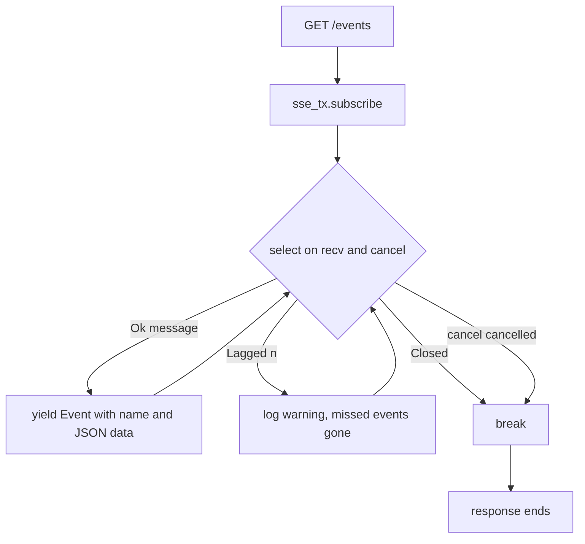
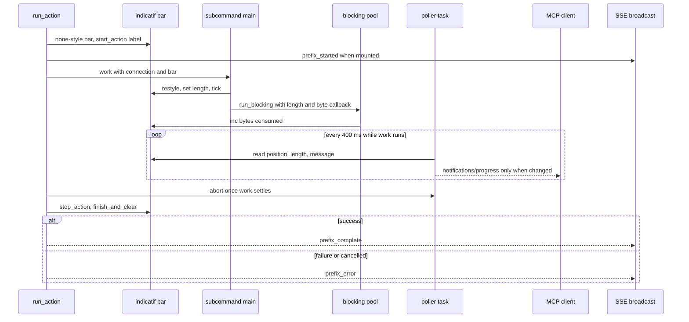

# SSE Events and Progress Bridging

Every oxyromon surface shares one implementation per action, so the interesting
question is not *what runs* but *how it reports*. A GraphQL mutation returns
`true` and an MCP tool blocks until the work is done, but the browser learns
what happened from exactly one place: **`GET /events`**, a Server-Sent Events
stream fed by a single in-process broadcast channel. The indicatif bar a
subcommand ticks for the terminal is bridged into a machine-readable progress
stream on exactly one surface: MCP.

Related: [HTTP Server, GraphQL API and Uploads](http-server-and-graphql-api.md),
[MCP Server: Tools, Resources and Prompts](mcp-server.md),
[Progress Bars, Categorized Output and Prompts](../concepts/cli-output-progress-and-prompts.md).

## The bus: one channel, one message shape

`server::main` creates the whole transport in two lines —
`broadcast::channel::<SseMessage>(100)` and a `CancellationToken` — and threads
both through `AppState` (for the axum handlers) and the GraphQL schema's `.data()`
(so resolvers reach the sender with `ctx.data_unchecked::<broadcast::Sender<SseMessage>>()`).

```rust
pub struct SseMessage {
    pub event: String,
    pub data: String,
}

pub fn sse_send(tx: &broadcast::Sender<SseMessage>, event: &str, data: Value) {
    let _ = tx.send(SseMessage { event: event.to_string(), data: data.to_string() });
}
```

`data` is serialized at the sender, so a `serde_json::Value` becomes a string
once and every subscriber gets the same bytes. On the wire that is
`event: <name>` plus `data: <json>`; the browser hands it to a
`MessageEvent`, and `frontend/src/sse.rs` parses it back with
`serde_json::from_str`.

Three properties follow from using `broadcast` rather than a queue, and all
three are load-bearing:

- **Fan-out is per-connection.** Each `GET /events` calls `sse_tx.subscribe()`
  and gets its own receiver. Two browser tabs, or a tab plus a `curl`, each see
  every event.
- **The channel is lossy by design.** `tokio::sync::broadcast` has a fixed
  capacity (100) and drops messages for a receiver that falls behind rather
  than blocking the producer.
- **`sse_send` ignores a full or closed channel.** `let _ = tx.send(..)` drops
  the send error whether it says there are no receivers or every subscriber's
  queue is full. The second receiver returned by `broadcast::channel(100)` is
  discarded at startup, so on a headless server with no browser attached every
  event is discarded silently.

That is the intended contract: **progress is best-effort telemetry, not a work
queue.** Nothing may depend on an event being delivered; the authoritative state
lives in SQLite and is re-fetched. Do not add an event whose only purpose is to
carry a value the client cannot otherwise obtain.

## The `/mcp` mount shares the same bus

The MCP server is not a second process or a second event pipeline. `server::main`
nests `crate::mcp::mcp_http_service(pool.clone(), cancel.clone(), sse_tx.clone())`
as a service at `/mcp` on the same axum router as `/graphql` and `/events`, so an
MCP client and the SPA watch the same channel and the same pool. `mcp_http_service`
holds a `LocalSessionManager` and builds the `OxyromonMcp` handler per request —
rmcp serves `2026-07-28` clients statelessly — and each fresh handler is passed
`with_sse(sse_tx.clone())`, which is what turns its `sse_tx` from `None` to
`Some`. The `CancellationToken` handed to it is the server's own, which is how a
server shutdown reaches in-flight MCP actions.

Two consequences are worth keeping in mind:

- `/mcp` is unauthenticated, like `/graphql` and `/events`: the route comment
  calls it "same-origin as the web app and the same trust level as `/graphql`".
  Anything that can reach the bound address can run mutating tools.
- In a stdio-only build (`--features mcp` without `server`) the SSE branch does
  not exist at all: `sse_prefix` is consumed by a `let _ = sse_prefix;` and only
  MCP progress notifications leave the process.

## The `/events` stream

`sse_handler` wraps an `async_stream` loop in `Sse::new(stream).keep_alive(KeepAlive::default())`,
so an idle connection still emits the periodic SSE comment axum uses to keep
proxies and NATs from reaping it.



*Caption: one connection's receive loop — a lagging client is degraded, never disconnected, and only a closed channel or a cancelled token ends the stream.*

`RecvError::Lagged(n)` logs a warning and **continues**: the missed events are
gone but the socket stays open, so a browser throttled in a background tab
resumes rather than erroring. `RecvError::Closed` and `cancel.cancelled()` both
`break`, which is what keeps shutdown from leaving sockets hanging.

Clients reach this same-origin URL in all three deployments: the SPA built by
Trunk proxies `/events` to a locally running `oxyromon server` in development
(`frontend/Trunk.toml`), the Tauri shell serves the webview from the sidecar's own
loopback origin, and production serves the embedded assets from the same listener.

## The `{prefix}_started` / `_complete` / `_error` contract

`spawn_cli_action` in [`src/mutation.rs`](../../src/mutation.rs#L21-L79) is the
template: emit `{prefix}_started`, acquire a connection, run the subcommand, then
emit `{prefix}_complete` (`success: true`) or `{prefix}_error` (`success: false`)
with a human `message`. Every event carries a JSON object with at least a
`message` field, because that string is what the browser shows verbatim.

These prefixes are actually emitted:

| Prefix | Emitted from | Trigger |
| --- | --- | --- |
| `sort_roms`, `check_roms`, `generate_playlists`, `purge_roms`, `convert_roms`, `purge_irds` | `spawn_cli_action` in `src/mutation.rs` | GraphQL mutation |
| `download_dats` | inlined in the `download_dats` mutation | GraphQL mutation |
| `purge` | inlined in the `purge_system` mutation | GraphQL mutation |
| `import_rom`, `import_patch`, `import_irds`, `import_dat` | the four upload handlers in `src/server.rs` | `POST /roms`, `/patches`, `/irds`, `/dats` |
| `import_dats`, `download_dats`, `sort_roms`, `check_roms`, `convert_roms`, `purge_roms`, `purge`, `purge_irds` | `OxyromonMcp::run_action` in [`src/mcp/actions.rs`](../../src/mcp/actions.rs#L57-L174) | MCP `tools/call` over `/mcp` |

Two details the table hides:

- **`purge` is the prefix for a whole-system purge**, not `purge_system`. The
  MCP `purge_systems` tool reuses the same prefix deliberately, so one browser
  listener covers both entry points.
- **`import_dat` is the only prefix that can emit several terminal events for one
  request.** `process_dat_upload` returns a `Vec<Result<ImportDatResult>>` — one
  entry per DAT inside an uploaded ZIP — and the task sends
  `import_dat_complete` per entry (`skipped: true` for an already-current system,
  which the frontend renders as a warning and does *not* refresh on) or
  `import_dat_error` per failure. `ImportDatResult::Skipped` — `--update` against
  a system that does not exist — is filtered out before the handler ever sees it,
  so it emits nothing at all.

The invariant that makes the UI correct: **one terminal event on every code path**.
`spawn_cli_action` acquires its connection *inside* the task, after
`{prefix}_started` has already gone out, precisely so a pool-exhaustion failure
becomes `{prefix}_error` rather than silence. The same discipline appears in
`upload_dat`, where a failed `TempDir::new()`, `pool.acquire()` or `fs::write`
emits `import_dat_error` and returns. A new action that can return early without a
terminal event leaves a menu spinner turning forever.

The ordering difference between the two hosts is worth knowing when debugging a
"nothing appeared" report: `spawn_cli_action` emits `started` *before* waiting
for a connection, so a queued action announces itself even when the pool is
saturated. `purge_system` and `download_dats` — which inline the sequence instead
of using the helper — and MCP's `run_action` all acquire first, so an action
waiting on a connection (or, for MCP, on the process-wide write lock) is
invisible on `/events` until it actually starts.

## Why the lossy channel is survivable: the frontend's rules

`connect_sse` in [`frontend/src/sse.rs`](../../frontend/src/sse.rs) opens one
`EventSource("/events")` for the SPA's lifetime and registers three kinds of
listener per prefix: an info toast for `_started`, a notification plus
`state.refresh()` for `_complete`, and an error toast for `_error`.

Because `EventSource` reconnects on its own **but never replays what it missed**,
a `_complete` sent while the socket was down would leave a busy flag set with
nothing left to clear it. The frontend defends itself in two ways:

- `source.set_onopen(..)` resets every in-flight flag (`purging_system_id`,
  `sorting_system_id`, `checking_system_id`, `purging_irds_system_id`,
  `generating_playlists`, `purging_roms`) on *every* opening, including the
  first, so a reconnect starts from "nothing is running".
- `on_finished` clears a flag on `complete` **or** `error`, so neither outcome
  can strand it.

A `_complete` whose payload has `system_id` equal to the current selection also
drops the selection to the `-1` sentinel — a purged system has nothing left to
fetch. Busy flags are set optimistically by the mutation helpers in
`frontend/src/api.rs`, which clear them immediately if the mutation itself
returned a GraphQL error, so the two writers of those signals never disagree.

Note one asymmetry when adding an MCP tool with a new prefix: the SPA listens
for exactly twelve prefixes, and MCP's `import_dats_*` is **not** among them (the
UI listens for `import_dat_*`, from the `/dats` upload). An MCP-triggered DAT
import therefore announces itself to nobody in the browser. Reusing an existing
prefix is what makes MCP work visible.

## Bridging a progress bar

A subcommand reports depth by ticking an `indicatif` bar. Where that bar's
movement comes from has changed as the external converters became in-process
crates: CPU-bound format work now runs through `run_blocking` in
[`src/progress.rs`](../../src/progress.rs#L72-L97), which clones the caller's
bar, moves the conversion onto the blocking pool, and hands the format crate a
`&mut dyn FnMut(u64)` that does nothing but `bar.inc(n)` with the input bytes
just consumed:

```rust
spawn_blocking(move || {
    bar.reset();
    bar.set_style(get_bytes_progress_style());
    bar.set_length(length);
    work(&mut |n| bar.inc(n))
})
```

That callback shape is the workspace-wide contract for the format crates —
[`AGENTS.md`](../../AGENTS.md#L205-L215) states that entry points take
`progress: &mut dyn FnMut(u64)`, called with the input bytes consumed since the
last call, and that **the calls add up to the input size**. `length` is that
total: the input file's `metadata().len()` for `xso-rs`, `nsz`, `xdelta` and
`xps`; the sum of the files a CUE names, from `chd_rs::cd_input_size`, for a CD
image ([`crates/chd-rs/src/cdrom.rs`](../../crates/chd-rs/src/cdrom.rs#L1425-L1438));
`gdi_rs::input_size` for a GDI conversion; and the CHD's
`info().logical_size` when extracting one. So the byte counts chd-rs and its
siblings push through this callback are exactly the `position`/`total` a client
eventually sees.

Whether that movement reaches a client depends on the host:

- **CLI** — the bar is the real output, plus `indicatif_log_bridge`.
- **GraphQL / uploads** — every action runs on `ProgressBar::hidden()`, and
  **nothing is bridged**. The byte callback still runs and still ticks a bar
  that renders nowhere; SSE carries lifecycle events and their `message` string,
  never percentages. Adding per-file progress to the web UI would mean inventing
  a new event stream, not wiring up the bar.
- **MCP** — `run_action` deliberately creates a real bar
  (`get_progress_bar(0, get_none_progress_style())` plus `start_action(label)`)
  rather than a hidden one, so both the poller below and the log bridge have
  something to read, and that same bar is the one threaded down through the
  subcommand into `run_blocking`.



*Caption: the only bar-to-client bridge — a 400 ms poller mirrors the subcommand's own progress bar (including the byte counts chd-rs pushes through `run_blocking`) into MCP progress notifications, while the same lifecycle events fan out to `/events`.*

The poller exists because subcommands own their bar (they set style, length and
message and tick it); `run_action` only ever reads it. It samples
`(position, length, message)`, compares against the previous reading, and sends
`notifications/progress` **only on change**, giving up when `notify_progress`
fails. It is spawned only when the caller passed a `progressToken`, and aborted
as soon as the work settles, so a completed action cannot keep notifying.

Both halves are conditional in server builds: the lifecycle fan-out requires
`self.sse_tx` to be `Some` — which only happens when the service is mounted at
`/mcp` via `mcp_http_service(pool, cancel, sse_tx)` — *and* an `sse_prefix` to be
passed. `import_roms` and `set_setting` pass `None` and emit nothing, so a
mutation may finish silently on `/events`.

## Cancellation and shutdown

One `CancellationToken` is created in `server::main` and shared by `AppState` and
the nested MCP service. `shutdown_signal` waits on Ctrl+C or (on unix) SIGTERM,
then runs `optimize_database(pool)` — `incremental_vacuum`, `optimize`,
`wal_checkpoint(truncate)` — and **only then** calls `cancel.cancel()`. The order
is client-visible: `/events` streams stay open for as long as the checkpoint
takes, then terminate together. `serve(..).with_graceful_shutdown` handles the
listener, and `src/main.rs` optimizes a second time after `server::main` returns.

What the token actually reaches:

- **`/events` streams** — `cancel.cancelled()` breaks the receive loop.
- **In-flight MCP actions** — `run_action` races `work` against the per-request
  `ctx.ct` ("cancelled by the client") and `self.cancel` ("server shutting
  down"), so a client hanging up and a server stopping both unblock the action
  and surface as `{prefix}_error`.
- **Spawned CLI actions — nothing.** A GraphQL- or upload-triggered task is not
  watched for cancellation and runs to completion; that is why the checkpoint
  can be the slow part of a shutdown.

The stdio MCP transport builds its own token and cancels it on Ctrl+C, and the
Tauri shell does not go through this path at all: it kills the sidecar child
directly on exit, since the process is outside its group.

## Focused tests

Nothing tests `/events`. Grep for the route reaches `src/server.rs`, the frontend
listener, the MCP bridge's comment and the desktop shell — no test file. The
server tests (`src/server/test_*.rs`, each on its own port and serialized by the
test-only `config::MUTEX`) boot the real `main()` and assert the contract from
outside instead: `test_uploads.rs` checks only the HTTP status code (202 for
accepted work, 400 for a missing field or unknown id), while `test_mutations.rs`
and `test_server.rs` re-query GraphQL a short `sleep` after the request for the
effect.

[`tests/mcp_stdio.rs`](../../tests/mcp_stdio.rs) (`#![cfg(feature = "mcp")]`)
spawns the real binary in `mcp` mode with its own `OXYROMON_DATA_DIRECTORY` and
`OXYROMON_LOG_LEVEL=off`, and speaks line-delimited JSON-RPC over its
stdin/stdout with a hand-rolled client — deliberately no SDK client, so the wire
format itself is under test. The client's `request()` reads lines until one
carries **its own** `id`, which is what lets it survive unsolicited notifications
on the same stream; `close()` drops stdin and asserts a clean exit. Coverage is
the handshake plus the full tool/prompt/resource lists (`audit_system`,
`onboard_system`, `oxyromon://status`, `oxyromon://systems`,
`oxyromon://settings`), `status` on an empty library, an unknown `system_id`
coming back as a tool error that points at `list_systems`, a DAT import read back
through `structuredContent`, confirm gating on all three purge tools,
`set_setting` validation mirroring the CLI, and `--read-only` both hiding and
refusing the write tools. Notably no test sends a `progressToken`, so the progress
poller never runs under test.

So the SSE event names and payloads are an unverified contract in both
directions: changing a prefix compiles cleanly, breaks the SPA's listener for
that action, and fails no test. Rename a prefix by editing `frontend/src/sse.rs`
in the same commit, or add a test that subscribes to `/events` before the request
and asserts the event sequence.
