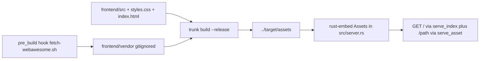
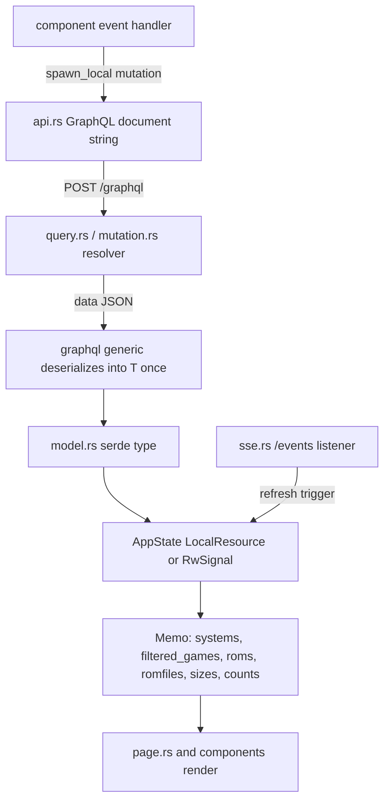
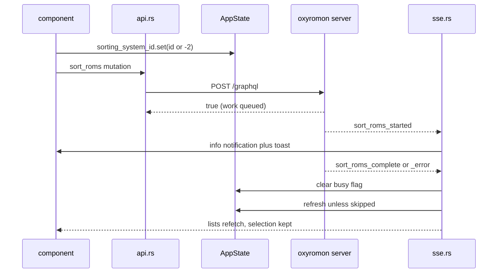

# Web UI (Leptos SPA + Web Awesome)

`frontend/` is a **standalone cargo crate** (`oxyromon-frontend`, `publish = false`)
holding a Leptos 0.8 client-side-rendering app compiled to WebAssembly. It is not a
member of the root workspace: its `Cargo.toml` declares an empty `[workspace]` so
cargo does not walk up to the `oxyromon` package, which keeps the wasm dependency
tree out of the native build entirely. The same separation is why `cargo clippy
--workspace` from the repository root never sees this code.

The crate has no backend of its own and no privileged access. It talks to the same
same-origin `/graphql`, `/events`, `/dats`, `/roms`, `/patches`, `/irds` and
`/romfiles/{id}` endpoints that any `curl` would, so the server is unchanged by the
framework choice — and so is the desktop shell.

Related: [HTTP Server, GraphQL API and Uploads](http-server-and-graphql-api.md),
[SSE Events and Progress Bridging](sse-and-progress-bridge.md),
[Desktop App (Tauri Sidecar)](desktop-tauri-shell.md),
[Builds, Distribution and Releases](../operations/build-and-release.md).

## Entrypoints and ownership

| File | Responsibility |
| --- | --- |
| `src/main.rs` | installs the panic hook, applies language + theme, `mount_to_body(<App/>)` |
| `src/app.rs` | provides `AppState`, opens SSE, lays out navbar + page + global modals |
| `src/state.rs` | the whole reactive model: sources, resources, memos |
| `src/api.rs` | GraphQL document strings and the typed fetch helpers |
| `src/model.rs` | serde types mirroring the *requested subset* of the GraphQL schema |
| `src/sse.rs` | `EventSource("/events")` and every event listener |
| `src/notify.rs` | notification history + `<wa-toast>` delivery |
| `src/page.rs` | the three panes, statistics, delete dialog, toast host |
| `src/ui.rs` | `Modal`, `Dropzone`, `ScrollWindow`, `Spacer`, `StatTile`, event-property readers |
| `src/components/` | navbar, notifications bell, the modal dialogs |

## Build and serve path

*Caption: the wasm bundle is a build artifact of the native binary, not a separate deployable.*

`Trunk.toml` sets `target = "index.html"`, `dist = "../target/assets"` and
`public_url = "/"`. That output directory is exactly the `#[folder = "target/assets"]`
that `rust_embed` reads in `src/server.rs`, so there is no copy step: the SPA is
embedded into the `oxyromon` binary at compile time. `serve_index` answers `/` with
the embedded `index.html`, and `serve_asset` (`/{*path}`) resolves every hashed JS,
WASM and vendored asset by exact path, returning 404 for anything not in the
bundle. `public_url = "/"` means the generated markup asks for root-absolute URLs
(`/webawesome/…`, `/icons/…`, the hashed bundle), which the `/{*path}` route
serves from the embedding root rather than relative to the current page.

The native build drives trunk automatically. `build.rs` runs `trunk build --release`
with `current_dir("frontend")` when the `server` feature is enabled and
`SKIP_TRUNK != "true"`, then unconditionally creates `target/assets` so rust-embed
still compiles. That `create_dir_all` is load-bearing: building the **published
crate** (cargo omits nested packages from the tarball, so `frontend/` is simply
absent) still produces a linkable binary rather than a compile error — but with an
empty asset set, so `serve_index`'s `Assets::get("index.html").unwrap()` has nothing
to return and the UI is simply not there. The `server` build asserts `frontend/`
exists first and says so explicitly, because `Command` reports a missing working
directory identically to a missing binary and would otherwise blame trunk.
`frontend/Cargo.toml`'s `[profile.release]` is size-oriented (`opt-level = "z"`,
`lto`, `codegen-units = 1`, plus `data-wasm-opt="z"` in `index.html`) for the same
reason everything else here is: the bundle is embedded in a shipped binary.

`dist.sh` exports `SKIP_TRUNK=true` once and runs `trunk build --release` on the
**host** at the top of each target loop, before `cross build --release --target …
--features server`. Two things make that shape necessary rather than redundant. The
wasm bundle is target-independent and lands in `target/assets`, but every loop ends
with `cargo clean`, which wipes that directory — so the next loop has to rebuild it.
And `SKIP_TRUNK` only helps if it reaches `build.rs`, which executes inside the cross
image: `Cross.toml` lists it under `[build.env] passthrough` for exactly that. The
same exported value covers the host-only desktop step at the end, which is why that
step runs trunk again first: without it, `desktop/scripts/stage-sidecar.sh`'s
`cargo build --release --features server` would embed the empty `target/assets` the
previous `cargo clean` left behind and ship a sidecar with no UI.

Dev mode is a different topology: `trunk serve` hot-reloads and the four `[[proxy]]`
entries forward `/graphql`, `/events`, `/dats` and `/romfiles/` to a locally running
`oxyromon server` on `127.0.0.1:8000`. The proxies are ignored by `trunk build`.
Note the list is shorter than the set of endpoints the SPA actually calls: the
`/roms`, `/patches` and `/irds` upload POSTs have no `[[proxy]]` entry, so those
three imports cannot be exercised against `trunk serve` and fail in a way the
embedded build never shows. Building requires the `wasm32-unknown-unknown` target
and trunk — there is no Node.js toolchain anywhere in this crate.

## Data flow: query string → serde type → signal → view

*Caption: the one write path (fetch and mutation results into signals) and the one re-read trigger (SSE completion).*

`graphql<T>()` in `api.rs` is the single network primitive: it POSTs
`{"query", "variables"}` to `/graphql`, deserializes into
`GraphQlResponse<T> { data, errors }`, returns the **first** error message as a
`String` if any, and otherwise requires `data`. `T` is always a caller-declared
struct rather than `serde_json::Value`, deliberately: parsing through a `Value`
tree and then walking it built several megabytes of throwaway allocation for a
large system.

`model.rs` mirrors **only the fields the frontend asks for**. Two fields are not
API data at all: `Game::name_lower` is `#[serde(skip)]` and filled in once when a
chunk arrives, so the name filter never reallocates a lowercase copy of every game
name on every keystroke; `Notification` is a purely client-side type. `camelCase`
renaming is applied per struct (`System`, `Info`, `Sizes`, `SystemSettingsData`)
matching async-graphql's default field naming — a backend field rename breaks
deserialization silently for optional fields and loudly for required ones.

Failures never surface as a panic or a blank screen by accident: each data helper
calls `report_error(notifier, "<action>", &e)`, which logs **and** pushes an
`Error` notification, then returns an empty value (`Vec::new()` / `Sizes::default()`).
Without that, an unreachable backend would render empty tables in silence.

Two panes are derived rather than fetched. `romfiles` projects the selected game's
ROMs down to their `romfile`s, sorts by path and deduplicates — many ROMs share one
archive — and the pane links each entry to `GET /romfiles/{id}` with `download`, a
plain anchor rather than a fetch. `RomfilesCard` also strips the leading system
directory segment for display, since the stored path is relative to
`ROM_DIRECTORY`. The statistics card is mixed too: system/game/ROM counts come from
the same memos the lists do, and only the four aggregate sizes are a separate query
per system.

## AppState: sources, resources, memos

`AppState` is `Copy` (signals and memos both are), built once in `App` behind
`provide_context` and pulled back with `expect_context` anywhere. The contract is
stated in the module docs and enforced by the field layout: **sources are written,
derived values are `Memo`s and nothing writes them.** Adding a new view of the data
means adding a memo, not another effect that has to remember to fire.

`AppState::new()` must run inside a reactive owner (i.e. from a component) because
it creates the resources and memos. `Notifier` — just
`notifications: RwSignal<Vec<Notification>>` — is deliberately a *separate* `Copy`
struct that `AppState` holds, because the resource fetchers have to report failures
while `AppState` is still being constructed around them. `main.rs` runs
`console_error_panic_hook::set_once()`, `init_language()` and `init_theme()` before
`mount_to_body`, so neither locale nor theme can flash.

Fetching is declarative rather than effect-driven:

- `systems_resource: LocalResource<Vec<System>>` reads no signal, so it is refetched
  only explicitly by `AppState::refresh()`.
- The games list is **not** a resource. A resource resolves to a single value, and
  the point here is to be usable before the last chunk lands: `games: RwSignal<Vec<Game>>`
  grows as `stream_games` hands over each `GAMES_CHUNK` (10 000) row, so a huge
  arcade set starts appearing almost immediately while a console system still
  arrives in one request.
- `roms_resource` and `sizes_resource` re-run when the selection they read changes.
  `roms_resource` tracks only `game_id` and reads `system_id` untracked on purpose:
  tracking both would fire a doomed fetch pairing the new system with the game still
  selected under the old one.

`refresh()` does two things — `systems_resource.refetch()` plus
`refresh.notify()` on a `Trigger` that the games effect and the roms and sizes
resources all track. It is the answer to "the server just changed what is on
screen" and it deliberately keeps the selection.

Two correctness details in the games effect are easy to break:

- A **generation counter** (`games_generation: RwSignal<u64>`) is captured per run.
  A stream whose system has since been deselected notices on the next chunk and
  returns `ControlFlow::Break`, abandoning the rest rather than appending foreign
  rows.
- The effect distinguishes a **refresh** (its previous `system_id` argument equals
  the current one, i.e. it was woken by `refresh` or by an unrelated signal) from a
  **reload**. A refresh leaves the rows on screen, accumulates the new chunks
  privately and swaps them in once the stream ends, so the list neither blanks nor
  loses its scroll position; a reload clears immediately and appends as it goes.
  `loading_games` is set only on the reload path, and only cleared if this run is
  still the current generation.

Leptos 0.8 exposes no public `loading()` on a resource and keeps the previous value
in flight, so **each fetch drives its own `loading_*` flag**. The `roms` and
`romfiles` memos read `loading_roms` to return an empty list while a *different*
game is in flight, so the previous selection's rows never linger; `filtered_games`
deliberately does not blank, since the whole point of streaming is that rows already
in hand stay on screen. `filtered_games` holds *indices* into `games`, not clones —
a system can hold tens of thousands of games and that memo recomputes on every
keystroke.

The one effect in `app.rs` encodes a single invariant: a game belongs to a system,
so changing `system_id` sets `game_id` to the `-1` sentinel. Sentinel `-1`
(negative generally) means "nothing selected", and the fetch helpers early-return an
empty result (`stream_games`/`fetch_roms` an empty `Vec`, `fetch_sizes`
`Sizes::default()`) rather than issuing a doomed query.

## Mutations, busy flags, and SSE

Long-running work is *handed over*, not awaited. `request_action()` fires a
mutation, reports a refusal, and returns; the work itself reports over SSE. The
caller sets a busy flag first, and **the server's terminal event clears it** — not
the client's `await`. That is what keeps a menu out of reach for as long as the
action really runs. Only a refused request clears the flag locally.

`-1` means idle; `-2` means "all systems", and the per-row spinners treat
`[id, -2]` as busy so an all-systems sort spins every row's menu.

*Caption: the busy flag's lifetime spans the mutation request and the SSE terminal event, which is why a missing terminal event strands a spinner.*

`connect_sse` opens one `EventSource("/events")` for the SPA's lifetime and
registers three listener kinds per action prefix (`_started` → info notification,
`_complete` → notification + `refresh()`, `_error` → error notification), plus an
`on_finished` pair that clears the busy flag on `complete` **or** `error`. A
`_complete` with `skipped: true` warns and does **not** refresh, because nothing
changed. A `_complete` whose `system_id` matches the current selection drops the
selection to `-1` — a purged system has nothing left to fetch.

`EventSource` reconnects on its own but never replays what it missed, so a terminal
event sent while the socket was down would leave a flag set forever. `set_onopen`
therefore resets **all seven** busy flags on every opening, including the first: a
reconnect starts from "nothing is running". Closures are intentionally leaked with
`forget()` and the `EventSource` with `std::mem::forget`, since the connection lives
as long as the page.

The set of prefixes the SPA listens for is a hardcoded list. Renaming a backend
event prefix compiles cleanly, breaks that action's UI, and fails no test. Note the
existing asymmetry: the UI listens for `import_dat_*` (from the `/dats` upload) but
not `import_dats_*` (from MCP), so an MCP-triggered DAT import announces itself to
nobody in the browser.

## Uploads bypass GraphQL

Multipart uploads go straight to axum handlers with `gloo_net::http::Request` +
`web_sys::FormData`, not through `graphql()`: `/dats`, `/roms`, `/patches`, `/irds`.
Each handler reports its own progress over SSE, so the client only learns whether
the **handover** succeeded. The consistent convention: on a non-2xx response the
dialog stays open with the file still selected so the attempt can be retried, and
only a success clears the input and closes. `ImportRomModal` additionally accepts a
URL instead of a file — fetched by the server, so the bytes never pass through the
browser — and treats file and URL as mutually exclusive.
`ImportDatModal` sends two switches with the file, *Update only* and *Arcade*,
as the `update` and `arcade` form fields; *Arcade* imports a DAT that lists
games instead of machines, such as FBNeo's, as an arcade system.

## Virtualization and the `ROW_HEIGHT` coupling

The games list can hold tens of thousands of rows, so only the drawn window exists
in the DOM: `ScrollWindow` turns `scrollTop`/`clientHeight` into a half-open range
(with `OVERSCAN = 8` rows either side), `Spacer` components stand in for the rows
above and below so the scrollbar stays proportional, and `filtered_games` indices
are sliced into `games` at draw time rather than cloned wholesale.

The arithmetic only works because rows are a **fixed height**. `ROW_HEIGHT = 40.0`
in `state.rs` and `--row-height: 40px` in `styles.css` must match exactly; they are
two constants in two languages with nothing but a comment linking them. Changing
one without the other yields a scrollbar that lies and rows that drift. For the
same reason zebra striping is keyed off the row's absolute position, not
`:nth-child`, so stripes do not shift as rows are recycled.

Keyboard support on that list is a real `role="listbox"` with `role="option"`
children and exactly one `tabindex="0"` (the active row, falling back to the first
game), arrow/Home/End movement, and `focus_row` looking the DOM id up live so a
row past the overscan simply does not take focus yet. Changing the system or any
filter resets scroll to the top rather than stranding the view mid-list.

Each game row also carries an actions menu, a `wa-dropdown` like the one on
system rows. Today it holds a single danger item, Purge, disabled when the game
has no files. Picking it stores the row's game in `purge_game_target` and opens
`PurgeGameModal`, so the dialog acts on that game whether or not it is the
selected one. Confirming calls `purge_game`, which sends the `purgeGames`
mutation for that one game. While `purging_game_id` holds the row's id, a
spinner replaces the menu until the `purge_games` SSE terminal event clears it.
The list's keydown handler returns early for keys pressed inside a
`wa-dropdown`, so arrows and Enter drive the menu instead of moving the
selection.

## Web Awesome integration constraints

The components are Lit-based custom elements loaded from the vendored
`webawesome.loader.js`. Four non-obvious rules govern how Leptos may talk to them;
each has caused a real bug.

1. **State goes through properties, not attributes.** `prop:open=`, `prop:value=`,
   `prop:checked=`, `prop:disabled=`, `prop:loading=` set the JS property, which is
   what Lit observes. A plain attribute is a string snapshot. `SizeTile` sets
   `prop:value` on `<wa-format-bytes>` for the same reason — the component declares
   a number.
2. **Custom events need an explicit payload type.** `view!` maps an unknown `on:`
   name to `Custom::new(...)` but cannot infer the payload, so
   `on:wa-after-hide=move |ev: web_sys::Event| …` must be annotated. Known events
   (`on:click`) keep their own type and must **not** be annotated.
3. **Custom events bubble and are composed.** A nested component of the same kind
   delivers its events to the outer handler too: the inner `wa-split-panel` fires
   `wa-reposition` that the outer one also hears, and a `wa-select` inside a dialog
   fires `wa-after-hide` when its listbox closes. Every handler that could be
   confused compares `event.target()` against `event.current_target()` —
   `Modal`'s close handler and `remember_position` both do. Skipping that check
   closes a dialog when a dropdown inside it closes.
4. **Form controls re-dispatch from the custom element.** `wa-input` fires `input`
   from the `<wa-*>` host, not from the `<input>` inside its shadow root, so
   Leptos' `event_target_value` returns empty. `ui.rs` provides `control_value`,
   `control_checked` and `control_number`, each reading the property off
   `event.target()` with `js_sys::Reflect`.

`wa-cloak` on the app root div holds the whole UI hidden until every custom element
inside it has been upgraded; without it there is a flash of unknown inline
elements and the navbar renders as a run-on line of unstyled text. `Modal`
additionally builds its children only while open (`<Show when=open>`), because a
closed `<wa-dialog>` is still an unknown element until upgraded and would spill its
contents onto the page.

Notifications illustrate one more upgrade hazard: Web Awesome's autoloader fetches
each component the first time its tag appears, and the earliest notifications are
often load failures raised *during* that fetch — when `<wa-toast>` is in the DOM but
has no `create` method yet. `show_toast` awaits
`customElements.whenDefined("wa-toast")` before calling it, sets `allowHtml: false`
because these messages carry tool output and error text, and gives info 3 s against
5 s for everything else. `<wa-toast placement="bottom-end">` is a single app-wide
element that owns placement, stacking, timing and dismissal; the notification
history lives separately in `Notifier.notifications` and the transient stack is
deliberately *not* mirrored in a signal.

## Modals: one wrapper, careful placement

Every dialog goes through `ui::Modal`, a thin wrapper over `<wa-dialog>` that gets
the focus trap, Escape handling and labelling for free. `open` is driven as a
*property* and the dialog reports its own closing back through `wa-after-hide` —
which is also why that handler needs the `target == currentTarget` guard described
above. Each dialog keeps its own local `RwSignal`s rather than putting form state in
`AppState`, and most register an "on open" effect that resets or reloads them, so a
reopened dialog never shows the previous attempt. `AboutModal` goes one step further
and fetches `get_info()` once, the first time it is opened.

The same `SettingsModal` component is mounted **twice**: once in `App` with
`system_id` pinned to `None` for global settings, and once in `Page` carrying the
id of the system whose row opened it. They are separate instances with separate
local signal copies rather than one dialog switching scope. Every control in it is
write-through: the change goes out as its own GraphQL mutation and then the settings
for the current `system_id` are reloaded, so the server stays the source of truth
for what was stored. Note `set_directory` ignores an empty value and
`SelectField`'s "No conversion" option routes to `unset_prefer_format` rather than
writing an empty string.

The UI keeps its own copies of the server's format lists. `PREFER_FORMAT_CHOICES` in
`frontend/src/state.rs` feeds the settings `SelectField`, and `FORMATS` in
`ConvertRomModal` feeds the convert dialog. Both hold the ten `convert-roms` formats,
`WUA` and `WUX` included, and nothing checks them against `convert_roms::ALL_FORMATS`,
so a new format must be added to both by hand. The UI offers no export, so the
export-only Wii U target `NUS` never appears in it.

Dialog placement in the tree matters. The per-system `SettingsModal`,
`DeleteModal` and `PurgeGameModal` sit **outside** the `.page` flex column on purpose: a `wa-dialog`
host is `display: none` while closed and `display: block` once open, so inside that
column it becomes a flex item the moment it opens and its gap shoves the page
behind it. Dialogs paint in the top layer regardless of where they sit, so moving
them costs nothing. Similarly, row and bell menus are `wa-dropdown` / `wa-popover`
rather than hand-placed panels, because those also draw in the top layer and the
panes' `overflow` cannot clip them — the popover is anchored to its trigger by
`for=<id>`, which is what lets it open, close on an outside click and position
itself from outside the navbar's `overflow-x: auto`.

## CSS cascade and offline vendoring

`styles.css` is wrapped in `@layer app { … }`. Because it loads after
`webawesome.css`, that layer sits after every `wa-*` layer, so `.plain-button`
beats `native.css` **without specificity**. Order within the layer still matters:
the bare-target reset must precede the classes built on top of it, or its
`padding: 0` wins.

`index.html` loads **two** library stylesheets, and the second is not optional.
The theme pulls in the colour palette but not the variants built on it, so
`--wa-color-brand-*` and friends exist only inside component shadow styles until
`styles/color/variants.css` is loaded. Without it, any rule using those tokens is
silently dropped as invalid — no error, just no colour.

`native.css` styles a native `<button>` like a real button (chrome, fixed height,
centred flex, nowrap text), so anything that is a button only for semantics — a
whole list row, a drop target — needs `.plain-button` to strip all of it back.

Being in the later layer is also how the app re-points the whole brand scale at the
orange palette (the logo is orange, Web Awesome defaults the brand to blue): the
`--wa-color-brand-*` overrides in `:root` win over `wa-color-variant` with no
specificity at all, so every brand surface — buttons, links, focus rings, the
selected-row background and marker — follows. The same mechanism is what makes
`::part()` overrides such as `.panes-split::part(divider)` and
`.notifications-popover::part(body)` possible.

**Nothing may load from a CDN at runtime.** The UI is served by `oxyromon server`
and bundled into the desktop app, both of which must work offline. `index.html`
calls `setBasePath("/webawesome")` and `setIconPath("/icons")` to point the runtime
and `<wa-icon>` at local copies; the defaults point at the Font Awesome CDN.
`frontend/scripts/fetch-webawesome.sh` runs as a Trunk `pre_build` hook and vendors
the pinned `dist-cdn` build plus the explicit list of Font Awesome icons into
`frontend/vendor/` (gitignored, ~3.6 MB, all of which ends up embedded in the
binary). Its stamp file hashes the **icon list** as well as the two versions,
because otherwise adding an icon stays a no-op until the next version bump and
shows up only as an icon that silently renders nothing — a dialog would lose its
close button.

Styling otherwise comes from Web Awesome: its components, the `wa-stack` /
`wa-cluster` / `wa-grid` / `wa-split` layout utilities and its `--wa-*` tokens.
`styles.css` covers only what the library cannot — the pane shell, virtualized
rows, bare targets.

## Theme, language, and layout switching

Dark mode is one class: `set_dark` toggles `wa-dark` on `<html>` and persists
`color-theme` in `localStorage`; `init_theme` applies it before mount and defaults
to **dark** when nothing is stored. Nothing else is needed because the `--wa-*`
tokens carry both light and dark values, so `styles.css` never mentions a colour
scheme. The logo is the exception and ships in two variants swapped by
`:root:not(.wa-dark)`.

`init_language` overwrites `document.documentElement.lang` from
`navigator.language`, because `index.html` hardcodes `lang="en"` and Web Awesome's
localization falls back to it — otherwise `<wa-format-bytes>` would say "1.23 MB"
to a French reader. The attribute is set rather than removed so the document still
declares a language for assistive technology.

The three panes are columns at ≥1100px and stacked below. That is a `Show` driven by
`use_media_query`, not a media query in the stylesheet, because a draggable divider
is a **different tree** rather than different rules. The `@media (min-width: 1100px)`
block in `styles.css` must stay in step with the query in `Panes`, and divider
positions persist per-key in `localStorage`.

Accessibility carries meaning that colour alone would not: `.status-*` classes pair
a hue with a leading glyph (`●` `◐` `○`) so a colour-blind reader gets the same
state, and the glyph is leading so it survives the row's ellipsis.

Those classes come from a small numeric vocabulary shared with the database, not
from the API: `system_color`, `game_color` and `rom_color` in `page.rs` map
`completion` 2/1/0 to complete/incomplete/wanted, `sorting == 2` to ignored
(overriding completion) and `sorting == 1` to the bold `row-elected` 1G1R pick,
while a ROM is judged by whether it has a `romfile` and whether it is ignored. The
same four meanings are what the navbar's filter buttons toggle, so the mapping and
`GameFilter::keep` must move together — nothing checks that they do.

## Adding a query or mutation end to end

1. **Backend resolver** — add it to the `#[Object]` impl in `src/query.rs`
   (queries) or `src/mutation.rs` (mutations).
2. **Backend type** — if new, add it to `src/model.rs` with
   `#[cfg_attr(feature = "server", derive(Clone, SimpleObject))]`.
3. **Frontend client** — add the document string in `frontend/src/api.rs`,
   deserializing into a type (or a private `…Data` wrapper for the top-level
   selection) in `frontend/src/model.rs`. Mirror `camelCase` naming.
4. **Component wiring** — call it from a component via `spawn_local`, updating
   `AppState` signals; report failure through `report_error`.

For a long-running action, also emit `{prefix}_started/_complete/_error` from the
resolver with a human `message` field, set a busy flag in the api.rs helper and
clear it on refusal, register all three listeners (plus `on_finished`) in
`sse.rs`, and make sure **every** code path emits a terminal event — a path that
returns early without one leaves a menu spinner turning forever.

## Verification

Nothing under `frontend/src` is tested. `continuous_integration.yml` builds the
UI once, in its *Web UI* job: it installs trunk (pinned `TRUNK_VERSION`), runs
`cd frontend && trunk build --release`, lints the crate with
`cd frontend && cargo clippy --target wasm32-unknown-unknown --all-targets`, and
uploads `target/assets` as an artifact. Only the release job downloads it, to
embed it in the release build; `SKIP_TRUNK=true` keeps every cargo invocation
from running trunk again. The tests run `cargo llvm-cov` over `--workspace`,
which, for the reason in the first paragraph, excludes this crate, and they
compile against an empty UI. The *Format* job checks the crate with
`cargo fmt --check` from `frontend/`.
So a frontend change is checked by compiling, by those two passes, and by
whatever the server tests happen to cover on the other side of the boundary. Treat the GraphQL
field names, the SSE event prefixes and `ROW_HEIGHT`/`--row-height` as three
unverified contracts that only a browser reveals.

## Where this connects

- Server side of the same boundary: [HTTP Server, GraphQL API and Uploads](http-server-and-graphql-api.md)
- Event contract in full: [SSE Events and Progress Bridging](sse-and-progress-bridge.md)
- Native window over this SPA: [Desktop App (Tauri Sidecar)](desktop-tauri-shell.md)
- Toolchain and artifact packaging: [Builds, Distribution and Releases](../operations/build-and-release.md)
