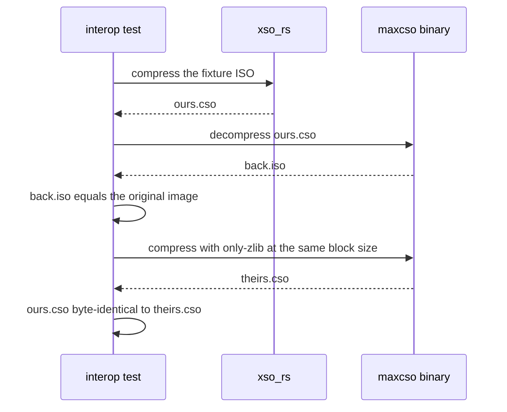
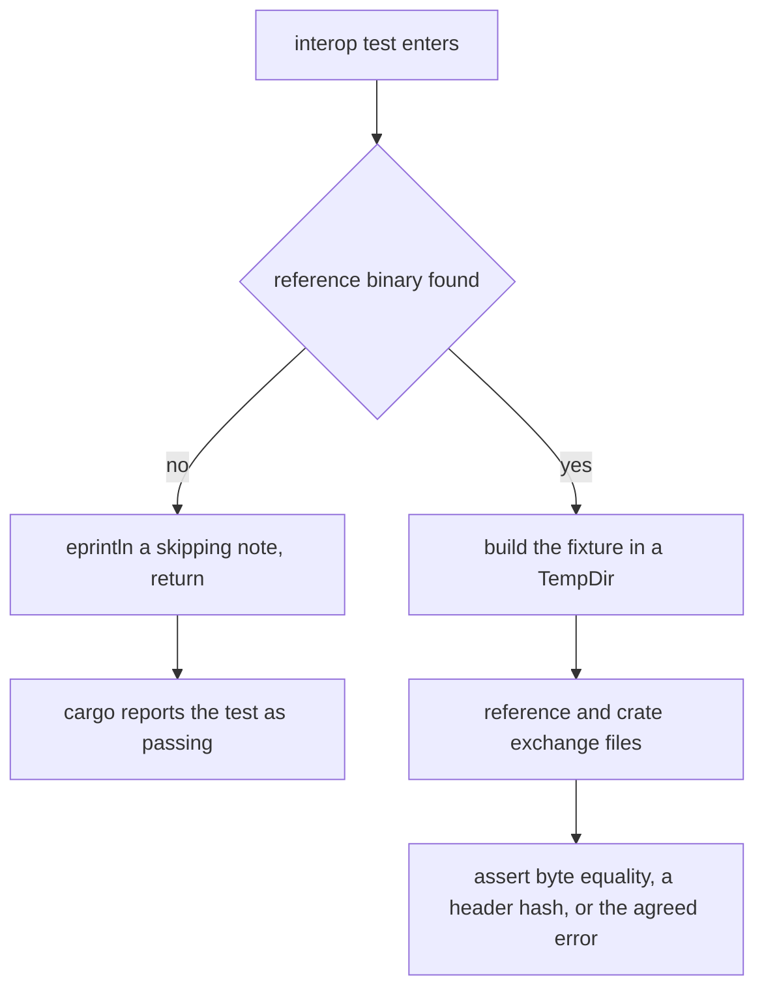
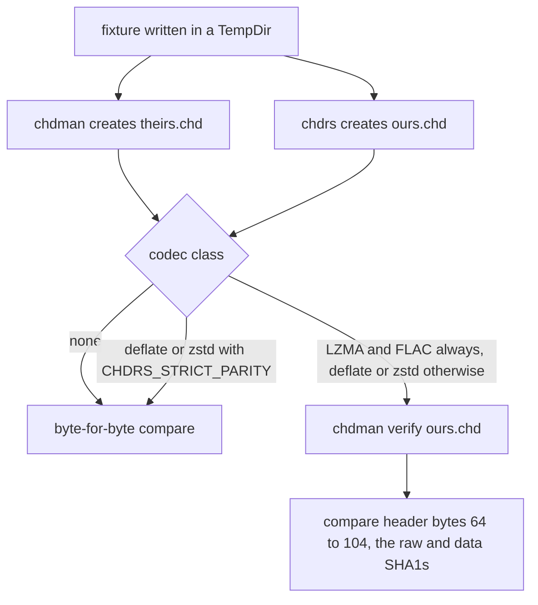

# Format Crate Test Strategy

Every crate under `crates/` is a port of an upstream tool whose bytes other
programs must accept, so the standard of proof is **agreement with the reference
implementation**, not self-consistency: a CSO that decompresses with its own
decoder proves almost nothing, while one that maxcso reads back proves the
container, the index and the padding are right. The suites are split accordingly
— `roundtrip.rs` / `apply.rs` / `decode.rs` / `convert.rs` exercise the crate on
its own, `interop.rs` and chd-rs's `cd.rs` / `write.rs` / `ld.rs` / `cli.rs` run
the upstream binary as a child process — and where a reference cannot be run in a
test environment, a pinned artifact or a generated vector file stands in for it.
The convention is stated in `AGENTS.md`: *"Tests check against the reference
implementation, by known-answer vectors or by running the upstream tool, and skip
rather than fail when it is missing. Slow ones are `#[ignore]`d."*

| Crate | Reference | How agreement is established |
| --- | --- | --- |
| `chd-rs` | chdman 0.289 | `tests/cd.rs`, `tests/write.rs`, `tests/ld.rs` — `chdrs` and chdman create, verify and extract each other's CHDs; byte-for-byte except where the compression library decides the bytes; `tests/cli.rs` — golden `info` report plus chdman agreement |
| `xso-rs` | maxcso | `tests/interop.rs` — both tools read each other's output; our CSO byte-identical to `maxcso --only-zlib`; generated ISO fixtures |
| `xdelta-rs` | xdelta3 | `tests/decode.rs` — committed patches xdelta3 3.2 wrote; `tests/interop.rs` — installed `xdelta3` encodes, we decode |
| `xps-rs` | Flips | `tests/apply.rs` — committed IPS/BPS Flips made plus hand-built IPS; `tests/interop.rs` — installed `flips --create`, we apply |
| `nsz-rs` | Python `nsz` | `tests/vectors.rs` — cross-language crypto/key-derivation vectors generated by `scripts/gen_vectors.py`; `pipeline.rs` round-trips over synthetic NCAs |
| `gdi-rs` | gdidrop | `tests/convert.rs` — the descriptor and track layout gdidrop itself wrote, pinned verbatim at port time |
| `cia-rs` | ctrtool `-p` | `tests/kat.rs` — the fixture CIA's extracted contents hashed against the DAT entry it was built with; `tests/interop.rs` — every part `ctrtool -p` extracts compared byte for byte with `unpack` |

`ctrtool`, `maxcso` and `flips` are **not** installed by CI; `mame-tools` (whose `chdman`
the `chd-rs` suites compare against), `xdelta3` and `ffmpeg` are. That
asymmetry is the single most important operational fact about these suites.

## Round-trip versus interop

`crates/xso-rs/tests/roundtrip.rs` is the crate talking to itself: write a
fixture ISO, `compress`, `decompress`, compare bytes, then check `probe` reports
the format, block size and uncompressed size it wrote. It covers the block-size
matrix (2048, 65536, `xso_rs::MAX_BLOCK_SIZE`), a single-block image, and the
error contract — an input whose length is not a sector multiple is rejected with
`Error::InvalidOption`, as are the block sizes `1024`, `3000` and `524288`, and a
junk file is refused by both `probe` and `decompress`. A rejected input is caught
before the output file is opened, so something already sitting at the destination
is never touched.

`crates/xso-rs/tests/interop.rs` is the crate talking to maxcso, and its own
header says why: *"These are the tests that matter: a CSO or ZSO is only worth
producing if the tools that consume it can read it back."* It runs in both
directions for each format, once at 2 KiB blocks and again at 64 KiB:
`maxcso_reads_ours` compresses with `xso_rs` and asks maxcso
`--decompress` to reproduce the image; `we_read_maxcos` has maxcso
`--format=cso1` / `--format=zso` produce the file and decompresses it with
`xso_rs`.



*Caption: the two interop obligations for CSO — mutual readability, and byte identity once maxcso is restricted to the same zlib trials.*

## Interop tests skip, they do not fail

Each interop suite begins by probing for its binary and returns early — printing
to stderr — when it is absent:

| Crate | Probe | Discovery |
| --- | --- | --- |
| `chd-rs` | `chdman_binary()` (also `ffmpeg` in `ld.rs`) returns `Option<PathBuf>` | `$CHDMAN` / `$FFMPEG` if they name a file, else the first of that name on `$PATH` |
| `xso-rs` | `common::maxcso_binary()` returns `Option<PathBuf>` | `$MAXCSO` if it names a file, else the first `maxcso` on `$PATH` |
| `xdelta-rs` | `Command::new("xdelta3").arg("-V")` succeeds | `xdelta3` on `$PATH` |
| `xps-rs` | `Command::new("flips").arg("--version")` succeeds | `flips` on `$PATH` |
| `cia-rs` | `common::ctrtool_binary()` returns `Option<PathBuf>` | `$CTRTOOL` if it names a file, else the first `ctrtool` on `$PATH` |

All four `chd-rs` suites open with `#![cfg(feature = "cli")]`: they drive the
`chdrs` binary through `env!("CARGO_BIN_EXE_chdrs")`, so with the `cli` feature
off — the way oxyromon depends on every crate — they compile to nothing rather
than to a link error.



*Caption: a missing reference is a silent green — the assertion path never runs, so nothing but the note on stderr records it.*

The consequence is deliberate but must be understood: **a green `cargo test` does
not prove interop conformance**, only that the code did not regress on whatever
the machine could exercise. CI installs the three tools it can get from apt —
`mame-tools` (for `chdman`), `ffmpeg` and `xdelta3` — with a comment saying they
are *"only for the crates' tests, which compare against chdman and xdelta3, make
the LaserDisc AVIs with ffmpeg, and skip without them"*, so the whole `chd-rs`
parity suite and the `xdelta-rs` comparison actually run on every CI job. It
installs none of `ctrtool`, `maxcso` or `flips`, so the `cia-rs`, `xso-rs` and
`xps-rs` interop tests skip on every CI run and are a **local** responsibility:
build ctrtool from Project_CTR and maxcso, point `$CTRTOOL` and `$MAXCSO` at
them, and install `flips`. The `cia-rs` known-answer test does run in CI, since
it needs only the committed fixture.

Interop coverage is also deliberately narrower than the format, because the
reference has bugs: `xps-rs/tests/interop.rs` only asks Flips for `--ips` and
`--bps-delta`, since *"Flips crashes creating linear BPS and shrinking IPS"* —
Flips 2.01 in the crate's notes — and those cases are covered by hand-built
patches in `apply.rs` instead. Similarly the `xdelta-rs` interop loop over seven
xdelta3 configurations (secondary compressors `lzma`/`none`/`djw`, levels `-9`
and `-0`, `-W 16384`, `-B 1048576`) does not expect success from `-S djw`: it
accepts only `Error::Unsupported` mentioning `DJW`, which is the crate's
documented divergence from the reference, and panics on anything else.

## Byte identity where the format allows it

Mutual readability is the floor, not the ceiling, and two suites go further:

- **`xso-rs`**: `same_bytes_as_maxcso_zlib_cso` compares our CSO with
  `maxcso --format=cso1 --only-zlib` byte for byte at block 2048 and 16384 —
  header, index, padding, and which of two equal-sized trials wins a block. The
  fixture matters: `common::write_text_iso` builds pseudo-text from a 256-word
  vocabulary with a squared index skewing picks toward the front, *"on which the
  zlib strategies often tie on size: a change in trial order shows up here."*
  The plain `write_iso` fixture would not do, since its regions rarely produce
  ties. ZSO has no equivalent test because maxcso cannot run LZ4 HC 16 on its
  own.
- **`gdi-rs`**: no gdidrop binary is run. Instead `tests/convert.rs` embeds the
  exact descriptor gdidrop wrote at port time (`GD_ROM_GDI`, including the jump
  to sector 45000 the `REM HIGH-DENSITY AREA` marker causes and the skipped
  pregaps) and asserts it verbatim, plus a `NEAR_MISS` set whose
  `REM HIGH-DENSITY AREA (TOC)` comment must *not* trigger the jump — pinning
  gdidrop's whole-string comparison rather than a substring match. A single-BIN
  set must produce the same layout and the same track bytes as its split
  equivalent.

## chd-rs: parity against chdman, byte for byte where the codec allows

`chd-rs` is the crate whose suite is least like the others: `crates/chd-rs/tests`
has no self-consistency file at all. Every one of the four files is written
against the reference binary, and three of them go further than mutual
readability — they compare our output to chdman's byte for byte.

- **`tests/cd.rs`** walks eleven CD fixtures — single-track BIN, shared BIN with
  in-file and out-of-file pregaps plus a postgap, split BINs, RW/RW_RAW subcode,
  a WAV track, a disc longer than chdman's work buffer and ending half way
  through a hunk, a bare ISO, a GDI with a virtual pregap and a jump to sector
  45000, the Redump two-density CUE layout, and both multisession shapes — and
  for each one runs `chdman createcd -c CODECS` and `chdrs -c CODECS` over the
  same table of contents and compares the CHDs.
- **`tests/write.rs`** does the same for hard disks (`createhd`), DVDs
  (`createdvd`) and parent-relative clones (`-op` / `-p`), and then checks the
  readability in both directions: `chdman verify`/`extracthd` over what `chdrs`
  wrote, and `chdrs verify`/extract over what chdman wrote.
- **`tests/ld.rs`** builds AVIs with `ffmpeg` covering every layout chdman reads
  — interlaced NTSC, PAL, 60 fps progressive mono, 8-bit audio, UYVY, left
  predicted HuffYUV — plus one fixture whose raw YUV frames carry hand-built VBI
  Manchester codes on lines 16–18, including picture numbers that disagree.
  Their audio is FLAC, so those CHDs are not chdman's bytes: chdman must
  `verify` ours and the header hashes must equal `chdman createld`'s. The AVI
  `chd_rs::extract_ld` writes from chdman's CHD must still be byte-identical to
  `chdman extractld`'s.
- **`tests/cli.rs`** compares `chdrs info` and `chdrs verify` to chdman over the
  three repository CHD fixtures (the `(RDSK)` LaserDisc one is left out because
  the `avhu` codec is not ported), stripping chdman's banner and carriage-return
  progress; a golden `ISO_INFO` string pins the DVD report unconditionally, even
  where no chdman is installed.



*Caption: the parity rule — library-independent codecs must match chdman's bytes exactly; codecs whose bytes depend on the linked library or on a different encoder must match its header hashes and survive its own verify.*

The exception is not slack, it is a property of the encoders. `tests/cd.rs` sorts
the codec lists into `IDENTICAL` (`none`), `LIBRARY` (`cdzs`, `zstd`, `cdzl`,
`zlib`) and `OWN_ENCODERS` (`cdlz,cdzl,cdfl`, `cdlz`, `lzma`, `cdfl`);
`tests/write.rs` applies the same rule from the codec string, and `tests/ld.rs`
always uses it. Deflate goes through `flate2`'s
`zlib-rs` backend — a port of zlib-ng, so it matches a chdman linked against
zlib-ng, not one linked against classic zlib — and Zstandard through the `zstd`
crate, which bundles 1.5.7, as Arch's chdman does, rather than the 1.5.5 MAME
bundles, as Debian's and Ubuntu's do. LZMA goes through `lzma-rust2` rather than
MAME's LZMA SDK encoder, and FLAC through the pure-Rust `rusty_flac` rather than
libFLAC. For those, byte identity is not achievable against an
arbitrary chdman build, so the suites compare the header's raw and data SHA-1s
(`ours[64..104]`), which cover the data and the metadata, and additionally make
chdman `verify` our CHD. Setting `CHDRS_STRICT_PARITY=1` tightens the deflate and
Zstandard cases to byte-for-byte — valid only against a chdman linking zlib-ng and
zstd 1.5.7; LZMA and FLAC never tighten.

Parity here also extends to behaviour the reference gets wrong on purpose.

`tests/write.rs::partial_last_hunks_match_chdman_byte_for_byte` pins the bytes
chdman leaves past the end of a partly filled last hunk — its 256-hunk work
buffer is never cleared, so the tail carries data from 256 hunks earlier, or the
parent's when cloning — and `tests/cli.rs::verify_reports_a_raw_sha1_mismatch`
pins our deliberate divergence, where `chdrs verify` fails and prints both hashes
to stderr on a corrupt header while `chdman` exits successfully.

## Known-answer vectors generated from the reference

`nsz-rs` cannot shell out to the Python tool it replaces, so its acceptance gate
is generated: `crates/nsz-rs/scripts/gen_vectors.py` imports the **actual**
`nsz.nut.aes128` and `nsz.nut.Keys` primitives from a sibling checkout (`$NSZ_SRC`),
disables `Keys.crc32_checksum` so synthetic sources are accepted, and emits
`tests/common/vectors_gen.rs` — a file headed `@generated … DO NOT EDIT BY HAND`
holding titlekek derivations, key-area keys, wrapped title keys, seekable-CTR
vectors at offsets spanning 0 to 1048591, XTSN vectors at sectors 0, 1, 2, 255
and 256, and `mul_alpha_le` cases including the high-bit reduction.
`tests/vectors.rs` then asserts each one, and re-checks the symmetric direction
for CTR and XTSN. Because the vectors come from the reference implementation
rather than from the Rust port, a derivation bug cannot be validated by the code
that contains it.

The same generated tables are what `common::build_keys()` writes out as a
`prod.keys`-shaped text and hands to `Keys::from_str(text, false)` — CRC32
verification of the sources and master keys is switched off, since synthetic keys
can never satisfy it. `verify_crc = false` is the same escape hatch the CLI
exposes as `--skip-key-check`; `malformed.rs` stays on that setting and shows the
length rule still bites, erroring on a 15-byte `titlekek_source`.

## Fixtures: generated deterministically, committed only for patches

Everything a test builds goes into a `tempfile::TempDir` and comes from a seeded
xorshift generator, so a failure is reproducible from its seed argument
(`roundtrip(Format::Cso, 2048, 32, 1)`). The generators are shaped for the codec,
not just filled with noise:

- `chd-rs` builds its media rather than shipping any: `cd.rs` writes seeded
  frames — a repeating pattern with stretches of noise so not every hunk
  compresses — a hand-built RIFF/WAVE whose first chunk is not `fmt `, so the
  parser has to skip it, and hand-written GDI and CUE sheets; `write.rs` builds
  256 KiB images of three flavors (all zeros, a repeated pattern, noise with a
  real-entropy run so not every hunk is compressible); `ld.rs` asks `ffmpeg` for
  the AVIs and synthesises the raw VBI frames itself. Only `cli.rs` reads media
  from disk, resolving the repository's own CHDs through
  `env!("CARGO_MANIFEST_DIR")/../../tests`.
- `xso-rs`'s `write_iso` interleaves all-zero sectors, high-redundancy text,
  incompressible noise and counting patterns so the compressor sees every block
  class; `gdi-rs`'s `byte(track, sector, offset)` makes every sector distinct so
  a pregap dropped by the wrong amount shows; `xdelta-rs` and `xps-rs` synthesise
  ROM-like data of repeated words punctuated by random stretches, then edit,
  grow, insert, delete and re-append so patches exercise copy and literal
  actions.

`nsz-rs` goes furthest: `tests/common/mod.rs` constructs **properly encrypted**
NCAs from scratch — header encrypted with XTSN under a fixed `header_key`, title
keys wrapped into the four keyblock slots, CTR-encrypted sections using the real
per-section counter, a common ticket with the title key encrypted under
titlekek 0, and a Meta NCA whose PFS0 holds a `meta.cnmt` listing each content
NCA's SHA-256. That lets `pipeline.rs` assert exact decrypted plaintext
(`solid_body(&ncz)` equals the section plaintext), which sections were decrypted,
and verification counts, without shipping any retail content.

Committed fixtures exist only where the reference produced them:
`crates/xdelta-rs/tests/data/{plain,lzma,djw}.xdelta` with their `source.bin` /
`target.bin`, and `crates/xps-rs/tests/data/{patch.ips,patch.bps,source.bin,target.bin}`.
Both suites locate them through `env!("CARGO_MANIFEST_DIR")/tests/data`, so they
run from any working directory. Fixture helpers live in
`tests/common/mod.rs` (`xso-rs`, `gdi-rs`, `nsz-rs`), pulled in with
`mod common;` and carrying `#![allow(dead_code)]` because each test target uses
only a subset. `chd-rs` has no `tests/common`: each of its four suites is
self-contained and builds its own media, because the fixtures are the parser
cases rather than generic byte soup.

## Malformed input must fail, never panic

Two suites sweep a corrupted reference file byte by byte, and two more craft
malformed containers by hand. The assertion style is deliberate: only a panic or
a hang fails the sweep, since some flipped bytes land where nothing checks them.

- `xdelta-rs/tests/decode.rs` tries **every** truncation and a byte flipped at
  **every** position of `lzma.xdelta`, then checks a `PK\x03\x04` header is
  rejected as `Error::BadMagic`.
- `xps-rs/tests/apply.rs` does the same over both patches, sampled at
  `(len / 500).max(1)` because an IPS runs to tens of thousands of positions.
- `cia-rs/tests/edge_cases.rs` builds synthetic CIAs that break one thing at a
  time — header size, type, format version, truncated sections, a TMD with a bad
  signature type, version or group hash, a content past the container, the
  highest content index — and requires a named `Error::Corrupt` or
  `Error::Unsupported` rather than a panic.
- `nsz-rs/tests/malformed.rs` targets allocation driven by untrusted header
  fields: an `NCZSECTN` count of `1 << 40`, `i64::MAX` or `-1`, an `NCZBLOCK`
  with `i32::MAX` blocks, a PFS0 with `u32::MAX` file count and string-table
  size, and a `u64::MAX` member offset must all error rather than allocate. It
  also pins the tolerance side — a PFS0 whose string table has no terminator must
  still decompress — and the CNMT verification matrix: NCAs with no CNMT fail
  under `strict` and are reported unverified without it, and a container with no
  NCAs succeeds even under `strict`.

## Invariants each crate's suite repeats

Two contracts shared by all seven crates ([Format Crates in crates/](../integrations/format-crates.md))
are asserted per crate rather than once:

**Progress sums to the caller's notion of input.** `xps_rs::apply` and
`xdelta_rs::decode` must report exactly the patch size; `xso_rs::compress` the
ISO and `xso_rs::decompress` the packed file; `gdi_rs::convert` the total BIN
bytes including dropped pregaps, matching `gdi_rs::input_size(&cue)`;
`chd_rs::create_cd` the disc's raw frame bytes, asserted twice over against
`chd_rs::cd_input_size(&toc)` and against `(203 + 301 + 77) * 2352`, and
`chd_rs::extract_cd` / `extract_ld` the CHD's `logical_size`. `nsz-rs` adds a
control-flow assertion: `progress_follows_compression_not_read_ahead` runs a
BKTR-heavy update NSP on a single-thread rayon pool and requires every callback
to be under a quarter of the total, so the seek to the BKTR table cannot make the
bar jump to (almost) done.

**A failed run changes nothing at the destination.** `xso-rs/tests/roundtrip.rs`
and `nsz-rs/tests/pipeline.rs` take the sharpest form: the packed file is
truncated so the decode fails *mid-write*, and the test asserts the pre-existing
output still reads `keep me`, that no `<output>.part` survives, and that a later
complete run does replace it. The other crates reach the same guarantee through a
source that fails validation — a one-bit-flipped ROM for `xdelta_rs::decode`
(`WrongSource` on the checksum) and for `xps_rs::apply` (a checksum mismatch, and
a distinct message when the "source" is the patch's own output) — and prove
nothing was left behind by counting the directory's entries afterwards.
`gdi-rs` blocks one track's `.part` path with a directory to show a half-written
set is neither committed nor cleaned up beyond what the crate created, and
`xdelta-rs` shows a refused DJW patch leaves an empty directory. `chd-rs` checks
it from the parser side: a CUE naming a missing BIN must fail with that name in
the message, leaving no `disc.chd` and no `disc.chd.part`. `nsz-rs` adds
the lazy-keys half: a container without NCAs is compressed and decompressed with
a loader that `panic!("keys loaded")`, and a key file that fails to load aborts
the run with the path in the message while leaving the previous NSZ untouched.

## Slow tests are `#[ignore]`d, and how to run them

Two tests in the crates are ignored — one per crate that has to move gigabytes —
and both skip on a missing reference even then.

```rust
// crates/xso-rs/tests/interop.rs
#[test]
#[ignore = "compresses and decompresses a 2 GiB image"]
fn index_shift_round_trips() { … }

// crates/chd-rs/tests/ld.rs
#[test]
#[ignore]
fn large_laserdiscs_match_chdman() { … }
```

Past 2 GiB the CSO/ZSO index stores offsets shifted right by `index_shift` and
pads every block to `1 << index_shift`, so the `xso-rs` test builds a mostly-hole
2 GiB image with incompressible and repetitive stretches placed either side of
the 2 GiB line, compresses it, asserts `probe(...).index_shift == 1`, round-trips
it through `xso_rs`, and — when maxcso happens to be available — through maxcso
too. It compares files a MiB at a time rather than reading either into memory,
and creates its scratch directory with
`tempfile::tempdir_in(env!("CARGO_TARGET_TMPDIR"))` so the 2 GiB of work lands on
the build filesystem instead of a tmpfs.

The `chd-rs` case makes a 100-second rawvideo capture, which ffmpeg writes as
OpenDML and which extracts back to an AVI split in `RIFF AVIX` parts with super
indexes — some 7 GiB of disk. It puts its scratch directory in
`CARGO_TARGET_TMPDIR` for the same reason, and deletes the source AVI before
extracting so the two CHDs and two AVIs are all that is live at once.

Run the ignored set explicitly, in release mode — the form `AGENTS.md` documents
and the crate READMEs repeat:

```sh
cargo test -p xso-rs                          # one crate: skips ignored tests and missing tools
cargo test --release -p xso-rs -- --ignored   # the 2 GiB image, ~35 s
cargo test --release -p chd-rs -- --ignored   # the >2 GiB LaserDisc, ~7 GiB of disk
```

`cargo test --release -p <crate> -- --ignored` is the general form for any crate
that gains an ignored test; nothing currently ignores tests in `nsz-rs`,
`xdelta-rs`, `xps-rs` or `gdi-rs`.

## Running the suites

```sh
cargo test --workspace --features oxyromon/server   # oxyromon plus the seven crates
cargo test -p nsz-rs                                # one crate
./test.sh                                           # the suite under cargo llvm-cov
```

CI's `cargo llvm-cov --workspace --features oxyromon/server --lcov --output-path
lcov.info` step is what executes these tests — clippy only lints them — so a
crate's suite gates every pull request even though nobody invokes `cargo test -p`
directly ([CI Pipelines and Runtime Environment](../operations/ci-and-environment.md)).
The dependency step refreshes apt first (`apt-get -o Acquire::Retries=3 update`)
because the runner image bakes its package lists at image-build time and Ubuntu
rolls superseded `.deb`s out of the pool, so installing against the cached lists
404s. `./test.sh` from the repository root is the same single llvm-cov command.

The root package contributes one cross-crate check to the same pass:
`tests/crates.rs` reads `crates/xso-rs/src/bin/xsors/ui.rs` and requires the
copies in `chdrs`, `ciars`, `gdirs`, `nszrs`, `xdeltars` and `xpsrs` to be identical. That
shared shell — oxyROMon's progress bar, the per-input `✔`/`✖` lines, the `-o DIR`
default, and the `Outputs` ledger that refuses to write one input's output over
another input or over an earlier output — is not covered by any crate's own suite,
so the check is what makes it a seven-crate invariant: change it in all of them at
once.

For the local runs CI cannot make, set the reference paths before testing:

```sh
CHDMAN=/path/to/chdman cargo test -p chd-rs    # parity suites; FFMPEG likewise for the LD ones
CHDRS_STRICT_PARITY=1 CHDMAN=… cargo test -p chd-rs   # also demand zlib-ng/zstd-1.5.7 bytes
MAXCSO=/path/to/maxcso cargo test -p xso-rs    # exercises xso interop
cargo test -p xdelta-rs                        # needs xdelta3 on PATH
cargo test -p xps-rs                           # needs flips on PATH
```

## Extending a crate's suite

- Add a `tests/interop.rs` case that runs the reference tool, and make the
  absence of the tool a `return`, never a failure — CI must stay green on a
  runner that has no reference installed. A suite that shells out to the crate's
  own CLI needs `#![cfg(feature = "cli")]` so a `default-features = false` build
  still compiles.
- Prefer byte-for-byte comparison with the reference's output; fall back to
  comparing what the reference itself can verify (a header hash plus
  `chdman verify`) only where the bytes legitimately depend on which compression
  library the reference linked, and put the tighter comparison behind an opt-in
  flag like `CHDRS_STRICT_PARITY`.
- Keep fixtures seeded and self-generated; commit a fixture only when a real
  reference tool produced it, and read it through `env!("CARGO_MANIFEST_DIR")`.
- Assert the two shared invariants for anything new: progress deltas summing to
  a size the caller can compute, and a failed run leaving the destination and no
  `.part` behind.
- Anything that must round-trip gigabytes of data gets `#[ignore]` with a reason
  string, scratch space in `CARGO_TARGET_TMPDIR`, and a chunked comparison so
  neither file has to be held in memory.
- Never hand-edit `crates/nsz-rs/tests/common/vectors_gen.rs`; regenerate it with
  `python3 scripts/gen_vectors.py` against a real `nsz` checkout.
- Change `src/bin/<cli>/ui.rs` in all seven crates together, or `tests/crates.rs`
  fails.

See also [Testing Conventions](testing-conventions.md) for the oxyromon-side test
infrastructure (temporary databases, the `MUTEX`, DAT and ROM fixtures), and
[CHD Format and the chd-rs Crate](../concepts/chd-format-and-chd-rs.md) for the
crate these parity suites cover.
