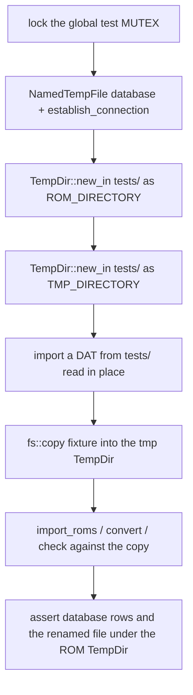
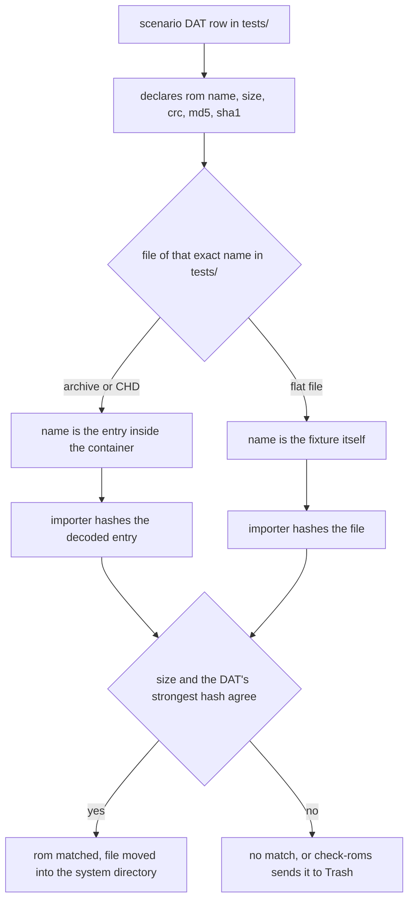
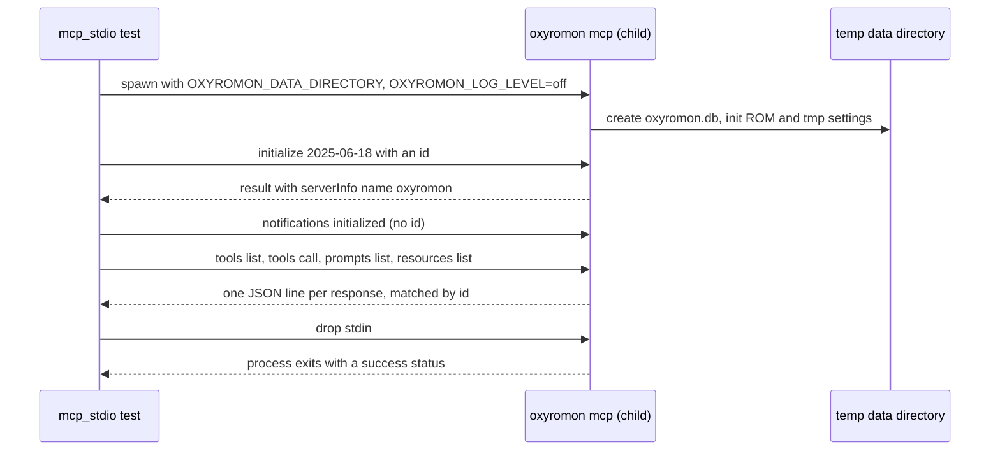

# Test Fixtures and End-to-End Suites

`tests/` is not an integration-test directory in the ordinary Rust sense. It is
**a fixture corpus** — 30 Logiqx DAT files and the ROM, disc-image, archive,
patch and header files they describe — consumed by the ~300 `src/<module>/test_*.rs`
modules that live beside the code under test (see
[Testing Conventions](testing-conventions.md)). Only two files in it are test
targets of the root package: `tests/crates.rs` and `tests/mcp_stdio.rs`, and
both are the special cases — one cross-crate parity guard, one end-to-end suite
that spawns the real binary. A third audience exists: `crates/chd-rs/tests/`
reads the repository's CHD fixtures through `../../tests` as the
byte-comparison corpus for its `chdman` interop suites.

## The corpus is read-only; imports move files

The rule that shapes every test's setup: **an import moves, it does not copy**.
`import_roms` relocates the romfile into the system directory with
`rename_file`, which falls back to copy-then-remove only when the rename crosses
filesystems
([src/util.rs](../../src/util.rs#L122-L150)). Handing `tests/` a committed
fixture path directly would delete it from the checkout. So every test copies the
fixture into a scratch directory first and imports that copy
([src/import_roms/test_original.rs](../../src/import_roms/test_original.rs#L19-L37)):

```rust
let romfile_path = tmp_directory.join("Test Game (USA, Europe).rom");
fs::copy(
    test_directory.join("Test Game (USA, Europe).rom"),
    &romfile_path.as_os_str().to_str().unwrap(),
)
.await
.unwrap();
```

Only fixtures that are **read**, never imported, are referenced in place:
`tests/Test Game (USA).ird` for `parse_ird`, `tests/profile.xml` served by a
wiremock server, the DAT zips fed to `download_dats`, and the DATs themselves.

The scratch `TempDir`s are created **inside `tests/`**, not in `/tmp` —
`TempDir::new_in(test_directory)` — so fixtures and their imported results stay
on one filesystem and the rename path is exercised rather than the cross-device
fallback. `.gitignore` carries `tests/.tmp*` for the leftovers
([.gitignore](../../.gitignore#L10-L20)). The MCP stdio harness is the one
exception: it has no fixtures to keep close, so its data `TempDir` is an ordinary
system-temp one held inside the `Client` struct.

The rest of the skeleton is the same twelve lines in every fixture-consuming
test, and it is a test-only API: `config.rs` defines `MUTEX`,
`set_rom_directory` and `set_tmp_directory` inside a `cfg_if!`/`cfg(test)`
block, so no production build can point the database at a scratch directory. The
global `MUTEX` is taken first because the settings that follow are process-wide
database rows, then a `NamedTempFile` database is opened, then the ROM and tmp
directories are registered
([src/config.rs](../../src/config.rs#L631-L648),
[src/import_roms/test_iso_chd.rs](../../src/import_roms/test_iso_chd.rs#L10-L24)).



*Caption: the shared setup every fixture-consuming test repeats — scratch directories inside `tests/`, fixtures copied before anything can move them, assertions made against the ROM directory.*

## DAT naming: system, version date, scenario suffix

A fixture DAT is named `Test System (<YYYYMMDD>)[ (<Scenario>)]….dat`. The two
identities in play are decoupled, and confusing them is the main way to break a
suite while "renaming a fixture":

- **The file name** is only how a test finds the file. It is a string passed to
  `import_dats::subcommand().get_matches_from(["import-dats", "tests/…dat"])`,
  never parsed by the product code.
- **The `<header><name>`** is the database identity. Systems are matched with
  `find_system_by_name(&system_xml.name)`
  ([src/import_dats.rs](../../src/import_dats.rs#L453-L501)), so the scenario
  suffix belongs in `<name>` **only when the scenario needs its own system**.
- **The `<header><version>`** is the update gate — see the next section.

That yields two naming families. Scenario DATs that are *distinct systems* carry
the suffix in the header too, and the tests assert it: `Test System
(20200721) (Parent-Clone).dat` → `"Test System (Parent-Clone)"`, `Test System
(20230105) (Multiple Discs).dat` → `"Test System (Multiple Discs)"`, `Test System
(20230618) (RVZ).dat` → `"Test System (RVZ)"`. DATs that exercise a **catalog
update of the same system** keep `<name>Test System</name>` and advance only the
date, so the suffix lives in the file name alone: `Test System (20210401).dat`,
`Test System (20200722) (Renamed Game).dat`, `Test System (20200723) (Changed
Hashes).dat`, and both `Test System (20240626) (Multiple Orphan Roms*)` DATs
([src/import_dats/test_dat_updated.rs](../../src/import_dats/test_dat_updated.rs#L88-L128)).

The file-name date and `<version>` normally agree, and the deliberate exceptions
are load-bearing: `Test System (20240908) (Patches).dat` carries version
`20230112` and the header name `Test System (Parent-Clone) (Revisions)`;
`Test System (20241010) (Special Characters).dat` carries `20210401`; and `Test
System (20241230) (MAME Mixed).dat` deliberately reuses **both** the header name
and the version of `Test System (20241228) (MAME CHD).dat`, which is why its test
asserts `"Test System (MAME CHD)"` and not anything about "Mixed"
([src/import_dats/test_dat_mame_mixed.rs](../../src/import_dats/test_dat_mame_mixed.rs#L23-L49)).

### The version gate

`import_dat` only touches an existing system when `is_update(old, new)` says so,
and `is_update` is a plain string `Ordering` compare on the version: **less**
prints "Skipping older version" and returns false, **equal** prints "Already up
to date" and returns false, **greater** updates
([src/util.rs](../../src/util.rs#L363-L390)). `--force` bypasses it. This is why
`Test System (20000000).dat` exists at all: it is a *deliberately ancient*
catalog, imported second, used to prove nothing changed
([src/import_dats/test_dat_outdated_should_do_nothing.rs](../../src/import_dats/test_dat_outdated_should_do_nothing.rs#L23-L62)).
Dates are lexicographic, not calendar: any `YYYYMMDD` string works, and a new
scenario DAT that must update an existing system simply needs a version string
that sorts higher.

## A DAT row is a checksum contract with a file on disk

The pairing is exact and unforgiving. Each `<rom>` element declares `name`,
`size`, `crc`, `md5` and `sha1`
([src/model.rs](../../src/model.rs#L267-L284)):

```xml
<rom name="Test Game (USA, Europe).rom" size="256" crc="cc721e14"
    md5="c1fe7a7ed317bd069b0cb7bdbc40be01" sha1="4b3e49f0f22c7ce5f1eb7c30a2bbd6fb4fdc6f3d"
    status="verified" />
```

- `name` must equal a file in `tests/` **byte for byte**, including double
  extensions (`Test Game (USA, Europe).rom.zip`, `.iso.7z`) and the `(Track
  01).bin` spacing. This is what the special-characters scenario probes with its
  `-Test Game@ (USA, Europe).rom` entry.
- `size` and one hash must match the file's bytes, because import matches a file
  by size and hash before it ever looks at a name. `get_hash_algorithm` picks
  **CRC first, then MD5, then SHA1**, whichever the row carries, and
  `compare_hash_and_size` fails with `Size mismatch` or `Checksum mismatch`
  ([src/common.rs](../../src/common.rs#L540-L573)).

For containers, the DAT declares the **entries inside**, not the container: the
base DAT lists `Test Game (USA, Europe).rom` and the test feeds it
`Test Game (USA, Europe).rom.zip`; the CUE/BIN game is declared as a `.cue` plus
two `.bin` tracks and a CHD holding the same three entries is matched to it
([src/import_roms/test_multiple_tracks_chd.rs](../../src/import_roms/test_multiple_tracks_chd.rs#L37-L100)).
MAME arcade DATs break the pattern in one specific way: `<disk>` rows carry only
a `sha1` and no size, because MAME's own CHD DATs have none, and the importer has
a dedicated retry that looks the file up by CHD SHA1 with size 0 — in each of the
three non-CD branches, DVD, HD and LD
([src/import_roms.rs](../../src/import_roms.rs#L1192-L1215),
[src/import_roms.rs](../../src/import_roms.rs#L1303-L1326),
[src/import_roms.rs](../../src/import_roms.rs#L1423-L1446)).



*Caption: a DAT row only works if a fixture file with that exact name exists in `tests/` and its size and hash agree with what the row declares.*

## Checksums for new fixtures: `tests/compute_sums.sh`

Do not compute these by hand or with a home-grown pipeline. `tests/compute_sums.sh`
prints, per file, the `ls -l` size, the CRC via `rhash -C --simple`, the MD5 and
the SHA1 — exactly the four fields a `<rom>` row needs
([tests/compute_sums.sh](../../tests/compute_sums.sh#L1-L8)):

```sh
#!/bin/sh

for f in "$*"; do
    ls -l "$f"
    rhash -C --simple "$f"
    md5sum "$f"
    sha1sum "$f"
done
```

`rhash` must be installed for the CRC line. Run it over every file a new scenario
adds, paste the values into the DAT, and keep the fixture's name equal to the row
it produced. Conversely, **regenerating a fixture invalidates its DAT rows**: the
hashes in the DAT, not the file, are what the assertions ultimately encode.

### Reusing bytes across scenarios

Because the identity is the checksum, one file serves many catalogs:
`Test Game (USA, Europe).rom` (`cc721e14`) is declared verbatim by the base DAT,
the Parent-Clone DAT, the MAME DAT, the Headered DAT and the Patches DAT, and
`Test Game (Asia).rom` (`1c3321f3`) carries the same CRC as `Test BIOS.rom` in
the MAME Rebuild DAT. Arcade scenarios exploit that freedom: the `rebuild_roms`
tests copy a flat fixture to the name the `<machine>` catalog declares
(`Test Game (USA, Europe).rom` → `Test Parent.rom`) rather than committing a
duplicate file ([src/rebuild_roms/test_split_to_non_merged.rs](../../src/rebuild_roms/test_split_to_non_merged.rs#L9-L35)).

The merged-layout scenarios go one step further and build their ZIPs at run
time. `Test System (20200721) (MAME Merged).dat` declares a parent and two
clones: Clone 1 has its own `Test Program.rom` with other contents than its
parent's (`Test Game (USA) (Rev 1).rom`, a name clash), and both clones have
`Test Clones.rom`, which their parent lacks (a file sibling clones share). The
`src/rebuild_roms/merged_set.rs` helper writes those as split ZIPs with the
`zip` crate, imports them, and offers `rebuild`, `assert_merged`,
`entry_names` and `assert_checks` (run `check-roms` and assert nothing moved to
the trash). The rebuild, sort-roms and export-roms merged tests all start from
it, and `import_roms/test_none_selected.rs` reuses the DAT for a file that
matches both clones.

## Staging failures without corrupting fixtures

Two techniques, and neither commits a broken ROM:

- **A DAT with the wrong numbers.** `Test System (20210401).dat` carries a
  mutated `Test Game (Asia)` CRC (`1c3321f4`, one nibble off) so its previously
  matched romfile is orphaned; `Test System (20200723) (Changed Hashes).dat`
  uses the loud `crc="deadbeef"` on `Test Game (USA, Europe).rom`;
  `Test System (20240626) (Multiple Orphan Roms Mismatch).dat` mutates the
  `(Track 0n).bin` hashes *and* renames the rows away from `(CUE BIN)`.
  Renaming a game while keeping its rom rows — `Test System (20240626) (Multiple
  Orphan Roms).dat`, `Test System (20200722) (Renamed Game).dat` — orphans the
  same files from the other direction. The ancient `Test System (20000000).dat`
  repeats the same mutations but sits behind the version gate, so nothing in it
  ever takes effect.
- **Corrupt after import.** `check_roms` writes over the already-imported file in
  the ROM directory and asserts the file lands under `/Trash/`
  ([src/check_roms/test_original_crc_mismatch.rs](../../src/check_roms/test_original_crc_mismatch.rs#L50-L72)).

Trash assertions are substring checks on `romfile.path`, not existence checks
against a fixed location: the trash directory is per-system
(`<system>/Trash`) or global (`<ROM directory>/Trash`) depending on the system
([src/util.rs](../../src/util.rs#L277-L288)), and `contains("/Trash/")` holds for
both.

### What the DAT-update work changed about orphan fixtures

The orphan DATs are not just an import of a bad catalog. Each pairs a DAT-update
`import_dat` with an explicit romfile count and an explicit trash verdict, and
the two DATs differ *on purpose*
([src/import_dats/test_dat_updated_orphan_chd.rs](../../src/import_dats/test_dat_updated_orphan_chd.rs#L102-L119),
[src/import_dats/test_dat_updated_orphan_chd_mismatch.rs](../../src/import_dats/test_dat_updated_orphan_chd_mismatch.rs#L103-L120)):

| Fixture imported first | Update DAT | Roms / romfiles after | Trash |
| --- | --- | --- | --- |
| `(Multiple Tracks).cue` + `.chd` | `(Multiple Orphan Roms).dat` — game renamed to `(…) (Rev 1)`, rom rows unchanged | 3 / 2 | nothing trashed |
| `(Multiple Tracks).cue` + `.chd` | `(Multiple Orphan Roms Mismatch).dat` | 3 / 2 | the CUE/BIN romfile is trashed |
| `Test Game (USA, Europe) (Full).7z` | `(Multiple Orphan Roms).dat` | 3 / 1 | nothing trashed |
| `Test Game (USA, Europe) (Full).7z` | `(Multiple Orphan Roms Mismatch).dat` | 3 / 1 | the archive is trashed, every rom loses its `romfile_id` |

The reading: a rename alone leaves the still-matching romfile where it is, and
only a *checksum* mismatch moves a container to Trash. That is exactly why the
CHD variant keeps two romfiles — the CUE/BIN pair and the CHD are separate
romfiles for the same three roms — and why it asserts `!path.contains("/Trash/")`
for every one of them. A test that only counted roms would pass either way;
`assert_eq!(romfiles.len(), 2)` plus the trash assertion is what pins the
behaviour.

## The disc-image fixtures, and how they are read now

CHD create/extract runs **in process** through the workspace crate
`crates/chd-rs`; there is no `chdman` fixture helper in `src/` and no
`src/chdman.rs`. Nothing in oxyromon spawns `chdman` — the external binary
survives only as an optional oracle inside the crate's own test suites, resolved
through the `CHDMAN` environment variable then `PATH`
([crates/chd-rs/tests/write.rs](../../crates/chd-rs/tests/write.rs#L1-L22)). The
fixture names below are therefore just names: each `.chd` is opened by
`CommonRomfile::parse_chd`, which reads the type, logical size, data SHA-1, file
SHA-1, parent SHA-1 and track count straight from the container
([src/chd.rs](../../src/chd.rs#L547-L583)).

| Fixture | `ChdType` | Consumed by | What the assertion proves |
| --- | --- | --- | --- |
| `Test Game (USA, Europe) (Multiple Tracks).chd` | `Cd` | `import_roms/test_multiple_tracks_chd.rs`, `check_roms/test_multiple_tracks_chd.rs`, `import_dats/test_dat_updated_orphan_chd*.rs`, `convert_roms`/`export_roms` CHD suites | the CD branch hashes **each extracted track** against the DAT's `.cue` + two `(Track 0n).bin` rows, and only imports when every track matches one game ([src/import_roms.rs](../../src/import_roms.rs#L1047-L1145)) |
| `Test Game (USA, Europe) (Single Track).chd` | `Cd` with one track | `import_roms/test_single_track_chd.rs`, `export_roms/test_single_track_chd_to_iso.rs` | `track_count == 1` takes the unsplit extraction path, so one rom is matched and the CHD is stored as `<game>.chd` ([src/chd.rs](../../src/chd.rs#L418-L467)) |
| `Test Game (USA, Europe) (ISO).chd` | `Dvd` | `import_roms/test_iso_chd.rs`, `check_roms/test_iso_chd.rs`, the `iso_chd_to_*` convert/export suites | the DVD branch hashes the *extracted* ISO against `Test Game (USA, Europe) (ISO).iso`'s row — `ChdRomfile::get_hash_and_size` extracts into the tmp directory and delegates, so the importer never hashes the CHD itself ([src/chd.rs](../../src/chd.rs#L171-L229)) |
| `Test Game (USA, Europe) (RDSK).chd` | `Hd` | `import_roms/test_mame_chd.rs`, `import_roms/test_mame_mixed.rs` | the HD branch matches the `<disk sha1=…>` row through the size-0 CHD-SHA1 retry, and an arcade system stores it in a per-game subdirectory ([src/import_roms/test_mame_chd.rs](../../src/import_roms/test_mame_chd.rs#L77-L94)) |
| `Test Game (USA, Europe) (LD).riff` | the LaserDisc source, not a CHD | `src/chd/test_ld.rs` | `.riff` → `to_chd` → `as_chd` → `to_riff` → `to_chd` again produces a **byte-identical** CHD, in process ([src/chd/test_ld.rs](../../src/chd/test_ld.rs#L1-L50)) — the only consumer of this fixture anywhere in the workspace |

Two consequences worth internalising. First, the `.chd` fixtures no longer
require any tool on `PATH` to be *used*: import, check, convert and export all
run through `chd_rs`, so the fixture corpus is self-sufficient and `chd::get_version()`
reports the literal string `built-in`
([src/chd.rs](../../src/chd.rs#L896-L898)). Second, `crates/chd-rs/tests/cli.rs`
does reuse three of them — the ISO, Multiple Tracks and Single Track CHDs — but
as a **cross-crate** read of `../../tests`, comparing `chdrs info` against a
pinned golden report and, when a `chdman` binary is reachable, comparing `info`
and `verify` output; its header records that the LaserDisc-flavoured `(RDSK)`
fixture is deliberately excluded because the `avhu` codec has no chdman-side
oracle there
([crates/chd-rs/tests/cli.rs](../../crates/chd-rs/tests/cli.rs#L1-L22),
[crates/chd-rs/tests/cli.rs](../../crates/chd-rs/tests/cli.rs#L95-L143)). Fixing
a fixture's bytes is therefore a two-sided change: the DAT rows in this
repository *and* the golden report in the crate.

## The synthetic Wii U fixtures

No real Wii U disc or key can ship, so the Wii U fixtures are synthetic, built with
the same layout wux-rs's own tests use
([Wii U Formats and wux-rs](../concepts/wii-u-formats-and-wux-rs.md)).

| File | Role |
| --- | --- |
| `Test Game (USA).wud` | A 1.8 MiB encrypted disc with an update partition, declared by `Test System (20261025) (WUD).dat` under Redump's name, `Test Game (USA).iso` |
| `Test Game (USA).wux` | The same disc as a WUX, which imports and checks against the WUD's row |
| `Test Game (USA).keys.txt` | Made-up keys in Cemu's format: the disc key, then a stand-in common key. `src/wux.rs` reads it in place of the data directory's keys under `cfg(test)` |
| `Test Game (USA) (Update)/` | An update as a NUS folder under No-Intro's CDN names: `tmd.48`, `cetk.48`, contents `00000010` to `00000012` and `00000012.h3`. Declared by `Test System (20261025) (CDN).dat` |

These drive `import_roms/test_wux.rs` and `test_nus.rs`, `check_roms/test_wux.rs`,
the WUD, WUX and WUA cases under `convert_roms/` and `export_roms/`,
`import_roms/test_wua.rs`, `check_roms/test_wua.rs` and
`test_wua_without_its_update.rs`, `purge_roms/test_foreign_store.rs`, and
`create_dats/test_wux_and_nus.rs` and `test_wua.rs`. No WUA ships as a fixture:
the WUA tests write one from the WUD first, its update partition in a store. The export tests that bundle an update import
both DATs, so `ToWua` finds the update by title ID; the ticketless case removes
the `cetk` and checks that the update is left out of the WUA.

## Non-DAT fixtures

| File | Role |
| --- | --- |
| `header.xml` | A `clrmamepro` header detector (`NES` magic at offset 10) referenced by `<clrmamepro header="header.xml" />` in the Headered DATs; resolved next to the DAT, else from the embedded `data/` assets ([src/import_dats.rs](../../src/import_dats.rs#L283-L304)) |
| `profile.xml` | A no-intro profile served by a wiremock `GET /profile.xml` in the DAT-download test ([src/download_dats/test_nointro.rs](../../src/download_dats/test_nointro.rs#L35-L50)) |
| `Test System (20200721).zip` | The redump datfile payload a mocked `GET /datfile/…` returns ([src/download_dats/test_redump.rs](../../src/download_dats/test_redump.rs#L28-L70)) |
| `Test System (20210401).zip` | A DAT **nested in a subdirectory** (`Test System/…`), exercising `import-dats` on an archive: the ZIP is unpacked into the tmp directory and every `.dat` in the tree is found ([src/import_dats.rs](../../src/import_dats.rs#L110-L143), [src/import_dats/test_zip_nested.rs](../../src/import_dats/test_zip_nested.rs#L25-L46)) |
| `Test Game (USA, Europe).ips` / `.bps` / `.xdelta` with `(patched).rom` | The known-answer triple: apply the patch, compare to the committed expected output ([src/xps/test_patch.rs](../../src/xps/test_patch.rs#L38-L45)) |
| `UP0001-BLUS00001.pkg` + `prfgmHWxGNxsfJ.rap` | The PSN pair declared by `Test System (20230527) (PSN).dat` |

## `tests/crates.rs`: the shared CLI shell must not drift

`tests/crates.rs` is a workspace-level guard, not a behaviour test. The eight
format crates each ship a CLI whose `ui.rs` — progress bar, `-o DIR`, the
`✔`/`✖` per-input lines — is a **verbatim copy**. `every_cli_shares_one_ui`
reads `crates/xso-rs/src/bin/xsors/ui.rs` as the reference and asserts the copies
in **`chdrs`**, `ciars`, `gdirs`, `nszrs`, `wuxrs`, `xdeltars` and `xpsrs` are
byte-identical ([tests/crates.rs](../../tests/crates.rs#L1-L19)).

It has no feature gate and no fixtures, so it runs on every
`cargo test --workspace`, including the CI coverage pass. Editing one `ui.rs`
without the other seven turns CI red with `"<path> differs from xsors's ui.rs"`;
the fix is always to change all eight together, which is the convention `AGENTS.md`
records for the crates
([Format Crates](../integrations/format-crates.md)).

One fixture is deliberately duplicated: `crates/cia-rs/tests/data/Test Game (USA,
Europe).cia` is a byte-identical copy of `tests/Test Game (USA, Europe).cia`, so the
published `cia-rs` crate carries its own known-answer fixture instead of reaching
into the root corpus the way `chd-rs`'s tests do.

## `tests/mcp_stdio.rs`: driving the real binary over JSON-RPC

This suite has no SDK client. Its header states the reason: raw JSON-RPC against
the spawned binary means *"the wire format is what a real client will find"*
([tests/mcp_stdio.rs](../../tests/mcp_stdio.rs#L1-L10)). It is `#![cfg(feature
= "mcp")]`, so without the feature it compiles to nothing.

`Client::spawn(args)` launches `env!("CARGO_BIN_EXE_oxyromon")` — cargo's
build-time path to the `oxyromon` binary target — with `mcp` plus any extra
arguments, and:

- sets **`OXYROMON_DATA_DIRECTORY` to a `TempDir`** held in the `Client` struct,
  so `main.rs` creates `oxyromon.db` in an isolated directory and each test has a
  virgin library instead of the developer's
  ([src/main.rs](../../src/main.rs#L118-L132));
- sets `OXYROMON_LOG_LEVEL=off` and `Stdio::null()` for stderr — nothing but the
  protocol channel is read;
- pipes stdin and stdout, and `initialize` runs before the client is handed back.

Requests are single-line JSON written with `writeln!` to stdin; responses are
read one line at a time and **matched by `id`, with any non-matching message
discarded**. That loop is what lets server-initiated notifications (progress,
etc.) interleave with a call without desynchronising the test
([tests/mcp_stdio.rs](../../tests/mcp_stdio.rs#L45-L67)).



*Caption: the harness lifecycle — isolated data directory, id-matched newline-delimited JSON-RPC, and a clean EOF-triggered shutdown.*

`close()` drops stdin and asserts `status.success()`: **stdin EOF must terminate
the server cleanly**. That is the observable half of the
`tokio::select! { _ = server.waiting() … }` shape in `mcp::main`
([src/mcp.rs](../../src/mcp.rs#L116-L134)) and the only automated proof that
shutdown does not panic on the way through `optimize_database`. It also implicitly
guards the project's hard rule that **stdout carries nothing but protocol
messages** — a stray `println!` anywhere on the reached path yields a line that
fails `serde_json::from_str` and the test aborts with "a JSON-RPC message"
([MCP Server](../server/mcp-server.md)).

The behaviours pinned by the suite:

| Test | Contract |
| --- | --- |
| `handshake_exposes_the_full_surface` | `initialize` names the server `oxyromon`; `tools/list` contains every one of the 20 tool names it enumerates; `prompts/list` is exactly `audit_system`, `onboard_system` **in that order**; `resources/list` is exactly `oxyromon://status`, `oxyromon://systems`, `oxyromon://settings` |
| `status_reports_the_empty_library` | `structuredContent.version` equals `CARGO_PKG_VERSION`, `read_only` false, `systems` 0 |
| `unknown_ids_are_tool_errors_with_pointers` | `get_system` with an unknown id is a **tool-level** `isError` whose text points at `list_systems` |
| `import_dats_then_read_the_catalog_back` | Importing `tests/Test System (20200721).dat` through the tool yields one system with `games_total` 6, `search_games "test game"` count 6, `list_games limit 2` returning 2 of 6 |
| `destructive_tools_need_confirmation` | `purge_roms` and `purge_games` with `confirm` omitted, and `purge_systems` / `purge_irds` with `confirm: false`, error and mention `confirm` |
| `convert_roms_accepts_any_case` | after a DAT import, `convert_roms` accepts `"zip"` and refuses `"nkit"` with "unknown format" |
| `setting_validation_mirrors_the_cli` | `PREFER_REGIONS=broad` accepted, `mars` rejected with "valid", an unknown key rejected, and the accepted value read back through `get_settings` |
| `read_only_hides_and_refuses_the_write_tools` | With `--read-only` the mutating tools are absent from `tools/list` **and** a direct `tools/call` returns a JSON-RPC `error` object, not a tool result |

The read-only distinction matters: hidden routes are rejected at the protocol
layer (`message["error"]`), while a refused-but-routable call is an `isError`
tool result. Note also the fixture coupling — `import_dats_then_read_the_catalog_back`
resolves `tests/Test System (20200721).dat` through `CARGO_MANIFEST_DIR` and
hard-codes its game count, so adding or removing a `<game>` from that DAT breaks
an MCP test as well as the ~130 in-module tests that import it
([tests/mcp_stdio.rs](../../tests/mcp_stdio.rs#L198-L221)).

## Running them

```sh
cargo test --workspace --features oxyromon/server   # fixtures, crates.rs, mcp_stdio.rs
cargo test --features oxyromon/server mcp_stdio     # just the stdio suite
./test.sh                                           # the llvm-cov command CI runs
```

`server` implies `mcp`, so CI's single
`cargo llvm-cov --workspace --features oxyromon/server` step runs both suites
([CI Pipelines and Runtime Environment](../operations/ci-and-environment.md)).
The stdio suite is also compiled — linted, at least — under
`cargo clippy --no-default-features --features use-rustls,mcp --all-targets`,
which is the combination where MCP ships without the web server. Without either
feature `mcp_stdio.rs` contributes no tests at all, so a green run there is not
evidence the server was exercised.

A local run against the fixture corpus needs one tool that CI installs for a
different reason and that the corpus itself never invokes: `rhash`, for
`compute_sums.sh`. `chdman`, `ffmpeg` and `maxcso` gate only the format crates'
interop suites — those skip with a note on stderr — so oxyromon's own fixture
tests pass without any of them.

## Adding a scenario

1. Name the DAT `Test System (<date>) (<Scenario>).dat`, choosing the date so it
   sorts after any DAT the same system is expected to update from.
2. Decide the `<header><name>`: keep it equal to an existing system to test an
   update, give it the scenario suffix to test a separate system, and match the
   test's assertion to whichever you chose.
3. Add or reuse ROM files, then run `tests/compute_sums.sh` on each and paste the
   size, CRC, MD5 and SHA1 into its `<rom>` row. For a container, declare the
   entries inside it; for a MAME `<disk>`, the SHA1 of the CHD **file**.
4. Copy the fixture into the test's temp directory before importing it — never
   import from `tests/`.
5. Create scratch directories with `TempDir::new_in(test_directory)` so renames
   stay on one filesystem.
6. For a new CHD, generate it with `chdrs` or `convert-roms` rather than with an
   external tool, and check whether `crates/chd-rs/tests/cli.rs` now has to
   include it in its golden comparison.

See also [Format Crate Test Strategy](format-crate-tests.md) for how the crates
under `crates/` prove themselves against upstream tools, and
[Testing Conventions](testing-conventions.md) for the shared
`MUTEX`/`NamedTempFile` scaffolding every fixture-consuming test uses.
