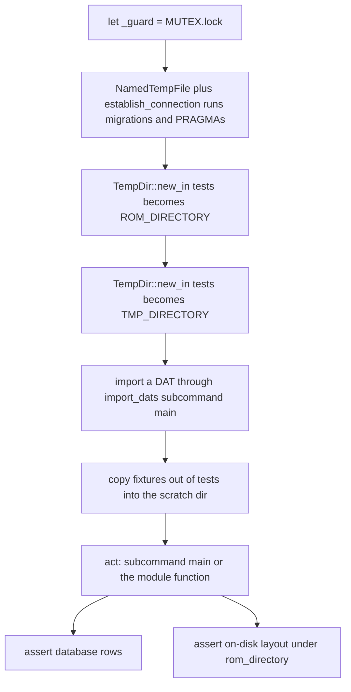
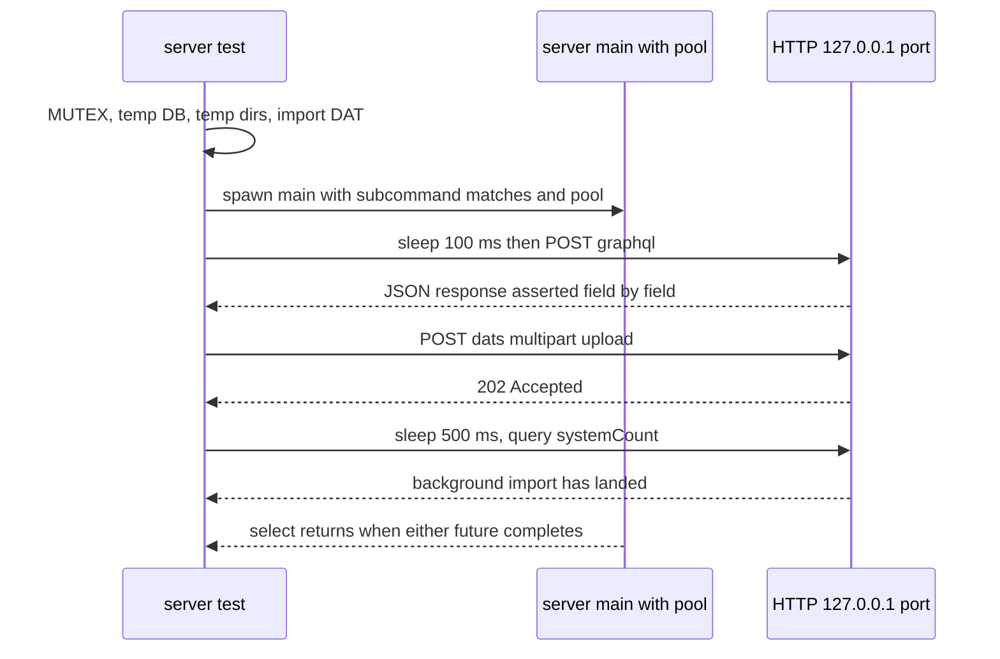

# Test Harness and Conventions

Almost every test in the repository is a **unit test of the binary crate**, not an
integration test: they live in `src/<module>/test_*.rs`, are pulled into the
parent module with `#[cfg(test)] mod test_name;` at the bottom of that module
([src/sort_roms.rs](../../src/sort_roms.rs#L937-L1020),
[src/import_roms.rs](../../src/import_roms.rs#L2695-L2732)), and reach the code
under test with `use super::*` (and `use super::super::import_dats;` to drive a
neighbouring subcommand). Because they compile *into* the `oxyromon` bin target's
test harness, they can touch private items and call a subcommand's `main()`
directly with a synthesized clap `ArgMatches` — no process is spawned
([src/config/test_cli.rs](../../src/config/test_cli.rs#L5-L35)).

Roughly 300 such modules exist; `src/sort_roms/` alone holds 42, one per sorting
scenario. `tests/` is **not** the ordinary Rust integration directory — it is the
fixture corpus the in-module tests read
([Test Fixtures and End-to-End Suites](test-fixtures.md)). Only two files there
are test targets: the CLI-parity guard `tests/crates.rs` and the end-to-end
`tests/mcp_stdio.rs`, which is the sole case that spawns the real binary via
`env!("CARGO_BIN_EXE_oxyromon")` ([tests/mcp_stdio.rs](../../tests/mcp_stdio.rs#L1-L43)).
A third style exists once, inline: `#[cfg(test)] mod tests { … }` inside
[src/iso.rs](../../src/iso.rs#L186-L192) for the CUE-parsing helpers.

## The canonical skeleton

`AGENTS.md` describes the shape in its Tests section, and the modules follow
it literally ([AGENTS.md](../../AGENTS.md#L113-L124)):

```rust
#[tokio::test]
async fn test() {
    // given
    let _guard = MUTEX.lock().await;

    let test_directory = Path::new("tests");
    let progress_bar = ProgressBar::hidden();

    let db_file = NamedTempFile::new().unwrap();
    let pool = establish_connection(db_file.path().to_str().unwrap()).await;
    let mut connection = pool.acquire().await.unwrap();

    let rom_directory = TempDir::new_in(test_directory).unwrap();
    set_rom_directory(&mut connection, PathBuf::from(rom_directory.path())).await;
    let tmp_directory = TempDir::new_in(test_directory).unwrap();
    let tmp_directory =
        set_tmp_directory(&mut connection, PathBuf::from(tmp_directory.path())).await;

    let matches = import_dats::subcommand()
        .get_matches_from(["import-dats", "tests/Test System (20200721).dat"]);
    import_dats::main(&mut connection, &matches, &progress_bar).await.unwrap();

    // when — call the function or subcommand under test
    // then — assert database rows *and* filesystem state
}
```



*Caption: the five-step lifecycle every fixture-consuming test repeats — lock, temp DB, temp ROM and TMP directories, DAT import, then act and assert both halves.*

`ProgressBar::hidden()` stands in for the real bar; the production `print_*`
helpers still write to it, so output formatting is exercised without polluting
`cargo test` output ([src/progress.rs](../../src/progress.rs#L26-L41)). The
`// given` / `// when` / `// then` comments are part of the convention. Some
suites factor the preamble into an `async fn setup(dat: &str)` helper — and it
must return the `NamedTempFile` and both `TempDir`s so the caller keeps them
alive; the comment in that file says so explicitly, because a dropped `TempDir`
deletes the directory the pool and the assertions still point at
([src/import_roms/test_prefer_format.rs](../../src/import_roms/test_prefer_format.rs#L9-L42)).

## Isolation: temp database, temp directories, one filesystem

`establish_connection()` is the same entry point `main.rs` uses, so each test
builds a **real schema**: it applies the embedded `MIGRATOR` and sets the whole
`PRAGMA` block (`foreign_keys`, `locking_mode`, WAL, `synchronous`,
`temp_store`, `mmap_size`, `cache_size`, `auto_vacuum`)
([src/database.rs](../../src/database.rs#L11-L72)). That has a consequence agents
miss: the pool geometry is **compile-time feature-dependent**. With `server` or
`mcp` enabled the pool is 5 connections with `NORMAL` locking; otherwise it is
1 connection with `EXCLUSIVE`. The same test source therefore runs against two
different database configurations depending on the feature flags of the command
line — which is precisely why CI and `AGENTS.md` insist on
`--features oxyromon/server` ([CI Pipelines and Runtime Environment](../operations/ci-and-environment.md)).

The scratch directories are created with `TempDir::new_in("tests")`, **not** in
`/tmp`. Two reasons, both load-bearing: fixtures and their imported results stay
on one filesystem, so the rename path in `rename_file()` is exercised rather than
its cross-device copy+delete fallback
([src/util.rs](../../src/util.rs#L122-L150)); and the leftovers are gitignored by
the `tests/.tmp*` entry ([.gitignore](../../.gitignore#L10-L21)). Because an
import *moves* the file, a fixture is never handed to the importer directly — it
is copied into the temp TMP directory first (see
[Test Fixtures](test-fixtures.md#the-corpus-is-read-only-imports-move-files)).

The two setters used to aim the settings at those directories,
`set_rom_directory` / `set_tmp_directory`, exist **only under `cfg(test)`**
alongside the mutex, inside a `cfg_if!` block in `config.rs`
([src/config.rs](../../src/config.rs#L631-L648)). Production code has no
equivalent: it goes through `get_rom_directory()` / `get_tmp_directory()`, which
fall back to `OXYROMON_ROM_DIRECTORY`, `$HOME/Emulation` and `env::temp_dir()` and
write the value back. The test helpers exist so a test can bypass that bootstrap
and point the library at its own directory — and each returns the `PathBuf`, which
is why the idiom is `let tmp_directory = set_tmp_directory(...).await;`. Since the
canonicalized settings live in the per-test database, no environment variables are
set or unset anywhere in the suite.

## The global `MUTEX`

```rust
pub static MUTEX: LazyLock<Mutex<i32>> = LazyLock::new(|| Mutex::new(0));
```

defined in `config.rs` behind `cfg(test)`
([src/config.rs](../../src/config.rs#L631-L648)) and taken as the **first
statement** of each test: `let _guard = MUTEX.lock().await;`. It is a
`tokio::sync::Mutex`, so it serializes across the libtest worker threads inside
one test binary — and since all ~300 `src/` modules compile into the *same*
binary, holding it makes the whole in-crate suite effectively sequential. That is
the price paid for the process-wide state the tests genuinely share: the global
`MULTI_PROGRESS` instance every progress bar registers with
([src/progress.rs](../../src/progress.rs#L17-L34)), the `tests/` directory that
hosts every scratch directory, and the fixed loopback ports the server tests bind.
`AGENTS.md`'s Tests section warns about a forgotten `MUTEX`: the symptom is
flakiness that only appears under a full `cargo test` run, not when the test is
run alone ([AGENTS.md](../../AGENTS.md#L119-L120)).

The lock is *not* universal, and the exceptions are deliberate: tests with no
process-wide footprint skip it. Pure `#[test]` units — the `mimetype` matchers,
`crc32`, the GraphQL validators, `compute_alpha_subfolder`, `prompt_for_games` —
take nothing ([src/util/test_compute_alpha_subfolder.rs](../../src/util/test_compute_alpha_subfolder.rs#L1-L21)),
and a database-only test like `sort_roms/test_all_regions_from_matches.rs` reads
a setting from its own temp DB without touching the filesystem, so it acquires no
guard ([src/sort_roms/test_all_regions_from_matches.rs](../../src/sort_roms/test_all_regions_from_matches.rs#L1-L23)).
The rule of thumb: if the test writes to `ROM_DIRECTORY`/`TMP_DIRECTORY`, boots a
server, or relies on the settings bootstrap, it locks.

## Prompts must never block

A subcommand that would ask the user something interactively must resolve without
a TTY under test. Three mechanisms carry this:

- **`cfg!(test)` as the "select everything" flag.** `prompt_for_games(games, all)`
  returns the whole list untouched when `all` is true, so the `dialoguer`
  multiselect is never constructed
  ([src/prompt.rs](../../src/prompt.rs#L123-L144)). The two call sites pass
  `cfg!(test)` for exactly this reason
  ([src/check_roms.rs](../../src/check_roms.rs#L61-L82),
  [src/common.rs](../../src/common.rs#L36-L55)).
- **Explicit unattended modes.** Import helpers thread an
  `UnattendedMode::{None, Skip, First}` parameter — the same value the CLI's
  `-u/--unattended` flag parses — and tests pass `Skip` (or `First`) rather than
  relying on `cfg!(test)`
  ([src/import_roms.rs](../../src/import_roms.rs#L39-L54),
  [src/import_roms/test_original.rs](../../src/import_roms/test_original.rs#L44-L57)).
  When the mode is not `None`, multi-match resolution returns early — `Skip`
  yields `MatchState::Skipped`, `First` takes the first candidate — so
  `prompt_for_roms` is never reached
  ([src/import_roms.rs](../../src/import_roms.rs#L2436-L2475)).

- **Scripted selections.** Under `cfg(test)`, `select_opt`, and `select` through
  it, never builds a `FuzzySelect`. It pops the next answer from
  `prompt::SCRIPTED_SELECTIONS`, a `Mutex<VecDeque<Option<usize>>>` the test
  fills beforehand, and panics with `Unscripted prompt "…"` once the queue is
  empty. `src/import_roms/test_none_selected.rs` uses it to answer "None"
  (`Some(0)`) at the ROM prompt, then asserts the queue was drained, so the
  prompt was reached exactly once
  ([src/prompt.rs](../../src/prompt.rs#L258-L291),
  [src/import_roms/test_none_selected.rs](../../src/import_roms/test_none_selected.rs)).

The other `dialoguer` paths (`multiselect`, `confirm`, `editor`) still read the
terminal, so `src/prompt/test_prompt_for_games_single_match.rs` covers only the
early return (`len() <= 1` answers the question already)
([src/prompt/test_prompt_for_games_single_match.rs](../../src/prompt/test_prompt_for_games_single_match.rs#L1-L30)).
Without a terminal `FuzzySelect` spins rather than failing, which is why the
scripted queue panics instead of falling through: a test reaching an unscripted
selection fails at once rather than hanging. A new call site of the other prompts
still needs its own bypass, or the suite hangs until CI times out.

## Reference binaries: one skip policy in the crates, no probe in the app

Two different rules cover two different kinds of external dependency, and mixing
them up is the usual source of a suite that "should have failed".

**The format crates compare against upstream tools and skip when they are
absent.** `crates/*/tests/*` locate an oracle binary — `chdman`, `ffmpeg`,
`ctrtool`, `maxcso` — through a `$CHDMAN`-style environment variable first, then `$PATH`,
and `return` with an `eprintln!("skipping: …")` when the lookup yields `None`
([crates/chd-rs/tests/write.rs](../../crates/chd-rs/tests/write.rs#L1-L22),
[crates/chd-rs/tests/ld.rs](../../crates/chd-rs/tests/ld.rs#L15-L23),
[crates/cia-rs/tests/common/mod.rs](../../crates/cia-rs/tests/common/mod.rs#L147-L161),
[crates/xso-rs/tests/common/mod.rs](../../crates/xso-rs/tests/common/mod.rs#L88-L98)).
The patch crates use the weaker form of the same policy: a probe that runs
`xdelta3 -V` / `flips --version` and reports only whether the process could be
spawned ([crates/xdelta-rs/tests/interop.rs](../../crates/xdelta-rs/tests/interop.rs#L8-L53),
[crates/xps-rs/tests/interop.rs](../../crates/xps-rs/tests/interop.rs#L9-L45)).
Nothing here resolves `chdman` from `src/` — there is no `src/chdman.rs`, and no
version floor such as a minimum splitbin `chdman` is compared anywhere: an absent
oracle skips, and the `env` override exists so a developer can point the suite at
a build outside `PATH`.

**The application has no tool probe left**, because `sevenz-rust2`, `chd-rs`,
`cia-rs`, `xps-rs`, `xso-rs`, `nsz-rs`, `xdelta-rs` and `nod` are all linked
libraries whose `get_version()` returns a constant such as `"built-in"`
([src/archive.rs](../../src/archive.rs#L477-L480),
[src/chd.rs](../../src/chd.rs#L896-L898),
[src/cia.rs](../../src/cia.rs#L20-L22)). `ctrtool`, the last program the
application ran, was replaced by `cia-rs`, and `util::tool_version` went with it.
`src/import_roms/test_cia.rs` therefore has no probe and no early return: it takes
the mutex and runs the real CIA import on every machine, CI included
([src/import_roms/test_cia.rs](../../src/import_roms/test_cia.rs#L7-L12)).

Those functions are also the application's only notion of "available": the same
`get_version()` calls build the `info` dependency report, the GraphQL
`dependencies` field and the MCP `status` payload
([src/info.rs](../../src/info.rs#L26-L37),
[src/query.rs](../../src/query.rs#L241-L261),
[src/mcp/read.rs](../../src/mcp/read.rs#L71-L83)). So unlike the crates' oracle
suites, the in-crate suite is never tool-gated — a green run there
really does mean the code path executed.

CI installs `mame-tools`, `xdelta3` and `ffmpeg` **as test-time oracles only** —
the comment in the workflow says they are "only for the crates' tests … and skip
without them" — and not as runtime dependencies of `oxyromon`
([continuous_integration.yml](../../.github/workflows/continuous_integration.yml#L23-L32)).
The consequence for green runs still holds wherever the policy applies: a skipped
test is reported as passing, so an oracle-gated path can be silently unexercised —
check the `skipping:` line in the output, not the exit code. `maxcso` is *not*
installed, so `crates/xso-rs`'s interop suite skips in CI; `flips` is likewise
absent for `crates/xps-rs`.

## Assert both halves

The convention's other half is that an assertion on rows alone is incomplete. A
subcommand's contract is *database state plus on-disk layout*, and tests assert
the two together:

- `sort_roms/test_sort.rs` checks the four `romfiles` rows **and** that each
  `path` equals the expected relative path under the system directory, then that
  `rom_directory.join(&romfile.path).is_file()`
  ([src/sort_roms/test_sort.rs](../../src/sort_roms/test_sort.rs#L82-L102)).
- `purge_roms/test_orphans.rs` deletes a game row out from under an imported
  romfile, purges, then asserts `find_romfiles()` is empty **and** the system
  directory has zero entries ([src/purge_roms/test_orphans.rs](../../src/purge_roms/test_orphans.rs#L54-L72)).
- `check_roms/test_check_by_name.rs` overwrites the imported file *after* import
  (so the fixture stays intact), runs `check-roms --system …`, and asserts the
  surviving row's path contains `/Trash/` and that the file really exists there
  ([src/check_roms/test_check_by_name.rs](../../src/check_roms/test_check_by_name.rs#L50-L73)).

Comparing the stored path against `system_directory.join(…).strip_prefix(&rom_directory)`
encodes the invariant that **`romfiles.path` is relative to `ROM_DIRECTORY`**; an
implementation that starts storing absolute paths fails here and nowhere else
([src/import_roms/test_original.rs](../../src/import_roms/test_original.rs#L82-L94)).
Tests that only need "it ran and the catalog agrees" assert the cheaper pair —
`info/test_info.rs` runs the whole dependency-and-statistics report and then checks
`count_systems`/`count_games`/`count_roms`
([src/info/test_info.rs](../../src/info/test_info.rs#L29-L36)).

## Tests that cross an HTTP boundary

Two patterns, neither of which touches the network. DAT downloads take a base URL
as a parameter, so the test mounts a `wiremock` `MockServer` and passes
`mock_server.uri()` into the function under test — dependency injection rather
than an environment variable ([src/download_dats/test_nointro.rs](../../src/download_dats/test_nointro.rs#L35-L51),
[src/download_dats/test_redump_failures.rs](../../src/download_dats/test_redump_failures.rs#L39-L58)).
`wiremock` is the root package's only dev-dependency
([Cargo.toml](../../Cargo.toml#L157-L158)).

The server suites build the same temp DB/directories, then run the *real* Axum
`main(pool, &matches)` in one future and the requests in another, racing them with
`tokio::select!` after a fixed warm-up sleep (100 ms, or 1000 ms for the larger
first case) whose only purpose is to let the listener come up
([src/server/test_queries.rs](../../src/server/test_queries.rs#L48-L117),
[src/server/test_server.rs](../../src/server/test_server.rs#L85-L98)):



*Caption: the timing-based server harness — the server future and the client future race inside one `select!`, and background work is given a sleep before the asserting query.*

Each suite repeats that shape, with a `gql(client, body)` helper that posts a raw
query string to its own port and hands back parsed JSON:

- `test_queries.rs` (port 8011) covers read-only queries — `version`,
  `dependencies` (asserting the list is name-sorted and that an absent tool
  reports a null version), `downloadableSystems`, `systemSettings`,
  `gameInformation` and `roms.ignored`
  ([src/server/test_queries.rs](../../src/server/test_queries.rs#L11-L109)).
- `test_mutations.rs` (port 8010) drives the settings mutations against the
  running server — `setBool`, `addToList`/`removeFromList`,
  `setPreferRegions`/`setPreferVersions`, `setSubfolderScheme`, `setDirectory` —
  each round-tripped through the `settings` query, and pins the failure semantics:
  a value the validator rejects surfaces as a GraphQL `errors` array rather than a
  panic, and actions that cannot run (`sortRoms(systemId: 999)`, `purgeIrds`,
  `convertRoms`, a `purgeRoms` with nothing selected) answer with their exact
  message before queueing anything
  ([src/server/test_mutations.rs](../../src/server/test_mutations.rs#L57-L171)).
- `test_uploads.rs` (port 8012) asserts only HTTP status codes on the upload
  routes: `/roms`, `/patches` and `/irds` answer 400 for a malformed field set and
  202 once queued ([src/server/test_uploads.rs](../../src/server/test_uploads.rs#L81-L118)).
- `test_server.rs` holds the older, larger suite: the default port 8000 GraphQL
  smoke test, the `/dats` upload cases on 8001–8003, and two pure `#[test]`
  helpers (`url_filename`, `safe_filename`) that pin path-traversal handling for
  client-chosen names without a server at all
  ([src/server/test_server.rs](../../src/server/test_server.rs#L517-L547)).

Multipart bodies are hand-assembled byte buffers rather than a client helper
([src/server/test_uploads.rs](../../src/server/test_uploads.rs#L13-L46)), and
background imports are awaited by sleeping 500 ms and then re-querying
([src/server/test_server.rs](../../src/server/test_server.rs#L249-L292)). Each
server test holds the `MUTEX` and pins its own loopback port — the default 8000 or
an explicit `--port` of 8001, 8002, 8003, 8010, 8011 or 8012 — so at most one of
them is live at a time, and no test has to discover a free port. The whole `src/server/` tree is compiled
only with the `server` feature (`#[cfg(feature = "server")] mod server;` in
`main.rs`), so a `cargo test` without features contributes **nothing** from these
files ([src/main.rs](../../src/main.rs#L26-L52)).

## Running the suite

```sh
# everything: oxyromon with the web-server feature, plus the format crates
cargo test --workspace --features oxyromon/server

# one module or one test by name filter
cargo test --features oxyromon/server sort_1g1r

# coverage, as CI runs it and as test.sh runs it
cargo llvm-cov --workspace --features oxyromon/server --lcov --output-path lcov.info

# one format crate, and its slow tests
cargo test -p xso-rs
cargo test --release -p xso-rs -- --ignored
```

The feature has to be written `oxyromon/server` because `--workspace` selects
several packages, and an unqualified `--features server` would name a feature on
whichever package is being built. `server` implies `mcp`, so that single command
also runs `tests/mcp_stdio.rs` ([Cargo.toml](../../Cargo.toml#L40-L55)). Only one
test in the workspace is `#[ignore]`d — the 2 GiB `index_shift_round_trips` in
`crates/xso-rs`, which writes its sparse image under `CARGO_TARGET_TMPDIR`
([crates/xso-rs/tests/interop.rs](../../crates/xso-rs/tests/interop.rs#L183-L218)).

`./test.sh` is now a single line, identical to CI's coverage step
([test.sh](../../test.sh#L1-L3),
[continuous_integration.yml](../../.github/workflows/continuous_integration.yml#L61-L62)).
CI brackets that run with two clippy passes — `--workspace --all-targets
--features oxyromon/server`, and a second covering the MCP-without-web-server
combination, `--no-default-features --features use-rustls,mcp --all-targets` —
plus a `--release --features server` build, before uploading the `lcov.info` to
Codecov ([continuous_integration.yml](../../.github/workflows/continuous_integration.yml#L51-L66)).

Two build facts matter when a suite feels inexplicably slow. `[profile.dev.package."*"]`
sets `opt-level = 3` for dependencies, because hashing and the pure-Rust codecs run
about an order of magnitude slower at opt-level 0
([Cargo.toml](../../Cargo.toml#L164-L168)); and the whole in-crate suite is
serialized by the `MUTEX`, so wall-clock time scales with the number of
`#[tokio::test]` modules, not with your CPU count.

## Workspace consistency guard

`tests/crates.rs` is a parity guard, not a behaviour test: `every_cli_shares_one_ui`
reads `crates/xso-rs/src/bin/xsors/ui.rs` as the canonical copy and asserts that
the `ui.rs` of `chd-rs`, `cia-rs`, `gdi-rs`, `nsz-rs`, `xdelta-rs` and `xps-rs` is
byte-identical to it
([tests/crates.rs](../../tests/crates.rs#L1-L18)). The format CLIs deliberately
share one shell, so a change to that shell must be made in all seven places at once;
editing one turns any `cargo test --workspace` red, on any crate
([AGENTS.md](../../AGENTS.md#L146-L155)).

## Invariants agents break most often

1. **Forgetting `let _guard = MUTEX.lock().await;`** — passes in isolation, fails
   intermittently in a full run and in CI.
2. **Importing a fixture in place** — the importer renames, so the committed file
   under `tests/` disappears
   ([Test Fixtures](test-fixtures.md#the-corpus-is-read-only-imports-move-files)).
3. **`TempDir::new()` instead of `TempDir::new_in("tests")`** — crosses a
   filesystem, exercises the copy+delete fallback instead of the rename, and stops
   being gitignored under `tests/.tmp*`.
4. **Dropping the guards** — a `TempDir`/`NamedTempFile` that isn't bound to a
   living `_name` is deleted at the end of the statement, taking the ROM directory
   or database out from under the assertions.
5. **Asserting only the database** — a move that leaves the wrong path or an empty
   directory behind still looks correct in `romfiles`.
6. **Adding an interactive prompt without a `cfg!(test)` or `UnattendedMode`
   bypass** — hangs the suite.
7. **Failing a crate test when a reference binary is missing** — locate it through
   `$CHDMAN`/`$PATH` (or spawn-probe it) and `return`; a skipped test is green but
   proves nothing, so check the `skipping:` line.
8. **Testing `server`/`mcp` code without `--features oxyromon/server`** — the
   modules are not compiled, so the run is vacuously green.
9. **Editing one crate's `ui.rs`** — `tests/crates.rs` requires all copies to be
   byte-identical to `xsors`'s ([tests/crates.rs](../../tests/crates.rs#L1-L18)).

## Adding tests for a new subcommand

`AGENTS.md`'s "New subcommand" checklist ends with tests, and its Tests section
says where they go: create `src/my_command/test_*.rs`, one
scenario per file, named for the behaviour (`test_sort_1g1r_strict.rs`,
`test_dat_updated_orphan_chd.rs`), and register each with
`#[cfg(test)] mod test_*;` at the bottom of `src/my_command.rs`
([AGENTS.md](../../AGENTS.md#L170-L174)). Copy the skeleton verbatim, import the
system under test through `import_dats::main` rather than by inserting rows —
except for the handful of pure helpers that build a `System`/`Game`/`Rom` struct
in place, which is how `common/test_path_*.rs` pins the path-building logic
([src/common/test_path_original.rs](../../src/common/test_path_original.rs#L5-L18)).

See also [Test Fixtures and End-to-End Suites](test-fixtures.md) for the DAT and
ROM corpus, [Format Crate Test Strategy](format-crate-tests.md) for how
`crates/*` prove byte agreement with their upstreams, and
[Settings and Configuration](../architecture/settings-and-configuration.md) for
what `ROM_DIRECTORY`/`TMP_DIRECTORY` mean outside a test.
