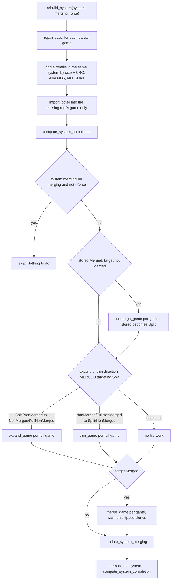
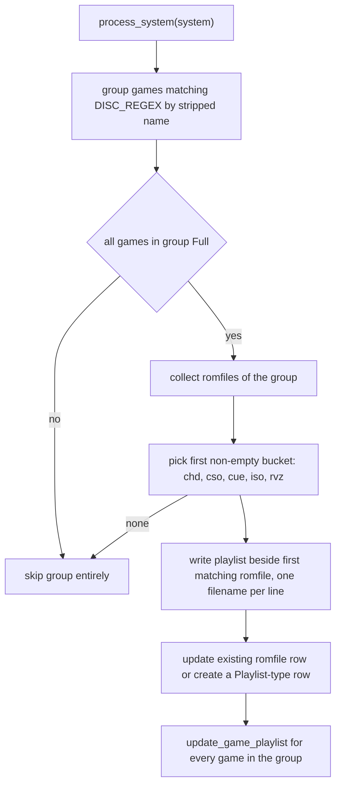

# Arcade Rebuilds and M3U Playlists

Two workflows in this repository share one idea: **a game's `roms` rows describe a
set, and `roms.romfile_id` decides which physical file satisfies each of them.**
`rebuild-roms` moves those links (and the files behind them) between arcade sets
when you switch merging strategies; `generate-playlists` creates the M3U files
that tie multi-disc games together and that the CHD parents feature reads back as
a parent relationship.

Both are CLI subcommands registered in `src/main.rs`
([src/main.rs](../../src/main.rs#L71-L167)), and both mutate the same
`roms` / `romfiles` / `games` tables documented in
[Data Model, SQLite Usage and Migrations](../architecture/data-model-and-migrations.md).

## Merging is stored on the system, not on the roms

`systems.merging` (added by
[`20220104132512_add_merging_to_system.sql`](../../migrations/20220104132512_add_merging_to_system.sql))
holds a `Merging` discriminant, and it is the only place the chosen strategy is
recorded:

```rust
pub enum Merging {
    Split = 0,
    NonMerged = 1,
    FullNonMerged = 2,
    Merged = 3,
    FullMerged = 4,
}
```

`SPLIT`, `NON_MERGED`, `FULL_NON_MERGED` and `MERGED` can be written —
`MERGING_STRATEGIES` is the clap value parser for `--merging`, listed in enum
order because the interactive choice maps its index straight onto `Merging`, and
`update_system_merging` writes the enum discriminant
([src/rebuild_roms.rs](../../src/rebuild_roms.rs#L20-L34),
[src/database.rs](../../src/database.rs#L192-L206)). `FullMerged` exists in the
enum but no code path selects it; it is handled defensively wherever a `match`
must be exhaustive.

The stored value changes the meaning of two other things:

- **Completion.** `compute_system_completion` picks the SQL that recomputes
  `games.completion` according to the stored strategy: `Split` and `Merged`
  ignore every rom that has a `parent_id`, `NonMerged` requires only roms merged
  from a *non-BIOS* parent, `FullNonMerged`/`FullMerged` require every rom
  ([src/util.rs](../../src/util.rs#L403-L435),
  [src/database.rs](../../src/database.rs#L493-L575)). `Merged` shares `Split`'s
  rules because a merged set links exactly the roms a split one does, only to
  the parent's ZIP. This is why a clone can be `Full` under `Split` with zero of
  its own shared files, and `None` the moment you switch to `FullNonMerged`.
- **What the server reports as "not needed".** The GraphQL `Rom::ignored`
  resolver returns `true` for any merged rom under `Split` and `Merged`, only
  BIOS-sourced merged roms under `NonMerged`, and never under `FullNonMerged`,
  so the same file row is "required" or "ignore it" depending purely on the
  system's stored strategy ([src/query.rs](../../src/query.rs#L115-L152)).

## Where the parent/clone graph comes from

`rebuild-roms` never inspects file contents to discover relationships; it consumes
the graph that DAT import built. `create_or_update_games` partitions machines into those with
neither `cloneof` nor `romof` and the rest, resolves each child's `cloneof` /
`romof` into `games.parent_id` and `games.bios_id`, and retries until a DAT with
nested clones is fully linked — a child whose parent name matches nothing is
skipped with a warning ([src/import_dats.rs](../../src/import_dats.rs#L521-L703)).

Per-file merging comes from the Logiqx `merge="..."` attribute: when it is present,
import searches the clone's own BIOS, its parent, and its parent's BIOS for a rom
with the same size and CRC, and records the hit as `roms.parent_id` plus
`roms.bios = true` when the source rom was a BIOS rom
([src/import_dats.rs](../../src/import_dats.rs#L748-L842)). `roms.parent_id IS NULL`
therefore means "exclusive to this set", and `roms.bios` distinguishes a BIOS
dependency from a parent dependency — exactly the two axes the rebuild below cuts
along.

The fixture that exercises all of this is
`tests/Test System (20200721) (MAME Rebuild).dat`:
`Test BIOS` (`isbios`), `Test Parent`, and `Test Clone` (`cloneof="Test Parent"
romof="Test BIOS"`) whose `Test Clone.rom` and `Test Clone Common.rom` merge from
the parent and whose `Test Clone Bios.rom` merges from the BIOS.

## rebuild-roms: control flow

`main` prompts for systems with `arcade_only = true` — the candidate list is
`find_arcade_systems`, so console systems can never be rebuilt. With no arcade
system it warns `No arcade systems found` and stops before asking for a strategy;
otherwise it resolves the target strategy either from `-m/--merging` or from an
interactive `select`, and runs `rebuild_system` per system
([src/rebuild_roms.rs](../../src/rebuild_roms.rs#L61-L101)).

A system is arcade when its DAT lists `<machine>` entries, as MAME's do, or when
it was imported with `import-dats -a/--arcade`. FBNeo's DATs list `<game>`
entries, so they need the flag; without it they import as console systems and
`rebuild-roms` finds nothing to rebuild.



*Figure: `rebuild_system` — repair, short-circuit, unmerge, migrate, merge,
re-record, recompute.*

### The repair pass runs before the merge check

`rebuild_system` starts by looking for files it already owns but has not linked:
for every `Partial` game it takes the roms with `romfile_id IS NULL` **and
`parent_id IS NULL`** (skipping `size == 0` placeholder roms) and searches the
**same system** for a rom that already has a romfile with the same size and CRC,
then MD5, then SHA1
([src/rebuild_roms.rs](../../src/rebuild_roms.rs#L110-L160),
[src/database.rs](../../src/database.rs#L1298-L1310)). If found, the file is
extracted from its archive or copied into the tmp directory and handed to
`import_roms::import_other` with a single-game allow-list
(`HashSet::from_iter(vec![missing_rom.game_id])`) and
`UnattendedMode::Skip`
([src/rebuild_roms.rs](../../src/rebuild_roms.rs#L161-L193),
[src/import_roms.rs](../../src/import_roms.rs#L2073-L2174)).

This is the mechanism that lets a rebuild "grow" a clone without ever knowing the
strategy yet: the import path is reused verbatim, but constrained so a duplicate
file can only be claimed by the game it was needed for, and ambiguous matches are
skipped rather than prompted for. Only after this does the strategy comparison
happen, and only then can `Nothing to do` be printed — so an unchanged strategy
still heals unlinked roms.

### Direction decides expand or trim

A merged set is a split one with each clone's own files in its parent's ZIP, so
`MERGED` is reached through `SPLIT` both ways. Leaving `Merged` first runs
`unmerge_game` on every game and treats the stored strategy as `Split`; a
`MERGED` target is treated as `Split` for the expand-or-trim test, and
`merge_game` then runs on every game. The expand-or-trim step itself is a
two-branch test on (stored, target)
([src/rebuild_roms.rs](../../src/rebuild_roms.rs#L201-L239)):

| Stored | Target | Work |
| --- | --- | --- |
| `Split` / `NonMerged` | `NonMerged` / `FullNonMerged` | `expand_game` for every `Full` game |
| `NonMerged` / `FullNonMerged` | `Split` / `NonMerged` | `trim_game` for every `Full` game |
| any other pair | — | only `update_system_merging` (unless `--force`) |

With the merged steps around it, `NON_MERGED → MERGED` trims to split then merges,
and `MERGED → FULL_NON_MERGED` unmerges then expands. Both expand-or-trim
branches operate on `find_full_games_by_system_id` — partial games are never
expanded or trimmed, which is why the repair pass matters. The merge and unmerge
passes walk every game instead, so a partial clone is not left in the other
layout. After recording the new strategy, `rebuild_system` reads the system row
again before `compute_system_completion`, so completion follows the new
strategy rather than the one it rebuilt from. `--force` bypasses the
early return, so a repeated `expand`/`trim` pass can be used to re-lay out files
after manual tampering.

### expand_game: pulling parent files into a set

The target rom set defines the strategy, and the two SQL shapes are the whole
difference between `NON_MERGED` and `FULL_NON_MERGED`
([src/rebuild_roms.rs](../../src/rebuild_roms.rs#L291-L298),
[src/database.rs](../../src/database.rs#L1196-L1239)):

- `NonMerged` → `find_roms_by_game_id_parents_no_parent_bioses`: own roms plus
  merged roms whose parent rom is not flagged `bios`.
- `FullNonMerged` → `find_roms_by_game_id_parents`: every rom of the game, BIOS
  dependencies included.

Roms flagged `disk` (imported from Logiqx `<disk>` entries rather than `<rom>`) are
dropped from the set, so rebuild never rewrites arcade disc media. Each remaining
rom without a `romfile_id` is then satisfied from `rom.parent_id`'s rom, and the
destination is decided by `add_rom`. If a parent rom has no file, `expand_game`
prints `Missing "<rom>"` and returns `Ok(())` from inside the transaction *without
committing*, so the dropped transaction rolls back the game's partial expansion and
the walk continues with the next game
([src/rebuild_roms.rs](../../src/rebuild_roms.rs#L299-L336)).

`add_rom` handles the four layout combinations, because arcade sets can be stored
as loose files or as one ZIP per set
([src/rebuild_roms.rs](../../src/rebuild_roms.rs#L375-L451)):

1. archive → archive: `archive::copy_files_between_archives` moves the entry with
   `raw_copy_file` / `raw_copy_file_rename`, i.e. recompression-free and renaming
   `Test Parent.rom` to `Test Clone.rom` when the DAT gives the merged rom a
   different name ([src/archive.rs](../../src/archive.rs#L419-L475)).
2. file → archive: `to_archive` the source file into the destination archive,
   then `rename_file` the entry if the names differ.
3. archive → file: extract the single entry, rename it to the target rom name,
   `create` a new `Romfile` row.
4. file → file: plain copy into the game directory plus a new row.

In all four cases the last step is `update_rom_romfile(connection, rom.id,
Some(destination_id))` — the clone's `roms` row now points at a file inside the
clone's own directory, and the parent's file is untouched. That is the invariant
the tests assert: the parent's romfile still resolves under
`system_directory/Test Parent` after a clone has been expanded
([src/rebuild_roms/test_split_to_non_merged.rs](../../src/rebuild_roms/test_split_to_non_merged.rs#L146-L167)).

### trim_game: the inverse

Trimming selects the roms to *release* — under `Split`, every rom with a
`parent_id`; under `NonMerged`, only the merged roms that are BIOS roms
([src/database.rs](../../src/database.rs#L1241-L1280)) — deletes each file from the
set's archive or from disk, sets `romfile_id = NULL`, and finally `update`s the
archive romfile row so its recorded size matches the shrunken archive
([src/rebuild_roms.rs](../../src/rebuild_roms.rs#L338-L373)). `ArchiveFile::delete_file`
also deletes the whole archive once it becomes empty, which is what keeps a
`Full Non-Merged → Split` run from leaving empty `Test Clone.zip` files behind
([src/archive.rs](../../src/archive.rs#L152-L171)).

Note the asymmetry: expansion *creates* romfiles and rows, trimming only removes
links and files, and neither ever deletes or mutates the parent's data. The full
matrix is pinned by five tests: `test_nothing_to_do`, `test_split_to_non_merged`,
`test_split_to_full_non_merged`, `test_non_merged_to_split`, and
`test_full_non_merged_to_non_merged`, plus three merged ones below
([src/rebuild_roms.rs](../../src/rebuild_roms.rs#L729-L746)).

### merge_game and unmerge_game: the merged layout

In a merged set, the parent's ZIP holds the parent's own files and every clone's
own files (`parent_id IS NULL`), each stored once, and the clone ZIPs are gone.
`merge_game` does this for one clone
([src/rebuild_roms.rs](../../src/rebuild_roms.rs#L485-L604)):

- It takes the clone's own roms that have a romfile other than the parent's ZIP,
  skipping `disk` roms, so clone CHDs stay in the clone's directory.
- Every source must be a ZIP. If one is not, the clone is left as it is and the
  function returns `false`; `rebuild_system` counts those and ends with a warning
  to convert them to ZIP first. Loose sets are therefore never merged.
- For each rom it reads the parent ZIP's entries. An entry with the rom's name
  and CRC is reused, which is how sibling clones share one copy. An entry with
  the rom's name but another CRC sends the rom under `<clone>/<name>`, as
  ClrMamePro does. Otherwise the entry is raw-copied with
  `copy_files_between_archives`, and the parent's romfile row is created if the
  ZIP is new.
- The rom is linked to the parent's ZIP, and `prune_archive` then runs on each
  source and on the parent: it deletes entries no linked rom resolves to, deletes
  the archive and its row once no rom is left in it, and records the new size.

`unmerge_game` is the inverse: each clone rom linked to the parent's ZIP is found
with `rom_entry` (by name, `<clone>/<name>`, then CRC), copied into
`<clone>.zip` under its own name, and relinked, then the parent ZIP is pruned
([src/rebuild_roms.rs](../../src/rebuild_roms.rs#L606-L699)). Because pruning
only drops entries no remaining rom resolves to, a file shared by two clones
stays in the parent's ZIP until the last of them moves out.

File copies happen outside the database transaction. If a merge fails midway,
the parent's ZIP keeps copies the database does not know about; running it again
converges, because an entry with the same name and CRC is reused rather than
copied. The merged tests build a parent and two clones covering a name clash and
a shared file from `src/rebuild_roms/merged_set.rs`: `test_split_to_merged`
(round trip back to split), `test_merged_to_non_merged` and
`test_non_merged_to_merged`, each also running `check-roms` on the result.

## generate-playlists: M3U creation for multi-disc games

`generate-playlists` is scoped to Redump systems: it calls
`prompt_for_systems(connection, Some(REDUMP_SYSTEM_URL), …)`, so only systems whose
`systems.url` matches Redump are offered
([src/generate_playlists.rs](../../src/generate_playlists.rs#L36-L55),
[src/prompt.rs](../../src/prompt.rs#L9-L46)). The GraphQL
`generatePlaylists` mutation always runs it with `-a`, i.e. all Redump systems at
once ([src/mutation.rs](../../src/mutation.rs#L507-L534)).

Grouping is entirely driven by one regex:

```rust
pub static DISC_REGEX: LazyLock<Regex> = LazyLock::new(|| Regex::new(r" \(Disc \d+\).*").unwrap());
```

Every game whose name contains ` (Disc N)` is grouped under
`DISC_REGEX.replace(name, "") + ".m3u"`. The trailing `.*` is load-bearing: it
strips whatever follows the disc marker, so `(Disc 1) (Reprint)` and `(Disc 2)
(En,Fr)` collapse into the same playlist
([src/generate_playlists.rs](../../src/generate_playlists.rs#L21-L71)). The same
regex is reused by `Game::get_playlist_path` in `src/common.rs`, which is what keeps
the generated filename and the sorted filename identical
([src/common.rs](../../src/common.rs#L797-L838)).



*Figure: `process_system` — group, gate on completion, pick a media format, write, link.*

The rules worth knowing before changing this function:

- **All-or-nothing per group.** If any game in a disc group is not
  `Completion::Full`, the whole playlist is skipped, and the games keep
  `playlist_id = NULL`
  ([src/generate_playlists.rs](../../src/generate_playlists.rs#L73-L79),
  [src/generate_playlists/test_iso_incomplete.rs](../../src/generate_playlists/test_iso_incomplete.rs#L48-L61)).
- **One media format per playlist, by priority.** The romfiles are filtered to the
  first non-empty bucket among `chd`, `cso`, `cue`, `iso`, `rvz`; a mixed set
  therefore produces a playlist covering only the highest-priority format
  ([src/generate_playlists.rs](../../src/generate_playlists.rs#L101-L119)).
- **Entries are bare filenames**, one per line with a trailing newline, so the
  playlist works when the M3U sits next to the images — exactly what
  `test_iso_complete` asserts, including the empty final line
  ([src/generate_playlists/test_iso_complete.rs](../../src/generate_playlists/test_iso_complete.rs#L82-L91)).
- **The playlist lands in the directory of the first matching romfile**
  (`set_file_name`), which is the game's already-sorted location.
- **Persistence goes through the `Persist` trait**: an existing row is `update`d,
  otherwise `CommonRomfile::from_path(…).create(.., RomfileType::Playlist)` inserts
  a row typed `Playlist`
  ([src/generate_playlists.rs](../../src/generate_playlists.rs#L153-L173),
  [src/common.rs](../../src/common.rs#L708-L737)). Beware the shape of the lookup:
  `find_romfile_by_path` is called with the **absolute** path while
  `Persist::create` stores the **ROM-directory-relative** path (see
  [the relative-path migration](../../migrations/20241117210150_make_romfile_paths_relative.sql)),
  so the update branch only ever matches legacy absolute rows — re-running the
  command for a system whose playlist row is already stored relatively does not
  take the dedupe path.

## games.playlist_id: the join the rest of the toolchain reads

The final step of each group is `update_game_playlist(connection, game.id,
playlist_id)` for every game in the group
([src/generate_playlists.rs](../../src/generate_playlists.rs#L174-L176),
[src/database.rs](../../src/database.rs#L654-L667)). The column was added by
[`20230106190403_add_playlist_id_to_games.sql`](../../migrations/20230106190403_add_playlist_id_to_games.sql)
as `INTEGER REFERENCES romfiles(id) ON DELETE SET NULL` with an index — so a
playlist is an ordinary `romfiles` row, and deleting it never deletes the discs, it
only unlinks them.

```
games (Disc 1) ──playlist_id──▶ romfiles (Playlist: Game.m3u) ◀──playlist_id── games (Disc 2)
                                     ▲
                                     │ find_first_game_by_playlist_id (ORDER BY name LIMIT 1)
                                     └── romfiles.parent_id of Disc 2's CHD
```

*Figure: multi-disc games are related to each other only through the shared playlist row.*

### CHD parents: the playlist is the only parent guess

Three consumers depend on that link. The first is the CHD parents feature, and the
chain is entirely DB-mediated — no M3U text is ever parsed:

1. `convert-roms` reads the per-system boolean `CHD_PARENTS`
   ([src/convert_roms.rs](../../src/convert_roms.rs#L225-L263),
   [`20240403223843_add_chd_parents_setting.sql`](../../migrations/20240403223843_add_chd_parents_setting.sql)).
2. `find_parent_chd` branches on it: `--parents` (`prompt_for_parents`)
   interactively asks instead, otherwise the setting decides
   ([src/convert_roms.rs](../../src/convert_roms.rs#L1860-L1875)).
3. `find_parent_chd_romfile_by_game` reads `game.playlist_id`, takes the *first
   game ordered by name* in that playlist, returns `None` if that is the game
   itself, and picks that game's `.chd` romfile
   ([src/util.rs](../../src/util.rs#L464-L494),
   [src/database.rs](../../src/database.rs#L937-L955)).
4. The chosen parent is handed to `ToChd::to_chd` as a `CommonRomfile` and written
   to `romfiles.parent_id` once the conversion persists
   ([src/convert_roms.rs](../../src/convert_roms.rs#L1481-L1544),
   [src/database.rs](../../src/database.rs#L2718-L2735)).

**Playlists must therefore be generated first**: with `playlist_id = NULL` the
lookup short-circuits to `None` and the CHDs are written parentless. This is the
ordering `test_iso_to_chd_parents` encodes — `generate-playlists` runs before
`to_chd`, and Disc 2's romfile ends up with `parent_id == Some(disc1_id)` while
Disc 1's stays `None`
([src/convert_roms/test_iso_to_chd_parents.rs](../../src/convert_roms/test_iso_to_chd_parents.rs#L53-L137)).

`convert-roms` `--parents` is the escape hatch when the playlist guess is wrong:
it offers every CHD romfile in the system that has no `parent_id` of its own,
ranked by Jaro–Winkler similarity between the game name and the candidate path,
with "None" available when nothing matches
([src/prompt.rs](../../src/prompt.rs#L192-L231),
[src/database.rs](../../src/database.rs#L2794-L2822)).

### Ordering and protection inside `to_chd`

`to_chd` partitions games by source media (archives, CUE/BIN, ISO, CSO, ZSO, CHD,
then other raw types) and calls `find_parent_chd` once per game in every bucket,
including `--recompress` of existing CHDs
([src/convert_roms.rs](../../src/convert_roms.rs#L1241-L1275)). Because the parent
must already be a CHD when the child asks for it, the CHD bucket is sorted so games
whose romfiles **already have** a `parent_id` — i.e. children — are converted
first; the same sort exists in `to_xso`
([src/convert_roms.rs](../../src/convert_roms.rs#L1264-L1274),
[src/convert_roms.rs](../../src/convert_roms.rs#L1965-L1975)).

Reading an existing parent back out of a CHD goes through `transcode::romfile_as_chd`:
when `romfiles.parent_id` is set, the parent row is opened with
`as_chd_with_parent`, which verifies the parent's own CHD SHA1 against the child's
recorded `parent_sha1` and bails on mismatch; when it is unset, `as_chd` scans the
parent CHD's own directory for a sibling whose CHD SHA1 matches
([src/transcode.rs](../../src/transcode.rs#L57-L78),
[src/chd.rs](../../src/chd.rs#L584-L680)). Recompressing a CHD that other romfiles
point at as their parent is refused outright — `to_chd` prints `CHD has children,
skipping` — so rewriting a parent would never silently orphan its children
([src/convert_roms.rs](../../src/convert_roms.rs#L1726-L1756)).

CHDs themselves are created **in-process by chd-rs**: `create_chd` calls
`chd_rs::create_cd` / `create_dvd` / `create_hd` / `create_ld` with the opened
parent, and there is no `chdman` subprocess and no external-version gate — the
reported dependency version is the literal `built-in`
([src/chd.rs](../../src/chd.rs#L683-L794),
[src/chd.rs](../../src/chd.rs#L896-L898)). Hunk size and codec defaults mirror
chdman's (parent's hunk size when unspecified; `cdlz,cdzl,cdfl` for CD, `avhu` for
LaserDisc, `lzma,zlib,huff,flac` for HD).

### Sorting, export and purge

- **Sorting.** `sort_system` pre-loads `find_playlist_romfiles_by_system_id` into
  its romfile map so playlist rows can be moved at all
  ([src/sort_roms.rs](../../src/sort_roms.rs#L237-L251)), and `sort_game` appends a
  move for `game.playlist_id` whenever its current path differs from
  `Game::get_playlist_path`, which honours the 1G1R directory and the
  `REGIONS_*_SUBFOLDERS` alpha scheme
  ([src/sort_roms.rs](../../src/sort_roms.rs#L705-L713),
  [src/common.rs](../../src/common.rs#L799-L837)). The end-to-end proof is
  `test_sort_1g1r_playlist`: after importing two discs, generating playlists and
  sorting with one-region settings, both ISOs **and** `Test Game (USA, Europe).m3u`
  live under `system_directory/1G1R`
  ([src/sort_roms/test_sort_1g1r_playlist.rs](../../src/sort_roms/test_sort_1g1r_playlist.rs#L58-L126)).
- **Export.** `export-roms` calls `find_parent_chd_romfile_by_game` unconditionally
  for the archive, CUE/BIN, ISO, CSO/ZSO and CHD export paths, with no `CHD_PARENTS`
  check
  ([src/export_roms.rs](../../src/export_roms.rs#L739-L741),
  [src/export_roms.rs](../../src/export_roms.rs#L812-L816)),
  so exports of multi-disc CHDs quietly degrade to non-parent CHDs if you never ran
  `generate-playlists`.
- **Purge.** Playlists are protected from cleanup: `find_orphan_romfiles` excludes
  any romfile referenced by `games.playlist_id`, so `purge-roms --orphan` will not
  delete an M3U that has no roms pointing at it
  ([src/database.rs](../../src/database.rs#L2845-L2867)).

## Operational notes and known edges

- `generate-playlists` does not re-run itself after conversion: as the README
  states, `sort-roms` moves playlists with the games, but after `convert-roms` you
  must run the command again to reflect new filenames
  ([README.md](../../README.md#L668-L681)).
- Arcade games are stored one directory per set when the extension is not an
  archive (`system.arcade && !ARCHIVE_EXTENSIONS`), which is why `expand_game` and
  `trim_game` both compute paths under `<system_directory>/<game_name>/` and look
  up `<game_name>.zip` as the alternative layout
  ([src/common.rs](../../src/common.rs#L444-L449),
  [src/rebuild_roms.rs](../../src/rebuild_roms.rs#L267-L290)).
- `rebuild-roms -y/--yes` is declared but never read, unlike `sort-roms` which does
  consume its `YES` flag — rebuilding performs no confirmation prompt, so it does
  not need one, and passing the flag is a no-op
  ([src/rebuild_roms.rs](../../src/rebuild_roms.rs#L51-L58),
  [src/sort_roms.rs](../../src/sort_roms.rs#L116-L116)).
- Other commands follow the merged layout: `check-roms` accepts one ZIP entry
  backing several roms and `<clone>/` entries, `sort-roms` leaves a merged
  clone's archived files to follow its parent, and `export-roms -f ORIGINAL`
  writes each rom under its own name in its game's directory. See
  [Integrity Check and Purge](integrity-check-and-purge.md),
  [Sorting and 1G1R Election](sorting-and-1g1r-election.md) and
  [Format Conversion and Export](format-conversion-and-export.md).
- `rebuild-roms` has no GraphQL mutation today; it is CLI-only, while
  `generate-playlists` has one
  ([src/mutation.rs](../../src/mutation.rs#L507-L534)).
- Rebuild touches only files whose *target* rom is part of a `Full` game under the
  stored strategy. If you switch from `Split` to `FULL_NON_MERGED` while BIOS games
  are incomplete, the BIOS roms stay unlinked and the clones end up `Partial` —
  run the rebuild again after importing the BIOS.

See also [Format Conversion and Export](format-conversion-and-export.md) for the
CHD pipeline that consumes these playlists, and
[Catalog Ingestion: DATs, Headers and Downloads](dat-ingestion.md) for how the
parent/clone graph rebuild consumes is built.
