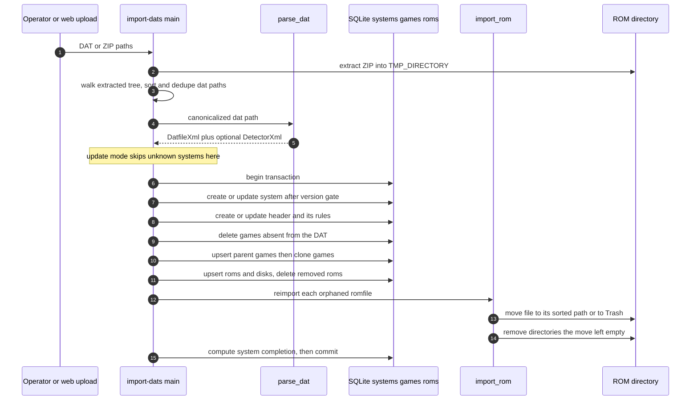

# Catalog Ingestion: DATs, Headers and Downloads

oxyromon only knows what a ROM *should* be from a catalog. Three subcommands put a
catalog in the database — `import-dats` (a DAT or ZIP of DATs on disk),
`download-dats` (Redump over HTTP) and `create-dats` (your own files) — and two
more extend it with per-game catalogs: `import-irds` (PS3 JB folders) and
`import-patches` (BPS/IPS/xdelta against a specific ROM). Everything downstream —
`import-roms`, `sort-roms`, `check-roms`, the web UI — reads the rows these create.

Provider identities, the Redump system-code catalogue and the naming tokens that
produce regions are covered in
[DAT Providers and Naming Conventions](../integrations/dat-providers-no-intro-redump.md);
this page covers the ingest mechanics and the file-system consequences of updating
a catalog.

## Entry points

`import-dats`, `download-dats`, `create-dats`, `import-irds` and
`import-patches` are ordinary clap subcommands registered in
[`src/main.rs`](../../src/main.rs#L69-L170); each runs on the single CLI
connection inside one scope, so nothing here holds a pool of its own.

`import-dats` takes one or more `<DATS>` arguments plus
`-i/--info`, `-u/--update`, `-s/--skip-header`, `-f/--force`, `-n/--name` and
`-e/--extension` ([src/import_dats.rs](../../src/import_dats.rs#L42-L103),
[README](../../README.md#L312-L352)). Its first act is to split the argument list
on the file extension: everything ending in `zip` is extracted into a temporary
directory created **under the configured `TMP_DIRECTORY`**, and the extracted tree
is walked with `WalkDir` to collect every `.dat`, at any depth
([src/import_dats.rs](../../src/import_dats.rs#L110-L143),
[src/util.rs](../../src/util.rs#L201-L205)). A No-Intro dat-o-matic pack — a ZIP
whose DATs live in per-platform subdirectories — is therefore a single argument.
Because every ZIP on the command line is extracted into that *same* temporary
directory and re-walked, overlapping packs yield the same path more than once; the
list is sorted and de-duplicated before the per-DAT loop so such a DAT imports only
once.

The DAT itself is deserialized with `quick_xml` into `DatfileXml`, whose `game`
and `machine` elements share the `GameXml` type
([src/model.rs](../../src/model.rs#L188-L284)). A DAT made of `<machine>` entries
is arcade, and so is any DAT imported with `-a/--arcade`: `import_dat` passes
`arcade || !datfile_xml.machines.is_empty()` to `create_or_update_system`, which
writes `systems.arcade` and returns the value it settled on. A plain update keeps
a system arcade once it is (`arcade || system.arcade`), while a forced import
applies the flag as given, the same rule custom names follow. That settled
boolean suppresses name-based region parsing for the whole import
([src/import_dats.rs](../../src/import_dats.rs#L319-L408),
[src/import_dats.rs](../../src/import_dats.rs#L464-L514),
[src/import_dats.rs](../../src/import_dats.rs#L553-L563)). That is the only place
console and arcade diverge during ingest.

The flag exists for DATs that list `<game>` entries but describe arcade sets, such
as FBNeo's. `romof` or `cloneof` cannot stand in for detection: FBNeo's console
DATs carry `romof` too, and No-Intro parent/clone DATs carry `cloneof`.
`test_dat_arcade` pins the flag, the sticky update and the forced revert.

## Header definitions and the embedded fallback

Some systems' catalogs describe headerless ROMs while the files on disk carry a
header, so a DAT can point at a *detector* file:

```rust
#[derive(RustEmbed)]
#[folder = "data/"]
struct Assets;
```

`parse_dat` looks for the first `<clrmamepro>` element that actually carries a
`header` attribute — a DAT may list several `clrmamepro` elements and most of them
have none — and, unless `-s/--skip-header` was passed, resolves that file name
first as a sibling of the DAT, then as a member of the `data/` directory compiled
into the binary by `rust-embed`
([src/import_dats.rs](../../src/import_dats.rs#L283-L306),
[`data/No-Intro_NES.xml`](../../data/No-Intro_NES.xml)). That fallback is what
makes a bare No-Intro NES DAT importable without downloading `No-Intro_NES.xml`
by hand; the README states the rule as "if not provided, oxyromon will use its own
fallback header definition". Note the asymmetry in failure handling: a sibling
file that fails to parse and an unknown embedded name both `unwrap`, so a
*malformed* header definition is a panic, not a warning.

The detector's XML shape matters because it is what later lets a file match:
`rule/@start_offset` becomes `headers.size` and each `<data>` element becomes a
`rules` row, both parsed as **hexadecimal**
([src/model.rs](../../src/model.rs#L286-L306),
[src/database.rs](../../src/database.rs#L2985-L3068)). At hash time
`get_file_and_header_size` reads that many bytes, checks every rule's magic at its
offset, and either advances past the header or rewinds to hash the file whole
([src/common.rs](../../src/common.rs#L575-L607)). Persisting a header is
idempotent per system: `create_or_update_header` updates the existing row and
deletes then re-inserts its rules, so a DAT revision never accumulates stale rules
([src/import_dats.rs](../../src/import_dats.rs#L492-L508)).

`download-dats` passes `skip_header = true` when it parses a fetched Redump DAT:
the ZIP carries only the DAT, so there is no header file to resolve
([src/download_dats.rs](../../src/download_dats.rs#L480-L490)).

## Version gating and the flags that bypass it

`is_update` is a plain lexicographic `new_version.cmp(old_version)` that prints its
verdict and returns `true` only for `Greater`
([src/util.rs](../../src/util.rs#L393-L420)). `create_or_update_system` calls it for
an existing system and, unless `-f/--force` is set, returns `None` — which makes
`import_dat` return `Ok(None)` **before touching games, roms or files**
([src/import_dats.rs](../../src/import_dats.rs#L453-L490)). Providers publish
fixed-width date stamps (`20200721`) precisely so this comparison is correct;
`create-dats` follows the same convention (below). The two sides are pinned by
`test_dat_outdated_should_do_nothing` (6 games survive an older DAT) and
`test_dat_outdated_forced` (the same DAT with `force` replaces them).

The remaining flags gate different things and are checked at different points:

- **`-i/--info`** runs the full parse — including header resolution and all the
  `System:` / `Version:` / `Games:` printing — and skips only the `import_dat`
  call. Nothing is written
  ([src/import_dats.rs](../../src/import_dats.rs#L220-L232)).
- **`-u/--update`** inverts the default for unknown systems: instead of creating
  one, the DAT is skipped with `Skipping unknown system` after parsing and before
  any write ([src/import_dats.rs](../../src/import_dats.rs#L189-L200),
  [`test_zip_update_unknown_system.rs`](../../src/import_dats/test_zip_update_unknown_system.rs)).
  Combined with a dat-o-matic pack this is the "refresh everything I already have"
  workflow; `test_zip_update_known_system` shows the other half, where a known
  system moves `20200721` → `20210401` and its catalog shrinks to the new DAT's 3
  games.
- **`-n/--name` / `-e/--extension`** are refused (`conflicts_with("UPDATE")`)
  whenever `-u` is present, require a *single* DAT, and `-n` additionally refuses
  a name that already exists in the database
  ([src/import_dats.rs](../../src/import_dats.rs#L85-L102),
  [src/import_dats.rs](../../src/import_dats.rs#L147-L172)). They write
  `systems.custom_name` / `systems.custom_extension` — the catalog name stays in
  `systems.name` and keeps being the match key — and `-e` further refuses any game
  with more than one ROM or disk, since one extension cannot describe a multi-file
  set ([src/import_dats.rs](../../src/import_dats.rs#L202-L218),
  [`test_dat_custom_name.rs`](../../src/import_dats/test_dat_custom_name.rs)).
  Both are *replaced*, not merged: re-importing the same DAT with `-f` and no
  `--name` clears `custom_name` back to `NULL`
  ([`test_dat_custom_name_revert.rs`](../../src/import_dats/test_dat_custom_name_revert.rs)).

Nothing between these flags softens errors: `parse_dat` and `import_dat` are both
awaited with `?` inside the loop, so a malformed DAT aborts the remaining arguments
too. Only the version gate and the update-mode skip are per-DAT
([src/import_dats.rs](../../src/import_dats.rs#L182-L232)).

## Upsert order inside one transaction

`import_dat` opens a single SQLite transaction and works in a fixed order; the
order is load-bearing because the parent/clone and merge passes read rows the
earlier passes wrote ([src/import_dats.rs](../../src/import_dats.rs#L309-L418)):



*Figure: a DAT import, from argument to committed catalog and relocated files.*

Deleting before inserting is deliberate. `delete_old_games` collects every existing
game whose name is absent from the DAT and returns the `romfile_id`s those games'
non-parent roms held; `delete_old_roms` does the same per surviving game
([src/import_dats.rs](../../src/import_dats.rs#L833-L878)). Because
`roms.romfile_id` is `ON DELETE SET NULL`, dropping the rows detaches the files
without deleting them ([`create_roms.sql`](../../migrations/20210323000005_create_roms.sql#L1-L16)),
and the collected ids are what the reconciliation pass below consumes. Identity is
the natural key everywhere — `games UNIQUE (name, system_id)`,
`roms UNIQUE (name, game_id)` — so "update in place" is expressed as
find-by-name-then-update-or-create rather than an SQL upsert.

**Parents before clones.** `create_or_update_games` partitions the DAT entries into
those with neither `cloneof` nor `romof` and the rest, imports the first group
wholesale, then loops: each round drains the children whose parent name is now
known and re-runs the pass
([src/import_dats.rs](../../src/import_dats.rs#L510-L735)). A round that drains
nothing means no child can ever resolve, so every remaining one is reported as
`Game "..." has an invalid parent: "..."` and the loop breaks rather than spinning.
`romof` is resolved twice, once as a normal parent (`games.parent_id`) and once as a
BIOS (`games.bios_id`), because arcade DATs use it for both
([src/import_dats.rs](../../src/import_dats.rs#L635-L655)).

**Per-file merging** comes from the Logiqx `merge` attribute: import searches the
clone's own BIOS, its parent and its parent's BIOS for a rom with the same size and
CRC, records the hit as `roms.parent_id`, and inherits `roms.bios` from the source
rom; a miss prints `please fix your DAT file` and imports the rom as exclusive
([src/import_dats.rs](../../src/import_dats.rs#L746-L831)). Two adjacent details
shape later behaviour: roms with `status="nodump"` are skipped entirely, and
`roms.original` is false when the DAT's file name carries an extension in
`NON_ORIGINAL_EXTENSIONS` (chd, cso, nsz, rvz, wua, wux, zso, 7z, zip)
([src/mimetype.rs](../../src/mimetype.rs#L40-L49),
[`test_dat_as_is.rs`](../../src/import_dats/test_dat_as_is.rs)). Hashes are
lower-cased on write so a provider's upper-case CRC still matches a computed one.
See [Arcade Rebuilds and M3U Playlists](./arcade-rebuild-and-playlists.md) for how
`parent_id` / `bios` are later re-cut along merging strategies.

Regions are computed from the game name with `shiratsu-naming`, No-Intro first and
TOSEC as a fallback; a name the parser rejects is a **per-game** skip with a warning,
not an import failure ([src/import_dats.rs](../../src/import_dats.rs#L420-L451),
[`test_regions_world.rs`](../../src/import_dats/test_regions_world.rs)).

## Reconciling on-disk romfiles

The part that reaches outside the database: a DAT revision can change a rom's size
or CRC, or drop it entirely. `create_or_update_roms` detects the first case while
updating — a mismatch between the new and stored size/CRC drops `roms.romfile_id`
and queues the old `romfile_id` as an orphan
([src/import_dats.rs](../../src/import_dats.rs#L802-L809)); the second case comes
from `delete_old_games` / `delete_old_roms`. So an orphan is a physical file whose
catalog description no longer holds.

`reimport_orphan_romfiles` runs, still inside the same transaction, once all rows
are settled ([src/import_dats.rs](../../src/import_dats.rs#L880-L935)):

1. delete the `romfiles` row (the path it records may be about to change), then
2. hand the file back to `import_rom` with a fixed unattended policy
   (`UnattendedMode::Skip`): it re-hashes, re-matches against the *new* catalog and
   moves to the sorted path it now belongs to; or
3. if nothing matched, move it into the system's `Trash` directory and record it
   again as a romfile there.

Every directory a file leaves behind is remembered in a `HashSet`, and afterwards
`remove_empty_directories` climbs from each one while `get_kept_directories`
shields the ROM directory, every system directory and every trash directory
([src/util.rs](../../src/util.rs#L278-L338)). Two invariants are visible in the
tests: after a rename, the abandoned `T` subfolder is gone while the system
directory itself remains
([`test_dat_updated_renamed_subfolder.rs`](../../src/import_dats/test_dat_updated_renamed_subfolder.rs));
and when the system directory is read-only so the subdirectory *cannot* be deleted,
the failure is demoted to a warning — the moves above already happened and must not
be undone or abort the import
([`test_dat_updated_undeletable_subfolder.rs`](../../src/import_dats/test_dat_updated_undeletable_subfolder.rs)).
Directory cleanup is cosmetic; catalog and file placement are not.

Finally `import_dat` recomputes completion for every game and the system before
committing ([src/import_dats.rs](../../src/import_dats.rs#L403-L417),
[src/util.rs](../../src/util.rs#L459-L492)). The two path lookups just above it are
labelled "create necessary directories" but `get_system_directory` and
`get_trash_directory` only compute paths; the directories themselves are created on
demand by `rename_file`, which makes a move's parent before renaming and falls back
to copy+remove when the rename fails across filesystems
([src/util.rs](../../src/util.rs#L123-L151),
[src/util.rs](../../src/util.rs#L230-L289)). `import-irds` uses the same
`compute_system_completion` tail but no version gate; `import-dats`' transaction
means an aborted DAT leaves neither rows nor half-relinked files behind — though,
as ever with SQLite, files already moved on disk are not rolled back, which is why
the moves happen as late as they do.

## download-dats: fetch straight into the same importer

`download_redump_dat` is a thin transport wrapper over the two primitives above:
`GET {base}/datfile/{code}/` into memory, `ZipArchive` over the bytes, extraction
into a `TempDir` under `TMP_DIRECTORY`, `parse_dat(..., skip_header = true)`,
`import_dat(..., None, None, force)`
([src/download_dats.rs](../../src/download_dats.rs#L414-L500)). It returns
`Imported` or `UpToDate` from `import_dat`'s summary, so callers can tell a
refreshed system from one the version gate skipped. A few operational details
follow from that shape:

- The ZIP must contain **exactly one** file; zero or many is an error, as are an
  unreachable host and an HTTP error status, and none of them touch the database.
- Every surface loops through `collect_redump_dats`, which reports a failed
  system, carries on with the next, and returns per-system `imported`,
  `up_to_date` and `failed` lists. The CLI's `download_redump_batch` then fails
  the run at the end naming every failure.
- `-s/--save <DIRECTORY>` copies the extracted `.dat` (not the ZIP) to a directory
  created on demand, and is the only way to keep a fetched DAT — the `TempDir` is
  dropped when the fetch returns.
- Pacing is one `sleep(1s)` after every system, failures included. `-f/--force`
  reaches only the update path; a fresh download always passes `force = false`.

`create-dats` closes the loop in the other direction: it walks a directory, emits
one `<game>` per file with size, CRC32, MD5 and SHA1, writes the Logiqx DOCTYPE
header, and names the output `<directory> (<version>).dat` with the version
defaulting to the creation timestamp `YYYYMMDD-HHMMSS`
([src/create_dats.rs](../../src/create_dats.rs#L121-L253)). `rom_xml` reads each
file once and feeds the three digests together. The Wii U shapes are exceptions to
"one game per file". A `.wux` is listed as the `.iso` it holds, as Redump names a
disc, hashed as `wux_rs::Image` decompresses it. A lossless `.wua` is listed as its
`.iso` too, from the size and hashes its disc info keeps, so nothing is read. The
DAT therefore matches the disc in every format. A
subdirectory holding a NUS title's TMD becomes one game named after the folder,
whose ROMs are its files, the way No-Intro's CDN DAT lists updates and DLC; the
walk then skips that folder, and it skips `.update-partitions` stores altogether.
`create_dats/test_wux_and_nus.rs` and `create_dats/test_wua.rs` cover these. The
DAT file is flushed before `create_dat` returns, which fixed DATs sometimes being
cut short. The timestamp default is
what makes a self-made catalog pass the lexicographic gate on the next regeneration
rather than being skipped as older; the round trip (create then import) is exercised
by [`create_dats/test_dat.rs`](../../src/create_dats/test_dat.rs).

## Catalog entries that are not DATs

**IRD files** are a per-game catalog for extracted PS3 ISOs. `import_ird` walks the
ISO 9660 header embedded in the IRD, refuses the file if the entry count disagrees
with the IRD's own count, then upserts one child `roms` row per disc file — named by
its path inside the image, hashed with the IRD's MD5, parented to the chosen disc
ROM — and marks `games.jbfolder = true`
([src/import_irds.rs](../../src/import_irds.rs#L368-L459)). When a child's recorded
size or MD5 changes, its romfile is orphaned and the *same*
`reimport_orphan_romfiles` used by DAT updates re-homes or trashes it, so JB-folder
maintenance obeys the same Trash and empty-directory rules as a DAT revision. An IRD
needs an existing catalog: `import-irds` picks the game from
`find_wanted_games_by_system_id`, and unattended mode (`--system`) bails with
`import its DAT first` on an empty system, resolves the game only when exactly one
name matches after `title_key` strips tags and punctuation, and skips a game already
flagged `jbfolder` unless `-f`
([src/import_irds.rs](../../src/import_irds.rs#L61-L156),
[src/import_irds.rs](../../src/import_irds.rs#L162-L197)). Only IRD version 9 is
accepted; anything else warns and continues
([src/import_irds.rs](../../src/import_irds.rs#L115-L118)).

**Patches** attach to a specific ROM rather than to a system. `parse_patch`
identifies BPS, IPS and xdelta by magic bytes via the shared `infer` matcher, and
`import_patch` moves the file next to the target ROM — into the `1G1R` directory
when that game's sorting says so — recording a `patches` row plus a `romfiles` row
([src/import_patches.rs](../../src/import_patches.rs#L94-L240)). Since several
patches can share a ROM, the target path reuses the ROM's base name with the patch
extension plus an index suffix (`foo.ips1` when one patch exists), and
`patches UNIQUE (name, rom_id)` is enforced instead by an explicit name check that
skips unless `-f` re-imports over the top
([`test_bps_ips.rs`](../../src/import_patches/test_bps_ips.rs)). `sort-roms`
knows about this coupling and relocates a game's patch files alongside the ROM they
patch ([src/sort_roms.rs](../../src/sort_roms.rs#L243-L246),
[src/sort_roms.rs](../../src/sort_roms.rs#L683-L704)). Cataloging a patch does not
apply it — application is not wired up yet.

## Server and MCP surfaces

The web upload path does not shell out to the CLI; it calls
`process_dat_upload`, which mirrors `import-dats` with a smaller surface: ZIP-or-file,
`update` and `arcade` flags, header parsing always enabled, `force` always false,
and a typed result the SSE bridge turns into a toast
([src/import_dats.rs](../../src/import_dats.rs#L961-L1065),
[src/server.rs](../../src/server.rs#L204),
[src/server.rs](../../src/server.rs#L1005-L1046)). `ImportDatResult::Skipped` (update
mode, unknown system) is filtered out of the result vector, while
`ImportDatResult::UpToDate` surfaces as a `skipped: true` completion — so a version
gate that produced *no write at all* is still reported to the user. `ImportSummary`
carries the system name, version and game count for the success case.

The MCP `import_dats` tool takes the opposite route: it rebuilds an argv and calls
the same clap `subcommand()` and `main()` the CLI uses, so the agent-facing tool and
the terminal command cannot drift apart; `--update` and `--arcade` are the only
flags it can convey ([src/mcp/write.rs](../../src/mcp/write.rs#L61-L105)). Patch uploads go
through `parse_patch` / `import_patch` directly with a `--rom`-style id, skipping the
prompts the CLI would otherwise need
([src/server.rs](../../src/server.rs#L408-L459)).

## What the tests pin

`src/import_dats/` is organized one scenario per file, and the split tells you where
the risk is: ZIP handling (`test_zip_nested`, the two `test_zip_update_*`), headers
(`test_dat_headered`, `..._embedded`, `..._duplicate_clrmamepro`,
`..._skipped_header`), the version gate (outdated / outdated-forced), arcade shape
(`test_dat_mame`, `test_dat_mame_chd`, `test_dat_mame_mixed` — the last one checks a
`<machine>` with both a `<rom>` and a `<disk>`), parent/clone linking, and a large
family of `test_dat_updated_*` files that all follow the same choreography: import a
DAT, `import_rom` a real file, import a newer DAT, then assert where the file ended
up and whether the directory it left behind still exists. The fixture DATs live in
`tests/` and are named by version and variation, e.g.
`tests/Test System (20200721).dat` and
`Test System (20200723) (Changed Hashes).dat`.
