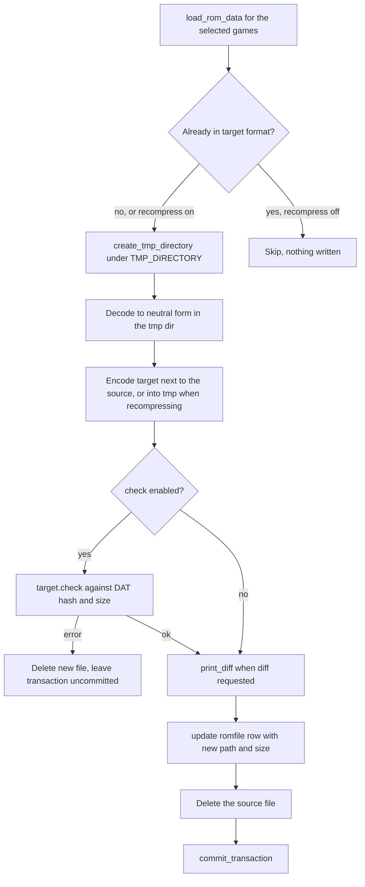

# Format Conversion and Export

Two subcommands share the same format plumbing and produce very different side
effects:

- **`convert-roms`** rewrites the library in place — new file next to the old
  one, old file deleted, `romfiles` row updated — and is also the engine behind
  `import-roms` auto-conversion
  ([src/convert_roms.rs](../../src/convert_roms.rs#L134-L386)).
- **`export-roms`** writes copies into a required `-d/--directory` and touches
  neither the originals nor the database, which is what makes lossy targets safe
  ([src/export_roms.rs](../../src/export_roms.rs#L105-L149),
  [README](../../README.md#L630-L646)).

Both are plain clap subcommands registered in
[`src/main.rs`](../../src/main.rs#L69-L98) and dispatched on the single CLI
connection ([src/main.rs](../../src/main.rs#L153-L156)).

## The conversion matrix

| Format | `convert-roms` | `export-roms` | Source formats accepted |
| --- | --- | --- | --- |
| `ORIGINAL` | ✔ | ✔ | 7z/ZIP archives, CHD, CSO, ZSO, NSZ, RVZ |
| `7Z` / `ZIP` | ✔ | ✔ | loose files, CHD, CSO, ZSO, NSZ, RVZ, the other archive type |
| `CHD` | ✔ | ✔ | ISO, CUE/BIN, CSO, ZSO, RDSK, RIFF, CHD (`--recompress`) |
| `CSO` / `ZSO` | ✔ | ✔ | ISO, DVD CHD, the opposite XSO type |
| `RVZ` | ✔ | ✔ | ISO, RVZ (`--recompress`) |
| `NSZ` | ✔ | ✔ | NSP |
| `ISO` | ✖ | ✔ | ISO (copy), CUE/BIN, CD/DVD CHD |
| `GDI` | ✖ | ✔ | CUE/BIN (loose or archived), GDI (copy), CD CHD |
| `WBFS` | ✖ | ✔ | ISO, RVZ |

`convert_roms::ALL_FORMATS` is
`ORIGINAL, 7Z, CHD, CSO, NSZ, RVZ, ZIP, ZSO`; `export_roms` keeps its own
private list that adds `GDI`, `ISO` and `WBFS`
([src/convert_roms.rs](../../src/convert_roms.rs#L27-L28),
[src/export_roms.rs](../../src/export_roms.rs#L30-L33)). Those three are
**export-only** because they are one-way: `ISO` throws away every track but the
first (a bchunk port for Open PS2 Loader, [src/iso.rs](../../src/iso.rs#L1-L12)),
`GDI` is a Dreamcast-only encoding, and `WBFS` has no decoder path in this code
base. Since `config`'s choice list for `PREFER_FORMAT` is literally
`convert_roms::ALL_FORMATS` ([src/config.rs](../../src/config.rs#L72-L84)),
`ISO`, `GDI` and `WBFS` can never become an auto-conversion target, and the
GraphQL `PreferFormatValidator` rejects them too
([src/validator.rs](../../src/validator.rs#L33-L53)).

Both modules define `ARCADE_FORMATS = ["ORIGINAL", "ZIP"]`: arcade sets ship as
loose files or a single ZIP and nothing else.

## Gating: format availability and system support

Since CHD moved in-process to the `chd-rs` crate there is **no external-tool
probe anywhere in this pipeline**. `convert_roms::format_available` is a pure
string test over the eight built-in formats and returns false only for a format
outside that list; the caller treats a false as a **soft stop** — `main` returns
`Ok(())` before touching a system
([src/convert_roms.rs](../../src/convert_roms.rs#L36-L42),
[src/convert_roms.rs](../../src/convert_roms.rs#L363-L365)). In practice clap's
`PossibleValuesParser` rejects an unknown `--format` before `main` ever runs, so
this gate exists for programmatic callers. `export_roms::main` repeats the same
inline table and `bail!("Not supported")` on an unknown format
([src/export_roms.rs](../../src/export_roms.rs#L109-L114)).

`format_available` is called twice on the CLI path: once in `main` before the
system loop and again inside `convert_system`. The second call is what protects
`import-roms`, whose auto-conversion pass enters through `convert_system` and
never runs `main`
([src/convert_roms.rs](../../src/convert_roms.rs#L144-L146)).

The remaining gates:

- **Arcade systems**: `format_supported_for_system(system, format)` returns
  false for anything outside `ARCADE_FORMATS` when `system.arcade`.
  `convert_system` turns that into a warning and an early return; the same
  function is reused by the three validated `PREFER_FORMAT` writers —
  `config::set_setting`, the GraphQL `set_prefer_format` mutation, and the MCP
  tool — so a format the converter would refuse can never be stored through a
  validated surface
  ([src/convert_roms.rs](../../src/convert_roms.rs#L30-L34),
  [src/config.rs](../../src/config.rs#L381-L400),
  [src/mutation.rs](../../src/mutation.rs#L171-L191),
  [src/mcp/write.rs](../../src/mcp/write.rs#L361-L417)).
- **GDI** additionally requires the system name to contain `Dreamcast`
  ([src/export_roms.rs](../../src/export_roms.rs#L119-L133)).

The Dreamcast and split-bin **minimum-`chdman`-version gates are gone**. They
existed only because `chdman` 0.264 and 0.265 were the first releases with those
features; with the crate linked in, the capability is always present, and
multi-track CD CHDs are handled unconditionally by `extract_cd`'s `%t` split
naming ([CHANGELOG.md](../../CHANGELOG.md#L15),
[src/chd.rs](../../src/chd.rs#L418-L467)).

## `ConvertOpts` and `convert_system`: the shared entry

```rust
pub struct ConvertOpts {
    pub recompress: bool,
    pub diff: bool,
    pub check: bool,
    pub prompt_for_parents: bool,
}
```

`convert_system(connection, progress_bar, system, format, games, opts)` is the
only conversion entry a caller other than the CLI uses. It prints the system
header, runs the two gates, loads rom data, then dispatches on the format string
after reading the **per-system** settings for `system.id`
([src/convert_roms.rs](../../src/convert_roms.rs#L134-L337)). Two callers exist:

- `convert-roms` builds the struct from `-r/--recompress`, `-d/--diff`,
  `-c/--check` and `-p/--parents`, resolves systems via `-s`/`-a` (prompting
  otherwise), prompts for the format when `-f` is absent, and with `-S/--save`
  writes the format straight into `PREFER_FORMAT` for every processed system
  ([src/convert_roms.rs](../../src/convert_roms.rs#L339-L386)).
- `import_roms::auto_convert` groups the games imported in that run by system,
  reads `PREFER_FORMAT`, and calls `convert_system` with
  `recompress: false, diff: false, check: true, prompt_for_parents: false`.
  Conversion errors are caught and downgraded to
  `Auto-conversion to {format} failed: …`, so a failed conversion never rolls
  back a completed import — the ROM simply stays in the format it arrived in
  ([src/import_roms.rs](../../src/import_roms.rs#L353-L398)).

`--save` writes with the raw `config::set_string`, **not** through the
validated `set_setting` path, so the arcade check above does not apply to it —
though the format itself is already confined to `ALL_FORMATS` by clap
([src/convert_roms.rs](../../src/convert_roms.rs#L380-L382),
[src/config.rs](../../src/config.rs#L600-L607)).

The MCP `convert_roms` tool does not call `convert_system` directly; it
reconstructs a `convert-roms` argv (`--system`, `--format`) and runs
`convert_roms::main` inside the job runner, which is why MCP conversions never
carry `--recompress`, `--check` or `--save`
([src/mcp/write.rs](../../src/mcp/write.rs#L361-L417)).

`convert_system` loads roms with `load_rom_data(.., true)`, i.e. only rows with
`original = true`, while `export_roms` passes `false` and therefore also exports
roms a DAT marks as non-original
([src/common.rs](../../src/common.rs#L57-L96)).

## Settings read per system at conversion time

Everything is fetched with `Some(system.id)`, so a system override wins over the
global row ([Settings and Configuration](../architecture/settings-and-configuration.md)):

| Target | Keys |
| --- | --- |
| `7Z` | `SEVENZIP_COMPRESSION_ALGORITHM`, `SEVENZIP_COMPRESSION_LEVEL` / `SEVENZIP_ZSTD_COMPRESSION_LEVEL`, `SEVENZIP_SOLID_COMPRESSION` |
| `ZIP` | `ZIP_COMPRESSION_ALGORITHM`, `ZIP_COMPRESSION_LEVEL` / `ZIP_ZSTD_COMPRESSION_LEVEL` (solid is hard-coded `false`) |
| `CHD` | `CHD_CD/DVD/HD/LD_COMPRESSION_ALGORITHMS`, `CHD_CD/DVD/HD/LD_HUNK_SIZE`, `CHD_PARENTS` |
| `RVZ` | `RVZ_COMPRESSION_ALGORITHM`, `RVZ_COMPRESSION_LEVEL`, `RVZ_BLOCK_SIZE`, plus `RVZ_SCRUB` in `export_roms` only |
| `CSO`, `ZSO`, `NSZ`, `ORIGINAL` | none |

`archive::get_archive_compression` maps an archive type onto its
(algorithm, zstd-level, level) key triple and returns an `ArchiveCompression`
carrying the level on that algorithm's own scale, falling back to
`ArchiveCompression::Default` when the algorithm key is unset
([src/archive.rs](../../src/archive.rs#L57-L94)). Note that the `solid` flag is
threaded through `ToArchive` but ignored by the writer — entries are added one
at a time, with a `TODO` to batch a game's files into one solid block
([src/archive.rs](../../src/archive.rs#L585-L595)).

## One conversion, start to finish

Every branch in `convert_roms` follows the same decode → encode → verify →
commit shape. The decoders live in `src/transcode.rs` and all return a
`Decoded<T> { source, inner }` pair: the romfile the roms currently point at,
and the neutral artefact (ISO, CUE/BIN set, NSP) written into a fresh
`create_tmp_directory` under `TMP_DIRECTORY`
([src/transcode.rs](../../src/transcode.rs#L15-L150),
[src/util.rs](../../src/util.rs#L200-L204)).



*Figure: the shared skeleton of a single `convert-roms` conversion.*

The pieces of that skeleton, and the invariants they carry:

- **Transaction per game.** `begin_transaction` is taken around each game (each
  CHD, each archive), and `commit_transaction` only runs on the success path. A
  `continue` after a skipped or failed conversion drops the transaction, so the
  `romfiles`/`roms` rows revert while any file already written has been deleted
  explicitly by the branch
  ([src/database.rs](../../src/database.rs#L74-L92)).
- **`check_and_persist`** is the generic distillation of the tail: on a
  `Check` error it prints `Integrity check failed, reverting conversion`,
  deletes the newly written file and returns `false`, leaving the caller to skip
  the commit; on success it optionally prints the diff, then either
  `update`s the row and deletes the source, or — with
  `rename_to_source = true`, used by the recompression paths that keep the
  original filename — deletes the source first and renames the new file onto
  the old path before updating
  ([src/convert_roms.rs](../../src/convert_roms.rs#L1887-L1939)).
- **Checking means decoding.** `Check` for a CHD, XSO or archive wrapper
  extracts into a tmp directory and hashes the extracted bytes against the DAT's
  expected hash and size
  ([src/chd.rs](../../src/chd.rs#L232-L277),
  [src/xso.rs](../../src/xso.rs#L72-L89),
  [src/archive.rs](../../src/archive.rs#L217-L236),
  [src/common.rs](../../src/common.rs#L674-L706)). RVZ is the exception: with no
  DAT header in play it hashes the disc in place and only falls back to an ISO
  extraction when a header exists
  ([src/rvz.rs](../../src/rvz.rs#L69-L98)). Nothing here moves files to `Trash`;
  a failed conversion's output is deleted outright, and the library's own
  corrupt-file handling stays in
  [Integrity Check and Purge](integrity-check-and-purge.md).
- **The row keeps its identity.** `Persist::update` rewrites `romfiles.path`
  and `romfiles.size` for the *same* id, so every `roms.romfile_id` continues to
  point at the converted file without being touched — except when a multi-file
  game collapses into one archive or one CHD, where the code creates (or
  reuses, via `find_romfile_by_path`) a single row and re-points each rom with
  `update_rom_romfile` before deleting the old rows
  ([src/common.rs](../../src/common.rs#L708-L737),
  [src/convert_roms.rs](../../src/convert_roms.rs#L1163-L1198)).
- **`print_diff` normalizes against the DAT, not the old file.** `Before` and
  `After` are printed as percentages of `sum(rom.size)` — the expected sizes of
  the logical ROMs — so converting an already-compressed CSO to CHD still shows
  both sides relative to the uncompressed original
  ([src/convert_roms.rs](../../src/convert_roms.rs#L2863-L2891)).

## CHD: created and extracted through chd-rs

`src/chdman.rs` no longer exists. Every CHD write goes through one helper,
`create_chd`, which opens no subprocess: it packs the configured codec names
into the header's four slots and calls `chd_rs::create_cd` / `create_dvd` /
`create_hd` / `create_ld` inside `run_blocking`, so the synchronous crate runs
on the blocking pool while the caller's progress bar becomes a byte bar fed by
the crate's progress callback
([src/chd.rs](../../src/chd.rs#L683-L794),
[src/progress.rs](../../src/progress.rs#L72-L97)). The CD denominator is
`chd_rs::cd_input_size` (the bytes the sheet names), every other type uses the
input file's length.

Extraction is symmetrical: `extract_chd` opens the CHD on the blocking pool
(`Chd::open` or `Chd::open_with_parent` when the database records a parent),
then runs `chd_rs::extract_cd` for CDs, `chd_rs::extract_ld` for LaserDiscs, and
`Chd::extract` for DVDs and hard disks
([src/chd.rs](../../src/chd.rs#L796-L874)).

The durable invariants that came with the crate:

- **Outputs are staged as `<output>.part` and renamed into place only on
  success**; a failed run deletes the part file and leaves nothing behind. This
  holds for `write_part`, `Chd::extract`, `extract_cd` (every sheet and BIN) and
  `extract_ld`
  ([crates/chd-rs/src/writer.rs](../../crates/chd-rs/src/writer.rs#L149-L191),
  [crates/chd-rs/src/container.rs](../../crates/chd-rs/src/container.rs#L756-L782),
  [crates/chd-rs/src/extract.rs](../../crates/chd-rs/src/extract.rs#L421-L447),
  [crates/chd-rs/src/ld.rs](../../crates/chd-rs/src/ld.rs#L343-L360)).
- **chdman's default codec lists are reproduced, not reinterpreted.** When the
  configured list is empty, `create_chd` substitutes `cdlz, cdzl, cdfl` for a
  CD, `avhu` for a LaserDisc, and `lzma, zlib, huff, flac` for DVDs and hard
  disks ([src/chd.rs](../../src/chd.rs#L716-L728)). A lone `none` becomes four
  zero slots — an uncompressed CHD — rather than a `"none"` fourcc, and more
  than four names is a hard error
  ([src/chd.rs](../../src/chd.rs#L876-L894)).
- **chdman's default hunk sizes too.** LaserDiscs short-circuit first (one
  video field a hunk); otherwise an unset hunk size takes the parent CHD's, and
  failing that `8 * CD_FRAME_SIZE` (19584) for CDs and 4096 for everything else
  ([src/chd.rs](../../src/chd.rs#L740-L757)). So a clone created without an
  explicit `CHD_*_HUNK_SIZE` inherits its parent's hunk size. HD CHDs are always
  written with a 512-byte sector size
  ([src/chd.rs](../../src/chd.rs#L775-L784)).
- **Version reporting.** `chd::get_version()` returns the literal `built-in`,
  which is what `info`, the GraphQL `query` status and the MCP `status` tool
  print under the `chd-rs` name
  ([src/chd.rs](../../src/chd.rs#L896-L898),
  [src/info.rs](../../src/info.rs#L26-L37)). `util::tool_version` is gone: its
  last caller was `ctrtool::get_version`, and CIA import now runs on the
  in-process `cia-rs` crate, so no format shells out and nothing can print a
  missing-tool error
  ([src/cia.rs](../../src/cia.rs#L20-L22)).

## Per-target behaviour worth knowing

### `to_archive` (7Z and ZIP)

Partitions the loaded games by extension in a fixed order — CHD, CSO, NSZ, RVZ,
ZSO, archive, then everything else — and each partition is handled by its own
loop; the leftover loop is what packs plain loose files
([src/convert_roms.rs](../../src/convert_roms.rs#L403-L440),
[src/common.rs](../../src/common.rs#L98-L129)). Details:

- CHD games are sorted so **children convert before parents**, and a CHD that
  still has children is skipped (`CHD has children, skipping`). Converting a
  child clears its own `parent_id`, so by the time the parent's turn comes the
  guard is normally empty and it converts too; it only fires when a child could
  not be converted, protecting the child from losing its parent file
  ([src/convert_roms.rs](../../src/convert_roms.rs#L406-L416),
  [src/convert_roms.rs](../../src/convert_roms.rs#L456-L462)).
- Arcade CHDs are left untouched: any rom with `rom.disk` set skips the branch
  ([src/convert_roms.rs](../../src/convert_roms.rs#L442-L446)).
- `ChdType` drives the intermediate: `Cd` → CUE/BIN (the `.cue` is regenerated
  and each track archived separately), `Dvd` → ISO, `Hd` → RDSK, `Ld` → RIFF
  ([src/convert_roms.rs](../../src/convert_roms.rs#L464-L610)).
- Archive → archive: if the source archive type differs, the entries are
  re-packed into a new `<game name>.7z`/`.zip` and the old file deleted. If it
  is the same type, **nothing happens unless `recompress` is set**; when it is,
  the archive is rebuilt into the tmp directory and renamed over the original
  path. The two tests assert exactly that distinction through the file's mtime
  ([src/convert_roms.rs](../../src/convert_roms.rs#L961-L1050),
  [test_zip_to_zip_should_do_nothing.rs](../../src/convert_roms/test_zip_to_zip_should_do_nothing.rs#L66-L112),
  [test_zip_to_zip.rs](../../src/convert_roms/test_zip_to_zip.rs#L66-L112)).
- Multi-file games collapse: each loose file is added to one archive named
  after the game, and for arcade systems the archive is written one directory up
  (`directory.parent()`) and the now-empty set directory removed
  ([src/convert_roms.rs](../../src/convert_roms.rs#L1104-L1211)).

### `to_chd`

Partitions archives, CUE/BIN, ISO, CSO, ZSO and CHD; the leftovers are only
considered as RDSK/RIFF candidates (by mimetype) and otherwise skipped.
Archives are re-derived by extension and mimetype — an archive holding an ISO,
RDSK or RIFF picks the CD/HD/LD settings accordingly, anything else is skipped
as `Unsupported file type, skipping`
([src/convert_roms.rs](../../src/convert_roms.rs#L1241-L1362),
[convert_roms.rs](../../src/convert_roms.rs#L1645-L1700)).

Parent CHDs are chosen by `find_parent_chd`: `prompt_for_parents` (the `-p`
flag) prompts through `prompt_for_parent_romfile`, which lists the system's CHDs
that have no parent of their own sorted by jaro-winkler similarity to the game
name; otherwise `CHD_PARENTS` looks the parent up from the playlist —
`find_parent_chd_romfile_by_game` takes the first game of the game's playlist
and that game's CHD romfile; otherwise there is no parent
([src/convert_roms.rs](../../src/convert_roms.rs#L1860-L1875),
[src/prompt.rs](../../src/prompt.rs#L192-L231),
[src/util.rs](../../src/util.rs#L464-L494)). The resulting link is written with
`update_romfile_parent` after every successful conversion, and CHD-to-CHD
recompression only ever rewrites a child, never the parent —
`test_chd_parents_to_chd_should_not_touch_parent` asserts the parent's mtime is
unchanged while the child's moves forward
([src/convert_roms.rs](../../src/convert_roms.rs#L1725-L1755),
[test_chd_parents_to_chd_should_not_touch_parent.rs](../../src/convert_roms/test_chd_parents_to_chd_should_not_touch_parent.rs#L144-L211)).
`test_iso_to_chd_parents` pins the same playlist-driven link on the forward
ISO→CHD path
([test_iso_to_chd_parents.rs](../../src/convert_roms/test_iso_to_chd_parents.rs#L95-L131)).

CUE/BIN → CHD is the one branch that leaves two romfiles behind: the generated
`.cue` is renamed next to the source and kept as its own row, while every BIN
rom is re-pointed at the new CHD row
([src/convert_roms.rs](../../src/convert_roms.rs#L1481-L1557),
[test_multiple_tracks_cue_bin_to_chd.rs](../../src/convert_roms/test_multiple_tracks_cue_bin_to_chd.rs)).
More than one archive or more than one CHD inside a single game is a hard
failure: `bail!("Multiple archives found")` /
`bail!("Multiple CHDs found")`.

### `to_xso`, `to_nsz`, `to_rvz`

These accept only a narrow source set and silently ignore the rest by
`drop(others)`:

- `to_xso`: archives that contain a single ISO, loose ISOs, DVD CHDs, the
  opposite XSO type (CSO↔ZSO, always via a decoded ISO), and — only under
  `recompress` — the same XSO type, renamed back onto its own path
  ([src/convert_roms.rs](../../src/convert_roms.rs#L1941-L2170)). A CHD that
  still has children is skipped, and after a successful conversion its
  `parent_id` is cleared. A multi-track CD CHD is a no-op because
  `chd_to_iso` returns `None` for anything that is not a DVD CHD — that is what
  `test_multiple_tracks_chd_to_cso_should_do_nothing` pins
  ([src/transcode.rs](../../src/transcode.rs#L80-L99),
  [test_multiple_tracks_chd_to_cso_should_do_nothing.rs](../../src/convert_roms/test_multiple_tracks_chd_to_cso_should_do_nothing.rs#L71-L103)).
- `to_nsz`: NSPs and archives holding a single NSP; NSZ→NSZ only under
  `recompress`, in place
  ([src/convert_roms.rs](../../src/convert_roms.rs#L2172-L2291)).
- `to_rvz`: ISOs, archives holding a single ISO, and RVZs re-encoded under
  `recompress`. `convert_roms` always passes `scrub = false` and never reads
  `RVZ_SCRUB`
  ([src/convert_roms.rs](../../src/convert_roms.rs#L2293-L2437)).

### `to_original`

The only target whose signature takes nothing but `check` — `recompress` and
`diff` never reach it, and no branch prints a diff
([src/convert_roms.rs](../../src/convert_roms.rs#L2439-L2446),
[convert_roms.rs](../../src/convert_roms.rs#L2782-L2861)). It extracts archive
entries, unpacks CHDs according to `ChdType`, decodes CSO/ZSO→ISO, NSZ→NSP and
RVZ→ISO. Two behaviours stand out:

- Arcade systems get a directory: an extracted archive expands into a new
  directory named after the archive stem rather than into the parent directory
  ([src/convert_roms.rs](../../src/convert_roms.rs#L2509-L2527)).
- A multi-track CD CHD explodes into one row per track plus the `.cue`, which is
  the inverse of the CUE/BIN→CHD collapse
  ([src/convert_roms.rs](../../src/convert_roms.rs#L2614-L2683),
  [test_multiple_tracks_chd_to_cue_bin.rs](../../src/convert_roms/test_multiple_tracks_chd_to_cue_bin.rs#L70-L138)).

There is no "the tool disappeared mid-run" path any more: because CHD work is a
library call, a failure is an ordinary `Err` that propagates out of
`convert_system` (and, on the import path, is reported as a failed
auto-conversion) rather than a `break` out of one loop.

## `export-roms`: copies only

`-d/--directory` is the one required flag; it is canonicalized (so it must
already exist) and created before any work, and `-o/--1g1r` filters the
selection down to games whose `games.sorting` is `Sorting::OneRegion`
([src/export_roms.rs](../../src/export_roms.rs#L105-L146),
[src/util.rs](../../src/util.rs#L28-L36),
[src/model.rs](../../src/model.rs#L61-L68)).

Every `to_*` function takes a `destination_directory` and returns after writing
files. There are **no transactions, no `Persist` calls and no `Check` calls**
anywhere in the module: the database is read-only for the whole command, and the
ROM directory is never written to
([src/export_roms.rs](../../src/export_roms.rs#L81-L332)).

Already-in-format sources are copied rather than re-encoded, which is the
export-side analogue of the `recompress` rule:

| Source | Export behaviour |
| --- | --- |
| ZIP → ZIP, 7z → 7z | `copy_file` of the archive |
| CHD → CHD | `copy_file` of the CHD |
| CSO/ZSO → CSO/ZSO | `copy_file`, either subtype to either target |
| RVZ → RVZ | copy; re-encode through a temp ISO only when `scrub` is on |
| ISO → ISO | `copy_file` |
| GDI set → GDI | GDI file plus every track file copied |
| multi-track CD CHD → CSO/ZSO | **no file written** |

([src/export_roms.rs](../../src/export_roms.rs#L582-L604),
[#L926-L955](../../src/export_roms.rs#L926-L955),
[#L1033-L1045](../../src/export_roms.rs#L1033-L1045),
[#L1344-L1378](../../src/export_roms.rs#L1344-L1378),
[#L1615-L1632](../../src/export_roms.rs#L1615-L1632),
[#L1176-L1218](../../src/export_roms.rs#L1176-L1218))

The CD-CHD-to-XSO row is deliberate, not a gap: the same non-DVD `chd_to_iso`
guard that makes it a no-op in `convert-roms` applies here, and
`test_multiple_tracks_chd_to_cso_should_do_nothing` /
`test_multiple_tracks_chd_to_zso_should_do_nothing` assert the destination file
is *absent* — with no tool-version early return in front of them, as there used
to be
([src/export_roms.rs](../../src/export_roms.rs#L1016-L1031),
[test_multiple_tracks_chd_to_cso_should_do_nothing.rs](../../src/export_roms/test_multiple_tracks_chd_to_cso_should_do_nothing.rs#L73-L91),
[test_multiple_tracks_chd_to_zso_should_do_nothing.rs](../../src/export_roms/test_multiple_tracks_chd_to_zso_should_do_nothing.rs#L73-L91)).

The export-only targets:

- **`to_iso`** flattens CUE/BIN to the first track's 2048-byte user data
  (bchunk's behaviour, minus the other tracks); CD CHDs go CHD → CUE/BIN → ISO,
  DVD CHDs go straight to ISO, and `ChdType::Hd`/`Ld` are skipped
  ([src/export_roms.rs](../../src/export_roms.rs#L1450-L1635),
  [src/iso.rs](../../src/iso.rs#L1-L12)).
- **`to_wbfs`** writes a Wii WBFS from an ISO via `nod`, decoding an RVZ through
  the tmp directory first when that is the source
  ([src/export_roms.rs](../../src/export_roms.rs#L1383-L1448),
  [src/wbfs.rs](../../src/wbfs.rs#L12-L40)).
- **`to_gdi`** converts Redump-style CUE/BIN (loose, archived, or extracted from
  a CD CHD) into a GDI plus its track files through `gdi_rs` on the blocking
  pool, and copies an existing GDI set verbatim; a CD CHD with no CUE alongside
  is skipped with `No CUE file found`
  ([src/export_roms.rs](../../src/export_roms.rs#L1050-L1221),
  [src/gdi.rs](../../src/gdi.rs#L64-L80)).
- **`to_chd`** still consults parents — via `find_parent_chd_romfile_by_game`
  only, since export has no prompt flag — so exported clones can stay slim, but
  it has no notion of `recompress`, and export reads only the CD and DVD CHD
  settings (HD and LD sources are not re-encoded)
  ([src/export_roms.rs](../../src/export_roms.rs#L218-L243),
  [#L676-L958](../../src/export_roms.rs#L676-L958)).
- **`to_original`** mirrors the convert-side extractor except that arcade games
  get a per-game subdirectory named after the game inside the destination
  ([src/export_roms.rs](../../src/export_roms.rs#L1668-L1702)).

## Testing conventions

Conversion tests are one file per transition, named
`test_<source>_to_<target>.rs`, and they drive the private `to_*` functions
directly rather than the clap entry point, so `recompress`/`diff`/`check` and
the CHD settings are passed positionally
([src/convert_roms/test_iso_to_chd.rs](../../src/convert_roms/test_iso_to_chd.rs#L60-L106)).
Each sets up a temp `ROM_DIRECTORY` and `TMP_DIRECTORY` under `tests/`, imports
a DAT plus ROMs, converts, then asserts on `romfiles.path`, the existence of the
file on disk, and `rom.romfile_id`. The no-op transitions are asserted
explicitly — `*_should_do_nothing` for convert, `*_should_copy` for export.

**No conversion test skips on a tool version any more.** Since nothing resolves
a `chdman` binary, the multi-track CHD tests run unconditionally: they import a
committed multi-track CHD and assert the real round trip — three rows and three
files for CHD→CUE/BIN, no destination file for CHD→CSO/ZSO
([src/convert_roms/test_multiple_tracks_chd_to_cue_bin.rs](../../src/convert_roms/test_multiple_tracks_chd_to_cue_bin.rs#L82-L138)).
`chdman` survives only inside `crates/chd-rs`' own interop tests, where it is an
optional oracle that skips when absent
([CHD Format and the chd-rs Crate](../concepts/chd-format-and-chd-rs.md)).
See [Test Harness and Conventions](../testing/testing-conventions.md).

## Changing this code

- A new target format must be added in **both** format lists and in
  `format_available`, or the asymmetry becomes load-bearing: `PREFER_FORMAT`,
  the GraphQL validator and the MCP tool all read `convert_roms::ALL_FORMATS`
  ([src/config.rs](../../src/config.rs#L74),
  [src/convert_roms.rs](../../src/convert_roms.rs#L36-L42)).
- New decoders belong in `src/transcode.rs` and should return `Decoded<T>` so
  the caller keeps the source romfile for the diff and for deletion
  ([src/transcode.rs](../../src/transcode.rs#L15-L19)).
- Any new `to_*` in `convert_roms` should reuse `check_and_persist`, keep one
  transaction per game, and delete its tmp output on failure — the
  uncommitted-transaction revert only covers the database. (CHD output is already
  safe here: a failure never produced a final-named file in the first place.)
- Anything touching CHD extraction must re-check `ChdType`: the CD path is the
  only one that produces multiple files and the only one that needs a sheet, and
  `Chd::extract` refuses `Cd` and `Ld` outright rather than emitting garbage
  ([src/chd.rs](../../src/chd.rs#L418-L539),
  [crates/chd-rs/src/container.rs](../../crates/chd-rs/src/container.rs#L756-L782)).
