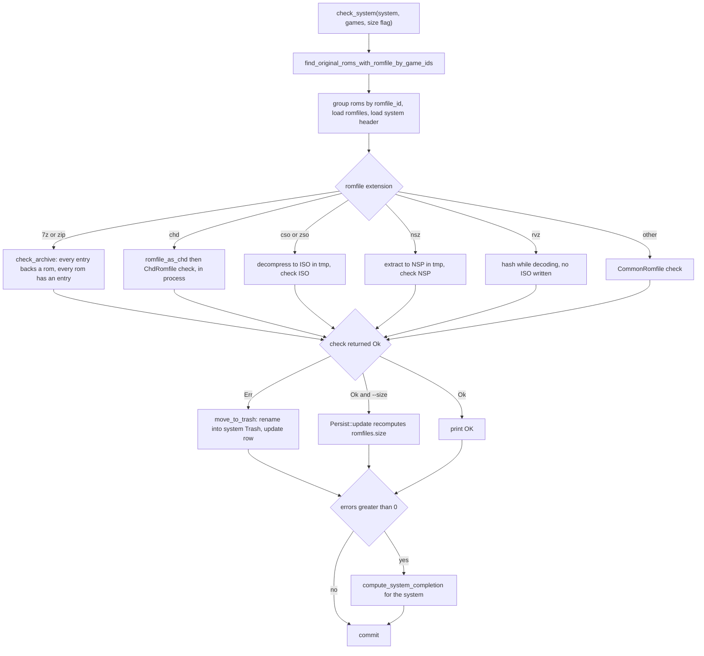
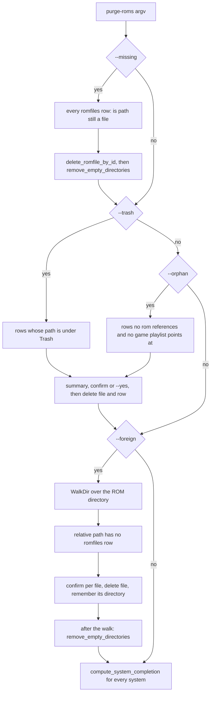

# Integrity Checking, Purging and Trash

Four subcommands close the loop between what the database believes is on disk and
what is actually on disk. `check-roms` re-hashes files against the catalog and
*buries* the ones that no longer match; the `purge-*` trio then removes either
the records (missing, orphan) or the files (trash, foreign, whole systems, IRD
child files). Every one of them is a plain CLI subcommand registered in
[src/main.rs](../../src/main.rs#L69-L170), and each is also reachable from the
GraphQL mutations the UI drives and from the MCP tools.

They share two helpers in [src/util.rs](../../src/util.rs#L278-L338):
`get_trash_directory` (where a file goes when it is retired) and
`get_kept_directories` + `remove_empty_directories` (which tidy up afterwards
without ever eating the directories oxyromon owns).

## Trash is a directory convention, not a table

There is no `deleted` flag anywhere. A file is "trashed" when its
`romfiles.path` sits under a `Trash` directory:

```rust
Some(system) => get_system_directory(connection, system).await?.join("Trash"),
None => get_rom_directory(connection).await.join("Trash"),
```

`get_trash_directory` derives it from the *system* directory, so a system that
overrides `ROM_DIRECTORY` per-system gets its trash under that override.
`find_romfiles_in_trash` then matches those rows on the stored relative path with
`WHERE path LIKE '%/Trash/%' OR path LIKE 'Trash/%'`
([src/database.rs](../../src/database.rs#L2869-L2883)).

The second pattern is the 0.25 fix, and it matters: `import-roms -t` files a ROM
that matches **no** system into the *ROM directory's* own `Trash`, whose stored
path begins with `Trash/` rather than containing `/Trash/`. Without that clause
`purge-roms -t` never saw them
([src/purge_roms/test_trashed_rom_directory.rs](../../src/purge_roms/test_trashed_rom_directory.rs#L33-L79)).

Both patterns are substring/prefix matches, which is what makes the convention
robust: `import-roms` sorts its rejects one level deeper —
`Trash/<Valid|Duplicate|Invalid|Skipped>/` with the computed hash appended to the
filename — and those files are swept by the same `--trash` pass as the flat names
`check-roms` produces ([src/import_roms.rs](../../src/import_roms.rs#L2620-L2677)).

Two consequences matter when changing this area:

- **A trashed file is still a `romfiles` row and still on disk.** `check-roms`
  and `purge-systems` both *rename* rather than delete, and update the row in the
  same step, so nothing is lost until `purge-roms --trash` runs.
- **Trash is never emptied implicitly.** Nothing in this workflow physically
  deletes a trashed file except `purge-roms --trash`, and
  `remove_empty_directories` will not remove a `Trash` directory even when it is
  empty.

## check-roms: re-hash, report, trash

`check-roms` takes `-a/--all`, `-g/--game`, `-s/--size` and `--system`
([src/check_roms.rs](../../src/check_roms.rs#L19-L53)). `--system` is name-like
and resolved by `resolve_systems_by_name_like`, which sorts by id and
de-duplicates so two overlapping patterns cannot check the same system twice;
without it, `-a` checks every system and anything else opens an interactive
multiselect ([src/database.rs](../../src/database.rs#L314-L331),
[src/prompt.rs](../../src/prompt.rs#L9-L46)). The same `--system` resolution is
what makes the GraphQL and MCP wrappers headless, and `purge-systems -s` behaves
identically ([src/purge_systems.rs](../../src/purge_systems.rs#L35-L53)).

Within a system, `--game` patterns are collected, de-duplicated and handed to a
game multiselect that is skipped entirely in test builds; with no `--game`, the
work set is every game already at `completion = 2`. An empty selection prints
`No matching games found` **only** when `--game` was given, and moves on rather
than failing the run
([src/check_roms.rs](../../src/check_roms.rs#L55-L100)).

For each system, `check_system` loads only `original = true` roms that have a
`romfile_id`, groups them by `romfile_id`, and dispatches on the romfile's
extension. The whole pass runs inside one transaction that is committed at the
end of the system ([src/check_roms.rs](../../src/check_roms.rs#L102-L249)).



*Figure: `check_system` — extension dispatch, trashing on failure, completion recompute only when something was trashed.*

### Verification is format-aware but comparison is not

Every format implements the same `Check` trait, and the leaf comparison is always
`compare_hash_and_size`
([src/common.rs](../../src/common.rs#L540-L573)):

- The algorithm is picked from whichever checksum the `roms` row holds — CRC,
  then MD5, then SHA1 — and a rom with none of the three makes the check fail.
- A size mismatch is only raised when `roms.size > 0`, so DAT entries that
  declare no size cannot fail on size.
- `ArchiveRomfile::check` extracts the member into a temp directory before
  hashing. `check_archive` pairs each member with the roms linked to the archive
  whose name it holds, either exactly or as `<folder>/<name>` (a merged arcade
  set's `<clone>/` entry). When several match, those with the member's CRC win.
  The member is checked against one of them and all of them count as present,
  so one member can back several roms, as sibling clones' shared file does in a
  merged set. The check fails when a member matches no rom, when same-name roms
  match it but none by CRC, or when a rom is left without a member
  ([src/archive.rs](../../src/archive.rs#L217-L236),
  [src/check_roms.rs](../../src/check_roms.rs#L251-L296)).
- `RvzRomfile::check` hashes *while decoding*, writing no ISO at all; it falls
  back to the extract-then-check path only if a header is configured
  ([src/rvz.rs](../../src/rvz.rs#L69-L98)).

Headers are handled inside hashing, not after: when the system has a `headers`
row, `get_file_and_header_size` peeks at the configured bytes and, only if every
`rules` row matches, subtracts `header.size` from the file size before comparing
([src/common.rs](../../src/common.rs#L575-L607)).

### CHDs are verified in process, per track

CHDs no longer shell out to `chdman` — the external binary is gone and
`src/chdman.rs` does not exist. Everything goes through the in-repo `chd-rs`
crate ([Cargo.toml](../../Cargo.toml#L78)), and `chd::get_version()` reports the
literal string `built-in`
([src/chd.rs](../../src/chd.rs#L896-L898)).

`CommonRomfile::parse_chd` opens the container with `Chd::open` on a blocking
task and returns its type, logical size, data SHA1, own SHA1, declared parent
SHA1 and `track_count`. A **CD** CHD deliberately reports size `0` and an empty
data hash: a CD has no single hash, only its tracks do
([src/chd.rs](../../src/chd.rs#L548-L583)).

`ChdRomfile::check` branches on that type. A CD CHD is extracted to cue/bin and
each track's bin is checked against **its own** rom — `roms.iter().zip(bin_romfiles)`
— so a multi-track disc passes only when every track matches; DVD, HDD and
LaserDisc CHDs are unpacked to a single image checked against the rom set. The
bin/CUE go to a temp directory, and the CUE `extract_chd` writes is hidden
(`.name.cue`) so a caller that keeps the original sheet deletes it
([src/chd.rs](../../src/chd.rs#L232-L277),
[src/chd.rs](../../src/chd.rs#L833-L842)).

Two paths feed `ChdRomfile::check` a parent. `romfile_as_chd` reads the
romfile's `parent_id` and, when set, attaches the parent through
`as_chd_with_parent`, which re-parses the candidate and **bails on a SHA1
mismatch** rather than extracting against the wrong disc. When there is no
`parent_id` but the header declares a `parent_sha1`, `as_chd` scans the CHD's own
directory for a sibling CHD whose own SHA1 equals it and adopts that one
([src/transcode.rs](../../src/transcode.rs#L57-L78),
[src/chd.rs](../../src/chd.rs#L584-L680)). Extraction then opens the container
with `Chd::open_with_parent`.

### Failure is per-file, and expensive

A failed file is renamed into the system's Trash with `rename` + `Persist::update`
inside the same transaction; the run continues to the next romfile
([src/check_roms.rs](../../src/check_roms.rs#L200-L300)). Only if at least one
file failed does `check_system` call `compute_system_completion`, which is what
turns "complete" games back into "partial" ones in the UI. The summary line
reports `{passed}/{checked} files passed, {errors} moved to trash`.

`--size` is the one non-destructive repair in this command: after a file passes,
`Persist::update` re-derives the relative path and size from the file itself and
writes both back to the `romfiles` row
([src/common.rs](../../src/common.rs#L726-L737)).

## purge-roms: four reconciliations, two of them destructive

`purge-roms` takes `--missing`, `--orphan`, `--trash`, `--foreign` and `--yes`.
The flags are independent and run in that fixed order, and after any of them the
completion of **every** system is recomputed — a purge can turn a `Partial` game
into `None` or reveal space, and the system counters must agree
([src/purge_roms.rs](../../src/purge_roms.rs#L61-L85)).



*Figure: `purge-roms` flag handling and the DB/filesystem reconciliation each category performs.*

| Category | Enumerated from | Removes | Confirmation |
| --- | --- | --- | --- |
| missing | every `romfiles` row | the database row only | none |
| trashed | rows under `Trash` | file **and** row | one summary prompt |
| orphan | rows no `roms.romfile_id` references and no `games.playlist_id` points at | file **and** row | one summary prompt |
| foreign | a `WalkDir` scan of the ROM directory | the file only | a prompt per file |

Key behaviours:

- **`--missing` never deletes a file.** It deletes rows whose path is not
  `is_file()` — the files were already gone, whether deleted by hand or by
  another tool — but it does clean up the directories they left behind
  ([src/purge_roms.rs](../../src/purge_roms.rs#L87-L116)).
- **`--trash` / `--orphan` skip silently when the file vanished.** Both list the
  candidates first, print a `Summary:` block, then ask once (`--yes` answers
  it); inside the loop the file is deleted and the row removed only if
  `path.is_file()` still holds, so a row that `--missing` should have handled is
  left alone rather than half-processed
  ([src/purge_roms.rs](../../src/purge_roms.rs#L118-L164)).
- **Orphans are defined by two edges, not one.** A `romfiles` row is orphaned
  only when no rom references it *and* no game has it as its
  `playlist_id` — M3U playlists are rows too and would otherwise be purged the
  moment `generate-playlists` output outlived its games
  ([src/database.rs](../../src/database.rs#L2845-L2867)).
- **`--foreign` is a filesystem-to-database scan.** Every file under the ROM
  directory is converted to a relative path and looked up with
  `find_romfile_by_path`; no row means the file is unknown and offered for
  deletion. This is the only purge that can delete a file oxyromon never knew
  about, so it is the one category where a mistaken `ROM_DIRECTORY` setting is
  most dangerous ([src/purge_roms.rs](../../src/purge_roms.rs#L166-L218)).
- **`--foreign` confirms per file.** It asks before each individual deletion, so
  answering "no" leaves that one file and moves on, unlike the batched trash and
  orphan passes.

### Per-system ROM directories are only half honoured

`ROM_DIRECTORY` can be set per system, and `CommonRomfile::get_relative_path`
honours that override when turning an absolute path into the stored
`romfiles.path` ([src/common.rs](../../src/common.rs#L354-L367),
[src/import_roms/test_per_system_rom_directory.rs](../../src/import_roms/test_per_system_rom_directory.rs#L49-L64)).
`AsCommon for Romfile` however always joins the **global** `ROM_DIRECTORY` to the
stored relative path ([src/common.rs](../../src/common.rs#L740-L745)), and
`purge_foreign_romfiles` walks only the global root. So for systems filed under
their own ROM root, the reconciliation commands resolve paths against the wrong
base and the foreign scan never descends into that root at all. Keep this in mind
before pointing these commands at a tree that uses the per-system override.

## Empty-directory cleanup

Deleting a file is only half of what a purge does — the directories it empties go
too, under rules tight enough that the cleanup can never take down something the
library owns.

`get_kept_directories` builds the set of directories that must survive: the ROM
directory, the global `Trash`, and every system directory plus every system
`Trash` ([src/util.rs](../../src/util.rs#L290-L302)). `remove_empty_directories`
then walks *upward* from the directory a purge emptied:

- It stops immediately on a kept directory, even an empty one.
- It also stops as soon as the path no longer starts with any kept directory —
  a stale `romfiles.path` can point outside the managed tree, and that tree is
  the boundary it will not cross.
- `NotFound` is tolerated: `--missing` routinely follows a game directory that
  was already removed by hand.
- `DirectoryNotEmpty` **ends the climb** rather than recursing, so a file written
  concurrently stops the walk instead of being taken down with its directory.
- Any other error is propagated with the directory in the context message.

All three purge categories call it on the parent of each deleted file
([src/purge_roms.rs](../../src/purge_roms.rs#L94-L147)). `purge-roms --foreign`
defers its climbs until the `WalkDir` iterator is finished, collecting the
emptied parents in a `HashSet` first — the source comment states the reason
plainly: "once the walk is over, so that no directory is deleted while being read"
([src/purge_roms.rs](../../src/purge_roms.rs#L173-L207)).

`sort-roms` has its own older loop that stops at the system directory only, and
`reimport_orphan_romfiles` treats cleanup as purely cosmetic — it warns instead
of propagating, so a directory it cannot remove never undoes the re-imports above
it ([src/sort_roms.rs](../../src/sort_roms.rs#L626-L642),
[src/import_dats.rs](../../src/import_dats.rs#L936-L944)).

## purge-systems: the catalog goes, the files stay (in Trash)

`purge-systems` selects systems by `--system` or interactively, with `--empty`
restricting the list to systems with no non-zero-completion games
([src/purge_systems.rs](../../src/purge_systems.rs#L35-L53)). `purge_system` is
also the function the GraphQL `purgeSystem` mutation calls directly, without
going through argv.

It moves **every romfile of the system** into that system's `Trash` (rename +
row update, keeping `romfiles.size` fresh), then
`delete_system_by_id`. Because `PRAGMA foreign_keys = ON` is set on every
connection and `games.system_id` cascades from `systems` while
`roms.romfile_id` is `ON DELETE SET NULL`
([src/database.rs](../../src/database.rs#L38-L40),
[migrations/20210323000002_create_games.sql](../../migrations/20210323000002_create_games.sql#L8-L9),
[migrations/20210323000005_create_roms.sql](../../migrations/20210323000005_create_roms.sql#L11-L12)),
the games and roms disappear with the system while the `romfiles` rows
survive — pointing into `Trash`, where `purge-roms --trash` can find them
([src/purge_systems.rs](../../src/purge_systems.rs#L55-L84)).

Note the asymmetry the UI reflects: the web UI's *Delete system* dialog warns
that "Files on disk are left alone", because the files are only moved, never
deleted, by this command
([frontend/src/page.rs](../../frontend/src/page.rs#L748-L782)).

## purge-irds: un-associating a PS3 JB folder

`purge-irds` is the inverse of `import-irds` and applies only to games flagged
`games.jbfolder` (PlayStation 3 folder games described by an IRD). With
`--system` it runs headless — purging **every** IRD game in that system when no
game names are given, which is exactly the shape the server and MCP use;
without it, the system is picked from a `%PlayStation 3%` filter and games are
selected one at a time in a loop that shrinks as it goes
([src/purge_irds.rs](../../src/purge_irds.rs#L33-L95)).

`purge_ird` per game, inside one transaction:

1. Find the game's parent roms (`parent_id IS NULL`) and, for each, its child
   roms — the individual files the IRD described.
2. Delete the child `roms` rows, collecting the `romfile_id`s they held into a
   set so a file shared by two children is handled once.
3. Move each collected romfile into `<system directory>/Trash` — skipping files
   that no longer exist — and update the row.
4. `update_game_jbfolder(game, false)`, returning the game to ordinary DAT
   membership.

The parent rom and its file survive; a test asserts a 208-rom IRD game is back
to a single rom with `jbfolder = false`
([src/purge_irds.rs](../../src/purge_irds.rs#L97-L172),
[src/purge_irds/test_ird.rs](../../src/purge_irds/test_ird.rs#L37-L56)). Note the
trash directory here is built as `system_directory.join("Trash")` rather than
through `get_trash_directory`.

## How each surface reaches these commands

The three entry surfaces agree on the work and disagree precisely on the
destructive boundary.

| Path | check-roms | purge-roms | purge-systems | purge-irds |
| --- | --- | --- | --- | --- |
| CLI | prompts + `-y` | interactive `confirm` unless `-y` | interactive selection | interactive loop unless `--system` |
| GraphQL (`src/mutation.rs`) | `-a` or `--system`, hidden bar | always `-y` | calls `purge_system` directly | always `--system` |
| MCP (`src/mcp/write.rs`) | `system_id` or `all: true` | flags + `confirm: true`, forced `--yes` | `confirm: true` | `confirm: true` |

- **GraphQL drives them over SSE.** `mutation::check_roms`,
  `mutation::purge_roms` and `mutation::purge_irds` hand the work to
  `spawn_cli_action`, which acquires a pooled connection *inside* the task and
  reports `{prefix}_started` / `_complete` / `_error` on the SSE stream; the
  mutation returns immediately. `purgeSystem` follows the same event contract but
  runs `purge_system` in its own spawned task because there is no argv form to
  reuse ([src/mutation.rs](../../src/mutation.rs#L21-L79),
  [src/mutation.rs](../../src/mutation.rs#L310-L384)). Because there is no TTY,
  the purge mutations always append `-y` — the user's confirmation is the modal,
  not the terminal. `purgeRoms` rejects an all-false request outright
  ([src/mutation.rs](../../src/mutation.rs#L536-L592)).
- **The UI mirrors the safety split.** The purge modal groups *missing* and
  *orphan* under "Remove from database" and *trash* and *foreign* under a
  visually flagged "Delete files from disk" section
  ([frontend/src/components/purge_rom_modal.rs](../../frontend/src/components/purge_rom_modal.rs#L47-L96)).
  On `purge_complete` the frontend drops a purged system from the selection,
  since there is nothing left of it to fetch
  ([frontend/src/sse.rs](../../frontend/src/sse.rs#L52-L60)).
- **MCP gates exactly the file-deleting operations behind `confirm: true`.**
  `purge_roms` requires it only when `trash` or `foreign` is set — `missing` and
  `orphan` are record-only — while `purge_systems` and `purge_irds` require it
  unconditionally; all three carry `destructive_hint = true`, refuse with
  `read_only_denial` under `--read-only`, and answer a missing confirmation with
  the `need_confirm` tool error
  ([src/mcp/write.rs](../../src/mcp/write.rs#L583-L722),
  [src/mcp/actions.rs](../../src/mcp/actions.rs#L40-L50)).
  `check_roms` is annotated `idempotent_hint = true` and needs no confirm, even
  though it trashes — it never destroys data.
- MCP runs everything through `run_action`, which serialises writers behind a
  process-wide lock and bridges progress to `notifications/progress`, so a purge
  can be watched and cancelled but never overlaps another write
  ([src/mcp/actions.rs](../../src/mcp/actions.rs#L52-L174)).

The bundled `audit_system` prompt encodes the intended operator sequence:
`check_roms` first, then read back completion, then propose the matching
`purge_roms` flags "they need confirm: true, so ask me first", then `sort_roms`
([src/mcp/prompts.rs](../../src/mcp/prompts.rs#L94-L110)).

## Invariants, failure semantics and tests

- **Nothing here deletes a file that has no record, except `--foreign`** — and
  that flag exists precisely to make that case explicit rather than automatic.
- **Trash, system directories and the ROM directory are never removed**, even
  when empty; `get_kept_directories` is the single source of that rule and is
  shared with the DAT re-import path.
- **`--missing` and `--orphan` are safe to run against a mounted-but-unrelated
  tree**: they only forget rows and empty directories; the file-deleting modes
  are opt-in at both the CLI (`-t`/`-f`) and MCP (`confirm: true`) layer.
- **Transaction scope is per-unit**, not per-invocation: `check_system` commits
  per system, `purge_romfiles` commits per category, `purge_ird` commits per
  game. An error midway leaves earlier units committed — which is why each loop
  prints its own count rather than reporting only at the end.
- **Completion is the visible aftermath.** `check-roms` recomputes it only when
  it trashed something; `purge-roms` recomputes it for every system
  unconditionally; `purge-irds` recomputes the one system it touched. See
  [Arcade Rebuilds and M3U Playlists](arcade-rebuild-and-playlists.md) for how
  `compute_system_completion` chooses its SQL.
- **`roms.original` decides what `check-roms` will even look at.**
  `find_original_roms_with_romfile_by_game_ids` filters `original = true`, and
  DAT import sets that flag from whether the declared rom name carries a
  non-original extension (`chd`, `cso`, `nsz`, `rvz`, `zso`, `7z`, `zip`)
  ([src/mimetype.rs](../../src/mimetype.rs#L37-L45),
  [src/import_dats.rs](../../src/import_dats.rs#L786-L827)). IRD child roms are
  written with `original = false`, which is part of why IRD games are retired by
  `purge-irds` rather than by re-hashing
  ([src/import_irds.rs](../../src/import_irds.rs#L400-L439)).

The focused tests track these boundaries rather than the happy path:
`test_original_crc_mismatch` and `test_original_size_mismatch` assert the failing
row survives with `/Trash/` in its path and the file still on disk, and
`test_check_by_name` drives the same outcome through `check-roms --system` so the
unattended selection path is covered; `test_iso_chd` and
`test_multiple_tracks_chd` assert a DVD CHD and a multi-track CD CHD each pass
without being moved
([src/check_roms/test_check_by_name.rs](../../src/check_roms/test_check_by_name.rs#L59-L72),
[src/check_roms/test_multiple_tracks_chd.rs](../../src/check_roms/test_multiple_tracks_chd.rs#L51-L63));
`test_missing_subfolder` and `test_orphans_subfolder` assert the emptied alpha
subfolder is gone while the system directory remains;
`test_foreign_subfolder` asserts that deleting the last foreign file removes
`Test System` but never the ROM directory; `test_trashed` asserts the system
`Trash` directory itself is left in place, empty; and
`test_trashed_rom_directory` asserts the same for the **ROM directory's** `Trash`
holding an `import-roms` reject ([src/purge_roms/test_foreign_subfolder.rs](../../src/purge_roms/test_foreign_subfolder.rs#L32-L42),
[src/purge_roms/test_trashed.rs](../../src/purge_roms/test_trashed.rs#L58-L75),
[src/purge_roms/test_trashed_rom_directory.rs](../../src/purge_roms/test_trashed_rom_directory.rs#L69-L79)).
