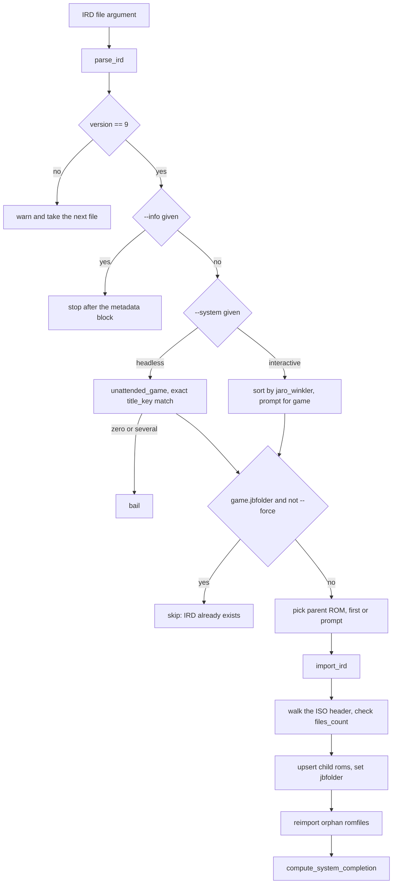
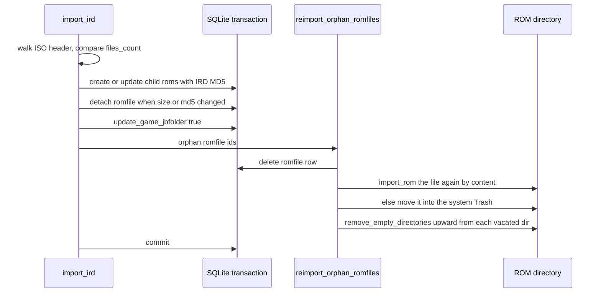

# PS3 IRD Files and JB Folders

PlayStation 3 games are commonly dumped as **JB folders** — an extracted ISO
directory tree rather than one image file. A DAT can describe only the disc image,
so oxyromon reads a second kind of catalog for this platform: the **IRD file**,
which lists every file inside the folder with its size and MD5. `import-irds`
turns an IRD into per-file `roms` rows and flips a switch on the game
(`games.jbfolder`); `purge-irds` reverses that. Everything else — completion,
sorting, file placement, the web UI — follows from those two facts.

The DAT that must already exist for an IRD to land is covered in
[DAT Ingestion](dat-ingestion.md); the sibling destructive commands are in
[Integrity Check and Purge](integrity-check-and-purge.md); the magic-byte matcher
that recognises an IRD is in
[File Type Detection and Extensions](../concepts/file-type-detection-and-extensions.md).

## Entry points

`import-irds <IRDS>...` and `purge-irds [GAMES]...` are ordinary clap subcommands
registered in [`src/main.rs`](../../src/main.rs#L69-L170), each taking an optional
`--system <NAME>` that turns the run unattended
([src/import_irds.rs](../../src/import_irds.rs#L24-L59),
[src/purge_irds.rs](../../src/purge_irds.rs#L13-L31)). `import-irds` additionally
takes `-i/--info` (print and stop) and `-f/--force` (re-import over an
already-imported game).

Beyond the CLI, the same two `main()` functions are reused — never reimplemented —
by every other surface:

| Surface | import | purge |
| --- | --- | --- |
| Web upload | `POST /irds` builds `import-irds <path> --system <name>` and runs it in a spawned task | — |
| GraphQL | — | `purgeIrds(systemId)` → `--system <name>` over SSE |
| MCP | no tool | `purge_irds` tool, `confirm: true` required |
| Web UI | *Import IRDs* dialog on PlayStation 3 systems only | *Purge IRDs* on the same menu |

The upload handler rejects a missing file, a missing `system` field, or an unknown
system id with `400`, then answers `202 Accepted` and reports the real work over
SSE as `import_irds_started` / `_complete` / `_error`; the temporary upload
directory is dropped when the task ends
([src/server.rs](../../src/server.rs#L210),
[src/server.rs](../../src/server.rs#L535-L658)). The frontend offers the two menu
entries only when the system name contains "playstation 3", mirroring the
`%PlayStation 3%` prompt filter the backend uses
([frontend/src/page.rs](../../frontend/src/page.rs#L343-L410),
[frontend/src/components/import_ird_modal.rs](../../frontend/src/components/import_ird_modal.rs#L1-L108),
[frontend/src/sse.rs](../../frontend/src/sse.rs#L140-L146)).

## Parsing the IRD

`parse_ird` first asks the shared `infer` matcher what the file is: the IRD
matcher recognises the `3IRD` magic (`application/x-ird` → `ird`)
([src/mimetype.rs](../../src/mimetype.rs#L76-L78)). No detected type, or a type
whose extension is neither `gz` nor `ird`, is a hard `Not an IRD file` — the `gz`
branch wraps the reader in a `GzDecoder`, so a gzipped IRD is accepted
transparently. The web dialog advertises exactly that: "PlayStation 3 IRD, or
gzipped".

The rest is a fixed sequential read into `Irdfile`: magic, one version byte, a
9-byte game ID, a length-prefixed game name, the update / game / app version
strings, a length-prefixed **gzipped** ISO header, a footer (read and discarded),
`regions_count` 16-byte hashes, then `files_count` pairs of an 8-byte little-endian
sector number and a 16-byte MD5
([src/import_irds.rs](../../src/import_irds.rs#L199-L310),
[src/model.rs](../../src/model.rs#L308-L321)). Two consequences matter
downstream:

- `files_hashes` is keyed by **LBA, not by name** — the name-to-hash link only
  exists once the ISO 9660 tree has been walked.
- `regions_hashes` is parsed but deliberately unused (`#[allow(dead_code)]`), and
  the footer is thrown away, so the region and patch data in an IRD is not
  modeled at all yet.

Every read is `.unwrap()`, so a truncated or corrupt body surfaces as a panic
rather than a reported error; the failures a caller can rely on are the version
gate and the file-count gate below.

**Only IRD version 9 is supported.** A file whose version byte differs prints
`IRD version unsupported` and `continue`s to the next argument: a warning, never a
non-zero outcome, and it happens *after* the metadata block is printed so you can
still read what the file claimed
([src/import_irds.rs](../../src/import_irds.rs#L22),
[src/import_irds.rs](../../src/import_irds.rs#L94-L118),
[README](../../README.md#L404-L413)). `-i/--info` stops at that same metadata
block: the game and ROM prompts are skipped and no IRD is applied, though
`compute_system_completion` still runs for the selected system when the loop ends.

## Choosing the game and the parent ROM

An IRD never creates a game; it decorates one that a DAT already created. The
candidate list is `find_wanted_games_by_system_id`, which excludes games sorted to
`Ignored` ([src/database.rs](../../src/database.rs#L701-L719)).

*The per-file decision tree of `import-irds main`, from magic-byte parsing through
game selection to the shared orphan handling.*

The unattended rule is intentionally stricter than the interactive one. A fuzzy
best match would always find *some* game and silently write the IRD onto the wrong
one, so `unattended_game` compares `title_key` — the title with `(...)` and
`[...]` tags, punctuation and case removed — and accepts exactly one candidate,
bailing with "import the IRD from the CLI to pick one" on zero or several
([src/import_irds.rs](../../src/import_irds.rs#L158-L197),
[`src/import_irds/test_title.rs`](../../src/import_irds/test_title.rs)).
Headless mode has no fallback in the other direction either: a system with no
games is a hard error naming `import its DAT first`, where interactive mode would
just prompt
([src/import_irds.rs](../../src/import_irds.rs#L61-L92)).

The parent ROM is the game's `parent_id IS NULL` rom — the disc image the DAT
declared. Interactive mode prompts; headless mode takes `roms.first()`. If no
parent ROM can be chosen (`prompt_for_rom` allows "None"), `import_ird` returns
`Ok(())` having done nothing rather than erroring
([src/import_irds.rs](../../src/import_irds.rs#L139-L148),
[src/import_irds.rs](../../src/import_irds.rs#L368-L378)).

## The vendored ISO 9660 reader

An IRD embeds only the *beginning* of the disc — enough for the volume
descriptors and the directory extents, never the file data. Walking that buffer
needs a reader tolerant of running off the end, so `HeaderSectorReader` always
returns a full 2048-byte sector and zero-fills anything past the header. Without
that, the default `read_bytes` would either spin forever on a short sector or abort
the whole walk
([src/import_irds.rs](../../src/import_irds.rs#L312-L332)).

`walk_directory` recurses from the root into a `HashMap<path, Vec<FileEntry>>`.
Two normalizations make the keys comparable with DAT conventions: the leading `/`
is stripped, and a trailing `.` is dropped because ISO 9660 spells an
extensionless file `NAME.` while the IRD hashes and DAT names know it as `NAME`.
Files larger than 4 GiB span several extents, each with its own directory record,
hence the vector: the row's size is the **sum** of its extents, while the MD5 is
looked up under the **first** extent's location
([src/import_irds.rs](../../src/import_irds.rs#L334-L366),
[src/iso/iso9660.rs](../../src/iso/iso9660.rs#L188-L209)).

The reader itself (`src/iso/iso9660.rs`) is **vendored from the `opticaldiscs`
crate v0.14.0**, GPL-3.0 like oxyromon, and its presence is a dependency
constraint rather than a preference: `opticaldiscs` depends unconditionally on
`nod` 1.4, which pins `liblzma-sys` 0.3, while `nod` 2.x needs `liblzma-sys` 0.4;
both declare `links = "lzma"` and Cargo permits only one package per `links` value
— and oxyromon needs `nod` 2 for native RVZ/WBFS conversion
([src/iso/iso9660.rs](../../src/iso/iso9660.rs#L1-L17),
[Cargo.toml](../../Cargo.toml#L96-L98)). Once `nod` is optional upstream the module
is meant to be deleted and the crate restored, which is why the surviving API keeps
upstream names.

It is trimmed to exactly the directory walking `import-irds` needs — file reading,
El Torito, Rock Ridge timestamps, POSIX and symlink entries are all omitted — and
keeps:

- **Tree preference**: the primary tree when its root carries Rock Ridge (long
  POSIX names), otherwise a Joliet supplementary tree for its Unicode names,
  otherwise plain ISO 9660 8.3-style names
  ([src/iso/iso9660.rs](../../src/iso/iso9660.rs#L407-L454)).
- **Rock Ridge `NM` names following `CE` continuation areas**, capped at 16 reads
  so a malformed disc cannot loop
  ([src/iso/iso9660.rs](../../src/iso/iso9660.rs#L348-L405)).
- **High Sierra** detection (`CDROM` rather than `CD001`), which shifts every
  descriptor field and moves the file-flags byte in each record
  ([src/iso/iso9660.rs](../../src/iso/iso9660.rs#L115-L131)).
- A **guard absent upstream** in `read_bytes`: a reader returning a short sector
  breaks out instead of spinning.
- A **stable** `parse_directory` sort — directories first, then names, both
  case-folded. Stability is load-bearing: the several records of a multi-extent
  file keep their on-disc order, so the entry `.first()` really is the first
  extent the IRD keyed its hash on
  ([src/iso/iso9660.rs](../../src/iso/iso9660.rs#L483-L538)).

`import-irds` is this module's only consumer. Its parent `src/iso.rs` is otherwise
unrelated — a port of the part of bchunk that cuts a CUE/BIN's first track down to
a PS2 ISO — so the `iso` namespace holds two independent ISO concerns
([src/iso.rs](../../src/iso.rs#L1-L14)).

## What an import writes

`import_ird` runs in one transaction per IRD. The ISO tree is enumerated *before*
any `await`, in a scope that drops the filesystem, because `Iso9660Filesystem` is
not `Send` and the server needs to spawn this future
([src/import_irds.rs](../../src/import_irds.rs#L380-L397)).

Then, per disc file:

1. **Count gate** — before anything is written, `files.len()` must equal the IRD's
   own `files_count`, or the import bails with `Files count differ`. A partially
   readable header is therefore rejected wholesale rather than imported as a
   short set.
2. **Upsert the child rom** by name within the game: `update_rom` if
   `find_rom_by_name_and_game_id` already knows it, `create_rom` otherwise. The
   row carries the summed size, the IRD's MD5, `game_id`, `parent_id` = the chosen
   disc ROM, and `original = false`
   ([src/import_irds.rs](../../src/import_irds.rs#L399-L439),
   [src/database.rs](../../src/database.rs#L981-L1006)).
3. **Orphan what no longer matches.** If the recorded size or MD5 changed and the
   rom had a romfile attached, the romfile id is collected and detached with
   `update_rom_romfile(rom, None)`.
4. **`update_game_jbfolder(game.id, true)`** — the flag that says this game is now
   described by an IRD.
5. **Re-home the orphans** through `reimport_orphan_romfiles`, the *same* function
   a DAT revision uses.

*One `import_ird` transaction: the rom rows are written before any file on disk
moves, and the file moves happen inside the shared orphan re-import.*

Because the orphan path is shared with DAT updates, JB-folder maintenance obeys the
same rules as a catalog revision: a file whose new content matches another rom is
re-imported against it (unattended, `UnattendedMode::Skip`), and a file that
matches nothing is moved to the system `Trash`
([src/import_dats.rs](../../src/import_dats.rs#L880-L935)). Every directory the
file vacated is then removed walking upward — but never past a *kept* directory:
the ROM directory, every system directory and every Trash directory
([src/util.rs](../../src/util.rs#L291-L338)). The cleanup is explicitly cosmetic:
a directory that refuses to delete prints a warning instead of undoing the moves.
The README states the same contract for `import-irds`
([README](../../README.md#L408-L411)).

`main` finishes with `compute_system_completion` for the one system it touched
([src/import_irds.rs](../../src/import_irds.rs#L153),
[src/util.rs](../../src/util.rs#L459-L492)).

## jbfolder: the flag that reshapes completion and placement

`games.jbfolder` is written by `import_ird` and cleared by `purge_ird`, and three
behaviours hang off it:

- **Completion.** The ordinary rule ("complete when no rom lacks a file") is
  skipped for these games — `update_games_completion_by_system_id` filters
  `jbfolder = false` — and `update_jbfolder_games_completion_by_system_id` applies
  instead. Its "nothing missing" test looks only at **child** roms
  (`parent_id IS NOT NULL`) and skips any child under `PS3_CONTENT/`,
  `PS3_EXTRA/` or `PS3_UPDATE/`: **a JB-folder game counts as complete once the
  disc's own files are present, even with none of the PS3 add-on directories
  installed**
  ([src/database.rs](../../src/database.rs#L461-L491),
  [src/database.rs](../../src/database.rs#L577-L611)).
- **Placement.** A JB-folder game's sorted path always nests under the game name,
  so a JB folder is a directory rather than a loose file
  ([src/common.rs](../../src/common.rs#L444-L449)).
- **Candidacy.** Only `jbfolder` games are offered or purged by `purge-irds`, and
  only non-`jbfolder` games are re-decided by the ordinary completion SQL.

Note the arcade asymmetry: `compute_system_completion` picks the jbfolder SQL only
on its non-arcade branch, so arcade systems never get JB-folder semantics
([src/util.rs](../../src/util.rs#L469-L486)).

## purge-irds: un-associating a game

`purge-irds` is the inverse, and only ever touches `jbfolder` games — an empty
filter prints `No IRD games found` and returns. Three selection modes share one
implementation: explicit game names (unknown names warn and continue), headless
`--system` with no names (purges **every** IRD game in the system), and an
interactive loop that removes each purged game from the list until none remain
([src/purge_irds.rs](../../src/purge_irds.rs#L33-L95)).

`purge_ird` per game, in one transaction
([src/purge_irds.rs](../../src/purge_irds.rs#L97-L172)):

1. Find the game's parent roms and, for each, its child roms; delete the child
   rows while collecting their `romfile_id`s into a `HashSet`, so a file shared by
   two children is moved once.
2. Move each collected romfile that still exists to `<system directory>/Trash` —
   built by joining `"Trash"` directly rather than through `get_trash_directory`,
   which yields the same path — and update the romfile row to the new location.
3. `update_game_jbfolder(game.id, false)`, returning the game to ordinary DAT
   membership so a different IRD can be imported.

The parent rom and its file survive by design; the game's IRD association, not the
game, is what is retired. `compute_system_completion` runs afterwards, and because
the flag is now false the ordinary SQL re-decides the game
([src/mutation.rs](../../src/mutation.rs#L649-L687),
[src/mcp/write.rs](../../src/mcp/write.rs#L681-L722)). Both server surfaces run
`purge-irds` with `--system` only — the whole system's IRD games go at once — and
MCP gates it behind `confirm: true` plus a read-only denial, marking it
`destructive_hint = true` because it moves files.

## The JB folder's file side, and PSN companions

An IRD only states expectations; the files themselves arrive through `import-roms`.
A directory containing `PS3_DISC.SFB` is recognised as a JB folder and routed to
`import_jbfolder` instead of the ordinary per-file walk: the SFB file's size and
MD5 identify the game, every other file is hashed **with MD5 forced** (the only
algorithm IRDs provide) and matched against roms sharing the SFB rom's parent, then
moved to `<system directory>/<game name>/<rom name>`
([src/config.rs](../../src/config.rs#L150),
[src/import_roms.rs](../../src/import_roms.rs#L246-L290),
[src/import_roms.rs](../../src/import_roms.rs#L602-L792)). A jukebox folder names
no system of its own, so unattended mode without `--system` warns
`PlayStation 3 folder needs a system, skipping` — which is why the web dialog tells
you to import the system's DAT first.

PSN-style companions travel a different route from IRD games. `pkg`, `pup` and
`rap` are grouped as `PS3_EXTENSIONS`, and an archive whose single rom carries one
of those extensions is filed under the *game* name (`<game>.zip`) rather than the
rom name, so a PKG and its RAP keep their pairing
([src/mimetype.rs](../../src/mimetype.rs#L21-L35),
[src/import_roms.rs](../../src/import_roms.rs#L965-L983)). The
`(PSN)` fixture — `UP0001-BLUS00001.pkg` plus `prfgmHWxGNxsfJ.rap` — is what those
companion files look like, and its test asserts the pair ending as two rom rows
sharing one game-named zip
(`tests/Test System (20230527) (PSN).dat`,
[`src/convert_roms/test_original_to_zip_multiple_roms.rs`](../../src/convert_roms/test_original_to_zip_multiple_roms.rs)).
Nothing in `import-irds` special-cases those extensions.

## Failures, tests, and the known coverage gap

The IRD path fails loudly at exactly two points and quietly everywhere else: an
unsupported version and an already-imported game skip with a warning, while a
version-9 file whose walk disagrees with its own `files_count`, or a headless title
that matches zero or several games, aborts. All database work is inside a
transaction per IRD (or per game for purges), so a mid-way error leaves earlier
units committed and the failing one untouched.

The focused tests are these:

- [`src/import_irds/test_ird.rs`](../../src/import_irds/test_ird.rs) — import the
  fixture DAT, then `tests/Test Game (USA).ird`,
  and assert 208 rom rows: the DAT's disc row plus the IRD's per-file children.
- [`src/import_irds/test_ird_orphan_subfolder.rs`](../../src/import_irds/test_ird_orphan_subfolder.rs) —
  re-import over a file an older IRD described differently, and assert that file
  now lives in `Trash`, the subdirectory it left empty is gone, the game directory
  and the untouched root file survive.
- [`src/purge_irds/test_ird.rs`](../../src/purge_irds/test_ird.rs) — after
  `purge_ird`, one rom remains and `jbfolder` is false.
- [`src/mimetype/test_ird_matcher.rs`](../../src/mimetype/test_ird_matcher.rs) —
  the `3IRD` magic byte.

`src/iso/iso9660.rs` carries no unit tests of its own — it is exercised only
through the IRD imports above — and the README still lists the platform as a gap:
its TODO asks for tests *"for IRD and PS3 in general"* alongside *"Support
rebuilding PS3 ISOs from IRD files, if possible and requested"*
([README](../../README.md#L716-L723)). Rebuilding a PS3 ISO from an IRD is
therefore not implemented: the IRD's embedded header is used for reading a tree,
never for producing one.
