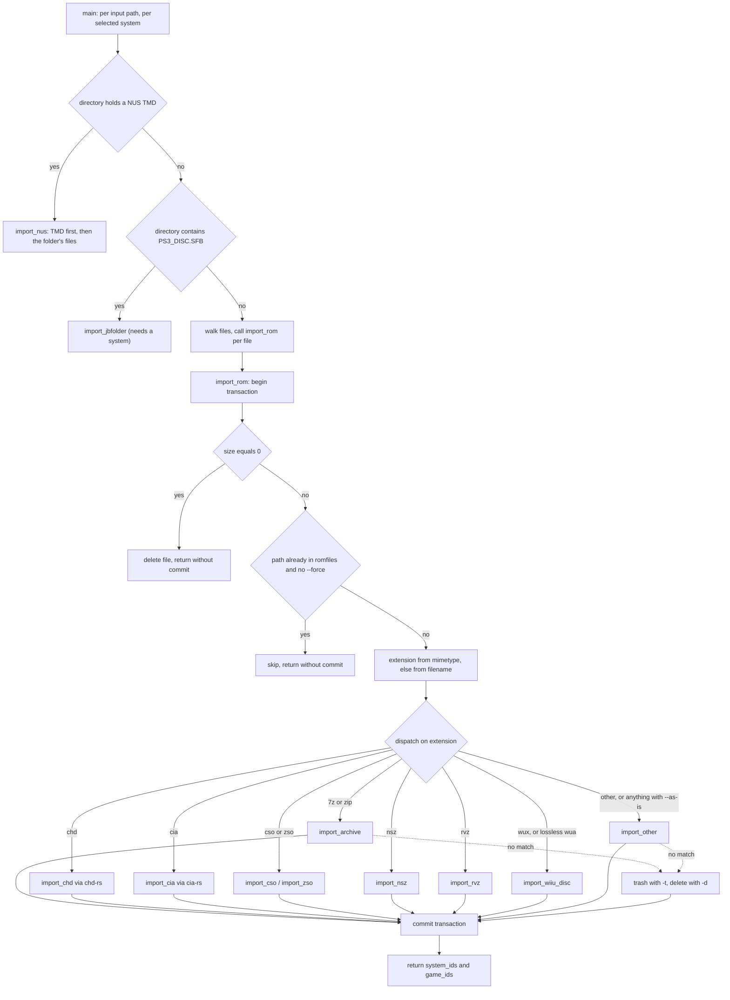

# ROM Import Pipeline

`import-roms` turns a pile of files on disk into `romfiles` rows linked from
`roms.romfile_id`. Everything else in oxyromon — sorting, conversion, export,
integrity checking — consumes the result, so the two things this page is really
about are **(1) how a file gets matched to a catalog `roms` row** and **(2) what
the unit of work is**, because that decides what a crash or a rejected file costs.

The one surface is [`import_roms::main`](../../src/import_roms.rs#L136-L351).
The CLI dispatches to it directly ([src/main.rs](../../src/main.rs#L151)), the
HTTP server synthesises an `ArgMatches` for uploads and URL imports
([src/server.rs](../../src/server.rs#L803-L817)), and the MCP `import_roms` tool
does the same ([src/mcp/write.rs](../../src/mcp/write.rs#L155-L236)). Other
modules bypass `main` and call the internals: `import-dats` re-imports orphaned
files through `import_rom` ([src/import_dats.rs](../../src/import_dats.rs#L891-L946))
and `rebuild-roms` fills arcade sets through `import_other`
([src/rebuild_roms.rs](../../src/rebuild_roms.rs#L174)).

## Command line

```
oxyromon import-roms [OPTIONS] <ROMS>...
  -s, --system <SYSTEM>     Select systems by name (repeatable)
  -t, --trash               Trash invalid ROM files
  -d, --delete              Delete invalid ROM files (hard delete)
  -f, --force               Force import of existing ROM files
  -u, --unattended <MODE>   none | skip | first   (clap default: none)
  -x, --extract             Extract top-level archives before importing
  -a, --as-is               Import as-is, without format handling or conversion
```

`--trash` and `--delete` are mutually exclusive and bail before any work starts
([src/import_roms.rs](../../src/import_roms.rs#L153-L159)). The clap default for
`--unattended` is `none`, i.e. **interactive**: anything driven by the server or
MCP must pass the flag explicitly, and both of them default to `first` because no
one is at a terminal
([src/server.rs](../../src/server.rs#L749-L760),
[src/mcp/write.rs](../../src/mcp/write.rs#L184-L193)).

## System scoping, and why `-s` also enables headered matching

`-s` resolves each name with `find_systems_by_name_like`, whose predicate is
`WHERE name LIKE ?` — a raw SQL `LIKE` pattern (SQLite matches ASCII
case-insensitively), so `%PlayStation 3%` works while a name with no wildcards has
to match a system name exactly
([src/database.rs](../../src/database.rs#L294-L312)). The resolved list is then
de-duplicated by id, and when nothing is passed it becomes a single `None` entry
meaning "every system"
([src/import_roms.rs](../../src/import_roms.rs#L141-L151)).

That list is not just a filter — `main` loops **once per system**, so `-s A -s B`
scans the input twice, and each pass carries the `Header` row loaded for that
system ([src/database.rs](../../src/database.rs#L3032),
[src/import_roms.rs](../../src/import_roms.rs#L236-L244)). For directory
inputs the `WalkDir` walk restarts inside that loop, so files claimed by an
earlier pass have already been moved out and are not seen again.

The header is what unlocks headered matching. When `header` is `Some`, hashing
goes through `get_headered_hash_and_size`, which reads the first `header.size`
bytes, checks every `rules` row against them, and hashes *without* the header only
if all rules match ([src/common.rs](../../src/common.rs#L575-L671)). Systems whose
DAT declares a header definition therefore only match headered dumps **when named
with `-s`**; without it the file is hashed whole and, if the DAT is headerless,
lands in Trash. The pair `test_original_headered` / `test_original_trash` pins
exactly this: the same headered file imports when a `Header` is passed and is
trashed as `Invalid` when it is not.

## Input ordering and `--extract`

Before touching the database, `main` assigns each input path a priority: **CHDs
with a parent first (0), CHDs without a parent second (1), everything else last
(2)** ([src/import_roms.rs](../../src/import_roms.rs#L169-L214)). The parent link
is read straight out of the CHD header with `parse_chd` — chd-rs, no external
binary — and it matters because `as_chd` resolves a CHD's `Parent SHA1` by
scanning *the directory the child sits in*
([src/chd.rs](../../src/chd.rs#L584-L650)); importing — and therefore moving
away — the parent first would strand every child in the batch.

Each path then gets its own temp directory and is canonicalised. With `-x`, a
top-level archive (as reported by `get_mimetype`, membership in
`ARCHIVE_EXTENSIONS`) has all of its members extracted into the temp directory,
which is then walked as if it had been the input
([src/import_roms.rs](../../src/import_roms.rs#L216-L235)). Without `-x`, archives
are imported as containers. `test_zip_single_file_extract` is the fixture for this
path: a `.rom.zip` becomes a `.rom` in the system directory.

Directories are walked with `WalkDir`. Three things differ between directory mode
and the single-file mode:

- A directory holding a Wii U NUS title's TMD is a **title folder** and goes whole
  to `import_nus` (see below). The walk applies the same test to each
  subdirectory and skips the folders it hands over.
- A directory containing `PS3_DISC.SFB` is treated as a **jukebox folder** and
  handed to `import_jbfolder` instead of being walked (see below).
- In directory mode an `Err` from `import_rom` is printed and the walk continues;
  a single file propagates the error and fails the run.

Both the directory walk and its error path keep output on the `progress` helpers,
which write to stderr; the walk's `Err` arm carries the guard comment that keeps
this code stdout-silent — under `oxyromon mcp` stdout *is* the JSON-RPC channel, so
a stray `println!` here would corrupt the protocol stream
([src/import_roms.rs](../../src/import_roms.rs#L305-L314),
[src/mcp.rs](../../src/mcp.rs#L1-L20)).

## import_rom(): one transaction per file

`import_rom` is the unit of work. It opens a transaction on entry and commits
exactly once on the success path
([src/import_roms.rs](../../src/import_roms.rs#L401-L594),
[src/database.rs](../../src/database.rs#L74-L85)). Every early return — empty
file, already in database — returns `Ok` **without
committing**, so the transaction is dropped and rolled back; only the filesystem
side effects those branches performed (a delete) survive. Nothing partial ever
reaches the database.



*Figure: the per-file boundary. Every path out of `import_rom` before the commit leaves the transaction uncommitted; `--as-is` routes every extension to `import_other`.*

Two cheap guards run first: a zero-byte file is deleted outright, and a file whose
path is already a `romfiles.path` is skipped unless `--force`
([src/import_roms.rs](../../src/import_roms.rs#L425-L446)). The second guard only
fires once the file is *inside* a ROM directory — `get_relative_path` fails for
anything outside it — so re-running an import from a staging directory falls
through to matching, where the `Duplicate` result handles it.

Then the format is decided: `get_mimetype` first (magic bytes), falling back to the
lowercased filename extension ([src/mimetype.rs](../../src/mimetype.rs#L100-L122)).
Magic wins, which is why a mis-named file still takes the right branch — and why a
future RVZ version that the matcher does not recognise degrades to the extension.
The one exception is a `.wua`, which keeps its own extension whatever the matchers
say: a WUA starts with a zstd block and keeps its magic at its end.

The dispatch is an ordered `if`/`else if` chain in which every specialised branch
is additionally gated on `!as_is`: archive, CHD, CIA, CSO, NSZ, RVZ, WUX, WUA
(only when `as_wua` accepts it as lossless), ZSO, and finally `import_other`. `--as-is` therefore does two things at once — it sends
every file to `import_other` (hash the container as it sits, move it, no
decompression), and it suppresses the auto-conversion pass below
([src/import_roms.rs](../../src/import_roms.rs#L456-L686)).

No external tool is required on this path. `.cia` dispatches straight into
`import_cia`, which parses the container and unpacks its contents and TMD with
the in-process `cia-rs` crate, so there is no probe and no `Required tool not
found` exit any more ([src/import_roms.rs](../../src/import_roms.rs#L550-L563)).
The certificates appended to the extracted TMD are flushed before it is hashed;
without that, tokio's background write sometimes left the TMD short when hashed.
A CIA that cannot be parsed — a corrupt TMD, a missing certificate chain, or a
homebrew SimpleCIA with no title metadata — is an `Err` naming the file. When
`import-roms` walks a directory it prints that error, says `Continuing` and moves
to the next file; a single file given directly fails the command. Either way the
transaction is dropped uncommitted. CHDs have no gate either — the former `chdman`
branch is gone along with the module, and `chd::get_version()` reports `built-in`
([src/chd.rs](../../src/chd.rs#L896-L898)).

## Matching a file to a catalog rom

All eight format handlers funnel into
[`find_rom_by_size_and_hash`](../../src/import_roms.rs#L2141-L2477), which answers
one question per hash algorithm: *which catalog roms could this be?*

- **Progressive narrowing.** Three queries in order, stopping at the first that
  returns anything: `name + size + hash + game names`, then `size + hash + game
  names`, then `size + hash` alone. Each has a system-scoped variant added by
  `-s`. Game names come from the file stem and, inside an archive, from the entry's
  parent directory; the rom name from the entry name. Every query carries
  `romfile_id IS NULL AND parent_id IS NULL`, so only unclaimed roms compete — and
  not the merged arcade roms whose `parent_id` points at the parent-game or BIOS
  copy ([src/database.rs](../../src/database.rs#L2084-L2113)).
- **Algorithm order.** `HashAlgorithm::iter()` tries CRC, then MD5, then SHA1
  ([src/config.rs](../../src/config.rs#L25-L31)). The CHD handler uses
  `iter().rev()` so SHA1 goes first, because CHD DATs are SHA1-native
  ([src/import_roms.rs](../../src/import_roms.rs#L1044)).
- **`Duplicate` vs `Invalid`.** If nothing unclaimed matches, a follow-up
  `count_roms_with_romfile_*` decides between "already imported" (`Duplicate`) and
  "no match" (`Invalid`). That distinction is what feeds Trash subfolder names and
  the `--trash` decision
  ([src/import_roms.rs](../../src/import_roms.rs#L2363-L2415)).
- **Ambiguity ladder.** One candidate wins immediately. Otherwise: a candidate
  whose game was already imported *during this run* (the `game_ids` set threaded
  through every handler) wins; then, under `--unattended first`, the closest name
  by `jaro_winkler` against the file name wins; then anything unattended that is
  left returns `Skipped` rather than hanging on a prompt nobody will answer. An
  interactive run always gets a prompt — labelled `rom (game)` when `-s` narrowed
  the search, `rom (game) [system]` when it did not. Its first entry is "None":
  picking it, or dismissing the list, yields `Skipped` ("No ROM selected,
  skipping") and leaves the file where it is
  ([src/import_roms.rs](../../src/import_roms.rs#L2417-L2513)).
- **A skip is final.** Every handler loops over the hash algorithms and records
  `Invalid` results to trash the file once the loop ends. A `Skipped` result
  clears those and breaks out, so the user is not asked again for the next hash
  and a skipped file is never trashed because an earlier hash matched nothing
  ([src/import_roms.rs](../../src/import_roms.rs#L1756-L1785)).
- **Already-linked rom.** If the chosen rom already has a `romfile_id`, the result
  is downgraded to `Duplicate`, which protects one-file-per-rom even when the path
  check at the top of `import_rom` did not catch it
  ([src/import_roms.rs](../../src/import_roms.rs#L2487-L2502)).

## Where the file goes

Placement is per-format, and the rule of thumb is: **keep the container when it
represents exactly one complete game, otherwise take the members out.**

| Case | On disk | Rows |
| --- | --- | --- |
| Plain file (`import_other`) | moved to `get_sorted_path(...)` | 1 romfile → 1 rom |
| Archive = whole game | archive kept intact, entries renamed inside it to the catalog rom names; the container becomes `<game name>.<archive ext>` when it holds several entries, and `<rom name stem>.<archive ext>` when it holds one — unless the system is arcade or the entry is a PS3 `.pkg`/`.pup`/`.rap`, which take `<game name>.<archive ext>` | 1 romfile → *n* roms |
| Archive = mixed or partial game | each matched member extracted and **copied** to the system directory (arcade and jbfolder games get a `<game>/` subfolder) | 1 romfile per member |
| CD CHD | unpacked to cue/bin in tmp; only if *every* track matches one game **and** one system is the CHD moved as `<game>.chd` | 1 romfile → 1 rom per track |
| DVD / HD / LD CHD | hashed by extracting (or reusing the hashes the CHD header publishes), moved as `<rom>.chd`; the HD and LD branches put arcade CHDs under a `<game>/` subfolder | 1 romfile → 1 rom |
| CIA | contents and the certificate-extended TMD extracted with `cia-rs` for hashing, each named as the DAT names it (content ID in lowercase hex, `tmd.<version>`); whole `.cia` moved as `<game>.cia` | 1 romfile → *n* roms |
| CSO / ZSO / NSZ / RVZ | container kept, renamed `<rom name>.<ext>` after hashing the decoded image | 1 romfile → 1 rom |
| WUX | hashed as it decompresses and matched against the DAT's disc row, then moved to the system directory as the rom name with a `.wux` extension | 1 romfile → 1 rom |
| lossless WUA | hash and size taken from its disc info, matched against the DAT's disc row, its store entries copied into the system's `.update-partitions` store, then moved as the rom name with a `.wua` extension; an entry found nowhere gets a warning that the disc can't be rebuilt | 1 romfile → 1 rom |
| NUS title folder | each file the DAT lists moved into `<system directory>/<game name>/`; unlisted files such as `title.cert` stay | 1 romfile per file |

The archive decision is the interesting one
([src/import_roms.rs](../../src/import_roms.rs#L931-L1029)): the archive is kept
intact only when every entry matched, all matches belong to a single game, *and*
the matched set covers every rom of that game
(`find_roms_by_game_id_no_parents`). Anything short of that falls through to the
per-member extraction branch, which **copies** the matched members out; the source
archive is never moved or removed by that branch, and only the extracted members
get `romfiles` rows (an archive left behind inside a ROM directory is exactly what
`purge-roms --foreign` reports). Unmatched members stay inside it; only a
**single-entry** archive whose sole entry fails all three algorithms is itself
trashed ([src/import_roms.rs](../../src/import_roms.rs#L918-L928)).

Hashing compressed formats is delegated to the wrapper types in the
[trait system](../concepts/romfile-trait-system.md): `ArchiveRomfile` reuses the
CRC already recorded in the archive's central directory instead of extracting
([src/archive.rs](../../src/archive.rs#L194-L215)), `XsoRomfile` and `NszRomfile`
decompress into a temp directory and delete the result
([src/xso.rs](../../src/xso.rs#L52-L70), [src/nsz.rs](../../src/nsz.rs#L76-L94)),
`RvzRomfile` hashes while decoding with no ISO ever written
([src/rvz.rs](../../src/rvz.rs#L44-L67)), and `ChdRomfile` answers SHA1 from the
hashes chd-rs read out of the CHD header — `sha1` for the logical data and
`chd_sha1` for the container — falling back to a real decode to ISO/RDSK/RIFF only
when it has neither
([src/chd.rs](../../src/chd.rs#L171-L230)). The consequence visible from the
tests: a `.cso` imports against the catalog entry for the `.iso` (`test_cso`), and
a `.rvz` against `Test Game (USA).iso` (`test_rvz`) — while `test_rvz_as_is` needs
a DAT that publishes the RVZ's *own* hash, because `--as-is` hashes the container.

The CHD branch is a single `import_chd` over the four `ChdType`s
([src/import_roms.rs](../../src/import_roms.rs#L1032-L1519)). A CD CHD is expanded
to cue/bin in a temp directory — one `.bin` per track whenever the CHD carries more
than one — and each track is matched **by name as well as hash**: the track hashes
are looked up against the CHD's own file stem, the ambiguity ladder is narrowed by
the games already resolved in this same CHD, and the CHD is only moved when every
track resolved, all to one game and one system. That is what lets a multi-track CHD
whose tracks are byte-identical to another game's tracks land in the right game
(`test_single_track_chd`, `test_multiple_tracks_chd`). DVD, HD and LD CHDs are
hashed as a unit, and when a SHA1 lookup comes back `Invalid` each of the three
repeats the query with **size 0 and the CHD's own `chd_sha1`**, because MAME's CHD
DATs publish no size and hash the CHD container rather than the extracted data
([src/import_roms.rs](../../src/import_roms.rs#L1192-L1215)). `test_mame_chd`
pins the arcade placement that follows: `<system directory>/<game>/<game>.chd`.

CD and DVD CHDs are decoded by chd-rs through the same `extract_chd` helper, with
the parent CHD passed to `Chd::open_with_parent` when one was found next to the
child ([src/chd.rs](../../src/chd.rs#L796-L874)). There is no minimum tool version
anywhere on this path: the old split-bin and Dreamcast version gates left with the
`chdman` module.

Every branch ends in the same persistence helper
([src/import_roms.rs](../../src/import_roms.rs#L2587-L2615)): build a
`CommonRomfile` scoped to the system, strip the (possibly per-system)
`ROM_DIRECTORY` prefix to get the stored relative path
([src/common.rs](../../src/common.rs#L354-L367)), update the `romfiles` row at that
path or create one with `RomfileType::Romfile`, then set `roms.romfile_id` for each
matched rom. The romfile row is deliberately shared: many roms may point at one
path, which is what makes multi-file archives, multi-track CHDs and CIA sets
representable.

## Rejected files: nothing, Trash, or deletion

If no algorithm matches, `trash_or_delete_romfile` runs
([src/import_roms.rs](../../src/import_roms.rs#L2617-L2677)):

- **Neither flag** — the file stays exactly where it was. Import is non-destructive
  by default.
- **`-d` / `--delete`** — hard delete, no database row.
- **`-t` / `--trash`** — moved to `<system or global Trash>/<Valid|Duplicate|Invalid|Skipped>/<stem> [algo:hash].<ext>`,
  with the computed hash baked into the filename so a later manual inspection says
  *why* it failed. If that path already exists the file is deleted instead, and the
  trashed file gets its own `romfiles` row.

The Trash root follows the file's system when the match narrowed to one and the
global ROM directory otherwise
([src/util.rs](../../src/util.rs#L277-L288)). Trash is a directory convention
rather than a flag, and `purge-roms --trash` is the only thing that empties it —
see [Integrity Checking, Purging and Trash](integrity-check-and-purge.md).

Where a move leaves a directory behind, `util::remove_empty_directories` is the
shared cleaner: it climbs from the emptied directory, deleting until it meets a
directory that is not empty or one of `get_kept_directories` — the ROM directory,
every system directory and every Trash directory, which survive even when empty
([src/util.rs](../../src/util.rs#L290-L337)). `import-roms` itself does not call
it; the caller that leaves emptied source directories behind does, and does so on a
best-effort basis — a directory that cannot be deleted is a warning, never a rolled
back import ([src/import_dats.rs](../../src/import_dats.rs#L896-L945)).

## Wii U title folders

An update or DLC arrives as a NUS folder: a TMD, a ticket, and one file per
content. `import_nus` handles it outside `import_rom` with a transaction of its own
([src/import_roms.rs](../../src/import_roms.rs#L695-L834)).

- **The TMD finds the game.** A TMD names one title at one version, so it is hashed
  and matched first, in the given system or any. A `Duplicate` prints `Already
  imported`, and no match prints a warning.
- **A ticket no DAT lists is kept apart.** Once the TMD matches, as a new
  title or one already imported, `keep_unlisted_ticket` moves the folder's
  ticket to the store of tickets, `<title id>.tik` in a `wiiu_tickets` folder
  in the data directory, when it is for the TMD's title and no DAT ROM has its
  size and SHA-1. That is DLC's case: No-Intro lists no ticket for it, and the
  one a downloader made is the only one there is.
- **The other files match within that game only**, since a game and its update can
  hold identical files. Size and hash must agree, and among identical candidates the
  ROM named like the file (ignoring `.app`) wins.
- **An `.h3` the DAT leaves out stays behind.** No-Intro sometimes omits a hashed
  content's `.h3`. When the TMD, read before any file moves, lists that content
  as hashed, the file is skipped with a note that exporting the title rebuilds
  it, rather than a "No match" warning.
- Placement goes through `get_sorted_path`, which gives a NUS title its own folder
  because every title names its contents alike.
- It needs no `--system` and no Wii U keys. Keys only matter for WUA and NUS
  conversions.

The directory walk skips `.update-partitions` folders. A WUA brings the entries it
needs along when it is imported, from the nearest store above its own folder.

See [Wii U Formats and wux-rs](../concepts/wii-u-formats-and-wux-rs.md).

## Jukebox folders

A directory containing `PS3_DISC.SFB` is a PS3 JB folder and never reaches
`import_rom` ([src/import_roms.rs](../../src/import_roms.rs#L779-L969)). The rules
that make it different:

- It **requires a system**. The folder names no system of its own, so without `-s`
  the pipeline either prompts (`prompt_for_system_like(connection, None,
  "%PlayStation 3%")`) or, when unattended, warns and skips.
- Matching is **MD5 only**, because IRD catalogs only publish MD5s. The `SFB` file
  identifies the game; each remaining file is looked up by `size + md5 +
  sfb_rom.parent_id`, disambiguated by filename suffix and then by `jaro_winkler`.
- Files are moved into `<system directory>/<game name>/<rom name>`, and the source
  directories are pruned while they stay empty.
- It returns only a `system.id`. Since the auto-conversion pass works from the
  *game* set, a run whose only imports are jukebox folders converts nothing.
- Trashing and deleting are not implemented here — a `TODO` leaves unmatched
  folders untouched.

The IRD side that makes these games exist is covered in
[IRD, PS3 Jukebox Folders](ird-ps3-jbfolders.md).

## After the files: auto-conversion, then completion

`main` accumulates the `(system_ids, game_ids)` pairs returned by every
`import_rom` call, and only after **all** inputs are committed runs
`auto_convert` — skipped entirely under `--as-is`
([src/import_roms.rs](../../src/import_roms.rs#L341-L398)). It groups the imported
games by system, reads `PREFER_FORMAT` for that system (per-system setting with the
global fallback of `get_setting`), and calls `convert_system` with
`ConvertOpts { recompress: false, diff: false, check: true, prompt_for_parents: false }`.

The ordering is the contract: a failed conversion never rolls back an import. The
ROM simply stays in the format it was imported in, with a warning. `check: true`
means each produced file is verified against the catalog before the source is
deleted — a failed check deletes the conversion, prints `Integrity check failed,
reverting conversion` and keeps the original
([src/convert_roms.rs](../../src/convert_roms.rs#L512-L535)). How
`PREFER_FORMAT` itself is validated — arcade systems reject everything outside
`ARCADE_FORMATS` — is covered in
[Settings and Configuration](../architecture/settings-and-configuration.md).
`test_prefer_format` covers the observable combinations: converts when set,
untouched when unset, untouched under `--as-is`, `convert-roms --save` making the
choice permanent, and an arcade system refusing `CHD` while accepting `ZIP`.

Finally `compute_system_completion` runs for each touched system
([src/util.rs](../../src/util.rs#L404-L438)). It also creates zero-byte placeholder
files for size-0 roms in partial games, so a partially imported set is visible on
disk as well as in the database. For a Wii U update or DLC whose DAT entry spans
several versions, it grades the title against its newest TMD, so importing the
newest version as Nintendo's servers deliver it makes the title complete; see
[Wii U Formats and wux-rs](../concepts/wii-u-formats-and-wux-rs.md).

## Failure modes worth remembering

| Situation | Behaviour |
| --- | --- |
| Malformed or homebrew `.cia` during a directory walk | error naming the file printed, file untouched, transaction rolled back, run continues |
| CHD whose parent sits in the same batch | children import first, so the parent is still there when `as_chd` looks for it |
| Empty file | deleted immediately, no rows |
| Path already in `romfiles` | skipped unless `--force` |
| Ambiguous match, `--unattended skip` | `Skipped`, file left in place |
| Ambiguous match, "None" picked at the prompt | `Skipped`, file left in place |
| Ambiguous match, `--unattended first`, no file name to rank | `Skipped` (the `first` heuristic needs a name) |
| Multi-entry archive with one bad member | bad member stays in the archive, good members extracted |
| Single-entry archive with no match | trashed or deleted per `-t` / `-d` |
| CD CHD whose tracks do not resolve to exactly one game and one system | import aborted; `CRC mismatch` plus trash/delete, but only when at least one track failed to match |
| Conversion failure after import | warning only; import stands |
| Error inside a walked directory | printed, walk continues; a top-level single file fails the run |

## Focused tests

`src/import_roms/` holds one file per behaviour rather than one per function, and
each is a full given/when/then over a temp database and temp ROM directory:

- `test_original`, `test_original_headered`, `test_original_trash`,
  `test_original_delete` — the happy path plus the three header/rejection outcomes;
  `test_original_shared` — two DATs declaring the same rom name import two copies,
  one per system, each with its own `romfiles` row.
- `test_sevenzip_single_file` (container kept, re-extensioned to `.7z`),
  `test_sevenzip_multiple_files_full_game` (one romfile, three roms),
  `test_sevenzip_multiple_files_mixed_games` (two games in one archive → two
  romfiles), `test_sevenzip_multiple_files_partial_game` (missing track → members
  extracted), `test_sevenzip_multiple_files_headered_mixed_games` (header rules
  applied per archive entry), `test_zip_single_file_extract` (`-x`).
- `test_single_track_chd`, `test_multiple_tracks_chd`, `test_iso_chd`,
  `test_mame_chd` (arcade CHD lands under a `<game>/` subfolder),
  `test_mame_mixed` (loose ROM plus RDSK CHD in one system).
- `test_cso`, `test_zso`, `test_nsz`, `test_rvz`, `test_rvz_as_is`, `test_cia`.
- `test_per_system_rom_directory` — with a per-system `ROM_DIRECTORY` override, the
  stored path is relative to that override and the file is *not* present under the
  global ROM directory.
- `test_prefer_format` — the auto-conversion matrix described above.

## Related

- [File Type Detection and Extension Constants](../concepts/file-type-detection-and-extensions.md) — the magic-byte matcher and the `ARCHIVE_EXTENSIONS` / `NON_ORIGINAL_EXTENSIONS` groups this dispatch reads.
- [The CommonRomfile Trait System](../concepts/romfile-trait-system.md) — the `As*`/`To*`/`HashAndSize`/`Persist` verbs each handler calls.
- [DAT Ingestion](dat-ingestion.md) — what must have run before an import can match anything, and the orphan re-import that reuses `import_rom`.
- [Format Conversion and Export](format-conversion-and-export.md) — the `convert_system` entry point auto-conversion calls.
- [Integrity Checking, Purging and Trash](integrity-check-and-purge.md) — what happens to the files `import-roms -t` retired.
- [Sorting and the 1G1R Election](sorting-and-1g1r-election.md) — what moves the imported files out of the system directory into `1G1R` and `Trash` afterwards.
