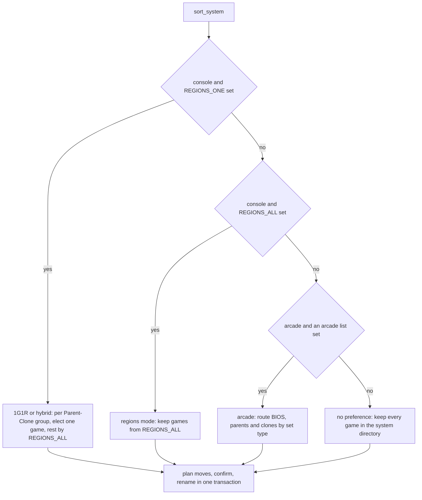

# Sorting and the 1G1R Election

`sort-roms` decides where every game of a system lives. It never changes what
is in the library, only where the files sit: in the system directory, in its
`1G1R` subdirectory, or in its `Trash` subdirectory. `src/sort_roms.rs` holds
the whole workflow — classification, the 1G1R election, the move plan — and
reuses the path logic every other subcommand uses, so a file sorted once stays
where `import-roms`, `convert-roms` and the others expect it.

## Inputs

`sort_roms::main` resolves the systems (`--system` by name, `--all`, or an
interactive multiselect) and then reads, per system and with that system's
scope, everything the classification needs:

| Input | Source | Used for |
| --- | --- | --- |
| `REGIONS_ALL` | `-r/--regions`, else the setting | regions kept in the system directory |
| `REGIONS_ONE` | `-o/--1g1r`, else the setting | 1G1R regions, in priority order |
| `REGIONS_ALL_ARCADE`, `REGIONS_ONE_ARCADE` | settings | arcade set types per directory |
| `DISCARD_RELEASES`, `DISCARD_FLAGS`, `LANGUAGES` | settings | the discard filter |
| `PREFER_PARENTS`, `PREFER_REGIONS`, `PREFER_VERSIONS`, `PREFER_FLAGS` | settings | the election weights |
| `REGIONS_ONE_STRICT` | setting | whether the election ignores ownership |
| subfolder schemes | `--subfolders` / `--1g1r-subfolders`, else the settings | alphabetical subfolders |

Regions are TOSEC two-letter codes parsed by `Region::try_from_tosec_region`;
an unparseable code panics with "Failed to parse region code". `ZZ` parses to
`Region::Unknown`. The settings themselves are described in
[Settings and Configuration Model](../architecture/settings-and-configuration.md).

## Choosing a mode

`sort_system` picks exactly one branch, in this order:

*Caption: the four classification branches; every one ends in the same move plan.*

Every branch produces three lists — games for the system directory
(`Sorting::AllRegions`), for `1G1R` (`Sorting::OneRegion`), and for `Trash`
(`Sorting::Ignored`) — split again by completion so that incomplete games
still get a sorting and feed the wanted list.

### 1G1R and hybrid mode

When `REGIONS_ONE` is set on a console system, games are processed per
Parent-Clone group: each parent with all its clones. For each group:

1. **Order.** The group is sorted by `sort_games_by_weight`, highest weight
   first (see below).
2. **Discard.** When `DISCARD_RELEASES` or `DISCARD_FLAGS` is set,
   `trim_ignored_games` sends matching games to `Trash`.
3. **Elect.** For each region of `REGIONS_ONE`, in order, the first game in
   weighted order whose regions contain it is elected, provided it is complete,
   or strict mode is on, or no game of the group is complete. The elected game
   goes to `1G1R`, and the search stops at the first region that finds one.
4. **The rest.** Every other game goes to the system directory if one of its
   regions is in `REGIONS_ALL`, and to `Trash` otherwise. `ZZ` in `REGIONS_ALL`
   is a catch-all here: it keeps every remaining game.

With `REGIONS_ALL` empty this is pure 1G1R mode, and everything but the
elected game is trashed. With both lists set it is hybrid mode. Without a
Parent-Clone DAT every game is its own parent, so each forms a group of one
and 1G1R reduces to "keep the game if it matches a 1G1R region".

**`REGIONS_ONE_STRICT`.** By default only games you own are eligible, so the
election falls back to the next best owned game, and only when the group has
no complete game at all does it pick an unowned one. Strict mode follows the
preferences regardless of ownership, so a missing preferred game is elected
anyway, stays incomplete, and shows up as wanted instead of being replaced.

### The election weights

`sort_games_by_weight` scores each pair of games and orders higher scores
first. Each criterion adds one point to the game it favours:

- **`PREFER_PARENTS`**: the parent.
- **`PREFER_REGIONS`**: with `broad`, the game released in more regions; with
  `narrow`, the one released in fewer.
- **`PREFER_VERSIONS`**: with `new`, the higher No-Intro version (major, then
  minor); with `old`, the lower. A versioned game beats an unversioned one
  under `new` and loses under `old`.
- **`PREFER_FLAGS`**: one point per listed flag in the game's name, so flags
  can stack.

The criteria have equal weight and are summed, so they trade off rather than
apply in a fixed priority. The sort is stable, so equal scores keep the
database order, with the parent appended after its clones.

### Regions mode

With only `REGIONS_ALL` set, every game of the system goes through the discard
filter, then to the system directory if one of its regions is in the list and
to `Trash` otherwise. Unlike the 1G1R branch, `ZZ` here is not a catch-all: it
only matches games whose region is unknown.

### Arcade systems

Arcade systems never run the 1G1R election. Games are split into BIOS sets,
parents and clones, and each type is routed by the two arcade lists:

- **BIOS and parents** go to `1G1R` if `REGIONS_ONE_ARCADE` lists their type,
  else to the system directory if `REGIONS_ALL_ARCADE` does, else to `Trash`.
- **Clones** go to the system directory if `REGIONS_ALL_ARCADE` lists them,
  else to `Trash`.

With both arcade lists empty, the last branch applies and everything stays in
the system directory.

### No preference

A console system with no region lists, or an arcade system with no arcade
lists, keeps every game that survives the discard filter in the system
directory.

## The discard filter

`trim_ignored_games` partitions games into discarded and kept. For console
systems it parses each name as a No-Intro name and discards a game when:

- a `Languages` token lists languages and none of them is in `LANGUAGES`
  (games that list no languages are kept);
- its release status, such as `Beta` or `Proto`, is in `DISCARD_RELEASES`;
- its flag group, or any comma-separated flag in it, is in `DISCARD_FLAGS`.

For arcade systems only `DISCARD_RELEASES` applies, matched as a substring of
the game's DAT comment.

The filter only runs when `DISCARD_RELEASES` or `DISCARD_FLAGS` is non-empty.
`LANGUAGES` is checked inside it, so setting `LANGUAGES` alone discards
nothing; it takes effect once either discard list has an entry. The naming
tokens are described in
[DAT Providers and Naming Conventions](../integrations/dat-providers-no-intro-redump.md).

## From classification to moves

Each game's new `Sorting` is written with `update_sorting` inside one
transaction, counting real changes. `sort_game` then computes, for each ROM
file of the game, its destination with `get_sorted_path`:

- The base directory follows the sorting: the system directory, its `1G1R`
  subdirectory, or its `Trash` subdirectory.
- With the `alpha` subfolder scheme, `compute_alpha_subfolder` adds the
  uppercase first letter of the game name, or `#` for anything else. When no
  scheme was passed on the command line, the scheme comes from
  `REGIONS_ALL_SUBFOLDERS` or `REGIONS_ONE_SUBFOLDERS` for the game's sorting;
  trashed games never get subfolders.
- Arcade games that are not archives, and PS3 JB folders, get a directory
  named after the game.

Patches move with their ROM file, keeping their own extension, and a game's
M3U playlist moves with the game. Only files whose path actually changes are
planned.

The plan is sorted, deduplicated and printed as a summary of
`"file" → "destination"` lines. The user confirms it, or `--yes` skips the
prompt. On confirmation every file is renamed, its `romfiles` row updated, and
directories left empty are removed up to the system directory; then the
transaction commits. Declining rolls the whole transaction back, sortings
included. With nothing to move, the sorting changes are committed and the run
reports "Already sorted, nothing to do". Whenever a sorting changed, system
completion is recomputed.

`--wanted` prints, before the moves, every ROM without a file among the
incomplete games that were kept, with its game and first known checksum.

## Other callers

The GraphQL `sortRoms` mutation and the MCP `sort_roms` tool both synthesize a
`sort-roms` argv with `--system` (or `--all`) and `--yes`, so neither can block
on the confirmation prompt. See
[MCP Server: Tools, Resources and Prompts](../server/mcp-server.md).

## Focused tests

`src/sort_roms/` holds one test per behaviour:

- `test_order_*` pin `sort_games_by_weight` for every preference, both ways
  round (`_swapped`).
- `test_sort_1g1r_strict` and `test_sort_1g1r_lenient` pin the ownership rule;
  `test_sort_1g1r_catch_all` pins `ZZ` as a catch-all in hybrid mode.
- `test_sort_1g1r_without_parent_clone`, `test_sort_1g1r_revisions`,
  `test_sort_1g1r_playlist` and `test_sort_1g1r_subfolders_alpha` cover groups
  of one, revision ordering, playlists moving with games and alphabetical
  subfolders.
- `test_sort_discard_*` and `test_trim_ignored` cover the discard filter.
- `test_all_regions_from_*` and `test_one_region_from_*` pin that command-line
  regions override the settings.

## Related

- [ROM Import Pipeline](rom-import-pipeline.md)
- [Settings and Configuration Model](../architecture/settings-and-configuration.md)
- [DAT Providers and Naming Conventions](../integrations/dat-providers-no-intro-redump.md)
- [Arcade Rebuilds and M3U Playlists](arcade-rebuild-and-playlists.md)
